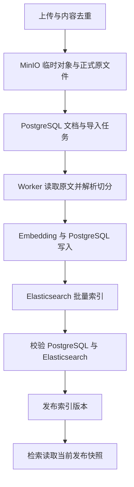
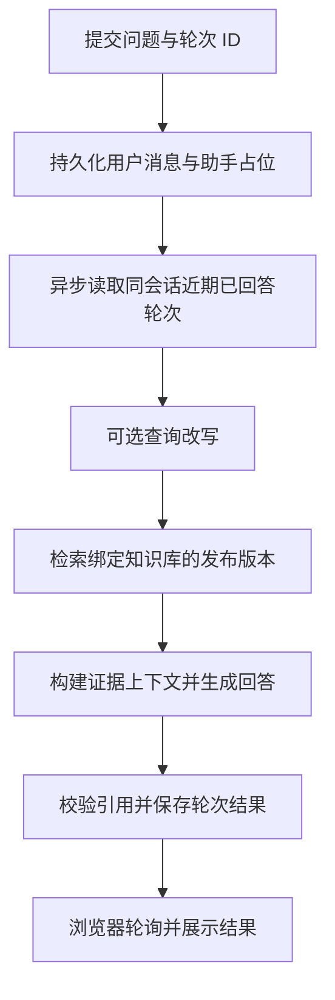

# 当前架构

当前实现是一个 Spring Boot 应用，根包为 `com.lnjecit.knowledge.assistant`。Vue 3 Web UI V2 随 JAR 交付，通过同源 `/api/v1` 调用业务接口。开发时使用 Vite 代理。业务 ID 以字符串传输，写请求携带当前 Session 的 CSRF Token。异步导入 Worker 和会话执行器均在应用进程内。

| Java 包 | 职责 |
| --- | --- |
| `auth`、`knowledge`、`document` | 认证、知识库归属校验、文档及证据查询 |
| `ingestion` | 上传、任务租约与重试、解析切分、向量化、索引验证与发布 |
| `retrieval`、`rag` | 发布快照、策略编排、上下文构建、生成与引用校验 |
| `conversation` | 会话归属、消息持久化、历史选择、轮次调度与取消 |
| `memory` | 账号级记忆管理、按问题召回、注入快照协议 |
| `evaluation`、`infrastructure` | 评估数据与运行归档，以及数据库、对象存储、模型和 Web 基础设施适配 |

[Java 源码](../src/main/java/com/lnjecit/knowledge/assistant) · [Flyway 迁移](../src/main/resources/db/migration)

| 存储 | 保存内容 |
| --- | --- |
| PostgreSQL / pgvector | 用户、知识库、文档、任务、索引版本、Chunk、向量及会话消息。发布状态以 PostgreSQL 为准 |
| Elasticsearch / IK | Chunk 文本的 BM25 搜索索引 |
| MinIO | 单 Bucket 中的 `staging/` 临时对象和 `originals/` 正式原文件 |
| Redis | Spring Session 登录态 |
| 文件系统 | 评估运行材料，默认位于 `data/evaluation` |

## 文档导入与索引发布

上传和后台建索引分开执行。Worker 领取带租约的任务，按索引版本记录的固定长度或 Markdown 结构感知配置切分，并自动重试可重试故障。最终失败的任务在满足恢复条件时可沿用原版本配置手动重试。索引经过双存储校验才可发布，检索以知识库的已发布文档及版本快照约束候选。对象存储与数据库之间存在失败窗口，上传流程做补偿清理，临时对象由 Bucket 生命周期规则兜底，正式孤儿对象需人工核对。[导入源码](../src/main/java/com/lnjecit/knowledge/assistant/ingestion) · [检索快照](../src/main/java/com/lnjecit/knowledge/assistant/retrieval/snapshot) · [对象存储运维](../infra/minio/README.md)

## 多轮 RAG

已回答历史按估算 Token 预算选取。查询改写默认关闭。近轮历史用于理解追问，引用由当前轮次的检索上下文约束。轮次和引用落在 PostgreSQL，登录态落在 Redis。知识库、文档与会话使用逻辑删除，业务查询按归属和有效状态限制访问。会话历史可按知识库与标题筛选，生成中可请求取消并轮询确认终态。[会话执行器](../src/main/java/com/lnjecit/knowledge/assistant/conversation/service/TurnExecutor.java) · [RAG 源码](../src/main/java/com/lnjecit/knowledge/assistant/rag)

## 长期记忆

Memory 模块保存账号级总开关及手动维护的条目。Conversation 在异步执行时使用提交轮次时确定的服务端用户 ID，按当前问题召回该账号的记忆，并将结果传给 RAG 的生成阶段。知识库检索与引用校验继续使用知识库证据。

生成器按完整请求预算裁剪记忆。有实际注入时使用 Prompt v3，否则按有效历史选择 v1 或 v2。成功且可回答时，Conversation 可随助手消息保存最终注入集合的 Memory Trace，历史接口直接读取消息 JSONB 快照，兼容旧版仅含元数据的记录。V9 创建记忆表及默认关闭的账号开关，V10 增加可空的消息 Trace 字段。
