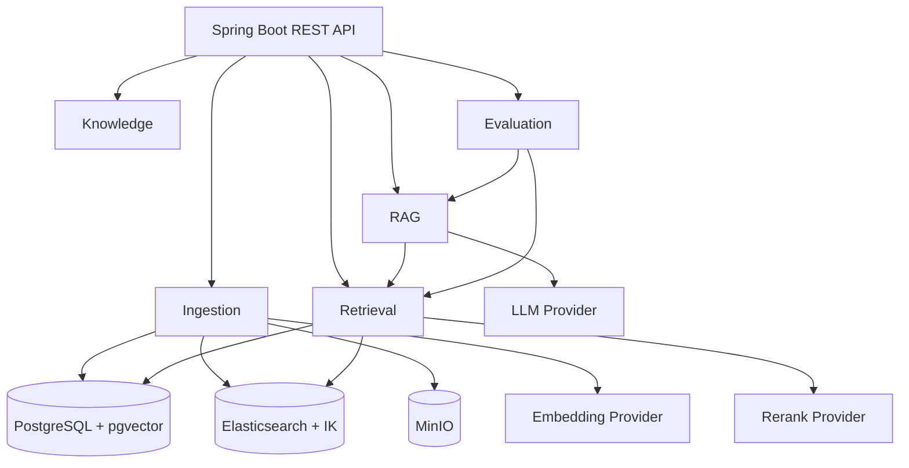
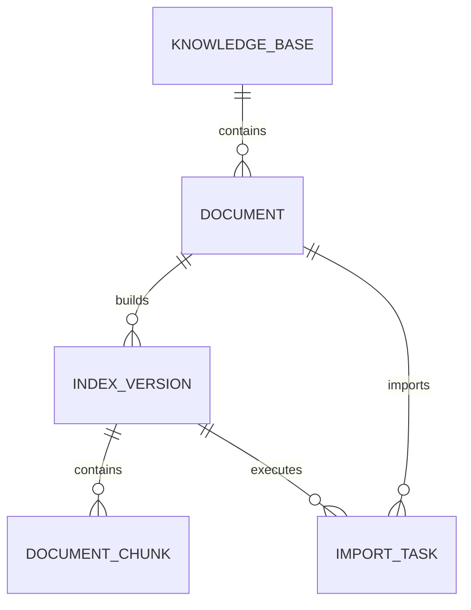
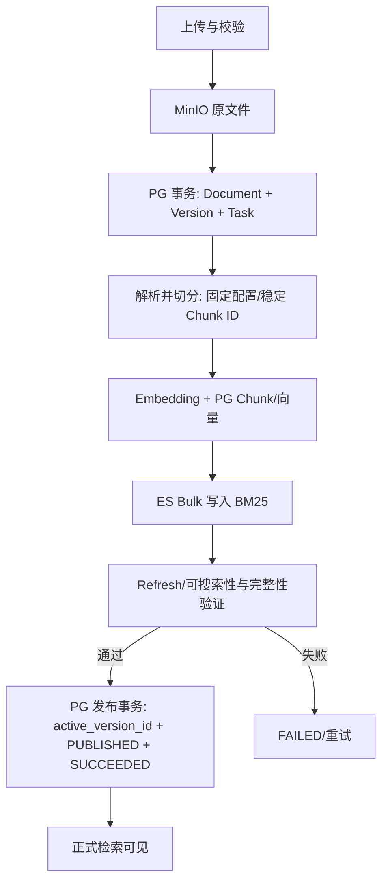
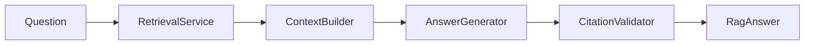

# Knowledge Assistant — V1 Architecture Specification

- 状态：Final（V1 架构基线）
- 版本：1.0
- 日期：2026-11-06
- 对应产品基线：[Product Spec](../product/product-spec.md)
- 范围：P0；P1/P2 仅保留演进接口，不提前实现

## 1. 目标、原则与边界

V1 是单用户、本地部署、领域无关的 RAG 知识库系统；Java 技术文档是首个验证场景，必须使用非技术文档验证通用性。支持 Markdown/TXT 手动上传、双索引构建、四种检索策略、单轮问答、真实引用、固定数据集评估。

架构原则：
1. 模块化单体；优先简单、可理解、可测试，不引入微服务、MQ、分布式事务或工作流引擎。
2. PostgreSQL 是元数据、任务状态、Chunk 正文及发布事实的权威来源；Elasticsearch 是 BM25 检索副本；MinIO 存原文件。
3. **首次发布前双索引均需验证可搜索**；未发布版本不得进入正式检索。
4. 失败可识别、重试幂等；不将检索失败解释为证据不足。
5. 检索策略和评估口径可复现；不假定混合检索或 Rerank 一定更优。
6. 代码通俗易懂，主流程与重要逻辑必须添加准确中文注释。

非目标：在线文档更新/删除、无感版本切换、SSE、Web UI、Git 同步、PDF、多租户、Memory、Agent、生产级高可用。

## 2. 技术栈与部署拓扑

| 层 | 选型 | 说明 |
|---|---|---|
| 运行时 | Java 21、Spring Boot 4.1.2 | 单体应用，REST API |
| AI 集成 | Spring AI 2.0.2 | Chat / Embedding 集成，Rerank 经适配接口接入 |
| 持久化 | PostgreSQL + pgvector | 元数据、Chunk、向量；Flyway 管理迁移 |
| 关键词检索 | Elasticsearch + IK 中文分词插件 | **真实 BM25**；中文/英文技术术语测试 |
| 原始文件 | MinIO | 服务端生成对象 Key，原始 Markdown/TXT |
| 测试 | JUnit、Testcontainers | 纯逻辑单测、容器集成测试、故障注入 |
| 本地部署 | Docker Compose | PG/pgvector、ES、MinIO；应用可由 IDE 启动 |

基础设施版本必须在实施前形成兼容性矩阵并锁定镜像 digest/明确版本，不使用 latest；尤其验证 ES 与 IK 插件精确兼容、pgvector 扩展、MinIO 镜像可获得性及许可证。模型提供方、模型 ID、Embedding 维度、Rerank 接口与 Tokenizer 在 M0 工程准备阶段通过最小连通性实验固定，不在本文虚构可用版本或模型能力。密钥仅通过环境变量/本地未跟踪配置提供。



## 3. 模块职责与依赖

- **knowledge**：知识库创建/列表/详情，Document 元数据、知识库边界。
- **ingestion**：上传、解析、Chunk、Embedding、双索引写入/验证、任务领取/恢复、首次发布。
- **retrieval**：VectorRetriever、KeywordRetriever、RRF、Reranker、策略编排、查询可见性、诊断指标。
- **rag**：ContextBuilder、AnswerGenerator、CitationValidator、单轮回答协议。
- **evaluation**：数据集校验、检索/问答运行器、指标、人工评审表、报告。
- **infrastructure**：PG、ES、MinIO、模型客户端适配、配置和观测。

模块通过清晰的 Java 接口协作，不为未来 Agent/Memory 构建插件框架。API DTO 与领域对象分离；数据库实体不直接作为外部响应。

## 4. 核心数据模型

### 4.1 关系



- `knowledge_base(id, name, description, created_at)`
- `document(id, knowledge_base_id, filename, content_hash, object_key, active_version_id NULL, created_at)`
- `index_version(id, document_id, status, expected_chunk_count, embedding_model, embedding_dimension, chunking_config, created_at, published_at NULL)`
- `document_chunk(id, knowledge_base_id, document_id, index_version_id, chunk_order, content, source_start, source_end, heading_path NULL, embedding NULL)`
- `import_task(id, document_id, index_version_id, status, attempt_count, lease_owner NULL, lease_until NULL, next_retry_at NULL, last_error_code NULL, last_error_message NULL, created_at, updated_at)`

ID 类型统一选用服务端生成的稳定标识；跨 PG/ES/评估集保持同一 Chunk ID。ES `_id=chunk_id`，并存 `knowledge_base_id/document_id/index_version_id/content/title/chunk_order`；ID 字段为 keyword，正文为 text。Chunk 位置统一为**解析前原始文本的 Unicode 码点偏移 [start,end)**；Markdown 标题路径为辅助信息。实现前用含中文、换行、代理对字符的定位测试确认偏移映射，禁止解析器丢失原文定位关系。若无法可靠映射则导入失败，不伪造位置。

### 4.2 约束

- `UNIQUE(document.knowledge_base_id, document.content_hash)`：同知识库同内容去重，跨知识库允许重复；并发上传靠数据库唯一约束裁决。
- `UNIQUE(document_chunk.index_version_id, document_chunk.chunk_order)`，Chunk ID 主键唯一。
- `source_start >= 0 AND source_end > source_start`；`expected_chunk_count > 0` 才可验证/发布。
- `document.active_version_id` 必须属于该 document；首次发布前为 NULL，发布后 V1 不再修改。
- IndexVersion 的 Chunk 切分配置、Embedding 模型/维度创建后不可变；已发布版本不得重写。
- Chunk 的 embedding 在构建期间可为空；发布前必须全部非空且维度正确。pgvector 列维度与所选模型一致；V1 固定一个模型及维度。
- 不强制数据库外键（如采用无外键约定），通过唯一约束、事务内关联校验、条件更新和集成测试维护引用关系。
- 空文档、不可解析文件不得发布。Document 与 IndexVersion 的首次创建和任务绑定应在同一 PG 事务完成。

### 4.3 状态语义

- ImportTask：`PENDING → RUNNING → SUCCEEDED`，失败可转 `FAILED`；可重试 FAILED 通过显式重试或调度重新领取，attempt_count 递增。对外映射为 `RECEIVED / PROCESSING / READY / FAILED`，满足产品协议。
- IndexVersion：`BUILDING → VERIFIED → PUBLISHED`，构建/验证失败可记 `FAILED`；重试同一未发布版本时重新进入 BUILDING。
- **发布事实仅以 document.active_version_id 为准**；其他状态为诊断/编排信息，不能独立赋予检索可见性。

## 5. 上传与首次发布

上传 API：`POST /api/v1/knowledge-bases/{kbId}/documents:import`，multipart 文件，返回 importTaskId/documentId 和初始状态；`GET /api/v1/import-tasks/{taskId}` 查询状态。只接受 UTF-8 Markdown/TXT（BOM/编码策略明确校验），文件大小上限作为配置且启动时验证；拒绝不支持类型、空文件和非法编码。文件名只用于展示，不参与对象路径拼接。大小上限的初始数值由工程准备时确定并写入配置与 README。



验证包括：PG Chunk 数量等于 expected_chunk_count，所有向量非空/维度匹配；ES Bulk 每项成功、同版本索引数量与 ID 集合一致、必要字段正确，Refresh 后用实际带 KB/版本过滤的查询能命中抽样/代表性数据。**仅计数一致不足以证明集合一致**；小规模 V1 可核对全部 ID 集合。验证与发布之间不允许并发修改该版本的数据；任务发布需有效领取权。PG 发布事务锁定 Document，校验任务、版本、文档关系与 VERIFIED 状态、active_version_id 为空，原子写入三个状态；响应丢失时按已有发布事实返回幂等结果。

MinIO 写成功但 PG 事务失败：尽力删除对象；失败时由按保留时间窗口的孤儿对象清理处理，不得清理上传中的对象。文档上传成功但处理失败：保留文件和任务供诊断与重试。重复内容返回明确的已有文档/任务信息，不新建第二份可检索内容；并发重复上传产生的多余 MinIO 对象须清理。

## 6. 并发领取、幂等与故障恢复

任务持久化在 PG，后台 Worker 使用条件更新/行锁领取，记录 lease_owner、lease_until、attempt_count；运行中续租，超时后可重新领取；重试有次数上限、退避和永久失败分类。进程启动扫描可领取或过期任务，不依赖内存队列的持久性。V1 不引入 MQ/Saga/Temporal。

**租约过期不等于旧 Worker 已停止**：写入需基于稳定版本/Chunk ID 幂等；发布前核验有效租约和领取代际（建议增加 claim_epoch 单调递增 fencing token），旧 Worker 不能发布。若两个执行者可能同时写同一未发布版本，必须通过单版本写入互斥或执行代际隔离，保证验证后不会被旧执行者覆盖；未落实该约束前不能宣称安全发布。最简单的 V1 实现可对每个版本使用 PG advisory lock 协调写入，并在最终发布时核验领取代际；跨外部调用的锁使用方式须通过崩溃测试确认。**发布版本永不允许后续重试写入**。

失败矩阵：MinIO 孤儿对象→补偿/延迟清理；Embedding 中断→幂等重建；ES 部分写入→固定 _id 补写并重验；ES 写完但未 Refresh→等待可搜索再验证；发布前崩溃→恢复核验；PG 发布提交但响应丢失→读取 active_version_id 判定已成功。永久错误（格式/解析）不无限重试，暂时错误（超时/服务不可用）有限重试。保存脱敏错误码与诊断信息。

## 7. 查询可见性与规模边界

**严禁先取 Top-K 再应用层过滤未发布版本**，否则候选被挤占。

- PG 向量检索：在排序/LIMIT 前 JOIN Document，要求 `document.active_version_id = chunk.index_version_id` 且知识库匹配、embedding 非空。
- ES BM25：在评分/Top-K 前 filter `knowledge_base_id` 和**PG 当前已发布版本 ID 集合**（terms）。发布版本集合在请求开始时读取一次，并复用于同一请求的各通道；PG 查询也使用该集合/相同发布视图约束，避免并发首次发布造成通道快照不一致。
- ES terms 列表不得静默截断；V1 明确限制单知识库可发布文档数量，配置上限必须低于经验证的 ES terms 限制，并在达到上限时拒绝新增发布、返回可解释错误。实施时测量枚举成本并记录性能基线。
- 首次发布不切换旧版本；V1 不提供已发布版本的删除/修改。已发布数据不可变。跨存储系统没有原子事务，索引或模型服务故障时返回失败或显式降级，不能宣称强一致/永久可用。

## 8. 检索架构

四种策略：
- S1 `VECTOR`：pgvector 余弦距离（默认精确搜索，HNSW 留作性能实验）。
- S2 `BM25`：ES 真正 BM25；IK 分词，固定插件兼容版本；中英文术语测试与标准分词对照可作为评估实验。
- S3 `HYBRID_RRF`：两路召回、按 Chunk ID 去重，RRF `sum(1/(k+rank))`。
- S4 `HYBRID_RERANK`：S3 候选再经 Rerank 模型重排。

建议初始参数：vectorTopK=20、bm25TopK=20、rrfK=60、fusionTopK=20、finalTopK=5；这些是实验起点，不是最佳值。S1/S2 的 finalTopK 也统一为 5 以便公平对照。融合前保留原始分数、排名和阶段耗时；不直接相加 BM25 与向量分数。Query Embedding 在同次对照运行中复用。

接口概念：`VectorRetriever`、`KeywordRetriever`、`Reranker`、`RetrievalService`；`RetrievalContext` 含 kbId、发布版本快照、requestId；`RankedChunk` 含 chunk/document/version IDs、来源、各路 rank/score；`RetrievalResult` 含 requestedStrategy、actualStrategy、degraded、候选与阶段耗时。

S3 任一路失败不可标记为完整 S3 成功；S4 Rerank 失败亦然。**评估模式严格失败**；正式问答可配置显式降级并报告 actualStrategy/degraded/reason。EMPTY_RESULT 与 FAILED 必须区分。默认不允许静默降级。

## 9. RAG 问答与引用协议

API：`POST /api/v1/chat/answers`，请求包含 knowledgeBaseId、question、strategy。单轮独立问答。



ContextBuilder 仅使用最终检索候选，按 Chunk ID 去重、按模型 Tokenizer/预算选取证据，记录**实际进入 Prompt** 的 E1/E2... 与 Chunk ID 映射；不随意截断会破坏事实前提的片段。证据视为不可信数据，不能执行文档内指令。模型输入只含问题、系统约束与所选证据，评估答案/Gold Evidence 不得进入 Prompt。

结构化模型输出（逻辑协议）：
```json
{"answerable":true,"answer":"...","citations":["E1","E2"]}
```

后端校验 Schema、引用 ID 必须属于**本次实际上下文**、所属 KB 与当前发布版本；来源路径/位置由 PG 权威元数据填充，不接受模型自造。若声称可答但无有效引用或引用非法，不能返回正常 ANSWERED；可采用明确 FAILED/OUTPUT_INVALID，是否进行有限重试由实现任务定义并测试。引用 ID 合法**不等于**引用语义支持结论；事实和语义支持通过离线评估与人工判断。

结果状态：`ANSWERED`、`INSUFFICIENT_EVIDENCE`、`FAILED`；检索/模型超时是 FAILED，不能伪装成拒答。高相似度不等于事实可答，不采用未经验证的统一分数阈值。回答响应包含 requestId、状态、答案、真实 citations、requested/actualStrategy、degraded、可得时 usage；详细诊断走检索/评估接口。V1 不做流式生成。

## 10. 评估架构

评估使用**正式 RetrievalService/RagService**，不另写一套算法。数据集 JSON + Java 运行入口 + JSON/Markdown 报告；不引入评估服务或数据库。

- 初始 20–30 条人工标注问题：术语、语义改写、多证据、易混淆、无答案；另有非技术知识库。
- 每例包含 caseId、question、kb/数据快照、answerable、relevantChunkIds、expectedFacts；多证据例可有 requiredEvidenceGroups（每组至少命中一个，全部组覆盖）。
- 检索：Hit@K、Recall@K（逐问题后 Macro 平均）、MRR、EvidenceCoverage@K（自定义任务指标，明确口径）。
- 生成：回答/拒答方式、事实正确性、引用语义支持、整例通过；不适用记 N/A，报告显示分子/分母。**引用存在性不计为语义支持**。
- `RetrievalEvaluationRunner` 与 `AnswerEvaluationRunner` 分离；人工未评审标记 `PENDING_HUMAN_REVIEW`，不编造成功率。
- 固定知识库数据快照、Chunk/Embedding/Rerank/LLM/Prompt 版本、参数与查询集；记录 runId、逐例候选/排名/耗时/错误、模型输出、usage、人工评审、summary。
- 四策略对照统一最终 Top-K；评估严格执行请求策略，不以降级结果冒充原策略。不同 Chunk 切分配置的 Gold Chunk ID 不自动复用；模型生成可能非确定性，记录原始输出。

## 11. API 与错误边界

建议 API：
- `POST /api/v1/knowledge-bases`；`GET /api/v1/knowledge-bases`；`GET /api/v1/knowledge-bases/{id}`
- `POST /api/v1/knowledge-bases/{id}/documents:import`（multipart）
- `GET /api/v1/import-tasks/{id}`
- `POST /api/v1/retrieval/search`（kbId/query/strategy/topK；包含可选诊断）
- `POST /api/v1/chat/answers`
- 评估入口以 CLI/Maven 为主，不要求 HTTP 管理端点。

统一错误语义：参数非法/不支持格式、知识库不存在、重复内容、导入失败、索引不可用、模型超时、输出非法、证据不足；区分业务状态与 HTTP 错误，返回 requestId 供排查。禁止把内部堆栈、密钥、原文大段泄漏到 API 或日志。

## 12. 安全、观测、测试与验收

- 上传限制文件大小、类型、编码；防路径穿越；MinIO Key 服务端生成；环境变量存密钥；限制请求大小、Token/模型调用预算。
- 每次查询严格 KB 隔离，引用绑定当前请求上下文；文档 Prompt Injection 视为不可信数据；V1 不向 LLM 开放有副作用的工具。
- 结构化日志：requestId/importTaskId/versionId、阶段耗时、错误码、重试次数、requested/actualStrategy、降级原因；不记录密钥和敏感原文。
- 纯逻辑单测：Chunk 位置、RRF、指标计算、状态机、引用校验、Token Budget。
- Testcontainers 集成：PG+pgvector、ES+IK（兼容镜像）、MinIO；验证真实 BM25、向量过滤、索引发布/刷新、KB 隔离。
- 故障注入：MinIO/PG 中断、Embedding 超时、ES 部分写入、Refresh 延迟、发布事务前崩溃、提交后响应丢失、租约过期/双 Worker、重复上传、无答案、非法引用、Rerank 失败。
- 测试不得把在线模型非确定性当作全部测试通过的必要条件；用 Fake 模型稳定覆盖业务逻辑，另设可选在线冒烟验证。
- M1 导入/双索引，M2 四策略，M3 问答引用，M4 评估，M5 文档与故障验收；对应 [Product Spec](../product/product-spec.md) 的 P0 门槛。

## 13. 工程实施前必须关闭的事项

以下属于**实施配置与验证**，不是新增产品范围：
1. 固定 Spring Boot/Spring AI、PostgreSQL/pgvector、Elasticsearch/IK、MinIO、Testcontainers 兼容版本及镜像来源；提供 Docker Compose 和验证记录。
2. 固定模型提供方、Embedding 维度、Tokenizer、Rerank 接口；验证鉴权、超时、费用边界。
3. 固定上传大小上限、知识库最大已发布文档数、ES terms 安全上限、任务重试/租约参数、上下文预算；记录配置及合理性。
4. 对**旧 Worker 写入与发布竞态**确定可验证的互斥/fencing 实现，完成故障注入测试；未通过不得标记 M1 完成。
5. 对发布版本快照在 PG/ES 两路的一致性及 ES Refresh 后的可搜索性进行真实集成测试。

这些事项由 Implementation Plan 拆成可验收的小任务；不能以“后续优化”为由跳过正确性验证。

## 14. 决策记录与演进

- ADR-01：模块化单体，避免过度工程化。
- ADR-02：ES + IK 实现真实 BM25；pgvector 做向量检索；MinIO 保存原文件。
- ADR-03：首次发布 + IndexVersion/active_version_id；在线版本切换属于 P1。
- ADR-04：PG 原子发布事实 + 两路预发布过滤；不承诺跨存储强事务。
- ADR-05：V1 精确向量检索基线；ANN/HNSW 作为后续对照。
- ADR-06：RAG 使用 answer + citations；引用语义支持由离线评估判断。
- ADR-07：JSON 数据集 + CLI + 人工评审；不建独立评估服务。
- ADR-08：正式问答允许**显式、可配置**降级；评估严格禁止静默降级。

未来 P1：文档删除/更新、版本切换与旧索引清理、SSE；P2：PDF/Web UI/Git 同步。Memory、Agent 属于独立后续阶段，不在 V1 预埋复杂平台。

当前工程状态与历史验证边界见 [M0 验收报告](../engineering/m0-verification-report.md)；V1 业务参数初始值见 [配置基线](../engineering/configuration-baseline.md)。版本事实修正不改变本文架构决策。
