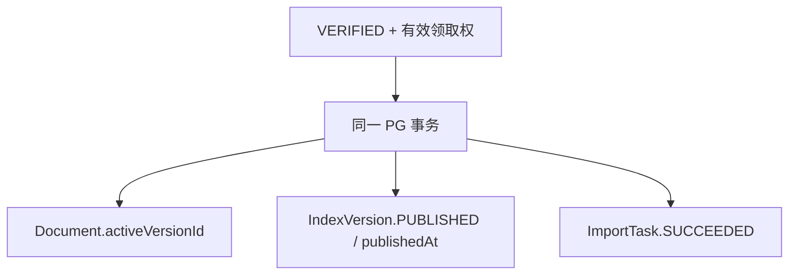

# M1 最终综合验收（M1-13D）

## 基线与交付范围

2026-11-09，feature/m1-ingestion-indexing，基线 19cd30752ad462f791ffdbf2f6e14fdb24ce0639，初始工作区干净；已核对 M1 提交历史及 M1-13A/B/C 最终记录。本次只做回归与归档，不改变冻结架构、依赖、迁移或业务语义。实际 Architecture Spec 技术栈表已是 Boot 4.1.2，与 pom 一致；任务指引中关于其仍为3.x的提示已过时，不修改冻结架构。

已实现知识库 API、UTF-8 Markdown/TXT 上传、去重、原件存储、任务调度恢复、解析切分、向量与 BM25 构建、双索引验证及首次发布。未实现在线重建、版本切换、检索/RAG、Memory、Agent、Web UI；不宣称生产就绪。

## 架构与发布事实

```mermaid
flowchart LR
  API[REST 上传] --> S[MinIO staging]
  S --> O[MinIO originals]
  O --> PG[PG Document / IndexVersion / ImportTask]
  PG --> W[Scheduler / 单 Worker]
  W --> H[SHA-256 / 解析 / Chunk]
  H --> E[Embedding 本地桩用于验收]
  E --> V[PG pgvector]
  V --> ES[ES BM25]
  ES --> CHECK[PG / ES 双索引验证]
  CHECK --> PUB[PG 首次发布事务]
  PUB --> READY[READY]
```

PG 是权威业务事实；ES 和 MinIO 不能独立宣布发布成功。上传网络操作在记录事务外，提交结果不确定时查主库引用，无法确认则保留 originals；staging 删除失败交给前缀 ILM。发布响应不确定复用幂等发布协议，失败更新不得覆盖成功事实。

## 工程一致性审查

| 领域 | 实际源码与结论 |
| --- | --- |
| 数据模型 | V2～V5、infrastructure/persistence：BIGINT 服务端 ID；同 KB/hash 唯一，版本/chunk_order 唯一；状态 CHECK、向量1024维、Chunk version 乐观锁；任务状态/重试及租约索引。归属由业务层验证，数据库未声明外键。index_job/index_job_item 未建立，不写成已实现能力 |
| 上传存储 | DocumentImportService：2 MiB、UTF-8、Markdown/TXT、原始字节 SHA-256；随机 staging/originals Key；网络与 PG 事务分离、并发去重和不确定提交引用保护。Compose 默认 knowledge-assistant，测试使用隔离容器的 pipeline-test/storage-test/随机 Bucket，不操作开发卷 |
| Chunk/Embedding | ChunkService、EmbeddingService/Repository：稳定持久化 ID、Unicode 码点区间、幂等初始化；只请求未完成向量；text-embedding-v4/1024 快照；模型调用拒绝外层事务，短事务条件写入，已发布版本拒绝改写 |
| ES | EsIndexService/Repository、EsIntegrityService：chunk_id 稳定ID、create/409内容比较、分批恢复、Refresh/Match、版本及归属过滤、PG/ES集合验证。ES 8.18.0 + IK 由 ElasticsearchIT 真实中文/英文探针验证 |
| Worker | TaskScheduler/TaskService/TaskMapper：15分钟租约、epoch/owner条件、最多4次、5/15/45秒退避±20%、过期RUNNING恢复；同实例 synchronized scan，10分钟协作预算。仅单实例单Worker |
| 首次发布 | IndexPublishService/Repository/Mapper：VERIFIED、无现有指针、期望Chunk>0、有效租约及epoch；三个条件更新同一事务，任一步失败回滚；完整成功事实允许幂等确认。事务内没有ES/模型调用 |
| API | DocumentImportController、ImportTaskResponse、Result、ApiExceptionHandler、RequestIdFilter：新上传202、重复200；正数ID/单文件校验；任务仅返回安全失败码，统一响应与追踪。READY来源SUCCEEDED，依赖发布事务维护事实一致性；不提供抵御人工SQL破坏的额外查询校验 |
| 事务 | 编排无外层事务；Embedding/ES显式拒绝事务；PG验证使用短快照及最终锁校验；发布独立Service代理边界。沿用 transaction-simplification-review.md，历史Context和迁移计数失败已有修复，不做传播配置重构 |

存储补偿日志仍记录服务端随机 objectKey，API不返回对象路径；运维日志访问需受控。这不是用户原文或凭据，但如要求日志完全不含对象标识，需另行收敛日志策略。

## 故障矩阵与正常 E2E

[M1-13B](m1-13b-verification.md) 与 [M1-13C 最终节](m1-13c-verification.md) 是历史验收依据，不与本轮统计合并。C01～C12 最终均 PASS：503恢复、原件摘要失败、四次耗尽、Chunk快照、部分向量恢复、部分ES恢复、验证前失败、VERIFIED恢复、提交响应不确定、事务回滚、租约恢复、协作超时。具体测试名称、注入位置、PG/ES/MinIO证据及最终状态以13C各轮详细说明和最终覆盖矩阵为准；早期NOT VERIFIED为历史阶段记录。

正常E2E在 IngestionPipelineIT 通过真实上传API、PG/ES/MinIO、生产模型客户端和本地HTTP桩检查Markdown/TXT、原始字节、向量维度、ES集合/中文Match及三项发布事实。显式scan不等同自动定时触发，固定向量不衡量语义质量。

## 验证范围和发现规则

本轮命令 `mvn clean verify`，不指定测试、不跳过、不启用online-model、不调用DashScope。clean前旧target日志复制到本地 .acceptance-evidence；本轮日志同目录 m1-13d-default.log。原始日志含运行细节，不纳入Git。

Surefire仅 **/*Tests.java；Failsafe白名单12类：DatabaseIT、ElasticsearchIT、EsIndexIT、EsIntegrityIT、PgIntegrityIT、IndexVerificationIT、IndexPublishIT、MinioIT、ImportTaskIT、TaskRecoveryIT、StorageImportIT、IngestionPipelineIT。

默认不发现：ChunkPersistenceIT、EmbeddingPersistenceIT、MarkdownPerformanceIT、EmbeddingBaselineOnlineIT、ModelOnlineIT、RerankOnlineIT。online-model profile仅选择后两类，不自动选择EmbeddingBaselineOnlineIT。前三类是额外专项而非默认覆盖，后面三类涉及在线模型，未获授权不运行。

Docker镜像沿用13B固定PG digest（17.6/pgvector0.8.0）、ES8.18.0/IK8.18.0、本地MinIO RELEASE.2025-09-07T16-13-09Z及预置Ryuk；禁止拉取，不启动Compose。测试容器随机端口，凭据为测试配置；默认不需要供应商密钥，真实IT需要Docker与本地镜像。部分以Tests命名的持久化测试也使用Docker，Surefire数量不等同纯单元数量。

## 限制及 M2 前置条件

- V1不支持多Worker fencing、分布式锁、在线重建/切换或强制取消HTTP/线程；同Scheduler串行不证明跨实例安全。
- 尚未验证真实PG TCP断线、单个ES Bulk响应丢失、空白异机离线恢复、生产容量/安全/语义质量；协作超时不是精确终止。
- 本轮没有确认的新生产代码缺陷；默认未发现的专项测试不得宣称由clean verify覆盖。
- M2可以依赖KnowledgeBase、Document、IndexVersion、已发布Chunk/PG向量/ES BM25与activeVersionId；查询必须同时约束KB、Document及当前发布版本。候选存在于ES不代表可见，必须以PG发布事实过滤，尚未实现此检索入口。
- M2前需人工审核最终提交、确认单Worker部署与MinIO ILM配置、具备真实模型配置及检索可见性设计；本次不进入M2。

## 本轮最终结果与里程碑结论

`mvn clean verify` 于2026-11-09 20:33:35 +08:00 BUILD SUCCESS，耗时9分12秒；统计来自本次clean后XML与同一次日志，不拼接历史批次。

| 引擎 | 类数 | 总数 | 通过 | 失败 | 错误 | 跳过 |
| --- | --- | --- | --- | --- | --- | --- |
| Surefire | 33 | 149 | 149 | 0 | 0 | 0 |
| Failsafe | 12 | 35 | 35 | 0 | 0 | 0 |

Failsafe：DatabaseIT 2、ElasticsearchIT 1、EsIndexIT 4、EsIntegrityIT 2、ImportTaskIT 1、IndexPublishIT 1、IndexVerificationIT 2、IngestionPipelineIT 15、MinioIT 2、PgIntegrityIT 1、StorageImportIT 1、TaskRecoveryIT 3。不存在环境不满足而跳过的默认测试；默认未发现的六类不计作跳过。Surefire含真实PG测试，不能把149项全部称作纯单元测试；35为Failsafe集成测试数量。

本轮没有失败及修复记录。日志有既有弃用/unchecked、动态agent提示，以及测试容器生命周期中的Hikari连接关闭警告；所有报告成功，不据此宣称已验证PG TCP故障。随后 `mvn spotless:apply spotless:check` BUILD SUCCESS，未产生Java/pom变更；仅文档变化，不重复执行已成功的完整范围。最终diff检查和独立提交由Git记录。

**结论：PASS（M1当前V1范围及默认完整回归）**。依据为本轮184项通过、工程源码审查及13C限定故障矩阵全部通过；不是全体专项测试本轮重跑，也不是生产就绪。未执行额外ChunkPersistenceIT/EmbeddingPersistenceIT/性能专项及在线模型，原因是默认配置不发现且本轮未修改相关实现；历史专项证据不能替代本轮默认统计。

建议用户审核本次最终Commit后再决定合并main；本轮不Push、不Merge、不进入M2。需保留单Worker、模型桩与本地镜像等边界。验收日志及本次XML保存在仓库外相邻 knowledge-assistant-m1-13d-evidence 目录，Git仅提交可审阅的脱敏归档文档。
