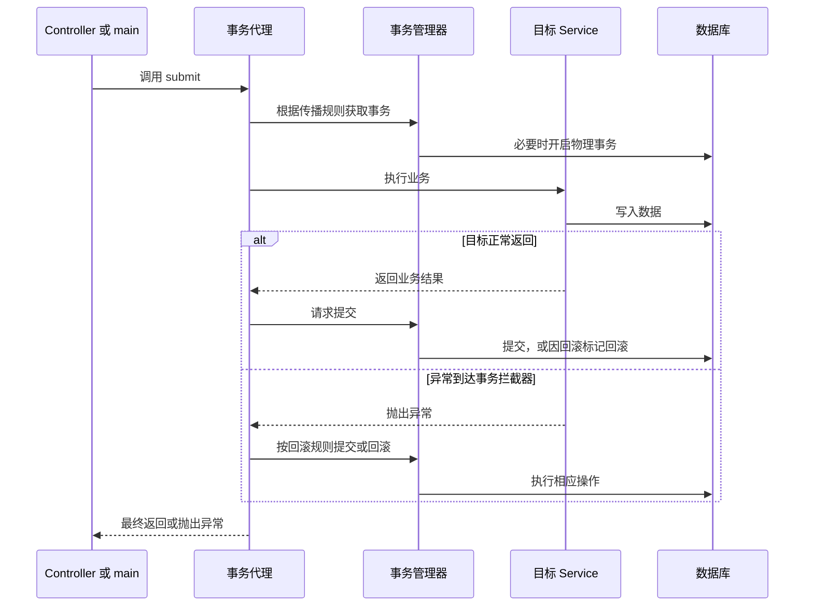
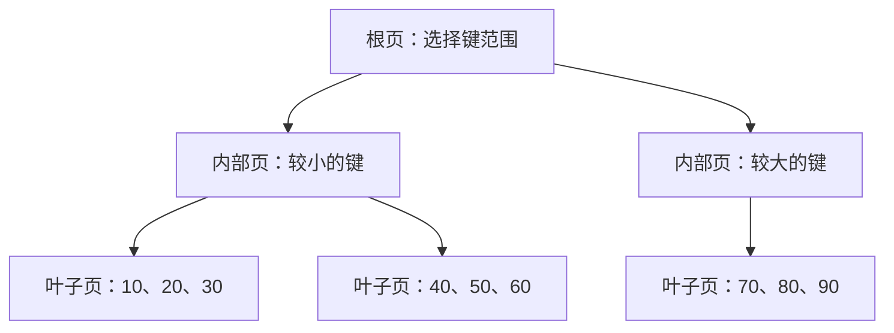
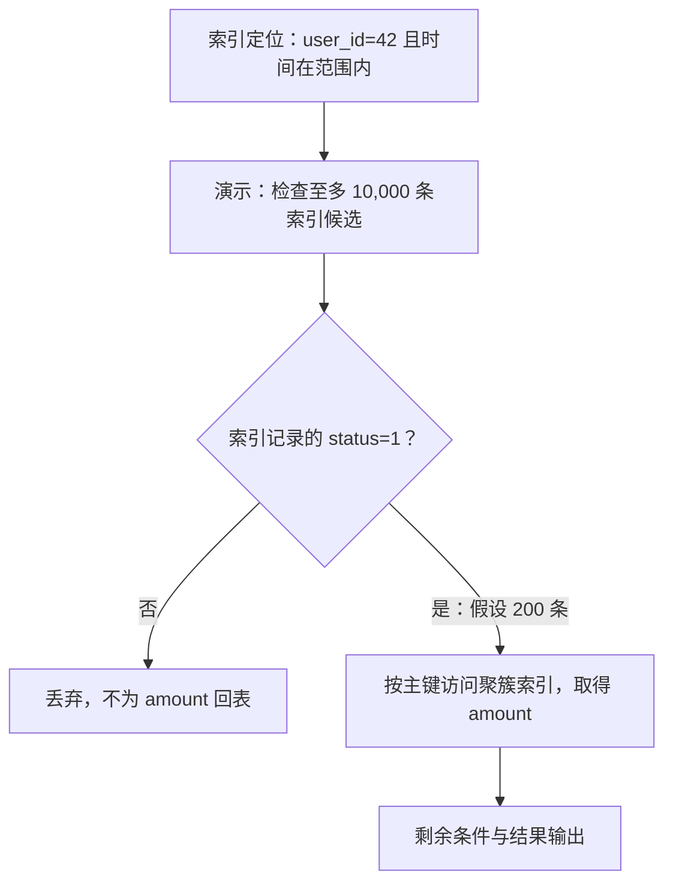

# M4-02 真实检索对照

状态：人工语义复核完成；仅作为 12 问探索性对照结论。

## 最终人工语义复核

依据用户确认的 Q01～Q12 复核结论。COMPLETE：Top-K 联合候选直接支持全部 expectedAnswerPoints；PARTIAL：至少支持一个必要事实但仍有缺失；MISSING：无直接支持；PENDING：无法可靠判断。本轮最终标签没有 PENDING。不得借助候选之外的知识补齐事实，也不把其他实验的相似数据作为当前问题的证据。

每格为 Top-3 / Top-5，C=COMPLETE、P=PARTIAL、M=MISSING。

|问题|Fixed VECTOR|Fixed BM25|Fixed HYBRID_RRF|Structure VECTOR|Structure BM25|Structure HYBRID_RRF|
|---|---|---|---|---|---|---|
|Q01|C/C|C/C|C/C|C/C|C/C|C/C|
|Q02|C/C|C/C|C/C|C/C|C/C|C/C|
|Q03|C/C|C/C|C/C|C/C|C/C|C/C|
|Q04|M/M|M/M|M/M|M/M|M/P|M/M|
|Q05|C/C|C/C|C/C|C/C|C/C|C/C|
|Q06|C/C|C/C|C/C|C/C|C/C|C/C|
|Q07|C/C|C/C|C/C|C/C|C/C|C/C|
|Q08|M/M|C/C|P/P|M/M|C/C|C/C|
|Q09|P/C|P/P|P/C|C/C|C/C|C/C|
|Q10|C/C|C/C|C/C|C/C|C/C|C/C|
|Q11|P/P|P/P|P/P|P/P|P/P|P/P|
|Q12|C/C|C/C|C/C|C/C|C/C|C/C|

### Semantic Complete Coverage

以 12 个问题为分母，仅 COMPLETE 计入分子；PARTIAL 与 MISSING 均不计为完整。72 次检索均 SUCCESS，无 FAILED 混入分母。以下从上表逐格计数独立复算，不以 SourceSpan 指标推导。

|策略|Fixed @3 / @5|Structure @3 / @5|
|---|---|---|
|VECTOR|8/12 = 66.7% / 9/12 = 75.0%|9/12 = 75.0% / 9/12 = 75.0%|
|BM25|9/12 = 75.0% / 9/12 = 75.0%|10/12 = 83.3% / 10/12 = 83.3%|
|HYBRID_RRF|8/12 = 66.7% / 9/12 = 75.0%|10/12 = 83.3% / 10/12 = 83.3%|

### SourceSpan 与语义结论的差异

- Q07：固定 805002（VECTOR/RRF 第 1、BM25 第 2）虽缺 Gold 段落开头，已经直接说明 S3 加 S2 仍缺 S1，以及补相邻块不能保证完整。因此所有组合语义 COMPLETE；结构感知的区间提升不算语义覆盖提升。
- Q08：固定 BM25 第 2 的 806008 已含公式、rank 起点、实验默认 60 和重复 ID 规则，Top-3 语义 COMPLETE，虽未覆盖全部 Gold。固定 RRF 第 3 的 806009 丢失公式开头，Top-3/5 PARTIAL；结构感知 906010 均排 BM25/RRF 第 1，补齐公式，RRF 产生真实语义改善。VECTOR 两组均 MISSING。
- Q09：固定 Top-3 缺少同步调用独立事务 Service 的明确证据。VECTOR 第 4、RRF 第 5 的 807001 补齐，故两者 Top-5 COMPLETE；固定 BM25 Top-5 仍 PARTIAL。结构感知 907004 三路均第 1，完整覆盖配置和失败依赖控制。仅评单队列消费端，不追加生产端条件。
- Q10：固定 807001 已在 Top-3 说明不同队列可能并行提交及稳定映射/屏障，语义 COMPLETE。结构感知提高区间覆盖，但不是语义从失败变成功；扩容不意味着必然乱序。
- Q11：全部 PARTIAL。Gold 原文未明确表达 Future 已完成时无需等待的条件；候选支持提交和等待基本关系，但按本次严格口径不以背景知识补齐条件。保留 Gold 不变，说明语义评估数据本身的限制。
- Q04：仅结构感知 BM25 第 4 的 903002 支持未做性能对照、耗时不作性能结果，仍缺两组参数的 Unacked/活跃数，故 Top-5 PARTIAL，其余 MISSING。

### 改善、退化与短块观察

语义完整覆盖的改善集中在 Q09 Top-3（三路）、Q09 BM25 Top-5，以及 Q08 RRF Top-3/5。本样本未发现 COMPLETE 退化。Q05～Q07 保持 COMPLETE，Q12 保持 COMPLETE；Q01～Q03 同样保持 COMPLETE。

结构感知的 180 个返回位置有 9 个短于 100 字符、4 个纯标题；固定均为 0（按返回位置计，含重复，不代表唯一块数）。Q01 的短块 901002 是充分证据，不能按长度认定无效；Q01 VECTOR 第 5 的 901000、Q05 Top-3 的 904000 纯标题没有增加必要事实支持。结构感知总块数增加 25（43.1%），存在额外索引和候选竞争成本，但不能把增加的块数全部判为噪声。

### 适用范围与技术决策

12 问、8 篇 Markdown 是已知开发样本，非独立未见测试集；题目集中于少数主题，不能推广到其他格式、规模或用户分布。语义标签采用本次人工确认的必要事实口径，不代表检索后生成答案正确率。Q11 展示 Gold 与细化答案条件不完全对齐的限制；未重设计 Gold。只计算语义完整覆盖率，没有由 C/P/M 标签虚构语义 Evidence Recall 或 MRR。耗时是单轮固定顺序的诊断阶段计时，存在冷启动与顺序偏差，不作性能结论。

技术决策：结构感知切分保留为候选，暂不替换生产 FixedCodePointSplitter。本样本存在局部语义收益，但不足以抵消样本和标注限制，也不足以证明生产整体收益。本次 M4-02 收尾，不新增 Chunking 实验或优化方案。

### 本次收尾验证

仅复算逐题标签、审阅报告与实验代码，并执行 Spotless 检查、test-compile、git diff --check；未重新运行检索或全量测试，未调用任何在线模型。既有真实检索验证为 1 test 通过、72/72 SUCCESS。


## 环境与边界

使用现有 Testcontainers Fixture：PostgreSQL 17 / pgvector 0.8.0（固定镜像摘要），Elasticsearch 8.18.0 / IK 8.18.0。两组独立 KB 和 ES 索引，8 篇文档，58 / 83 Chunk。参数 20/20/60/20/5；只请求 VECTOR、BM25、HYBRID_RRF，无在线模型调用。

模型 text-embedding-v4，1024 维 FLOAT；本地真实快照 target/m4-02c1/embedding，153 条完整加载验证。

输入指纹：d8080d19731b571a32985c3889c398138fb1c661bfef780bc8994c54398492d8

配置指纹：46126af9b308e9c300da290642ef34e8822575b3652a1028cdedf9fc5fe641f9

## 来源区间代理指标

按同一文档的 Top-K 区间并集完整覆盖每条 Gold 区间计算。相交不算命中；多个 Chunk 可合并覆盖。CEC 要求全部 Gold 完整覆盖；Recall 为完整覆盖 Evidence 比例；MRR 为首次完整覆盖任意一条 Evidence 的前缀倒数。FAILED 单独排除。以上均非最终语义质量分数。

|切分|检索|成功/失败|CEC@3|CEC@5|Recall@5|MRR@5|平均返回字符|平均阶段耗时ms|
|---|---|---|---|---|---|---|---|---|
|FIXED_CODE_POINT|VECTOR|12/0|0.583|0.750|0.750|0.468|779.2|54.2|
|FIXED_CODE_POINT|BM25|12/0|0.667|0.833|0.875|0.746|790.3|140.6|
|FIXED_CODE_POINT|HYBRID_RRF|12/0|0.667|0.833|0.833|0.662|777.9|194.8|
|MARKDOWN_STRUCTURE_AWARE|VECTOR|12/0|0.833|0.833|0.833|0.736|430.7|48.2|
|MARKDOWN_STRUCTURE_AWARE|BM25|12/0|0.917|0.917|0.958|0.896|493.0|57.6|
|MARKDOWN_STRUCTURE_AWARE|HYBRID_RRF|12/0|0.917|0.917|0.917|0.875|495.3|105.8|

耗时为诊断阶段耗时之和，未包含全部端到端开销；首轮冷启动、固定执行顺序，无重复测量，不能作为性能基准。字符长度按 Unicode 字符计。

## 逐问题排名与复核材料

以下保留 Top-5、来源区间、证据覆盖和文本。语义支持已按文末逐题标签完成人工复核；本节保留原始候选材料。展示文本已统一换行并移除行末空白；原始正文不变。完整分数、HeadingPath、诊断候选及各阶段耗时见 target/m4-02d/results.jsonl（本地实验产物）。Chunk Order 可由 chunkId 减去所属文档首 Chunk ID 得到。

### Q01

提交异常一定证明已回滚吗？

Gold Evidence：Q01-E01

```text
{'span': {'start': 741, 'end': 836}, 'text': '“目标正常返回”不代表“事务成功提交”。rollbackOnly、提交阶段错误等都可能使代理最终失败。若提交期间连接故障，数据库最终状态甚至可能需要核实，不能绝对说所有提交异常都证明已回滚。'}
```

**FIXED_CODE_POINT / VECTOR**：SUCCESS；CEC@3=True，CEC@5=True；完整覆盖 Evidence：Q01-E01

- Rank 1：Chunk 801001 / Doc 800100 / Order 1 / [680,1480)；heading={"version":1,"headings":[{"text":"Spring 事务：先找边界，再看异常与资源","level":1,"span":{"start":2,"end":24}},{"text":"一次事务调用到底由谁完成","level":2,"span":{"start":31,"end":43}}]}；distance=0.3638509160058072；BM25=None；RRF=None

```text
       M->>D: 执行相应操作

    end

    P-->>C: 最终返回或抛出异常

```


“目标正常返回”不代表“事务成功提交”。rollbackOnly、提交阶段错误等都可能使代理最终失败。若提交期间连接故障，数据库最终状态甚至可能需要核实，不能绝对说所有提交异常都证明已回滚。


## 三步判断事务是否按预期工作


1. 调用是否进入事务代理？new 对象、自调用、初始化回调直接调用自身都可能绕过。

2. 当前线程是否已有事务、使用哪个事务管理器和资源？传播规则决定参与、挂起、新建或保存点。

3. 异常是否到达相应事务拦截器，匹配什么回滚规则？不能只看异常的类名。


默认规则对 RuntimeException 和 Error 回滚，检查异常默认不触发回滚。rollbackFor=IOException.class 明确改变规则。目标内部把异常吞掉、正常返回时，该异常没有到达代理；仅增加 rollbackFor 无法让代理感知它。Controller 的 catch 在 Service 代理外，代理已处理完相应事务后才捕获，不会撤销已完成的回滚或提交。


| 情形：均已通过代理、此前无事务 | 结果（无其他回滚标记） |

| --- | --- |

| 目标抛出 IOException，默认规则 | 提交后继续向外抛异常 |

| 目标抛出 IOException，rollbackFor 指定该异常 | 回滚后继续向外抛异常 |

| 目标内部捕获自己的 IOException，正常返回 | 代理按正常返回路径请求提交 |

| REQUIRED 内层代理因运行时异常标记共享事务，外层 catch | 共享事务不能提交，最终回滚并可能抛 UnexpectedRollbackException |


最后一行与“同
```

- Rank 2：Chunk 801003 / Doc 800100 / Order 3 / [2040,2840)；heading={"version":1,"headings":[{"text":"Spring 事务：先找边界，再看异常与资源","level":1,"span":{"start":2,"end":24}},{"text":"六个组合：先限定实验条件","level":2,"span":{"start":1524,"end":1536}},{"text":"REQUIRED：捕获异常为什么仍失败","level":3,"span":{"start":2003,"end":2022}}]}；distance=0.384765349910577；BM25=None；RRF=None

```text
事务。内层运行时异常穿过内层代理，默认参与者失败处理将共享事务标记为 rollbackOnly。外层 catch 只处理 Java 异常，不清除标记。外层目标正常结束，代理请求提交时只能回滚，并以 UnexpectedRollbackException 告诉调用者“没有成功提交”。实验中内层 new=false/savepoint=false，外层 catch 后 rollbackOnly=true。


如果审批方法不加事务注解，但在相同线程通过 Spring JDBC 使用同一数据源，也能参与已有外层事务。不同点在于没有该方法自己的事务拦截器边界；它抛出而被外层目标捕获的普通业务异常，不会仅凭这个未注解方法自动设置 rollbackOnly。底层资源错误另论。


### REQUIRES_NEW：独立事务与异常传播分开判断


外层资源被挂起但没有提交，仍占连接；内层另取连接开启独立事务，完成后恢复外层资源。成功的内层提交不被后续外层回滚撤销。内层失败若外层捕获，外层可继续；不捕获时运行时异常穿过外层代理，外层会按自己的规则回滚，并非内层事务直接“传染”了外层状态。


实验 inner new=true、savepoint=false，连接 A→B→A。连接池需容纳外层占用与内层额外需求；并发下所有外层都占住连接再申请内层连接，可能造成等待甚至耗尽。实验池大小 4 只为单线程观察，不作为生产容量建议。


### NESTED：局部回滚不是独立提交


同一连接在外层写入后建立保存点。内层失败时回滚到保存点，撤销附加记录，保留之前请假写入；外层捕获后仍可提交。内层成功只完成保存点范围，没有独立提交，外层最终回滚会撤销两者。


实验 inner new=false、savepoint=true，同一连接；DataSourceTransactionMan
```

- Rank 3：Chunk 801004 / Doc 800100 / Order 4 / [2720,3520)；heading={"version":1,"headings":[{"text":"Spring 事务：先找边界，再看异常与资源","level":1,"span":{"start":2,"end":24}},{"text":"六个组合：先限定实验条件","level":2,"span":{"start":1524,"end":1536}},{"text":"NESTED：局部回滚不是独立提交","level":3,"span":{"start":2666,"end":2683}}]}；distance=0.38653083008158484；BM25=None；RRF=None

```text
录，保留之前请假写入；外层捕获后仍可提交。内层成功只完成保存点范围，没有独立提交，外层最终回滚会撤销两者。


实验 inner new=false、savepoint=true，同一连接；DataSourceTransactionManager 允许嵌套，驱动支持 JDBC 保存点，两表 InnoDB。NESTED 不是所有事务管理器都支持，不能把 JDBC 保存点语义直接套给所有 JPA/JTA 场景。


## 根据业务选择传播


请假单和审批必须原子：外层 REQUIRED，审批可 REQUIRED，也可无注解依赖调用契约；若明确禁止脱离事务调用，可 MANDATORY。操作尝试日志要求业务失败仍保留：通过另一个 Bean 的 REQUIRES_NEW 保存，并对是否让日志异常影响业务作明确决策。日志自身失败回滚时当然不会有“保证保存成功”的记录，必须区分独立性与成功保证。


不要用 NESTED 保存“必须独立保留”的日志，因为外层失败仍会回滚它。操作尝试与请假成功是不同语义，不能提前提交一条“成功”日志，事后外层却回滚。


## 线程、隔离级别、只读和超时


命令式 JDBC 事务通过线程绑定资源。新线程不自动继承父线程事务；Future.get 等待完成也不共享连接。子线程通过代理调用 REQUIRED 时，在该线程无事务的前提下会新开独立事务；父线程回滚不撤销已提交的子线程事务。父线程可以因等待异常而自己失败，但这是异常传播造成的另一条回滚路径。


隔离级别与 timeout 通常应用于新建物理事务。外层 REPEATABLE_READ，内层 REQUIRED 声明 READ_COMMITTED，默认仍参与外层事务，不会把隔离级别改为 RC。启用已有事务特征校验可拒绝不兼容配置；不能把忽略内层配置说成永远静默接受。


readOn
```

- Rank 4：Chunk 801000 / Doc 800100 / Order 0 / [0,800)；heading={"version":1,"headings":[{"text":"Spring 事务：先找边界，再看异常与资源","level":1,"span":{"start":2,"end":24}}]}；distance=0.38659458000595326；BM25=None；RRF=None

```text
# Spring 事务：先找边界，再看异常与资源


## 一次事务调用到底由谁完成


@Transactional 不是 Spring MVC 读取并执行的 HTTP 功能。事务基础设施识别方法配置，为适用的 Bean 调用建立拦截；事务管理器协调资源，数据库真正执行物理提交回滚。本篇主要针对实验 C 的 DataSourceTransactionManager + JdbcTemplate + MySQL InnoDB，不泛化到 JTA 或响应式事务。





“目标正常返回”不代表“事务成功提交”。rollbackOnly、提交阶段错误等都可能使代理最终失败。若提交期间连接故
```

- Rank 5：Chunk 801002 / Doc 800100 / Order 2 / [1360,2160)；heading={"version":1,"headings":[{"text":"Spring 事务：先找边界，再看异常与资源","level":1,"span":{"start":2,"end":24}},{"text":"三步判断事务是否按预期工作","level":2,"span":{"start":843,"end":856}}]}；distance=0.4108592516695997；BM25=None；RRF=None

```text
常返回 | 代理按正常返回路径请求提交 |

| REQUIRED 内层代理因运行时异常标记共享事务，外层 catch | 共享事务不能提交，最终回滚并可能抛 UnexpectedRollbackException |


最后一行与“同一目标方法自己 catch”不同：内层事务代理已经看见异常并修改事务状态。


## 六个组合：先限定实验条件


外层 REQUIRED，内层是另一个 Bean 的代理方法；同一事务管理器，SQL 先成功，再由 Java 代码抛 IllegalStateException。场景一内层失败、外层捕获后正常结束；场景二内层成功、外层随后抛异常。所有结果按独立 runId 查询，避免旧记录干扰。


| 内层传播 | 资源模型 | 场景一：请假/附加，调用结果 | 场景二：请假/附加，调用结果 |

| --- | --- | --- | --- |

| REQUIRED | 同连接，同物理事务 | 0/0，UnexpectedRollbackException | 0/0，外层 IllegalStateException |

| REQUIRES_NEW | 挂起外层，另一连接独立事务 | 1/0，正常返回 | 0/1，外层 IllegalStateException |

| NESTED | 同连接同物理事务，保存点 | 1/0，正常返回 | 0/0，外层 IllegalStateException |


### REQUIRED：捕获异常为什么仍失败


内外两个逻辑事务范围共享物理事务。内层运行时异常穿过内层代理，默认参与者失败处理将共享事务标记为 rollbackOnly。外层 catch 只处理 Java 异常，不清除标记。外层目标正常结束，代理请求提交时只能回滚，并以 UnexpectedRollbackExc
```


**FIXED_CODE_POINT / BM25**：SUCCESS；CEC@3=True，CEC@5=True；完整覆盖 Evidence：Q01-E01

- Rank 1：Chunk 801001 / Doc 800100 / Order 1 / [680,1480)；heading={"version":1,"headings":[{"text":"Spring 事务：先找边界，再看异常与资源","level":1,"span":{"start":2,"end":24}},{"text":"一次事务调用到底由谁完成","level":2,"span":{"start":31,"end":43}}]}；distance=None；BM25=14.8905945；RRF=None

```text
       M->>D: 执行相应操作

    end

    P-->>C: 最终返回或抛出异常

```


“目标正常返回”不代表“事务成功提交”。rollbackOnly、提交阶段错误等都可能使代理最终失败。若提交期间连接故障，数据库最终状态甚至可能需要核实，不能绝对说所有提交异常都证明已回滚。


## 三步判断事务是否按预期工作


1. 调用是否进入事务代理？new 对象、自调用、初始化回调直接调用自身都可能绕过。

2. 当前线程是否已有事务、使用哪个事务管理器和资源？传播规则决定参与、挂起、新建或保存点。

3. 异常是否到达相应事务拦截器，匹配什么回滚规则？不能只看异常的类名。


默认规则对 RuntimeException 和 Error 回滚，检查异常默认不触发回滚。rollbackFor=IOException.class 明确改变规则。目标内部把异常吞掉、正常返回时，该异常没有到达代理；仅增加 rollbackFor 无法让代理感知它。Controller 的 catch 在 Service 代理外，代理已处理完相应事务后才捕获，不会撤销已完成的回滚或提交。


| 情形：均已通过代理、此前无事务 | 结果（无其他回滚标记） |

| --- | --- |

| 目标抛出 IOException，默认规则 | 提交后继续向外抛异常 |

| 目标抛出 IOException，rollbackFor 指定该异常 | 回滚后继续向外抛异常 |

| 目标内部捕获自己的 IOException，正常返回 | 代理按正常返回路径请求提交 |

| REQUIRED 内层代理因运行时异常标记共享事务，外层 catch | 共享事务不能提交，最终回滚并可能抛 UnexpectedRollbackException |


最后一行与“同
```

- Rank 2：Chunk 801000 / Doc 800100 / Order 0 / [0,800)；heading={"version":1,"headings":[{"text":"Spring 事务：先找边界，再看异常与资源","level":1,"span":{"start":2,"end":24}}]}；distance=None；BM25=10.283958；RRF=None

```text
# Spring 事务：先找边界，再看异常与资源


## 一次事务调用到底由谁完成


@Transactional 不是 Spring MVC 读取并执行的 HTTP 功能。事务基础设施识别方法配置，为适用的 Bean 调用建立拦截；事务管理器协调资源，数据库真正执行物理提交回滚。本篇主要针对实验 C 的 DataSourceTransactionManager + JdbcTemplate + MySQL InnoDB，不泛化到 JTA 或响应式事务。


“目标正常返回”不代表“事务成功提交”。rollbackOnly、提交阶段错误等都可能使代理最终失败。若提交期间连接故
```

- Rank 3：Chunk 801003 / Doc 800100 / Order 3 / [2040,2840)；heading={"version":1,"headings":[{"text":"Spring 事务：先找边界，再看异常与资源","level":1,"span":{"start":2,"end":24}},{"text":"六个组合：先限定实验条件","level":2,"span":{"start":1524,"end":1536}},{"text":"REQUIRED：捕获异常为什么仍失败","level":3,"span":{"start":2003,"end":2022}}]}；distance=None；BM25=10.0144005；RRF=None

```text
事务。内层运行时异常穿过内层代理，默认参与者失败处理将共享事务标记为 rollbackOnly。外层 catch 只处理 Java 异常，不清除标记。外层目标正常结束，代理请求提交时只能回滚，并以 UnexpectedRollbackException 告诉调用者“没有成功提交”。实验中内层 new=false/savepoint=false，外层 catch 后 rollbackOnly=true。


如果审批方法不加事务注解，但在相同线程通过 Spring JDBC 使用同一数据源，也能参与已有外层事务。不同点在于没有该方法自己的事务拦截器边界；它抛出而被外层目标捕获的普通业务异常，不会仅凭这个未注解方法自动设置 rollbackOnly。底层资源错误另论。


### REQUIRES_NEW：独立事务与异常传播分开判断


外层资源被挂起但没有提交，仍占连接；内层另取连接开启独立事务，完成后恢复外层资源。成功的内层提交不被后续外层回滚撤销。内层失败若外层捕获，外层可继续；不捕获时运行时异常穿过外层代理，外层会按自己的规则回滚，并非内层事务直接“传染”了外层状态。


实验 inner new=true、savepoint=false，连接 A→B→A。连接池需容纳外层占用与内层额外需求；并发下所有外层都占住连接再申请内层连接，可能造成等待甚至耗尽。实验池大小 4 只为单线程观察，不作为生产容量建议。


### NESTED：局部回滚不是独立提交


同一连接在外层写入后建立保存点。内层失败时回滚到保存点，撤销附加记录，保留之前请假写入；外层捕获后仍可提交。内层成功只完成保存点范围，没有独立提交，外层最终回滚会撤销两者。


实验 inner new=false、savepoint=true，同一连接；DataSourceTransactionMan
```

- Rank 4：Chunk 801004 / Doc 800100 / Order 4 / [2720,3520)；heading={"version":1,"headings":[{"text":"Spring 事务：先找边界，再看异常与资源","level":1,"span":{"start":2,"end":24}},{"text":"六个组合：先限定实验条件","level":2,"span":{"start":1524,"end":1536}},{"text":"NESTED：局部回滚不是独立提交","level":3,"span":{"start":2666,"end":2683}}]}；distance=None；BM25=9.64399；RRF=None

```text
录，保留之前请假写入；外层捕获后仍可提交。内层成功只完成保存点范围，没有独立提交，外层最终回滚会撤销两者。


实验 inner new=false、savepoint=true，同一连接；DataSourceTransactionManager 允许嵌套，驱动支持 JDBC 保存点，两表 InnoDB。NESTED 不是所有事务管理器都支持，不能把 JDBC 保存点语义直接套给所有 JPA/JTA 场景。


## 根据业务选择传播


请假单和审批必须原子：外层 REQUIRED，审批可 REQUIRED，也可无注解依赖调用契约；若明确禁止脱离事务调用，可 MANDATORY。操作尝试日志要求业务失败仍保留：通过另一个 Bean 的 REQUIRES_NEW 保存，并对是否让日志异常影响业务作明确决策。日志自身失败回滚时当然不会有“保证保存成功”的记录，必须区分独立性与成功保证。


不要用 NESTED 保存“必须独立保留”的日志，因为外层失败仍会回滚它。操作尝试与请假成功是不同语义，不能提前提交一条“成功”日志，事后外层却回滚。


## 线程、隔离级别、只读和超时


命令式 JDBC 事务通过线程绑定资源。新线程不自动继承父线程事务；Future.get 等待完成也不共享连接。子线程通过代理调用 REQUIRED 时，在该线程无事务的前提下会新开独立事务；父线程回滚不撤销已提交的子线程事务。父线程可以因等待异常而自己失败，但这是异常传播造成的另一条回滚路径。


隔离级别与 timeout 通常应用于新建物理事务。外层 REPEATABLE_READ，内层 REQUIRED 声明 READ_COMMITTED，默认仍参与外层事务，不会把隔离级别改为 RC。启用已有事务特征校验可拒绝不兼容配置；不能把忽略内层配置说成永远静默接受。


readOn
```

- Rank 5：Chunk 801002 / Doc 800100 / Order 2 / [1360,2160)；heading={"version":1,"headings":[{"text":"Spring 事务：先找边界，再看异常与资源","level":1,"span":{"start":2,"end":24}},{"text":"三步判断事务是否按预期工作","level":2,"span":{"start":843,"end":856}}]}；distance=None；BM25=8.752971；RRF=None

```text
常返回 | 代理按正常返回路径请求提交 |

| REQUIRED 内层代理因运行时异常标记共享事务，外层 catch | 共享事务不能提交，最终回滚并可能抛 UnexpectedRollbackException |


最后一行与“同一目标方法自己 catch”不同：内层事务代理已经看见异常并修改事务状态。


## 六个组合：先限定实验条件


外层 REQUIRED，内层是另一个 Bean 的代理方法；同一事务管理器，SQL 先成功，再由 Java 代码抛 IllegalStateException。场景一内层失败、外层捕获后正常结束；场景二内层成功、外层随后抛异常。所有结果按独立 runId 查询，避免旧记录干扰。


| 内层传播 | 资源模型 | 场景一：请假/附加，调用结果 | 场景二：请假/附加，调用结果 |

| --- | --- | --- | --- |

| REQUIRED | 同连接，同物理事务 | 0/0，UnexpectedRollbackException | 0/0，外层 IllegalStateException |

| REQUIRES_NEW | 挂起外层，另一连接独立事务 | 1/0，正常返回 | 0/1，外层 IllegalStateException |

| NESTED | 同连接同物理事务，保存点 | 1/0，正常返回 | 0/0，外层 IllegalStateException |


### REQUIRED：捕获异常为什么仍失败


内外两个逻辑事务范围共享物理事务。内层运行时异常穿过内层代理，默认参与者失败处理将共享事务标记为 rollbackOnly。外层 catch 只处理 Java 异常，不清除标记。外层目标正常结束，代理请求提交时只能回滚，并以 UnexpectedRollbackExc
```


**FIXED_CODE_POINT / HYBRID_RRF**：SUCCESS；CEC@3=True，CEC@5=True；完整覆盖 Evidence：Q01-E01

- Rank 1：Chunk 801001 / Doc 800100 / Order 1 / [680,1480)；heading={"version":1,"headings":[{"text":"Spring 事务：先找边界，再看异常与资源","level":1,"span":{"start":2,"end":24}},{"text":"一次事务调用到底由谁完成","level":2,"span":{"start":31,"end":43}}]}；distance=0.3638509160058072；BM25=14.8905945；RRF=0.03278688524590164

```text
       M->>D: 执行相应操作

    end

    P-->>C: 最终返回或抛出异常

```


“目标正常返回”不代表“事务成功提交”。rollbackOnly、提交阶段错误等都可能使代理最终失败。若提交期间连接故障，数据库最终状态甚至可能需要核实，不能绝对说所有提交异常都证明已回滚。


## 三步判断事务是否按预期工作


1. 调用是否进入事务代理？new 对象、自调用、初始化回调直接调用自身都可能绕过。

2. 当前线程是否已有事务、使用哪个事务管理器和资源？传播规则决定参与、挂起、新建或保存点。

3. 异常是否到达相应事务拦截器，匹配什么回滚规则？不能只看异常的类名。


默认规则对 RuntimeException 和 Error 回滚，检查异常默认不触发回滚。rollbackFor=IOException.class 明确改变规则。目标内部把异常吞掉、正常返回时，该异常没有到达代理；仅增加 rollbackFor 无法让代理感知它。Controller 的 catch 在 Service 代理外，代理已处理完相应事务后才捕获，不会撤销已完成的回滚或提交。


| 情形：均已通过代理、此前无事务 | 结果（无其他回滚标记） |

| --- | --- |

| 目标抛出 IOException，默认规则 | 提交后继续向外抛异常 |

| 目标抛出 IOException，rollbackFor 指定该异常 | 回滚后继续向外抛异常 |

| 目标内部捕获自己的 IOException，正常返回 | 代理按正常返回路径请求提交 |

| REQUIRED 内层代理因运行时异常标记共享事务，外层 catch | 共享事务不能提交，最终回滚并可能抛 UnexpectedRollbackException |


最后一行与“同
```

- Rank 2：Chunk 801003 / Doc 800100 / Order 3 / [2040,2840)；heading={"version":1,"headings":[{"text":"Spring 事务：先找边界，再看异常与资源","level":1,"span":{"start":2,"end":24}},{"text":"六个组合：先限定实验条件","level":2,"span":{"start":1524,"end":1536}},{"text":"REQUIRED：捕获异常为什么仍失败","level":3,"span":{"start":2003,"end":2022}}]}；distance=0.384765349910577；BM25=10.0144005；RRF=0.03200204813108039

```text
事务。内层运行时异常穿过内层代理，默认参与者失败处理将共享事务标记为 rollbackOnly。外层 catch 只处理 Java 异常，不清除标记。外层目标正常结束，代理请求提交时只能回滚，并以 UnexpectedRollbackException 告诉调用者“没有成功提交”。实验中内层 new=false/savepoint=false，外层 catch 后 rollbackOnly=true。


如果审批方法不加事务注解，但在相同线程通过 Spring JDBC 使用同一数据源，也能参与已有外层事务。不同点在于没有该方法自己的事务拦截器边界；它抛出而被外层目标捕获的普通业务异常，不会仅凭这个未注解方法自动设置 rollbackOnly。底层资源错误另论。


### REQUIRES_NEW：独立事务与异常传播分开判断


外层资源被挂起但没有提交，仍占连接；内层另取连接开启独立事务，完成后恢复外层资源。成功的内层提交不被后续外层回滚撤销。内层失败若外层捕获，外层可继续；不捕获时运行时异常穿过外层代理，外层会按自己的规则回滚，并非内层事务直接“传染”了外层状态。


实验 inner new=true、savepoint=false，连接 A→B→A。连接池需容纳外层占用与内层额外需求；并发下所有外层都占住连接再申请内层连接，可能造成等待甚至耗尽。实验池大小 4 只为单线程观察，不作为生产容量建议。


### NESTED：局部回滚不是独立提交


同一连接在外层写入后建立保存点。内层失败时回滚到保存点，撤销附加记录，保留之前请假写入；外层捕获后仍可提交。内层成功只完成保存点范围，没有独立提交，外层最终回滚会撤销两者。


实验 inner new=false、savepoint=true，同一连接；DataSourceTransactionMan
```

- Rank 3：Chunk 801000 / Doc 800100 / Order 0 / [0,800)；heading={"version":1,"headings":[{"text":"Spring 事务：先找边界，再看异常与资源","level":1,"span":{"start":2,"end":24}}]}；distance=0.38659458000595326；BM25=10.283958；RRF=0.031754032258064516

```text
# Spring 事务：先找边界，再看异常与资源


## 一次事务调用到底由谁完成


@Transactional 不是 Spring MVC 读取并执行的 HTTP 功能。事务基础设施识别方法配置，为适用的 Bean 调用建立拦截；事务管理器协调资源，数据库真正执行物理提交回滚。本篇主要针对实验 C 的 DataSourceTransactionManager + JdbcTemplate + MySQL InnoDB，不泛化到 JTA 或响应式事务。


“目标正常返回”不代表“事务成功提交”。rollbackOnly、提交阶段错误等都可能使代理最终失败。若提交期间连接故
```

- Rank 4：Chunk 801004 / Doc 800100 / Order 4 / [2720,3520)；heading={"version":1,"headings":[{"text":"Spring 事务：先找边界，再看异常与资源","level":1,"span":{"start":2,"end":24}},{"text":"六个组合：先限定实验条件","level":2,"span":{"start":1524,"end":1536}},{"text":"NESTED：局部回滚不是独立提交","level":3,"span":{"start":2666,"end":2683}}]}；distance=0.38653083008158484；BM25=9.64399；RRF=0.03149801587301587

```text
录，保留之前请假写入；外层捕获后仍可提交。内层成功只完成保存点范围，没有独立提交，外层最终回滚会撤销两者。


实验 inner new=false、savepoint=true，同一连接；DataSourceTransactionManager 允许嵌套，驱动支持 JDBC 保存点，两表 InnoDB。NESTED 不是所有事务管理器都支持，不能把 JDBC 保存点语义直接套给所有 JPA/JTA 场景。


## 根据业务选择传播


请假单和审批必须原子：外层 REQUIRED，审批可 REQUIRED，也可无注解依赖调用契约；若明确禁止脱离事务调用，可 MANDATORY。操作尝试日志要求业务失败仍保留：通过另一个 Bean 的 REQUIRES_NEW 保存，并对是否让日志异常影响业务作明确决策。日志自身失败回滚时当然不会有“保证保存成功”的记录，必须区分独立性与成功保证。


不要用 NESTED 保存“必须独立保留”的日志，因为外层失败仍会回滚它。操作尝试与请假成功是不同语义，不能提前提交一条“成功”日志，事后外层却回滚。


## 线程、隔离级别、只读和超时


命令式 JDBC 事务通过线程绑定资源。新线程不自动继承父线程事务；Future.get 等待完成也不共享连接。子线程通过代理调用 REQUIRED 时，在该线程无事务的前提下会新开独立事务；父线程回滚不撤销已提交的子线程事务。父线程可以因等待异常而自己失败，但这是异常传播造成的另一条回滚路径。


隔离级别与 timeout 通常应用于新建物理事务。外层 REPEATABLE_READ，内层 REQUIRED 声明 READ_COMMITTED，默认仍参与外层事务，不会把隔离级别改为 RC。启用已有事务特征校验可拒绝不兼容配置；不能把忽略内层配置说成永远静默接受。


readOn
```

- Rank 5：Chunk 801002 / Doc 800100 / Order 2 / [1360,2160)；heading={"version":1,"headings":[{"text":"Spring 事务：先找边界，再看异常与资源","level":1,"span":{"start":2,"end":24}},{"text":"三步判断事务是否按预期工作","level":2,"span":{"start":843,"end":856}}]}；distance=0.4108592516695997；BM25=8.752971；RRF=0.03076923076923077

```text
常返回 | 代理按正常返回路径请求提交 |

| REQUIRED 内层代理因运行时异常标记共享事务，外层 catch | 共享事务不能提交，最终回滚并可能抛 UnexpectedRollbackException |


最后一行与“同一目标方法自己 catch”不同：内层事务代理已经看见异常并修改事务状态。


## 六个组合：先限定实验条件


外层 REQUIRED，内层是另一个 Bean 的代理方法；同一事务管理器，SQL 先成功，再由 Java 代码抛 IllegalStateException。场景一内层失败、外层捕获后正常结束；场景二内层成功、外层随后抛异常。所有结果按独立 runId 查询，避免旧记录干扰。


| 内层传播 | 资源模型 | 场景一：请假/附加，调用结果 | 场景二：请假/附加，调用结果 |

| --- | --- | --- | --- |

| REQUIRED | 同连接，同物理事务 | 0/0，UnexpectedRollbackException | 0/0，外层 IllegalStateException |

| REQUIRES_NEW | 挂起外层，另一连接独立事务 | 1/0，正常返回 | 0/1，外层 IllegalStateException |

| NESTED | 同连接同物理事务，保存点 | 1/0，正常返回 | 0/0，外层 IllegalStateException |


### REQUIRED：捕获异常为什么仍失败


内外两个逻辑事务范围共享物理事务。内层运行时异常穿过内层代理，默认参与者失败处理将共享事务标记为 rollbackOnly。外层 catch 只处理 Java 异常，不清除标记。外层目标正常结束，代理请求提交时只能回滚，并以 UnexpectedRollbackExc
```


**MARKDOWN_STRUCTURE_AWARE / VECTOR**：SUCCESS；CEC@3=True，CEC@5=True；完整覆盖 Evidence：Q01-E01

- Rank 1：Chunk 901002 / Doc 900100 / Order 2 / [741,840)；heading={"version":1,"headings":[{"text":"Spring 事务：先找边界，再看异常与资源","level":1,"span":{"start":2,"end":24}},{"text":"一次事务调用到底由谁完成","level":2,"span":{"start":31,"end":43}}]}；distance=0.26469063758849576；BM25=None；RRF=None

```text
“目标正常返回”不代表“事务成功提交”。rollbackOnly、提交阶段错误等都可能使代理最终失败。若提交期间连接故障，数据库最终状态甚至可能需要核实，不能绝对说所有提交异常都证明已回滚。


```

- Rank 2：Chunk 901005 / Doc 900100 / Order 5 / [1999,2381)；heading={"version":1,"headings":[{"text":"Spring 事务：先找边界，再看异常与资源","level":1,"span":{"start":2,"end":24}},{"text":"六个组合：先限定实验条件","level":2,"span":{"start":1524,"end":1536}},{"text":"REQUIRED：捕获异常为什么仍失败","level":3,"span":{"start":2003,"end":2022}}]}；distance=0.343422910179072；BM25=None；RRF=None

```text
### REQUIRED：捕获异常为什么仍失败


内外两个逻辑事务范围共享物理事务。内层运行时异常穿过内层代理，默认参与者失败处理将共享事务标记为 rollbackOnly。外层 catch 只处理 Java 异常，不清除标记。外层目标正常结束，代理请求提交时只能回滚，并以 UnexpectedRollbackException 告诉调用者“没有成功提交”。实验中内层 new=false/savepoint=false，外层 catch 后 rollbackOnly=true。


如果审批方法不加事务注解，但在相同线程通过 Spring JDBC 使用同一数据源，也能参与已有外层事务。不同点在于没有该方法自己的事务拦截器边界；它抛出而被外层目标捕获的普通业务异常，不会仅凭这个未注解方法自动设置 rollbackOnly。底层资源错误另论。


```

- Rank 3：Chunk 901007 / Doc 900100 / Order 7 / [2662,2930)；heading={"version":1,"headings":[{"text":"Spring 事务：先找边界，再看异常与资源","level":1,"span":{"start":2,"end":24}},{"text":"六个组合：先限定实验条件","level":2,"span":{"start":1524,"end":1536}},{"text":"NESTED：局部回滚不是独立提交","level":3,"span":{"start":2666,"end":2683}}]}；distance=0.3612835026552369；BM25=None；RRF=None

```text
### NESTED：局部回滚不是独立提交


同一连接在外层写入后建立保存点。内层失败时回滚到保存点，撤销附加记录，保留之前请假写入；外层捕获后仍可提交。内层成功只完成保存点范围，没有独立提交，外层最终回滚会撤销两者。


实验 inner new=false、savepoint=true，同一连接；DataSourceTransactionManager 允许嵌套，驱动支持 JDBC 保存点，两表 InnoDB。NESTED 不是所有事务管理器都支持，不能把 JDBC 保存点语义直接套给所有 JPA/JTA 场景。


```

- Rank 4：Chunk 901003 / Doc 900100 / Order 3 / [840,1521)；heading={"version":1,"headings":[{"text":"Spring 事务：先找边界，再看异常与资源","level":1,"span":{"start":2,"end":24}},{"text":"三步判断事务是否按预期工作","level":2,"span":{"start":843,"end":856}}]}；distance=0.3822627891458732；BM25=None；RRF=None

```text
## 三步判断事务是否按预期工作


1. 调用是否进入事务代理？new 对象、自调用、初始化回调直接调用自身都可能绕过。

2. 当前线程是否已有事务、使用哪个事务管理器和资源？传播规则决定参与、挂起、新建或保存点。

3. 异常是否到达相应事务拦截器，匹配什么回滚规则？不能只看异常的类名。


默认规则对 RuntimeException 和 Error 回滚，检查异常默认不触发回滚。rollbackFor=IOException.class 明确改变规则。目标内部把异常吞掉、正常返回时，该异常没有到达代理；仅增加 rollbackFor 无法让代理感知它。Controller 的 catch 在 Service 代理外，代理已处理完相应事务后才捕获，不会撤销已完成的回滚或提交。


| 情形：均已通过代理、此前无事务 | 结果（无其他回滚标记） |

| --- | --- |

| 目标抛出 IOException，默认规则 | 提交后继续向外抛异常 |

| 目标抛出 IOException，rollbackFor 指定该异常 | 回滚后继续向外抛异常 |

| 目标内部捕获自己的 IOException，正常返回 | 代理按正常返回路径请求提交 |

| REQUIRED 内层代理因运行时异常标记共享事务，外层 catch | 共享事务不能提交，最终回滚并可能抛 UnexpectedRollbackException |


最后一行与“同一目标方法自己 catch”不同：内层事务代理已经看见异常并修改事务状态。


```

- Rank 5：Chunk 901000 / Doc 900100 / Order 0 / [0,28)；heading={"version":1,"headings":[{"text":"Spring 事务：先找边界，再看异常与资源","level":1,"span":{"start":2,"end":24}}]}；distance=0.38897021943153154；BM25=None；RRF=None

```text
# Spring 事务：先找边界，再看异常与资源


```


**MARKDOWN_STRUCTURE_AWARE / BM25**：SUCCESS；CEC@3=True，CEC@5=True；完整覆盖 Evidence：Q01-E01

- Rank 1：Chunk 901002 / Doc 900100 / Order 2 / [741,840)；heading={"version":1,"headings":[{"text":"Spring 事务：先找边界，再看异常与资源","level":1,"span":{"start":2,"end":24}},{"text":"一次事务调用到底由谁完成","level":2,"span":{"start":31,"end":43}}]}；distance=None；BM25=16.019163；RRF=None

```text
“目标正常返回”不代表“事务成功提交”。rollbackOnly、提交阶段错误等都可能使代理最终失败。若提交期间连接故障，数据库最终状态甚至可能需要核实，不能绝对说所有提交异常都证明已回滚。


```

- Rank 2：Chunk 901003 / Doc 900100 / Order 3 / [840,1521)；heading={"version":1,"headings":[{"text":"Spring 事务：先找边界，再看异常与资源","level":1,"span":{"start":2,"end":24}},{"text":"三步判断事务是否按预期工作","level":2,"span":{"start":843,"end":856}}]}；distance=None；BM25=12.749891；RRF=None

```text
## 三步判断事务是否按预期工作


1. 调用是否进入事务代理？new 对象、自调用、初始化回调直接调用自身都可能绕过。

2. 当前线程是否已有事务、使用哪个事务管理器和资源？传播规则决定参与、挂起、新建或保存点。

3. 异常是否到达相应事务拦截器，匹配什么回滚规则？不能只看异常的类名。


默认规则对 RuntimeException 和 Error 回滚，检查异常默认不触发回滚。rollbackFor=IOException.class 明确改变规则。目标内部把异常吞掉、正常返回时，该异常没有到达代理；仅增加 rollbackFor 无法让代理感知它。Controller 的 catch 在 Service 代理外，代理已处理完相应事务后才捕获，不会撤销已完成的回滚或提交。


| 情形：均已通过代理、此前无事务 | 结果（无其他回滚标记） |

| --- | --- |

| 目标抛出 IOException，默认规则 | 提交后继续向外抛异常 |

| 目标抛出 IOException，rollbackFor 指定该异常 | 回滚后继续向外抛异常 |

| 目标内部捕获自己的 IOException，正常返回 | 代理按正常返回路径请求提交 |

| REQUIRED 内层代理因运行时异常标记共享事务，外层 catch | 共享事务不能提交，最终回滚并可能抛 UnexpectedRollbackException |


最后一行与“同一目标方法自己 catch”不同：内层事务代理已经看见异常并修改事务状态。


```

- Rank 3：Chunk 901001 / Doc 900100 / Order 1 / [28,741)；heading={"version":1,"headings":[{"text":"Spring 事务：先找边界，再看异常与资源","level":1,"span":{"start":2,"end":24}},{"text":"一次事务调用到底由谁完成","level":2,"span":{"start":31,"end":43}}]}；distance=None；BM25=10.430973；RRF=None

```text
## 一次事务调用到底由谁完成


@Transactional 不是 Spring MVC 读取并执行的 HTTP 功能。事务基础设施识别方法配置，为适用的 Bean 调用建立拦截；事务管理器协调资源，数据库真正执行物理提交回滚。本篇主要针对实验 C 的 DataSourceTransactionManager + JdbcTemplate + MySQL InnoDB，不泛化到 JTA 或响应式事务。


```

- Rank 4：Chunk 901006 / Doc 900100 / Order 6 / [2381,2662)；heading={"version":1,"headings":[{"text":"Spring 事务：先找边界，再看异常与资源","level":1,"span":{"start":2,"end":24}},{"text":"六个组合：先限定实验条件","level":2,"span":{"start":1524,"end":1536}},{"text":"REQUIRES_NEW：独立事务与异常传播分开判断","level":3,"span":{"start":2385,"end":2411}}]}；distance=None；BM25=9.211891；RRF=None

```text
### REQUIRES_NEW：独立事务与异常传播分开判断


外层资源被挂起但没有提交，仍占连接；内层另取连接开启独立事务，完成后恢复外层资源。成功的内层提交不被后续外层回滚撤销。内层失败若外层捕获，外层可继续；不捕获时运行时异常穿过外层代理，外层会按自己的规则回滚，并非内层事务直接“传染”了外层状态。


实验 inner new=true、savepoint=false，连接 A→B→A。连接池需容纳外层占用与内层额外需求；并发下所有外层都占住连接再申请内层连接，可能造成等待甚至耗尽。实验池大小 4 只为单线程观察，不作为生产容量建议。


```

- Rank 5：Chunk 901008 / Doc 900100 / Order 8 / [2930,3203)；heading={"version":1,"headings":[{"text":"Spring 事务：先找边界，再看异常与资源","level":1,"span":{"start":2,"end":24}},{"text":"根据业务选择传播","level":2,"span":{"start":2933,"end":2941}}]}；distance=None；BM25=9.016998；RRF=None

```text
## 根据业务选择传播


请假单和审批必须原子：外层 REQUIRED，审批可 REQUIRED，也可无注解依赖调用契约；若明确禁止脱离事务调用，可 MANDATORY。操作尝试日志要求业务失败仍保留：通过另一个 Bean 的 REQUIRES_NEW 保存，并对是否让日志异常影响业务作明确决策。日志自身失败回滚时当然不会有“保证保存成功”的记录，必须区分独立性与成功保证。


不要用 NESTED 保存“必须独立保留”的日志，因为外层失败仍会回滚它。操作尝试与请假成功是不同语义，不能提前提交一条“成功”日志，事后外层却回滚。


```


**MARKDOWN_STRUCTURE_AWARE / HYBRID_RRF**：SUCCESS；CEC@3=True，CEC@5=True；完整覆盖 Evidence：Q01-E01

- Rank 1：Chunk 901002 / Doc 900100 / Order 2 / [741,840)；heading={"version":1,"headings":[{"text":"Spring 事务：先找边界，再看异常与资源","level":1,"span":{"start":2,"end":24}},{"text":"一次事务调用到底由谁完成","level":2,"span":{"start":31,"end":43}}]}；distance=0.26469063758849576；BM25=16.019163；RRF=0.03278688524590164

```text
“目标正常返回”不代表“事务成功提交”。rollbackOnly、提交阶段错误等都可能使代理最终失败。若提交期间连接故障，数据库最终状态甚至可能需要核实，不能绝对说所有提交异常都证明已回滚。


```

- Rank 2：Chunk 901003 / Doc 900100 / Order 3 / [840,1521)；heading={"version":1,"headings":[{"text":"Spring 事务：先找边界，再看异常与资源","level":1,"span":{"start":2,"end":24}},{"text":"三步判断事务是否按预期工作","level":2,"span":{"start":843,"end":856}}]}；distance=0.3822627891458732；BM25=12.749891；RRF=0.031754032258064516

```text
## 三步判断事务是否按预期工作


1. 调用是否进入事务代理？new 对象、自调用、初始化回调直接调用自身都可能绕过。

2. 当前线程是否已有事务、使用哪个事务管理器和资源？传播规则决定参与、挂起、新建或保存点。

3. 异常是否到达相应事务拦截器，匹配什么回滚规则？不能只看异常的类名。


默认规则对 RuntimeException 和 Error 回滚，检查异常默认不触发回滚。rollbackFor=IOException.class 明确改变规则。目标内部把异常吞掉、正常返回时，该异常没有到达代理；仅增加 rollbackFor 无法让代理感知它。Controller 的 catch 在 Service 代理外，代理已处理完相应事务后才捕获，不会撤销已完成的回滚或提交。


| 情形：均已通过代理、此前无事务 | 结果（无其他回滚标记） |

| --- | --- |

| 目标抛出 IOException，默认规则 | 提交后继续向外抛异常 |

| 目标抛出 IOException，rollbackFor 指定该异常 | 回滚后继续向外抛异常 |

| 目标内部捕获自己的 IOException，正常返回 | 代理按正常返回路径请求提交 |

| REQUIRED 内层代理因运行时异常标记共享事务，外层 catch | 共享事务不能提交，最终回滚并可能抛 UnexpectedRollbackException |


最后一行与“同一目标方法自己 catch”不同：内层事务代理已经看见异常并修改事务状态。


```

- Rank 3：Chunk 901005 / Doc 900100 / Order 5 / [1999,2381)；heading={"version":1,"headings":[{"text":"Spring 事务：先找边界，再看异常与资源","level":1,"span":{"start":2,"end":24}},{"text":"六个组合：先限定实验条件","level":2,"span":{"start":1524,"end":1536}},{"text":"REQUIRED：捕获异常为什么仍失败","level":3,"span":{"start":2003,"end":2022}}]}；distance=0.343422910179072；BM25=8.084794；RRF=0.03128054740957967

```text
### REQUIRED：捕获异常为什么仍失败


内外两个逻辑事务范围共享物理事务。内层运行时异常穿过内层代理，默认参与者失败处理将共享事务标记为 rollbackOnly。外层 catch 只处理 Java 异常，不清除标记。外层目标正常结束，代理请求提交时只能回滚，并以 UnexpectedRollbackException 告诉调用者“没有成功提交”。实验中内层 new=false/savepoint=false，外层 catch 后 rollbackOnly=true。


如果审批方法不加事务注解，但在相同线程通过 Spring JDBC 使用同一数据源，也能参与已有外层事务。不同点在于没有该方法自己的事务拦截器边界；它抛出而被外层目标捕获的普通业务异常，不会仅凭这个未注解方法自动设置 rollbackOnly。底层资源错误另论。


```

- Rank 4：Chunk 901007 / Doc 900100 / Order 7 / [2662,2930)；heading={"version":1,"headings":[{"text":"Spring 事务：先找边界，再看异常与资源","level":1,"span":{"start":2,"end":24}},{"text":"六个组合：先限定实验条件","level":2,"span":{"start":1524,"end":1536}},{"text":"NESTED：局部回滚不是独立提交","level":3,"span":{"start":2666,"end":2683}}]}；distance=0.3612835026552369；BM25=7.648193；RRF=0.030798389007344232

```text
### NESTED：局部回滚不是独立提交


同一连接在外层写入后建立保存点。内层失败时回滚到保存点，撤销附加记录，保留之前请假写入；外层捕获后仍可提交。内层成功只完成保存点范围，没有独立提交，外层最终回滚会撤销两者。


实验 inner new=false、savepoint=true，同一连接；DataSourceTransactionManager 允许嵌套，驱动支持 JDBC 保存点，两表 InnoDB。NESTED 不是所有事务管理器都支持，不能把 JDBC 保存点语义直接套给所有 JPA/JTA 场景。


```

- Rank 5：Chunk 901001 / Doc 900100 / Order 1 / [28,741)；heading={"version":1,"headings":[{"text":"Spring 事务：先找边界，再看异常与资源","level":1,"span":{"start":2,"end":24}},{"text":"一次事务调用到底由谁完成","level":2,"span":{"start":31,"end":43}}]}；distance=0.40628215111983623；BM25=10.430973；RRF=0.03036576949620428

```text
## 一次事务调用到底由谁完成


@Transactional 不是 Spring MVC 读取并执行的 HTTP 功能。事务基础设施识别方法配置，为适用的 Bean 调用建立拦截；事务管理器协调资源，数据库真正执行物理提交回滚。本篇主要针对实验 C 的 DataSourceTransactionManager + JdbcTemplate + MySQL InnoDB，不泛化到 JTA 或响应式事务。


```


### Q02

默认回滚规则与吞异常的影响？

Gold Evidence：Q02-E01

```text
{'span': {'start': 992, 'end': 1188}, 'text': '默认规则对 RuntimeException 和 Error 回滚，检查异常默认不触发回滚。rollbackFor=IOException.class 明确改变规则。目标内部把异常吞掉、正常返回时，该异常没有到达代理；仅增加 rollbackFor 无法让代理感知它。Controller 的 catch 在 Service 代理外，代理已处理完相应事务后才捕获，不会撤销已完成的回滚或提交。'}
```

**FIXED_CODE_POINT / VECTOR**：SUCCESS；CEC@3=True，CEC@5=True；完整覆盖 Evidence：Q02-E01

- Rank 1：Chunk 801001 / Doc 800100 / Order 1 / [680,1480)；heading={"version":1,"headings":[{"text":"Spring 事务：先找边界，再看异常与资源","level":1,"span":{"start":2,"end":24}},{"text":"一次事务调用到底由谁完成","level":2,"span":{"start":31,"end":43}}]}；distance=0.3364225233230772；BM25=None；RRF=None

```text
       M->>D: 执行相应操作

    end

    P-->>C: 最终返回或抛出异常

```


“目标正常返回”不代表“事务成功提交”。rollbackOnly、提交阶段错误等都可能使代理最终失败。若提交期间连接故障，数据库最终状态甚至可能需要核实，不能绝对说所有提交异常都证明已回滚。


## 三步判断事务是否按预期工作


1. 调用是否进入事务代理？new 对象、自调用、初始化回调直接调用自身都可能绕过。

2. 当前线程是否已有事务、使用哪个事务管理器和资源？传播规则决定参与、挂起、新建或保存点。

3. 异常是否到达相应事务拦截器，匹配什么回滚规则？不能只看异常的类名。


默认规则对 RuntimeException 和 Error 回滚，检查异常默认不触发回滚。rollbackFor=IOException.class 明确改变规则。目标内部把异常吞掉、正常返回时，该异常没有到达代理；仅增加 rollbackFor 无法让代理感知它。Controller 的 catch 在 Service 代理外，代理已处理完相应事务后才捕获，不会撤销已完成的回滚或提交。


| 情形：均已通过代理、此前无事务 | 结果（无其他回滚标记） |

| --- | --- |

| 目标抛出 IOException，默认规则 | 提交后继续向外抛异常 |

| 目标抛出 IOException，rollbackFor 指定该异常 | 回滚后继续向外抛异常 |

| 目标内部捕获自己的 IOException，正常返回 | 代理按正常返回路径请求提交 |

| REQUIRED 内层代理因运行时异常标记共享事务，外层 catch | 共享事务不能提交，最终回滚并可能抛 UnexpectedRollbackException |


最后一行与“同
```

- Rank 2：Chunk 801003 / Doc 800100 / Order 3 / [2040,2840)；heading={"version":1,"headings":[{"text":"Spring 事务：先找边界，再看异常与资源","level":1,"span":{"start":2,"end":24}},{"text":"六个组合：先限定实验条件","level":2,"span":{"start":1524,"end":1536}},{"text":"REQUIRED：捕获异常为什么仍失败","level":3,"span":{"start":2003,"end":2022}}]}；distance=0.40207549345943183；BM25=None；RRF=None

```text
事务。内层运行时异常穿过内层代理，默认参与者失败处理将共享事务标记为 rollbackOnly。外层 catch 只处理 Java 异常，不清除标记。外层目标正常结束，代理请求提交时只能回滚，并以 UnexpectedRollbackException 告诉调用者“没有成功提交”。实验中内层 new=false/savepoint=false，外层 catch 后 rollbackOnly=true。


如果审批方法不加事务注解，但在相同线程通过 Spring JDBC 使用同一数据源，也能参与已有外层事务。不同点在于没有该方法自己的事务拦截器边界；它抛出而被外层目标捕获的普通业务异常，不会仅凭这个未注解方法自动设置 rollbackOnly。底层资源错误另论。


### REQUIRES_NEW：独立事务与异常传播分开判断


外层资源被挂起但没有提交，仍占连接；内层另取连接开启独立事务，完成后恢复外层资源。成功的内层提交不被后续外层回滚撤销。内层失败若外层捕获，外层可继续；不捕获时运行时异常穿过外层代理，外层会按自己的规则回滚，并非内层事务直接“传染”了外层状态。


实验 inner new=true、savepoint=false，连接 A→B→A。连接池需容纳外层占用与内层额外需求；并发下所有外层都占住连接再申请内层连接，可能造成等待甚至耗尽。实验池大小 4 只为单线程观察，不作为生产容量建议。


### NESTED：局部回滚不是独立提交


同一连接在外层写入后建立保存点。内层失败时回滚到保存点，撤销附加记录，保留之前请假写入；外层捕获后仍可提交。内层成功只完成保存点范围，没有独立提交，外层最终回滚会撤销两者。


实验 inner new=false、savepoint=true，同一连接；DataSourceTransactionMan
```

- Rank 3：Chunk 801005 / Doc 800100 / Order 5 / [3400,4200)；heading={"version":1,"headings":[{"text":"Spring 事务：先找边界，再看异常与资源","level":1,"span":{"start":2,"end":24}},{"text":"线程、隔离级别、只读和超时","level":2,"span":{"start":3206,"end":3219}}]}；distance=0.42913446252735765；BM25=None；RRF=None

```text
。外层 REPEATABLE_READ，内层 REQUIRED 声明 READ_COMMITTED，默认仍参与外层事务，不会把隔离级别改为 RC。启用已有事务特征校验可拒绝不兼容配置；不能把忽略内层配置说成永远静默接受。


readOnly 是提示，实际行为取决于管理器、驱动与数据库，不保证所有场景下写入必失败或必成功。DataSourceTransactionManager 默认可调用 Connection.setReadOnly；启用 enforceReadOnly 可额外执行数据库只读事务语句。它不自动完成读写分离路由。


timeout 不是定时中断 Java 线程的看门狗。JDBC 路径可将剩余时限用于 Statement 超时，具体还取决于驱动；Thread.sleep 或 HTTP 调用不因此自动被中断，远程调用要单独配置超时。内层 REQUIRED 不会重置外层的事务预算。


## 事务不等于并发互斥


两个事务都可能先查询“学生此时无请假单”，再分别插入重叠区间。原子提交不等于业务谓词自动串行化。requestId 唯一约束解决同一请求重试，不等价于任意时间区间不重叠。


可按学生序列化操作，例如在事务内先锁定稳定的学生行，再以适当的当前读检查冲突并写入；所有相关写路径要遵守该锁协议。分布式锁也是可选方案，但必须考虑租期、所有权及故障窗口，且覆盖事务最终提交。若在事务目标方法 finally 中释放，外围代理尚未提交，第二个请求可能过早进入。跨多实例时 synchronized 仅能约束单进程。


## 最小源码与证据


TransactionInterceptor#invoke → TransactionAspectSupport#invokeWithinTransaction：获取事务、调用目标、按异常规则完成事务、正常路径
```

- Rank 4：Chunk 801004 / Doc 800100 / Order 4 / [2720,3520)；heading={"version":1,"headings":[{"text":"Spring 事务：先找边界，再看异常与资源","level":1,"span":{"start":2,"end":24}},{"text":"六个组合：先限定实验条件","level":2,"span":{"start":1524,"end":1536}},{"text":"NESTED：局部回滚不是独立提交","level":3,"span":{"start":2666,"end":2683}}]}；distance=0.43090016473528137；BM25=None；RRF=None

```text
录，保留之前请假写入；外层捕获后仍可提交。内层成功只完成保存点范围，没有独立提交，外层最终回滚会撤销两者。


实验 inner new=false、savepoint=true，同一连接；DataSourceTransactionManager 允许嵌套，驱动支持 JDBC 保存点，两表 InnoDB。NESTED 不是所有事务管理器都支持，不能把 JDBC 保存点语义直接套给所有 JPA/JTA 场景。


## 根据业务选择传播


请假单和审批必须原子：外层 REQUIRED，审批可 REQUIRED，也可无注解依赖调用契约；若明确禁止脱离事务调用，可 MANDATORY。操作尝试日志要求业务失败仍保留：通过另一个 Bean 的 REQUIRES_NEW 保存，并对是否让日志异常影响业务作明确决策。日志自身失败回滚时当然不会有“保证保存成功”的记录，必须区分独立性与成功保证。


不要用 NESTED 保存“必须独立保留”的日志，因为外层失败仍会回滚它。操作尝试与请假成功是不同语义，不能提前提交一条“成功”日志，事后外层却回滚。


## 线程、隔离级别、只读和超时


命令式 JDBC 事务通过线程绑定资源。新线程不自动继承父线程事务；Future.get 等待完成也不共享连接。子线程通过代理调用 REQUIRED 时，在该线程无事务的前提下会新开独立事务；父线程回滚不撤销已提交的子线程事务。父线程可以因等待异常而自己失败，但这是异常传播造成的另一条回滚路径。


隔离级别与 timeout 通常应用于新建物理事务。外层 REPEATABLE_READ，内层 REQUIRED 声明 READ_COMMITTED，默认仍参与外层事务，不会把隔离级别改为 RC。启用已有事务特征校验可拒绝不兼容配置；不能把忽略内层配置说成永远静默接受。


readOn
```

- Rank 5：Chunk 801000 / Doc 800100 / Order 0 / [0,800)；heading={"version":1,"headings":[{"text":"Spring 事务：先找边界，再看异常与资源","level":1,"span":{"start":2,"end":24}}]}；distance=0.4345710199559951；BM25=None；RRF=None

```text
# Spring 事务：先找边界，再看异常与资源


## 一次事务调用到底由谁完成


@Transactional 不是 Spring MVC 读取并执行的 HTTP 功能。事务基础设施识别方法配置，为适用的 Bean 调用建立拦截；事务管理器协调资源，数据库真正执行物理提交回滚。本篇主要针对实验 C 的 DataSourceTransactionManager + JdbcTemplate + MySQL InnoDB，不泛化到 JTA 或响应式事务。


“目标正常返回”不代表“事务成功提交”。rollbackOnly、提交阶段错误等都可能使代理最终失败。若提交期间连接故
```


**FIXED_CODE_POINT / BM25**：SUCCESS；CEC@3=True，CEC@5=True；完整覆盖 Evidence：Q02-E01

- Rank 1：Chunk 801001 / Doc 800100 / Order 1 / [680,1480)；heading={"version":1,"headings":[{"text":"Spring 事务：先找边界，再看异常与资源","level":1,"span":{"start":2,"end":24}},{"text":"一次事务调用到底由谁完成","level":2,"span":{"start":31,"end":43}}]}；distance=None；BM25=13.5299635；RRF=None

```text
       M->>D: 执行相应操作

    end

    P-->>C: 最终返回或抛出异常

```


“目标正常返回”不代表“事务成功提交”。rollbackOnly、提交阶段错误等都可能使代理最终失败。若提交期间连接故障，数据库最终状态甚至可能需要核实，不能绝对说所有提交异常都证明已回滚。


## 三步判断事务是否按预期工作


1. 调用是否进入事务代理？new 对象、自调用、初始化回调直接调用自身都可能绕过。

2. 当前线程是否已有事务、使用哪个事务管理器和资源？传播规则决定参与、挂起、新建或保存点。

3. 异常是否到达相应事务拦截器，匹配什么回滚规则？不能只看异常的类名。


默认规则对 RuntimeException 和 Error 回滚，检查异常默认不触发回滚。rollbackFor=IOException.class 明确改变规则。目标内部把异常吞掉、正常返回时，该异常没有到达代理；仅增加 rollbackFor 无法让代理感知它。Controller 的 catch 在 Service 代理外，代理已处理完相应事务后才捕获，不会撤销已完成的回滚或提交。


| 情形：均已通过代理、此前无事务 | 结果（无其他回滚标记） |

| --- | --- |

| 目标抛出 IOException，默认规则 | 提交后继续向外抛异常 |

| 目标抛出 IOException，rollbackFor 指定该异常 | 回滚后继续向外抛异常 |

| 目标内部捕获自己的 IOException，正常返回 | 代理按正常返回路径请求提交 |

| REQUIRED 内层代理因运行时异常标记共享事务，外层 catch | 共享事务不能提交，最终回滚并可能抛 UnexpectedRollbackException |


最后一行与“同
```

- Rank 2：Chunk 801004 / Doc 800100 / Order 4 / [2720,3520)；heading={"version":1,"headings":[{"text":"Spring 事务：先找边界，再看异常与资源","level":1,"span":{"start":2,"end":24}},{"text":"六个组合：先限定实验条件","level":2,"span":{"start":1524,"end":1536}},{"text":"NESTED：局部回滚不是独立提交","level":3,"span":{"start":2666,"end":2683}}]}；distance=None；BM25=11.120561；RRF=None

```text
录，保留之前请假写入；外层捕获后仍可提交。内层成功只完成保存点范围，没有独立提交，外层最终回滚会撤销两者。


实验 inner new=false、savepoint=true，同一连接；DataSourceTransactionManager 允许嵌套，驱动支持 JDBC 保存点，两表 InnoDB。NESTED 不是所有事务管理器都支持，不能把 JDBC 保存点语义直接套给所有 JPA/JTA 场景。


## 根据业务选择传播


请假单和审批必须原子：外层 REQUIRED，审批可 REQUIRED，也可无注解依赖调用契约；若明确禁止脱离事务调用，可 MANDATORY。操作尝试日志要求业务失败仍保留：通过另一个 Bean 的 REQUIRES_NEW 保存，并对是否让日志异常影响业务作明确决策。日志自身失败回滚时当然不会有“保证保存成功”的记录，必须区分独立性与成功保证。


不要用 NESTED 保存“必须独立保留”的日志，因为外层失败仍会回滚它。操作尝试与请假成功是不同语义，不能提前提交一条“成功”日志，事后外层却回滚。


## 线程、隔离级别、只读和超时


命令式 JDBC 事务通过线程绑定资源。新线程不自动继承父线程事务；Future.get 等待完成也不共享连接。子线程通过代理调用 REQUIRED 时，在该线程无事务的前提下会新开独立事务；父线程回滚不撤销已提交的子线程事务。父线程可以因等待异常而自己失败，但这是异常传播造成的另一条回滚路径。


隔离级别与 timeout 通常应用于新建物理事务。外层 REPEATABLE_READ，内层 REQUIRED 声明 READ_COMMITTED，默认仍参与外层事务，不会把隔离级别改为 RC。启用已有事务特征校验可拒绝不兼容配置；不能把忽略内层配置说成永远静默接受。


readOn
```

- Rank 3：Chunk 801003 / Doc 800100 / Order 3 / [2040,2840)；heading={"version":1,"headings":[{"text":"Spring 事务：先找边界，再看异常与资源","level":1,"span":{"start":2,"end":24}},{"text":"六个组合：先限定实验条件","level":2,"span":{"start":1524,"end":1536}},{"text":"REQUIRED：捕获异常为什么仍失败","level":3,"span":{"start":2003,"end":2022}}]}；distance=None；BM25=10.848325；RRF=None

```text
事务。内层运行时异常穿过内层代理，默认参与者失败处理将共享事务标记为 rollbackOnly。外层 catch 只处理 Java 异常，不清除标记。外层目标正常结束，代理请求提交时只能回滚，并以 UnexpectedRollbackException 告诉调用者“没有成功提交”。实验中内层 new=false/savepoint=false，外层 catch 后 rollbackOnly=true。


如果审批方法不加事务注解，但在相同线程通过 Spring JDBC 使用同一数据源，也能参与已有外层事务。不同点在于没有该方法自己的事务拦截器边界；它抛出而被外层目标捕获的普通业务异常，不会仅凭这个未注解方法自动设置 rollbackOnly。底层资源错误另论。


### REQUIRES_NEW：独立事务与异常传播分开判断


外层资源被挂起但没有提交，仍占连接；内层另取连接开启独立事务，完成后恢复外层资源。成功的内层提交不被后续外层回滚撤销。内层失败若外层捕获，外层可继续；不捕获时运行时异常穿过外层代理，外层会按自己的规则回滚，并非内层事务直接“传染”了外层状态。


实验 inner new=true、savepoint=false，连接 A→B→A。连接池需容纳外层占用与内层额外需求；并发下所有外层都占住连接再申请内层连接，可能造成等待甚至耗尽。实验池大小 4 只为单线程观察，不作为生产容量建议。


### NESTED：局部回滚不是独立提交


同一连接在外层写入后建立保存点。内层失败时回滚到保存点，撤销附加记录，保留之前请假写入；外层捕获后仍可提交。内层成功只完成保存点范围，没有独立提交，外层最终回滚会撤销两者。


实验 inner new=false、savepoint=true，同一连接；DataSourceTransactionMan
```

- Rank 4：Chunk 801000 / Doc 800100 / Order 0 / [0,800)；heading={"version":1,"headings":[{"text":"Spring 事务：先找边界，再看异常与资源","level":1,"span":{"start":2,"end":24}}]}；distance=None；BM25=10.724425；RRF=None

```text
# Spring 事务：先找边界，再看异常与资源


## 一次事务调用到底由谁完成


@Transactional 不是 Spring MVC 读取并执行的 HTTP 功能。事务基础设施识别方法配置，为适用的 Bean 调用建立拦截；事务管理器协调资源，数据库真正执行物理提交回滚。本篇主要针对实验 C 的 DataSourceTransactionManager + JdbcTemplate + MySQL InnoDB，不泛化到 JTA 或响应式事务。


“目标正常返回”不代表“事务成功提交”。rollbackOnly、提交阶段错误等都可能使代理最终失败。若提交期间连接故
```

- Rank 5：Chunk 801002 / Doc 800100 / Order 2 / [1360,2160)；heading={"version":1,"headings":[{"text":"Spring 事务：先找边界，再看异常与资源","level":1,"span":{"start":2,"end":24}},{"text":"三步判断事务是否按预期工作","level":2,"span":{"start":843,"end":856}}]}；distance=None；BM25=8.550546；RRF=None

```text
常返回 | 代理按正常返回路径请求提交 |

| REQUIRED 内层代理因运行时异常标记共享事务，外层 catch | 共享事务不能提交，最终回滚并可能抛 UnexpectedRollbackException |


最后一行与“同一目标方法自己 catch”不同：内层事务代理已经看见异常并修改事务状态。


## 六个组合：先限定实验条件


外层 REQUIRED，内层是另一个 Bean 的代理方法；同一事务管理器，SQL 先成功，再由 Java 代码抛 IllegalStateException。场景一内层失败、外层捕获后正常结束；场景二内层成功、外层随后抛异常。所有结果按独立 runId 查询，避免旧记录干扰。


| 内层传播 | 资源模型 | 场景一：请假/附加，调用结果 | 场景二：请假/附加，调用结果 |

| --- | --- | --- | --- |

| REQUIRED | 同连接，同物理事务 | 0/0，UnexpectedRollbackException | 0/0，外层 IllegalStateException |

| REQUIRES_NEW | 挂起外层，另一连接独立事务 | 1/0，正常返回 | 0/1，外层 IllegalStateException |

| NESTED | 同连接同物理事务，保存点 | 1/0，正常返回 | 0/0，外层 IllegalStateException |


### REQUIRED：捕获异常为什么仍失败


内外两个逻辑事务范围共享物理事务。内层运行时异常穿过内层代理，默认参与者失败处理将共享事务标记为 rollbackOnly。外层 catch 只处理 Java 异常，不清除标记。外层目标正常结束，代理请求提交时只能回滚，并以 UnexpectedRollbackExc
```


**FIXED_CODE_POINT / HYBRID_RRF**：SUCCESS；CEC@3=True，CEC@5=True；完整覆盖 Evidence：Q02-E01

- Rank 1：Chunk 801001 / Doc 800100 / Order 1 / [680,1480)；heading={"version":1,"headings":[{"text":"Spring 事务：先找边界，再看异常与资源","level":1,"span":{"start":2,"end":24}},{"text":"一次事务调用到底由谁完成","level":2,"span":{"start":31,"end":43}}]}；distance=0.3364225233230772；BM25=13.5299635；RRF=0.03278688524590164

```text
       M->>D: 执行相应操作

    end

    P-->>C: 最终返回或抛出异常

```


“目标正常返回”不代表“事务成功提交”。rollbackOnly、提交阶段错误等都可能使代理最终失败。若提交期间连接故障，数据库最终状态甚至可能需要核实，不能绝对说所有提交异常都证明已回滚。


## 三步判断事务是否按预期工作


1. 调用是否进入事务代理？new 对象、自调用、初始化回调直接调用自身都可能绕过。

2. 当前线程是否已有事务、使用哪个事务管理器和资源？传播规则决定参与、挂起、新建或保存点。

3. 异常是否到达相应事务拦截器，匹配什么回滚规则？不能只看异常的类名。


默认规则对 RuntimeException 和 Error 回滚，检查异常默认不触发回滚。rollbackFor=IOException.class 明确改变规则。目标内部把异常吞掉、正常返回时，该异常没有到达代理；仅增加 rollbackFor 无法让代理感知它。Controller 的 catch 在 Service 代理外，代理已处理完相应事务后才捕获，不会撤销已完成的回滚或提交。


| 情形：均已通过代理、此前无事务 | 结果（无其他回滚标记） |

| --- | --- |

| 目标抛出 IOException，默认规则 | 提交后继续向外抛异常 |

| 目标抛出 IOException，rollbackFor 指定该异常 | 回滚后继续向外抛异常 |

| 目标内部捕获自己的 IOException，正常返回 | 代理按正常返回路径请求提交 |

| REQUIRED 内层代理因运行时异常标记共享事务，外层 catch | 共享事务不能提交，最终回滚并可能抛 UnexpectedRollbackException |


最后一行与“同
```

- Rank 2：Chunk 801003 / Doc 800100 / Order 3 / [2040,2840)；heading={"version":1,"headings":[{"text":"Spring 事务：先找边界，再看异常与资源","level":1,"span":{"start":2,"end":24}},{"text":"六个组合：先限定实验条件","level":2,"span":{"start":1524,"end":1536}},{"text":"REQUIRED：捕获异常为什么仍失败","level":3,"span":{"start":2003,"end":2022}}]}；distance=0.40207549345943183；BM25=10.848325；RRF=0.03200204813108039

```text
事务。内层运行时异常穿过内层代理，默认参与者失败处理将共享事务标记为 rollbackOnly。外层 catch 只处理 Java 异常，不清除标记。外层目标正常结束，代理请求提交时只能回滚，并以 UnexpectedRollbackException 告诉调用者“没有成功提交”。实验中内层 new=false/savepoint=false，外层 catch 后 rollbackOnly=true。


如果审批方法不加事务注解，但在相同线程通过 Spring JDBC 使用同一数据源，也能参与已有外层事务。不同点在于没有该方法自己的事务拦截器边界；它抛出而被外层目标捕获的普通业务异常，不会仅凭这个未注解方法自动设置 rollbackOnly。底层资源错误另论。


### REQUIRES_NEW：独立事务与异常传播分开判断


外层资源被挂起但没有提交，仍占连接；内层另取连接开启独立事务，完成后恢复外层资源。成功的内层提交不被后续外层回滚撤销。内层失败若外层捕获，外层可继续；不捕获时运行时异常穿过外层代理，外层会按自己的规则回滚，并非内层事务直接“传染”了外层状态。


实验 inner new=true、savepoint=false，连接 A→B→A。连接池需容纳外层占用与内层额外需求；并发下所有外层都占住连接再申请内层连接，可能造成等待甚至耗尽。实验池大小 4 只为单线程观察，不作为生产容量建议。


### NESTED：局部回滚不是独立提交


同一连接在外层写入后建立保存点。内层失败时回滚到保存点，撤销附加记录，保留之前请假写入；外层捕获后仍可提交。内层成功只完成保存点范围，没有独立提交，外层最终回滚会撤销两者。


实验 inner new=false、savepoint=true，同一连接；DataSourceTransactionMan
```

- Rank 3：Chunk 801004 / Doc 800100 / Order 4 / [2720,3520)；heading={"version":1,"headings":[{"text":"Spring 事务：先找边界，再看异常与资源","level":1,"span":{"start":2,"end":24}},{"text":"六个组合：先限定实验条件","level":2,"span":{"start":1524,"end":1536}},{"text":"NESTED：局部回滚不是独立提交","level":3,"span":{"start":2666,"end":2683}}]}；distance=0.43090016473528137；BM25=11.120561；RRF=0.031754032258064516

```text
录，保留之前请假写入；外层捕获后仍可提交。内层成功只完成保存点范围，没有独立提交，外层最终回滚会撤销两者。


实验 inner new=false、savepoint=true，同一连接；DataSourceTransactionManager 允许嵌套，驱动支持 JDBC 保存点，两表 InnoDB。NESTED 不是所有事务管理器都支持，不能把 JDBC 保存点语义直接套给所有 JPA/JTA 场景。


## 根据业务选择传播


请假单和审批必须原子：外层 REQUIRED，审批可 REQUIRED，也可无注解依赖调用契约；若明确禁止脱离事务调用，可 MANDATORY。操作尝试日志要求业务失败仍保留：通过另一个 Bean 的 REQUIRES_NEW 保存，并对是否让日志异常影响业务作明确决策。日志自身失败回滚时当然不会有“保证保存成功”的记录，必须区分独立性与成功保证。


不要用 NESTED 保存“必须独立保留”的日志，因为外层失败仍会回滚它。操作尝试与请假成功是不同语义，不能提前提交一条“成功”日志，事后外层却回滚。


## 线程、隔离级别、只读和超时


命令式 JDBC 事务通过线程绑定资源。新线程不自动继承父线程事务；Future.get 等待完成也不共享连接。子线程通过代理调用 REQUIRED 时，在该线程无事务的前提下会新开独立事务；父线程回滚不撤销已提交的子线程事务。父线程可以因等待异常而自己失败，但这是异常传播造成的另一条回滚路径。


隔离级别与 timeout 通常应用于新建物理事务。外层 REPEATABLE_READ，内层 REQUIRED 声明 READ_COMMITTED，默认仍参与外层事务，不会把隔离级别改为 RC。启用已有事务特征校验可拒绝不兼容配置；不能把忽略内层配置说成永远静默接受。


readOn
```

- Rank 4：Chunk 801000 / Doc 800100 / Order 0 / [0,800)；heading={"version":1,"headings":[{"text":"Spring 事务：先找边界，再看异常与资源","level":1,"span":{"start":2,"end":24}}]}；distance=0.4345710199559951；BM25=10.724425；RRF=0.031009615384615385

```text
# Spring 事务：先找边界，再看异常与资源


## 一次事务调用到底由谁完成


@Transactional 不是 Spring MVC 读取并执行的 HTTP 功能。事务基础设施识别方法配置，为适用的 Bean 调用建立拦截；事务管理器协调资源，数据库真正执行物理提交回滚。本篇主要针对实验 C 的 DataSourceTransactionManager + JdbcTemplate + MySQL InnoDB，不泛化到 JTA 或响应式事务。


“目标正常返回”不代表“事务成功提交”。rollbackOnly、提交阶段错误等都可能使代理最终失败。若提交期间连接故
```

- Rank 5：Chunk 801002 / Doc 800100 / Order 2 / [1360,2160)；heading={"version":1,"headings":[{"text":"Spring 事务：先找边界，再看异常与资源","level":1,"span":{"start":2,"end":24}},{"text":"三步判断事务是否按预期工作","level":2,"span":{"start":843,"end":856}}]}；distance=0.4349203965020406；BM25=8.550546；RRF=0.030536130536130537

```text
常返回 | 代理按正常返回路径请求提交 |

| REQUIRED 内层代理因运行时异常标记共享事务，外层 catch | 共享事务不能提交，最终回滚并可能抛 UnexpectedRollbackException |


最后一行与“同一目标方法自己 catch”不同：内层事务代理已经看见异常并修改事务状态。


## 六个组合：先限定实验条件


外层 REQUIRED，内层是另一个 Bean 的代理方法；同一事务管理器，SQL 先成功，再由 Java 代码抛 IllegalStateException。场景一内层失败、外层捕获后正常结束；场景二内层成功、外层随后抛异常。所有结果按独立 runId 查询，避免旧记录干扰。


| 内层传播 | 资源模型 | 场景一：请假/附加，调用结果 | 场景二：请假/附加，调用结果 |

| --- | --- | --- | --- |

| REQUIRED | 同连接，同物理事务 | 0/0，UnexpectedRollbackException | 0/0，外层 IllegalStateException |

| REQUIRES_NEW | 挂起外层，另一连接独立事务 | 1/0，正常返回 | 0/1，外层 IllegalStateException |

| NESTED | 同连接同物理事务，保存点 | 1/0，正常返回 | 0/0，外层 IllegalStateException |


### REQUIRED：捕获异常为什么仍失败


内外两个逻辑事务范围共享物理事务。内层运行时异常穿过内层代理，默认参与者失败处理将共享事务标记为 rollbackOnly。外层 catch 只处理 Java 异常，不清除标记。外层目标正常结束，代理请求提交时只能回滚，并以 UnexpectedRollbackExc
```


**MARKDOWN_STRUCTURE_AWARE / VECTOR**：SUCCESS；CEC@3=True，CEC@5=True；完整覆盖 Evidence：Q02-E01

- Rank 1：Chunk 901003 / Doc 900100 / Order 3 / [840,1521)；heading={"version":1,"headings":[{"text":"Spring 事务：先找边界，再看异常与资源","level":1,"span":{"start":2,"end":24}},{"text":"三步判断事务是否按预期工作","level":2,"span":{"start":843,"end":856}}]}；distance=0.34862627676881897；BM25=None；RRF=None

```text
## 三步判断事务是否按预期工作


1. 调用是否进入事务代理？new 对象、自调用、初始化回调直接调用自身都可能绕过。

2. 当前线程是否已有事务、使用哪个事务管理器和资源？传播规则决定参与、挂起、新建或保存点。

3. 异常是否到达相应事务拦截器，匹配什么回滚规则？不能只看异常的类名。


默认规则对 RuntimeException 和 Error 回滚，检查异常默认不触发回滚。rollbackFor=IOException.class 明确改变规则。目标内部把异常吞掉、正常返回时，该异常没有到达代理；仅增加 rollbackFor 无法让代理感知它。Controller 的 catch 在 Service 代理外，代理已处理完相应事务后才捕获，不会撤销已完成的回滚或提交。


| 情形：均已通过代理、此前无事务 | 结果（无其他回滚标记） |

| --- | --- |

| 目标抛出 IOException，默认规则 | 提交后继续向外抛异常 |

| 目标抛出 IOException，rollbackFor 指定该异常 | 回滚后继续向外抛异常 |

| 目标内部捕获自己的 IOException，正常返回 | 代理按正常返回路径请求提交 |

| REQUIRED 内层代理因运行时异常标记共享事务，外层 catch | 共享事务不能提交，最终回滚并可能抛 UnexpectedRollbackException |


最后一行与“同一目标方法自己 catch”不同：内层事务代理已经看见异常并修改事务状态。


```

- Rank 2：Chunk 901002 / Doc 900100 / Order 2 / [741,840)；heading={"version":1,"headings":[{"text":"Spring 事务：先找边界，再看异常与资源","level":1,"span":{"start":2,"end":24}},{"text":"一次事务调用到底由谁完成","level":2,"span":{"start":31,"end":43}}]}；distance=0.3688109517097429；BM25=None；RRF=None

```text
“目标正常返回”不代表“事务成功提交”。rollbackOnly、提交阶段错误等都可能使代理最终失败。若提交期间连接故障，数据库最终状态甚至可能需要核实，不能绝对说所有提交异常都证明已回滚。


```

- Rank 3：Chunk 901005 / Doc 900100 / Order 5 / [1999,2381)；heading={"version":1,"headings":[{"text":"Spring 事务：先找边界，再看异常与资源","level":1,"span":{"start":2,"end":24}},{"text":"六个组合：先限定实验条件","level":2,"span":{"start":1524,"end":1536}},{"text":"REQUIRED：捕获异常为什么仍失败","level":3,"span":{"start":2003,"end":2022}}]}；distance=0.38873311214048234；BM25=None；RRF=None

```text
### REQUIRED：捕获异常为什么仍失败


内外两个逻辑事务范围共享物理事务。内层运行时异常穿过内层代理，默认参与者失败处理将共享事务标记为 rollbackOnly。外层 catch 只处理 Java 异常，不清除标记。外层目标正常结束，代理请求提交时只能回滚，并以 UnexpectedRollbackException 告诉调用者“没有成功提交”。实验中内层 new=false/savepoint=false，外层 catch 后 rollbackOnly=true。


如果审批方法不加事务注解，但在相同线程通过 Spring JDBC 使用同一数据源，也能参与已有外层事务。不同点在于没有该方法自己的事务拦截器边界；它抛出而被外层目标捕获的普通业务异常，不会仅凭这个未注解方法自动设置 rollbackOnly。底层资源错误另论。


```

- Rank 4：Chunk 901007 / Doc 900100 / Order 7 / [2662,2930)；heading={"version":1,"headings":[{"text":"Spring 事务：先找边界，再看异常与资源","level":1,"span":{"start":2,"end":24}},{"text":"六个组合：先限定实验条件","level":2,"span":{"start":1524,"end":1536}},{"text":"NESTED：局部回滚不是独立提交","level":3,"span":{"start":2666,"end":2683}}]}；distance=0.404809379864297；BM25=None；RRF=None

```text
### NESTED：局部回滚不是独立提交


同一连接在外层写入后建立保存点。内层失败时回滚到保存点，撤销附加记录，保留之前请假写入；外层捕获后仍可提交。内层成功只完成保存点范围，没有独立提交，外层最终回滚会撤销两者。


实验 inner new=false、savepoint=true，同一连接；DataSourceTransactionManager 允许嵌套，驱动支持 JDBC 保存点，两表 InnoDB。NESTED 不是所有事务管理器都支持，不能把 JDBC 保存点语义直接套给所有 JPA/JTA 场景。


```

- Rank 5：Chunk 901006 / Doc 900100 / Order 6 / [2381,2662)；heading={"version":1,"headings":[{"text":"Spring 事务：先找边界，再看异常与资源","level":1,"span":{"start":2,"end":24}},{"text":"六个组合：先限定实验条件","level":2,"span":{"start":1524,"end":1536}},{"text":"REQUIRES_NEW：独立事务与异常传播分开判断","level":3,"span":{"start":2385,"end":2411}}]}；distance=0.4161885628812638；BM25=None；RRF=None

```text
### REQUIRES_NEW：独立事务与异常传播分开判断


外层资源被挂起但没有提交，仍占连接；内层另取连接开启独立事务，完成后恢复外层资源。成功的内层提交不被后续外层回滚撤销。内层失败若外层捕获，外层可继续；不捕获时运行时异常穿过外层代理，外层会按自己的规则回滚，并非内层事务直接“传染”了外层状态。


实验 inner new=true、savepoint=false，连接 A→B→A。连接池需容纳外层占用与内层额外需求；并发下所有外层都占住连接再申请内层连接，可能造成等待甚至耗尽。实验池大小 4 只为单线程观察，不作为生产容量建议。


```


**MARKDOWN_STRUCTURE_AWARE / BM25**：SUCCESS；CEC@3=True，CEC@5=True；完整覆盖 Evidence：Q02-E01

- Rank 1：Chunk 901003 / Doc 900100 / Order 3 / [840,1521)；heading={"version":1,"headings":[{"text":"Spring 事务：先找边界，再看异常与资源","level":1,"span":{"start":2,"end":24}},{"text":"三步判断事务是否按预期工作","level":2,"span":{"start":843,"end":856}}]}；distance=None；BM25=16.03511；RRF=None

```text
## 三步判断事务是否按预期工作


1. 调用是否进入事务代理？new 对象、自调用、初始化回调直接调用自身都可能绕过。

2. 当前线程是否已有事务、使用哪个事务管理器和资源？传播规则决定参与、挂起、新建或保存点。

3. 异常是否到达相应事务拦截器，匹配什么回滚规则？不能只看异常的类名。


默认规则对 RuntimeException 和 Error 回滚，检查异常默认不触发回滚。rollbackFor=IOException.class 明确改变规则。目标内部把异常吞掉、正常返回时，该异常没有到达代理；仅增加 rollbackFor 无法让代理感知它。Controller 的 catch 在 Service 代理外，代理已处理完相应事务后才捕获，不会撤销已完成的回滚或提交。


| 情形：均已通过代理、此前无事务 | 结果（无其他回滚标记） |

| --- | --- |

| 目标抛出 IOException，默认规则 | 提交后继续向外抛异常 |

| 目标抛出 IOException，rollbackFor 指定该异常 | 回滚后继续向外抛异常 |

| 目标内部捕获自己的 IOException，正常返回 | 代理按正常返回路径请求提交 |

| REQUIRED 内层代理因运行时异常标记共享事务，外层 catch | 共享事务不能提交，最终回滚并可能抛 UnexpectedRollbackException |


最后一行与“同一目标方法自己 catch”不同：内层事务代理已经看见异常并修改事务状态。


```

- Rank 2：Chunk 901001 / Doc 900100 / Order 1 / [28,741)；heading={"version":1,"headings":[{"text":"Spring 事务：先找边界，再看异常与资源","level":1,"span":{"start":2,"end":24}},{"text":"一次事务调用到底由谁完成","level":2,"span":{"start":31,"end":43}}]}；distance=None；BM25=11.569397；RRF=None

```text
## 一次事务调用到底由谁完成


@Transactional 不是 Spring MVC 读取并执行的 HTTP 功能。事务基础设施识别方法配置，为适用的 Bean 调用建立拦截；事务管理器协调资源，数据库真正执行物理提交回滚。本篇主要针对实验 C 的 DataSourceTransactionManager + JdbcTemplate + MySQL InnoDB，不泛化到 JTA 或响应式事务。


```

- Rank 3：Chunk 901008 / Doc 900100 / Order 8 / [2930,3203)；heading={"version":1,"headings":[{"text":"Spring 事务：先找边界，再看异常与资源","level":1,"span":{"start":2,"end":24}},{"text":"根据业务选择传播","level":2,"span":{"start":2933,"end":2941}}]}；distance=None；BM25=11.4358425；RRF=None

```text
## 根据业务选择传播


请假单和审批必须原子：外层 REQUIRED，审批可 REQUIRED，也可无注解依赖调用契约；若明确禁止脱离事务调用，可 MANDATORY。操作尝试日志要求业务失败仍保留：通过另一个 Bean 的 REQUIRES_NEW 保存，并对是否让日志异常影响业务作明确决策。日志自身失败回滚时当然不会有“保证保存成功”的记录，必须区分独立性与成功保证。


不要用 NESTED 保存“必须独立保留”的日志，因为外层失败仍会回滚它。操作尝试与请假成功是不同语义，不能提前提交一条“成功”日志，事后外层却回滚。


```

- Rank 4：Chunk 901006 / Doc 900100 / Order 6 / [2381,2662)；heading={"version":1,"headings":[{"text":"Spring 事务：先找边界，再看异常与资源","level":1,"span":{"start":2,"end":24}},{"text":"六个组合：先限定实验条件","level":2,"span":{"start":1524,"end":1536}},{"text":"REQUIRES_NEW：独立事务与异常传播分开判断","level":3,"span":{"start":2385,"end":2411}}]}；distance=None；BM25=10.666555；RRF=None

```text
### REQUIRES_NEW：独立事务与异常传播分开判断


外层资源被挂起但没有提交，仍占连接；内层另取连接开启独立事务，完成后恢复外层资源。成功的内层提交不被后续外层回滚撤销。内层失败若外层捕获，外层可继续；不捕获时运行时异常穿过外层代理，外层会按自己的规则回滚，并非内层事务直接“传染”了外层状态。


实验 inner new=true、savepoint=false，连接 A→B→A。连接池需容纳外层占用与内层额外需求；并发下所有外层都占住连接再申请内层连接，可能造成等待甚至耗尽。实验池大小 4 只为单线程观察，不作为生产容量建议。


```

- Rank 5：Chunk 901009 / Doc 900100 / Order 9 / [3203,3808)；heading={"version":1,"headings":[{"text":"Spring 事务：先找边界，再看异常与资源","level":1,"span":{"start":2,"end":24}},{"text":"线程、隔离级别、只读和超时","level":2,"span":{"start":3206,"end":3219}}]}；distance=None；BM25=9.515184；RRF=None

```text
## 线程、隔离级别、只读和超时


命令式 JDBC 事务通过线程绑定资源。新线程不自动继承父线程事务；Future.get 等待完成也不共享连接。子线程通过代理调用 REQUIRED 时，在该线程无事务的前提下会新开独立事务；父线程回滚不撤销已提交的子线程事务。父线程可以因等待异常而自己失败，但这是异常传播造成的另一条回滚路径。


隔离级别与 timeout 通常应用于新建物理事务。外层 REPEATABLE_READ，内层 REQUIRED 声明 READ_COMMITTED，默认仍参与外层事务，不会把隔离级别改为 RC。启用已有事务特征校验可拒绝不兼容配置；不能把忽略内层配置说成永远静默接受。


readOnly 是提示，实际行为取决于管理器、驱动与数据库，不保证所有场景下写入必失败或必成功。DataSourceTransactionManager 默认可调用 Connection.setReadOnly；启用 enforceReadOnly 可额外执行数据库只读事务语句。它不自动完成读写分离路由。


timeout 不是定时中断 Java 线程的看门狗。JDBC 路径可将剩余时限用于 Statement 超时，具体还取决于驱动；Thread.sleep 或 HTTP 调用不因此自动被中断，远程调用要单独配置超时。内层 REQUIRED 不会重置外层的事务预算。


```


**MARKDOWN_STRUCTURE_AWARE / HYBRID_RRF**：SUCCESS；CEC@3=True，CEC@5=True；完整覆盖 Evidence：Q02-E01

- Rank 1：Chunk 901003 / Doc 900100 / Order 3 / [840,1521)；heading={"version":1,"headings":[{"text":"Spring 事务：先找边界，再看异常与资源","level":1,"span":{"start":2,"end":24}},{"text":"三步判断事务是否按预期工作","level":2,"span":{"start":843,"end":856}}]}；distance=0.34862627676881897；BM25=16.03511；RRF=0.03278688524590164

```text
## 三步判断事务是否按预期工作


1. 调用是否进入事务代理？new 对象、自调用、初始化回调直接调用自身都可能绕过。

2. 当前线程是否已有事务、使用哪个事务管理器和资源？传播规则决定参与、挂起、新建或保存点。

3. 异常是否到达相应事务拦截器，匹配什么回滚规则？不能只看异常的类名。


默认规则对 RuntimeException 和 Error 回滚，检查异常默认不触发回滚。rollbackFor=IOException.class 明确改变规则。目标内部把异常吞掉、正常返回时，该异常没有到达代理；仅增加 rollbackFor 无法让代理感知它。Controller 的 catch 在 Service 代理外，代理已处理完相应事务后才捕获，不会撤销已完成的回滚或提交。


| 情形：均已通过代理、此前无事务 | 结果（无其他回滚标记） |

| --- | --- |

| 目标抛出 IOException，默认规则 | 提交后继续向外抛异常 |

| 目标抛出 IOException，rollbackFor 指定该异常 | 回滚后继续向外抛异常 |

| 目标内部捕获自己的 IOException，正常返回 | 代理按正常返回路径请求提交 |

| REQUIRED 内层代理因运行时异常标记共享事务，外层 catch | 共享事务不能提交，最终回滚并可能抛 UnexpectedRollbackException |


最后一行与“同一目标方法自己 catch”不同：内层事务代理已经看见异常并修改事务状态。


```

- Rank 2：Chunk 901002 / Doc 900100 / Order 2 / [741,840)；heading={"version":1,"headings":[{"text":"Spring 事务：先找边界，再看异常与资源","level":1,"span":{"start":2,"end":24}},{"text":"一次事务调用到底由谁完成","level":2,"span":{"start":31,"end":43}}]}；distance=0.3688109517097429；BM25=7.43997；RRF=0.031054405392392875

```text
“目标正常返回”不代表“事务成功提交”。rollbackOnly、提交阶段错误等都可能使代理最终失败。若提交期间连接故障，数据库最终状态甚至可能需要核实，不能绝对说所有提交异常都证明已回滚。


```

- Rank 3：Chunk 901005 / Doc 900100 / Order 5 / [1999,2381)；heading={"version":1,"headings":[{"text":"Spring 事务：先找边界，再看异常与资源","level":1,"span":{"start":2,"end":24}},{"text":"六个组合：先限定实验条件","level":2,"span":{"start":1524,"end":1536}},{"text":"REQUIRED：捕获异常为什么仍失败","level":3,"span":{"start":2003,"end":2022}}]}；distance=0.38873311214048234；BM25=8.825629；RRF=0.031024531024531024

```text
### REQUIRED：捕获异常为什么仍失败


内外两个逻辑事务范围共享物理事务。内层运行时异常穿过内层代理，默认参与者失败处理将共享事务标记为 rollbackOnly。外层 catch 只处理 Java 异常，不清除标记。外层目标正常结束，代理请求提交时只能回滚，并以 UnexpectedRollbackException 告诉调用者“没有成功提交”。实验中内层 new=false/savepoint=false，外层 catch 后 rollbackOnly=true。


如果审批方法不加事务注解，但在相同线程通过 Spring JDBC 使用同一数据源，也能参与已有外层事务。不同点在于没有该方法自己的事务拦截器边界；它抛出而被外层目标捕获的普通业务异常，不会仅凭这个未注解方法自动设置 rollbackOnly。底层资源错误另论。


```

- Rank 4：Chunk 901006 / Doc 900100 / Order 6 / [2381,2662)；heading={"version":1,"headings":[{"text":"Spring 事务：先找边界，再看异常与资源","level":1,"span":{"start":2,"end":24}},{"text":"六个组合：先限定实验条件","level":2,"span":{"start":1524,"end":1536}},{"text":"REQUIRES_NEW：独立事务与异常传播分开判断","level":3,"span":{"start":2385,"end":2411}}]}；distance=0.4161885628812638；BM25=10.666555；RRF=0.031009615384615385

```text
### REQUIRES_NEW：独立事务与异常传播分开判断


外层资源被挂起但没有提交，仍占连接；内层另取连接开启独立事务，完成后恢复外层资源。成功的内层提交不被后续外层回滚撤销。内层失败若外层捕获，外层可继续；不捕获时运行时异常穿过外层代理，外层会按自己的规则回滚，并非内层事务直接“传染”了外层状态。


实验 inner new=true、savepoint=false，连接 A→B→A。连接池需容纳外层占用与内层额外需求；并发下所有外层都占住连接再申请内层连接，可能造成等待甚至耗尽。实验池大小 4 只为单线程观察，不作为生产容量建议。


```

- Rank 5：Chunk 901007 / Doc 900100 / Order 7 / [2662,2930)；heading={"version":1,"headings":[{"text":"Spring 事务：先找边界，再看异常与资源","level":1,"span":{"start":2,"end":24}},{"text":"六个组合：先限定实验条件","level":2,"span":{"start":1524,"end":1536}},{"text":"NESTED：局部回滚不是独立提交","level":3,"span":{"start":2666,"end":2683}}]}；distance=0.404809379864297；BM25=5.7627606；RRF=0.030330882352941176

```text
### NESTED：局部回滚不是独立提交


同一连接在外层写入后建立保存点。内层失败时回滚到保存点，撤销附加记录，保留之前请假写入；外层捕获后仍可提交。内层成功只完成保存点范围，没有独立提交，外层最终回滚会撤销两者。


实验 inner new=false、savepoint=true，同一连接；DataSourceTransactionManager 允许嵌套，驱动支持 JDBC 保存点，两表 InnoDB。NESTED 不是所有事务管理器都支持，不能把 JDBC 保存点语义直接套给所有 JPA/JTA 场景。


```


### Q03

建表实验的列与索引是什么？

Gold Evidence：Q03-E01

```text
{'span': {'start': 770, 'end': 1089}, 'text': '```sql\r\nCREATE TABLE order_lab (\r\n  id BIGINT PRIMARY KEY,\r\n  user_id BIGINT NOT NULL,\r\n  status TINYINT NOT NULL,\r\n  created_at DATETIME NOT NULL,\r\n  amount DECIMAL(10,2) NOT NULL,\r\n  KEY idx_user_time_status(user_id, created_at, status),\r\n  KEY idx_user_status_time(user_id, status, created_at)\r\n) ENGINE=InnoDB;\r\n```'}
```

**FIXED_CODE_POINT / VECTOR**：SUCCESS；CEC@3=True，CEC@5=True；完整覆盖 Evidence：Q03-E01

- Rank 1：Chunk 802001 / Doc 800101 / Order 1 / [680,1480)；heading={"version":1,"headings":[{"text":"索引与 SQL 优化：从记录位置推到执行成本","level":1,"span":{"start":2,"end":24}},{"text":"2. 聚簇索引、二级索引、回表和覆盖","level":2,"span":{"start":682,"end":700}}]}；distance=0.38406715941629266；BM25=None；RRF=None

```text
# 2. 聚簇索引、二级索引、回表和覆盖


统一使用这张示例表；实验数据分布另见[证据](../labs/evidence/user-observations.md)。


```sql

CREATE TABLE order_lab (

  id BIGINT PRIMARY KEY,

  user_id BIGINT NOT NULL,

  status TINYINT NOT NULL,

  created_at DATETIME NOT NULL,

  amount DECIMAL(10,2) NOT NULL,

  KEY idx_user_time_status(user_id, created_at, status),

  KEY idx_user_status_time(user_id, status, created_at)

) ENGINE=InnoDB;

```


聚簇索引叶子记录保存完整行；表的数据按主键组织。二级索引叶子保存索引列与主键值，而非整个行。比如主键叶子含 `(id=800,user_id=42,status=1,created_at=...,amount=99)`，`idx_user_time_status` 的叶子含 `(user_id=42,created_at=...,status=1,id=800)`。查询 `id,user_id,created_at` 时后者可覆盖；查询 `amount` 时需用索引记录中的 id 到聚簇索引再查整行，叫回表。覆盖是**当前查询相对于某个索引**的性质，不能给索引永久贴标签。若查出的候选很多且都要回表，即使使用索引也可能很慢。短而稳定的主键通常减少所有二级索引中的主键负担，但还需考虑业务唯一性及插入模式。


## 3. 联合索引的扫描区间与 ICP


把 `
```

- Rank 2：Chunk 802002 / Doc 800101 / Order 2 / [1360,2160)；heading={"version":1,"headings":[{"text":"索引与 SQL 优化：从记录位置推到执行成本","level":1,"span":{"start":2,"end":24}},{"text":"2. 聚簇索引、二级索引、回表和覆盖","level":2,"span":{"start":682,"end":700}}]}；distance=0.42170262336730957；BM25=None；RRF=None

```text
对于某个索引**的性质，不能给索引永久贴标签。若查出的候选很多且都要回表，即使使用索引也可能很慢。短而稳定的主键通常减少所有二级索引中的主键负担，但还需考虑业务唯一性及插入模式。


## 3. 联合索引的扫描区间与 ICP


把 `(user_id,created_at,status)` 想成先按用户、同一用户按时间、同一时间按状态排列。假设用户 42 有 5 万行，其中状态 1 有 500 行：


```sql

SELECT id,created_at,amount

FROM order_lab FORCE INDEX(idx_user_time_status)

WHERE user_id=42 AND created_at>='2026-01-01 06:56:40' AND status=1

ORDER BY created_at DESC LIMIT 20;

```


`user_id=42` 固定第一维，时间范围划定连续区间；在这个区间中，状态 1 分散于不同时间，通常不能像索引 `(user_id,status,created_at)` 那样用两个等值条件直接定位一个窄区间。**范围列后面的列并未失效**：它还可能用于边界优化、索引上的过滤、ICP、覆盖。实际 C1 计划的范围文本甚至有 `1 <= status`，但这不意味着所有 `status=1` 都被连续定位；索引条件仍明确有 `status=1`。


ICP（索引条件下推）让存储引擎在取完整行前先检查可由二级索引记录判断的条件。假设时间区间检查 10,000 条索引记录、状态 1 有 200 条，查询还需要索引中没有的 `amount`：索引有 `status` 时可以先过滤，多数不必回表；若 `status` 不在索引中，通常要先回表再判断。**10,000/200 是
```

- Rank 3：Chunk 802000 / Doc 800101 / Order 0 / [0,800)；heading={"version":1,"headings":[{"text":"索引与 SQL 优化：从记录位置推到执行成本","level":1,"span":{"start":2,"end":24}}]}；distance=0.43555498123168945；BM25=None；RRF=None

```text
# 索引与 SQL 优化：从记录位置推到执行成本


本文以 MySQL 8.0 + InnoDB 为背景。相关[真实执行计划](../labs/evidence/user-observations.md)、[复现实验](../labs/README.md)、[面试问答](../review/interview-questions.md)分别承担证据、操作和表达训练的作用。


## 1. 为什么需要 B+Tree


InnoDB 把记录装进页，磁盘与 Buffer Pool 都以页为重要读写单位。没有合适的访问路径，找一行可能检查大量页；索引使我们先沿有序的 B+Tree 找到叶子页，再在相邻的叶子记录上扫描。上层节点用于导航，叶子承载索引记录。一个页包含多个键，树通常不必很高；相邻键方便范围查询和顺序遍历。示意是逻辑关系，不代表真实页恰好只有这些记录：





找 `id=50` 是定位后读目标叶子记录；找 `id BETWEEN 20 AND 80` 则从起点沿叶子记录继续扫描。后者即使使用索引，仍可能因范围巨大而慢；页是否在内存、检查多少记录、是否回表和额外排序，都会改变耗时。


## 2. 聚簇索引、二级索引、回表和覆盖


统一使用这张示例表；实验数据分布另见[证据](../labs/evidence/user-observations.md)。


```sql

CREATE TABLE order_lab
```

- Rank 4：Chunk 802006 / Doc 800101 / Order 6 / [4080,4880)；heading={"version":1,"headings":[{"text":"索引与 SQL 优化：从记录位置推到执行成本","level":1,"span":{"start":2,"end":24}},{"text":"5. 读真实执行计划","level":2,"span":{"start":3990,"end":4000}}]}；distance=0.45985005676299484；BM25=None；RRF=None

```text
` 或 `EXPLAIN ANALYZE` 就是本轮查看计划的方式：


```sql

SELECT id,user_id,created_at

FROM order_lab FORCE INDEX(idx_user_time_status)

WHERE user_id=42 AND created_at>='2026-01-01 06:56:40'

ORDER BY created_at DESC LIMIT 20;


SELECT id,user_id,created_at,amount

FROM order_lab FORCE INDEX(idx_user_time_status)

WHERE user_id=42 AND created_at>='2026-01-01 06:56:40'

ORDER BY created_at DESC LIMIT 20;

```


| 字段或节点 | 解释与边界 |

| --- | --- |

| `type=range`、`key` | 计划中的索引范围访问；`key` 不证明覆盖或省排序 |

| `possible_keys`、`key_len`、`ref` | 候选索引、最大使用键前缀长度、等值引用；须结合计划阅读，不能只数列 |

| `rows`、`filtered` | 优化器估算访问量和过滤比例，非实际访问数；本轮 `rows=1` 的计划实际返回 20 |

| `Using index` | 查询所需列由索引覆盖；A 同时显示 `Backward index scan` |

| `Using index condition` | 索引侧先检查可下推条件；B 仍因 `amount` 需要完整行 |

| `actual time=a..b rows=n loops=m` | 迭代器
```

- Rank 5：Chunk 802005 / Doc 800101 / Order 5 / [3400,4200)；heading={"version":1,"headings":[{"text":"索引与 SQL 优化：从记录位置推到执行成本","level":1,"span":{"start":2,"end":24}},{"text":"4. WHERE、ORDER BY、GROUP BY、LIMIT","level":2,"span":{"start":2880,"end":2912}}]}；distance=0.47134172916412354；BM25=None；RRF=None

```text
P BY status` 可借助 `(user_id,status,created_at)` 中同状态相邻的顺序做分组计数；在 `(user_id,created_at,status)` 上，状态分散，未必能顺序聚合。复杂聚合仍看具体执行计划，不能由索引存在推断是否用了临时表。


深分页 `ORDER BY created_at DESC,id DESC LIMIT 500000,20` 即使用有序索引也要越过前 50 万候选。若上一页最后一行为 `('2026-10-10 12:00:00',800)`：


```sql

SELECT id,created_at,amount FROM order_lab

WHERE user_id=42

  AND (created_at<'2026-10-10 12:00:00'

       OR (created_at='2026-10-10 12:00:00' AND id<800))

ORDER BY created_at DESC,id DESC LIMIT 20;

```


同一时间可能有多行，漏掉等号分支会漏数据。需要完整稳定的排序键；二级索引隐含主键在本例可能提供所需顺序，但要对目标版本与实际计划核对。游标分页适合连续向后翻页，任意跳页和并发写入时的展示语义需另行设计。


## 5. 读真实执行计划


实验 A 与 B 过滤和排序相同，只在 B 的 SELECT 列增加 `amount`。这里写出两条可直接执行的完整 SQL；在前面加 `EXPLAIN` 或 `EXPLAIN ANALYZE` 就是本轮查看计划的方式：


```sql

SELECT id,user_id,created_at

FROM order_lab FORCE INDEX(idx_user_time_sta
```


**FIXED_CODE_POINT / BM25**：SUCCESS；CEC@3=True，CEC@5=True；完整覆盖 Evidence：Q03-E01

- Rank 1：Chunk 802001 / Doc 800101 / Order 1 / [680,1480)；heading={"version":1,"headings":[{"text":"索引与 SQL 优化：从记录位置推到执行成本","level":1,"span":{"start":2,"end":24}},{"text":"2. 聚簇索引、二级索引、回表和覆盖","level":2,"span":{"start":682,"end":700}}]}；distance=None；BM25=10.218323；RRF=None

```text
# 2. 聚簇索引、二级索引、回表和覆盖


统一使用这张示例表；实验数据分布另见[证据](../labs/evidence/user-observations.md)。


```sql

CREATE TABLE order_lab (

  id BIGINT PRIMARY KEY,

  user_id BIGINT NOT NULL,

  status TINYINT NOT NULL,

  created_at DATETIME NOT NULL,

  amount DECIMAL(10,2) NOT NULL,

  KEY idx_user_time_status(user_id, created_at, status),

  KEY idx_user_status_time(user_id, status, created_at)

) ENGINE=InnoDB;

```


聚簇索引叶子记录保存完整行；表的数据按主键组织。二级索引叶子保存索引列与主键值，而非整个行。比如主键叶子含 `(id=800,user_id=42,status=1,created_at=...,amount=99)`，`idx_user_time_status` 的叶子含 `(user_id=42,created_at=...,status=1,id=800)`。查询 `id,user_id,created_at` 时后者可覆盖；查询 `amount` 时需用索引记录中的 id 到聚簇索引再查整行，叫回表。覆盖是**当前查询相对于某个索引**的性质，不能给索引永久贴标签。若查出的候选很多且都要回表，即使使用索引也可能很慢。短而稳定的主键通常减少所有二级索引中的主键负担，但还需考虑业务唯一性及插入模式。


## 3. 联合索引的扫描区间与 ICP


把 `
```

- Rank 2：Chunk 802002 / Doc 800101 / Order 2 / [1360,2160)；heading={"version":1,"headings":[{"text":"索引与 SQL 优化：从记录位置推到执行成本","level":1,"span":{"start":2,"end":24}},{"text":"2. 聚簇索引、二级索引、回表和覆盖","level":2,"span":{"start":682,"end":700}}]}；distance=None；BM25=9.439742；RRF=None

```text
对于某个索引**的性质，不能给索引永久贴标签。若查出的候选很多且都要回表，即使使用索引也可能很慢。短而稳定的主键通常减少所有二级索引中的主键负担，但还需考虑业务唯一性及插入模式。


## 3. 联合索引的扫描区间与 ICP


把 `(user_id,created_at,status)` 想成先按用户、同一用户按时间、同一时间按状态排列。假设用户 42 有 5 万行，其中状态 1 有 500 行：


```sql

SELECT id,created_at,amount

FROM order_lab FORCE INDEX(idx_user_time_status)

WHERE user_id=42 AND created_at>='2026-01-01 06:56:40' AND status=1

ORDER BY created_at DESC LIMIT 20;

```


`user_id=42` 固定第一维，时间范围划定连续区间；在这个区间中，状态 1 分散于不同时间，通常不能像索引 `(user_id,status,created_at)` 那样用两个等值条件直接定位一个窄区间。**范围列后面的列并未失效**：它还可能用于边界优化、索引上的过滤、ICP、覆盖。实际 C1 计划的范围文本甚至有 `1 <= status`，但这不意味着所有 `status=1` 都被连续定位；索引条件仍明确有 `status=1`。


ICP（索引条件下推）让存储引擎在取完整行前先检查可由二级索引记录判断的条件。假设时间区间检查 10,000 条索引记录、状态 1 有 200 条，查询还需要索引中没有的 `amount`：索引有 `status` 时可以先过滤，多数不必回表；若 `status` 不在索引中，通常要先回表再判断。**10,000/200 是
```

- Rank 3：Chunk 802000 / Doc 800101 / Order 0 / [0,800)；heading={"version":1,"headings":[{"text":"索引与 SQL 优化：从记录位置推到执行成本","level":1,"span":{"start":2,"end":24}}]}；distance=None；BM25=6.931318；RRF=None

```text
# 索引与 SQL 优化：从记录位置推到执行成本


本文以 MySQL 8.0 + InnoDB 为背景。相关[真实执行计划](../labs/evidence/user-observations.md)、[复现实验](../labs/README.md)、[面试问答](../review/interview-questions.md)分别承担证据、操作和表达训练的作用。


## 1. 为什么需要 B+Tree


InnoDB 把记录装进页，磁盘与 Buffer Pool 都以页为重要读写单位。没有合适的访问路径，找一行可能检查大量页；索引使我们先沿有序的 B+Tree 找到叶子页，再在相邻的叶子记录上扫描。上层节点用于导航，叶子承载索引记录。一个页包含多个键，树通常不必很高；相邻键方便范围查询和顺序遍历。示意是逻辑关系，不代表真实页恰好只有这些记录：


找 `id=50` 是定位后读目标叶子记录；找 `id BETWEEN 20 AND 80` 则从起点沿叶子记录继续扫描。后者即使使用索引，仍可能因范围巨大而慢；页是否在内存、检查多少记录、是否回表和额外排序，都会改变耗时。


## 2. 聚簇索引、二级索引、回表和覆盖


统一使用这张示例表；实验数据分布另见[证据](../labs/evidence/user-observations.md)。


```sql

CREATE TABLE order_lab
```

- Rank 4：Chunk 802003 / Doc 800101 / Order 3 / [2040,2840)；heading={"version":1,"headings":[{"text":"索引与 SQL 优化：从记录位置推到执行成本","level":1,"span":{"start":2,"end":24}},{"text":"3. 联合索引的扫描区间与 ICP","level":2,"span":{"start":1456,"end":1473}}]}；distance=None；BM25=6.7700443；RRF=None

```text
区间检查 10,000 条索引记录、状态 1 有 200 条，查询还需要索引中没有的 `amount`：索引有 `status` 时可以先过滤，多数不必回表；若 `status` 不在索引中，通常要先回表再判断。**10,000/200 是机制演示，并非本轮 C1 的实测扫描与回表计数**。`Using index condition` 说明计划采用下推，不直接给出节省了多少次回表。覆盖查询无需为读取完整行而使用这种下推，可能显示 `Using index`。换用 `(user_id,status,created_at)` 则两个等值前缀先确定更窄的时间区间；但在不限制 status 的其他查询里，排序代价可能增加。


用上述**假设数据**把“扫描区间”“索引过滤”“回表”分成三步；箭头只表示候选如何被处理，`LIMIT` 下真正检查的条数依赖扫描位置，不能把图中数字当作本轮计划的实测：





`(user_id,status,created_at)` 可以在进入时间扫描前先固定 status，因而可能从更窄的范围开始；本图展示的是 `(user_id,created_at,status)` 的 ICP 路径，不代表两个索引的真实耗时差。实际 C1/C2 见[实测记录](../labs/evidence/
```

- Rank 5：Chunk 802006 / Doc 800101 / Order 6 / [4080,4880)；heading={"version":1,"headings":[{"text":"索引与 SQL 优化：从记录位置推到执行成本","level":1,"span":{"start":2,"end":24}},{"text":"5. 读真实执行计划","level":2,"span":{"start":3990,"end":4000}}]}；distance=None；BM25=5.6407185；RRF=None

```text
` 或 `EXPLAIN ANALYZE` 就是本轮查看计划的方式：


```sql

SELECT id,user_id,created_at

FROM order_lab FORCE INDEX(idx_user_time_status)

WHERE user_id=42 AND created_at>='2026-01-01 06:56:40'

ORDER BY created_at DESC LIMIT 20;


SELECT id,user_id,created_at,amount

FROM order_lab FORCE INDEX(idx_user_time_status)

WHERE user_id=42 AND created_at>='2026-01-01 06:56:40'

ORDER BY created_at DESC LIMIT 20;

```


| 字段或节点 | 解释与边界 |

| --- | --- |

| `type=range`、`key` | 计划中的索引范围访问；`key` 不证明覆盖或省排序 |

| `possible_keys`、`key_len`、`ref` | 候选索引、最大使用键前缀长度、等值引用；须结合计划阅读，不能只数列 |

| `rows`、`filtered` | 优化器估算访问量和过滤比例，非实际访问数；本轮 `rows=1` 的计划实际返回 20 |

| `Using index` | 查询所需列由索引覆盖；A 同时显示 `Backward index scan` |

| `Using index condition` | 索引侧先检查可下推条件；B 仍因 `amount` 需要完整行 |

| `actual time=a..b rows=n loops=m` | 迭代器
```


**FIXED_CODE_POINT / HYBRID_RRF**：SUCCESS；CEC@3=True，CEC@5=True；完整覆盖 Evidence：Q03-E01

- Rank 1：Chunk 802001 / Doc 800101 / Order 1 / [680,1480)；heading={"version":1,"headings":[{"text":"索引与 SQL 优化：从记录位置推到执行成本","level":1,"span":{"start":2,"end":24}},{"text":"2. 聚簇索引、二级索引、回表和覆盖","level":2,"span":{"start":682,"end":700}}]}；distance=0.38406715941629266；BM25=10.218323；RRF=0.03278688524590164

```text
# 2. 聚簇索引、二级索引、回表和覆盖


统一使用这张示例表；实验数据分布另见[证据](../labs/evidence/user-observations.md)。


```sql

CREATE TABLE order_lab (

  id BIGINT PRIMARY KEY,

  user_id BIGINT NOT NULL,

  status TINYINT NOT NULL,

  created_at DATETIME NOT NULL,

  amount DECIMAL(10,2) NOT NULL,

  KEY idx_user_time_status(user_id, created_at, status),

  KEY idx_user_status_time(user_id, status, created_at)

) ENGINE=InnoDB;

```


聚簇索引叶子记录保存完整行；表的数据按主键组织。二级索引叶子保存索引列与主键值，而非整个行。比如主键叶子含 `(id=800,user_id=42,status=1,created_at=...,amount=99)`，`idx_user_time_status` 的叶子含 `(user_id=42,created_at=...,status=1,id=800)`。查询 `id,user_id,created_at` 时后者可覆盖；查询 `amount` 时需用索引记录中的 id 到聚簇索引再查整行，叫回表。覆盖是**当前查询相对于某个索引**的性质，不能给索引永久贴标签。若查出的候选很多且都要回表，即使使用索引也可能很慢。短而稳定的主键通常减少所有二级索引中的主键负担，但还需考虑业务唯一性及插入模式。


## 3. 联合索引的扫描区间与 ICP


把 `
```

- Rank 2：Chunk 802002 / Doc 800101 / Order 2 / [1360,2160)；heading={"version":1,"headings":[{"text":"索引与 SQL 优化：从记录位置推到执行成本","level":1,"span":{"start":2,"end":24}},{"text":"2. 聚簇索引、二级索引、回表和覆盖","level":2,"span":{"start":682,"end":700}}]}；distance=0.42170262336730957；BM25=9.439742；RRF=0.03225806451612903

```text
对于某个索引**的性质，不能给索引永久贴标签。若查出的候选很多且都要回表，即使使用索引也可能很慢。短而稳定的主键通常减少所有二级索引中的主键负担，但还需考虑业务唯一性及插入模式。


## 3. 联合索引的扫描区间与 ICP


把 `(user_id,created_at,status)` 想成先按用户、同一用户按时间、同一时间按状态排列。假设用户 42 有 5 万行，其中状态 1 有 500 行：


```sql

SELECT id,created_at,amount

FROM order_lab FORCE INDEX(idx_user_time_status)

WHERE user_id=42 AND created_at>='2026-01-01 06:56:40' AND status=1

ORDER BY created_at DESC LIMIT 20;

```


`user_id=42` 固定第一维，时间范围划定连续区间；在这个区间中，状态 1 分散于不同时间，通常不能像索引 `(user_id,status,created_at)` 那样用两个等值条件直接定位一个窄区间。**范围列后面的列并未失效**：它还可能用于边界优化、索引上的过滤、ICP、覆盖。实际 C1 计划的范围文本甚至有 `1 <= status`，但这不意味着所有 `status=1` 都被连续定位；索引条件仍明确有 `status=1`。


ICP（索引条件下推）让存储引擎在取完整行前先检查可由二级索引记录判断的条件。假设时间区间检查 10,000 条索引记录、状态 1 有 200 条，查询还需要索引中没有的 `amount`：索引有 `status` 时可以先过滤，多数不必回表；若 `status` 不在索引中，通常要先回表再判断。**10,000/200 是
```

- Rank 3：Chunk 802000 / Doc 800101 / Order 0 / [0,800)；heading={"version":1,"headings":[{"text":"索引与 SQL 优化：从记录位置推到执行成本","level":1,"span":{"start":2,"end":24}}]}；distance=0.43555498123168945；BM25=6.931318；RRF=0.031746031746031744

```text
# 索引与 SQL 优化：从记录位置推到执行成本


本文以 MySQL 8.0 + InnoDB 为背景。相关[真实执行计划](../labs/evidence/user-observations.md)、[复现实验](../labs/README.md)、[面试问答](../review/interview-questions.md)分别承担证据、操作和表达训练的作用。


## 1. 为什么需要 B+Tree


InnoDB 把记录装进页，磁盘与 Buffer Pool 都以页为重要读写单位。没有合适的访问路径，找一行可能检查大量页；索引使我们先沿有序的 B+Tree 找到叶子页，再在相邻的叶子记录上扫描。上层节点用于导航，叶子承载索引记录。一个页包含多个键，树通常不必很高；相邻键方便范围查询和顺序遍历。示意是逻辑关系，不代表真实页恰好只有这些记录：


找 `id=50` 是定位后读目标叶子记录；找 `id BETWEEN 20 AND 80` 则从起点沿叶子记录继续扫描。后者即使使用索引，仍可能因范围巨大而慢；页是否在内存、检查多少记录、是否回表和额外排序，都会改变耗时。


## 2. 聚簇索引、二级索引、回表和覆盖


统一使用这张示例表；实验数据分布另见[证据](../labs/evidence/user-observations.md)。


```sql

CREATE TABLE order_lab
```

- Rank 4：Chunk 802006 / Doc 800101 / Order 6 / [4080,4880)；heading={"version":1,"headings":[{"text":"索引与 SQL 优化：从记录位置推到执行成本","level":1,"span":{"start":2,"end":24}},{"text":"5. 读真实执行计划","level":2,"span":{"start":3990,"end":4000}}]}；distance=0.45985005676299484；BM25=5.6407185；RRF=0.031009615384615385

```text
` 或 `EXPLAIN ANALYZE` 就是本轮查看计划的方式：


```sql

SELECT id,user_id,created_at

FROM order_lab FORCE INDEX(idx_user_time_status)

WHERE user_id=42 AND created_at>='2026-01-01 06:56:40'

ORDER BY created_at DESC LIMIT 20;


SELECT id,user_id,created_at,amount

FROM order_lab FORCE INDEX(idx_user_time_status)

WHERE user_id=42 AND created_at>='2026-01-01 06:56:40'

ORDER BY created_at DESC LIMIT 20;

```


| 字段或节点 | 解释与边界 |

| --- | --- |

| `type=range`、`key` | 计划中的索引范围访问；`key` 不证明覆盖或省排序 |

| `possible_keys`、`key_len`、`ref` | 候选索引、最大使用键前缀长度、等值引用；须结合计划阅读，不能只数列 |

| `rows`、`filtered` | 优化器估算访问量和过滤比例，非实际访问数；本轮 `rows=1` 的计划实际返回 20 |

| `Using index` | 查询所需列由索引覆盖；A 同时显示 `Backward index scan` |

| `Using index condition` | 索引侧先检查可下推条件；B 仍因 `amount` 需要完整行 |

| `actual time=a..b rows=n loops=m` | 迭代器
```

- Rank 5：Chunk 802005 / Doc 800101 / Order 5 / [3400,4200)；heading={"version":1,"headings":[{"text":"索引与 SQL 优化：从记录位置推到执行成本","level":1,"span":{"start":2,"end":24}},{"text":"4. WHERE、ORDER BY、GROUP BY、LIMIT","level":2,"span":{"start":2880,"end":2912}}]}；distance=0.47134172916412354；BM25=5.3173213；RRF=0.030536130536130537

```text
P BY status` 可借助 `(user_id,status,created_at)` 中同状态相邻的顺序做分组计数；在 `(user_id,created_at,status)` 上，状态分散，未必能顺序聚合。复杂聚合仍看具体执行计划，不能由索引存在推断是否用了临时表。


深分页 `ORDER BY created_at DESC,id DESC LIMIT 500000,20` 即使用有序索引也要越过前 50 万候选。若上一页最后一行为 `('2026-10-10 12:00:00',800)`：


```sql

SELECT id,created_at,amount FROM order_lab

WHERE user_id=42

  AND (created_at<'2026-10-10 12:00:00'

       OR (created_at='2026-10-10 12:00:00' AND id<800))

ORDER BY created_at DESC,id DESC LIMIT 20;

```


同一时间可能有多行，漏掉等号分支会漏数据。需要完整稳定的排序键；二级索引隐含主键在本例可能提供所需顺序，但要对目标版本与实际计划核对。游标分页适合连续向后翻页，任意跳页和并发写入时的展示语义需另行设计。


## 5. 读真实执行计划


实验 A 与 B 过滤和排序相同，只在 B 的 SELECT 列增加 `amount`。这里写出两条可直接执行的完整 SQL；在前面加 `EXPLAIN` 或 `EXPLAIN ANALYZE` 就是本轮查看计划的方式：


```sql

SELECT id,user_id,created_at

FROM order_lab FORCE INDEX(idx_user_time_sta
```


**MARKDOWN_STRUCTURE_AWARE / VECTOR**：SUCCESS；CEC@3=True，CEC@5=True；完整覆盖 Evidence：Q03-E01

- Rank 1：Chunk 902002 / Doc 900101 / Order 2 / [679,1453)；heading={"version":1,"headings":[{"text":"索引与 SQL 优化：从记录位置推到执行成本","level":1,"span":{"start":2,"end":24}},{"text":"2. 聚簇索引、二级索引、回表和覆盖","level":2,"span":{"start":682,"end":700}}]}；distance=0.36302240335673797；BM25=None；RRF=None

```text
## 2. 聚簇索引、二级索引、回表和覆盖


统一使用这张示例表；实验数据分布另见[证据](../labs/evidence/user-observations.md)。


```sql

CREATE TABLE order_lab (

  id BIGINT PRIMARY KEY,

  user_id BIGINT NOT NULL,

  status TINYINT NOT NULL,

  created_at DATETIME NOT NULL,

  amount DECIMAL(10,2) NOT NULL,

  KEY idx_user_time_status(user_id, created_at, status),

  KEY idx_user_status_time(user_id, status, created_at)

) ENGINE=InnoDB;

```


聚簇索引叶子记录保存完整行；表的数据按主键组织。二级索引叶子保存索引列与主键值，而非整个行。比如主键叶子含 `(id=800,user_id=42,status=1,created_at=...,amount=99)`，`idx_user_time_status` 的叶子含 `(user_id=42,created_at=...,status=1,id=800)`。查询 `id,user_id,created_at` 时后者可覆盖；查询 `amount` 时需用索引记录中的 id 到聚簇索引再查整行，叫回表。覆盖是**当前查询相对于某个索引**的性质，不能给索引永久贴标签。若查出的候选很多且都要回表，即使使用索引也可能很慢。短而稳定的主键通常减少所有二级索引中的主键负担，但还需考虑业务唯一性及插入模式。


```

- Rank 2：Chunk 902008 / Doc 900101 / Order 8 / [3987,4486)；heading={"version":1,"headings":[{"text":"索引与 SQL 优化：从记录位置推到执行成本","level":1,"span":{"start":2,"end":24}},{"text":"5. 读真实执行计划","level":2,"span":{"start":3990,"end":4000}}]}；distance=0.43733325974146864；BM25=None；RRF=None

```text
## 5. 读真实执行计划


实验 A 与 B 过滤和排序相同，只在 B 的 SELECT 列增加 `amount`。这里写出两条可直接执行的完整 SQL；在前面加 `EXPLAIN` 或 `EXPLAIN ANALYZE` 就是本轮查看计划的方式：


```sql

SELECT id,user_id,created_at

FROM order_lab FORCE INDEX(idx_user_time_status)

WHERE user_id=42 AND created_at>='2026-01-01 06:56:40'

ORDER BY created_at DESC LIMIT 20;


SELECT id,user_id,created_at,amount

FROM order_lab FORCE INDEX(idx_user_time_status)

WHERE user_id=42 AND created_at>='2026-01-01 06:56:40'

ORDER BY created_at DESC LIMIT 20;

```


```

- Rank 3：Chunk 902001 / Doc 900101 / Order 1 / [193,679)；heading={"version":1,"headings":[{"text":"索引与 SQL 优化：从记录位置推到执行成本","level":1,"span":{"start":2,"end":24}},{"text":"1. 为什么需要 B+Tree","level":2,"span":{"start":196,"end":211}}]}；distance=0.46186733700425997；BM25=None；RRF=None

```text
## 1. 为什么需要 B+Tree


InnoDB 把记录装进页，磁盘与 Buffer Pool 都以页为重要读写单位。没有合适的访问路径，找一行可能检查大量页；索引使我们先沿有序的 B+Tree 找到叶子页，再在相邻的叶子记录上扫描。上层节点用于导航，叶子承载索引记录。一个页包含多个键，树通常不必很高；相邻键方便范围查询和顺序遍历。示意是逻辑关系，不代表真实页恰好只有这些记录：


找 `id=50` 是定位后读目标叶子记录；找 `id BETWEEN 20 AND 80` 则从起点沿叶子记录继续扫描。后者即使使用索引，仍可能因范围巨大而慢；页是否在内存、检查多少记录、是否回表和额外排序，都会改变耗时。


```

- Rank 4：Chunk 902000 / Doc 900101 / Order 0 / [0,193)；heading={"version":1,"headings":[{"text":"索引与 SQL 优化：从记录位置推到执行成本","level":1,"span":{"start":2,"end":24}}]}；distance=0.46353712895291177；BM25=None；RRF=None

```text
# 索引与 SQL 优化：从记录位置推到执行成本


本文以 MySQL 8.0 + InnoDB 为背景。相关[真实执行计划](../labs/evidence/user-observations.md)、[复现实验](../labs/README.md)、[面试问答](../review/interview-questions.md)分别承担证据、操作和表达训练的作用。


```

- Rank 5：Chunk 902009 / Doc 900101 / Order 9 / [4486,4988)；heading={"version":1,"headings":[{"text":"索引与 SQL 优化：从记录位置推到执行成本","level":1,"span":{"start":2,"end":24}},{"text":"5. 读真实执行计划","level":2,"span":{"start":3990,"end":4000}}]}；distance=0.474929602448367；BM25=None；RRF=None

```text
| 字段或节点 | 解释与边界 |

| --- | --- |

| `type=range`、`key` | 计划中的索引范围访问；`key` 不证明覆盖或省排序 |

| `possible_keys`、`key_len`、`ref` | 候选索引、最大使用键前缀长度、等值引用；须结合计划阅读，不能只数列 |

| `rows`、`filtered` | 优化器估算访问量和过滤比例，非实际访问数；本轮 `rows=1` 的计划实际返回 20 |

| `Using index` | 查询所需列由索引覆盖；A 同时显示 `Backward index scan` |

| `Using index condition` | 索引侧先检查可下推条件；B 仍因 `amount` 需要完整行 |

| `actual time=a..b rows=n loops=m` | 迭代器首行/末行计时、每轮向上输出行数、执行轮次；节点输出行数不总等于其底层检查记录数 |

| `cost`、`Sort`、`(reverse)` | 模型相对成本、额外排序节点、反向遍历；cost 不是毫秒 |


```


**MARKDOWN_STRUCTURE_AWARE / BM25**：SUCCESS；CEC@3=True，CEC@5=True；完整覆盖 Evidence：Q03-E01

- Rank 1：Chunk 902002 / Doc 900101 / Order 2 / [679,1453)；heading={"version":1,"headings":[{"text":"索引与 SQL 优化：从记录位置推到执行成本","level":1,"span":{"start":2,"end":24}},{"text":"2. 聚簇索引、二级索引、回表和覆盖","level":2,"span":{"start":682,"end":700}}]}；distance=None；BM25=11.456504；RRF=None

```text
## 2. 聚簇索引、二级索引、回表和覆盖


统一使用这张示例表；实验数据分布另见[证据](../labs/evidence/user-observations.md)。


```sql

CREATE TABLE order_lab (

  id BIGINT PRIMARY KEY,

  user_id BIGINT NOT NULL,

  status TINYINT NOT NULL,

  created_at DATETIME NOT NULL,

  amount DECIMAL(10,2) NOT NULL,

  KEY idx_user_time_status(user_id, created_at, status),

  KEY idx_user_status_time(user_id, status, created_at)

) ENGINE=InnoDB;

```


聚簇索引叶子记录保存完整行；表的数据按主键组织。二级索引叶子保存索引列与主键值，而非整个行。比如主键叶子含 `(id=800,user_id=42,status=1,created_at=...,amount=99)`，`idx_user_time_status` 的叶子含 `(user_id=42,created_at=...,status=1,id=800)`。查询 `id,user_id,created_at` 时后者可覆盖；查询 `amount` 时需用索引记录中的 id 到聚簇索引再查整行，叫回表。覆盖是**当前查询相对于某个索引**的性质，不能给索引永久贴标签。若查出的候选很多且都要回表，即使使用索引也可能很慢。短而稳定的主键通常减少所有二级索引中的主键负担，但还需考虑业务唯一性及插入模式。


```

- Rank 2：Chunk 902004 / Doc 900101 / Order 4 / [1997,2682)；heading={"version":1,"headings":[{"text":"索引与 SQL 优化：从记录位置推到执行成本","level":1,"span":{"start":2,"end":24}},{"text":"3. 联合索引的扫描区间与 ICP","level":2,"span":{"start":1456,"end":1473}}]}；distance=None；BM25=8.349003；RRF=None

```text
ICP（索引条件下推）让存储引擎在取完整行前先检查可由二级索引记录判断的条件。假设时间区间检查 10,000 条索引记录、状态 1 有 200 条，查询还需要索引中没有的 `amount`：索引有 `status` 时可以先过滤，多数不必回表；若 `status` 不在索引中，通常要先回表再判断。**10,000/200 是机制演示，并非本轮 C1 的实测扫描与回表计数**。`Using index condition` 说明计划采用下推，不直接给出节省了多少次回表。覆盖查询无需为读取完整行而使用这种下推，可能显示 `Using index`。换用 `(user_id,status,created_at)` 则两个等值前缀先确定更窄的时间区间；但在不限制 status 的其他查询里，排序代价可能增加。


用上述**假设数据**把“扫描区间”“索引过滤”“回表”分成三步；箭头只表示候选如何被处理，`LIMIT` 下真正检查的条数依赖扫描位置，不能把图中数字当作本轮计划的实测：


```

- Rank 3：Chunk 902003 / Doc 900101 / Order 3 / [1453,1997)；heading={"version":1,"headings":[{"text":"索引与 SQL 优化：从记录位置推到执行成本","level":1,"span":{"start":2,"end":24}},{"text":"3. 联合索引的扫描区间与 ICP","level":2,"span":{"start":1456,"end":1473}}]}；distance=None；BM25=7.218818；RRF=None

```text
## 3. 联合索引的扫描区间与 ICP


把 `(user_id,created_at,status)` 想成先按用户、同一用户按时间、同一时间按状态排列。假设用户 42 有 5 万行，其中状态 1 有 500 行：


```sql

SELECT id,created_at,amount

FROM order_lab FORCE INDEX(idx_user_time_status)

WHERE user_id=42 AND created_at>='2026-01-01 06:56:40' AND status=1

ORDER BY created_at DESC LIMIT 20;

```


`user_id=42` 固定第一维，时间范围划定连续区间；在这个区间中，状态 1 分散于不同时间，通常不能像索引 `(user_id,status,created_at)` 那样用两个等值条件直接定位一个窄区间。**范围列后面的列并未失效**：它还可能用于边界优化、索引上的过滤、ICP、覆盖。实际 C1 计划的范围文本甚至有 `1 <= status`，但这不意味着所有 `status=1` 都被连续定位；索引条件仍明确有 `status=1`。


```

- Rank 4：Chunk 902009 / Doc 900101 / Order 9 / [4486,4988)；heading={"version":1,"headings":[{"text":"索引与 SQL 优化：从记录位置推到执行成本","level":1,"span":{"start":2,"end":24}},{"text":"5. 读真实执行计划","level":2,"span":{"start":3990,"end":4000}}]}；distance=None；BM25=6.544776；RRF=None

```text
| 字段或节点 | 解释与边界 |

| --- | --- |

| `type=range`、`key` | 计划中的索引范围访问；`key` 不证明覆盖或省排序 |

| `possible_keys`、`key_len`、`ref` | 候选索引、最大使用键前缀长度、等值引用；须结合计划阅读，不能只数列 |

| `rows`、`filtered` | 优化器估算访问量和过滤比例，非实际访问数；本轮 `rows=1` 的计划实际返回 20 |

| `Using index` | 查询所需列由索引覆盖；A 同时显示 `Backward index scan` |

| `Using index condition` | 索引侧先检查可下推条件；B 仍因 `amount` 需要完整行 |

| `actual time=a..b rows=n loops=m` | 迭代器首行/末行计时、每轮向上输出行数、执行轮次；节点输出行数不总等于其底层检查记录数 |

| `cost`、`Sort`、`(reverse)` | 模型相对成本、额外排序节点、反向遍历；cost 不是毫秒 |


```

- Rank 5：Chunk 902001 / Doc 900101 / Order 1 / [193,679)；heading={"version":1,"headings":[{"text":"索引与 SQL 优化：从记录位置推到执行成本","level":1,"span":{"start":2,"end":24}},{"text":"1. 为什么需要 B+Tree","level":2,"span":{"start":196,"end":211}}]}；distance=None；BM25=5.6184616；RRF=None

```text
## 1. 为什么需要 B+Tree


InnoDB 把记录装进页，磁盘与 Buffer Pool 都以页为重要读写单位。没有合适的访问路径，找一行可能检查大量页；索引使我们先沿有序的 B+Tree 找到叶子页，再在相邻的叶子记录上扫描。上层节点用于导航，叶子承载索引记录。一个页包含多个键，树通常不必很高；相邻键方便范围查询和顺序遍历。示意是逻辑关系，不代表真实页恰好只有这些记录：


找 `id=50` 是定位后读目标叶子记录；找 `id BETWEEN 20 AND 80` 则从起点沿叶子记录继续扫描。后者即使使用索引，仍可能因范围巨大而慢；页是否在内存、检查多少记录、是否回表和额外排序，都会改变耗时。


```


**MARKDOWN_STRUCTURE_AWARE / HYBRID_RRF**：SUCCESS；CEC@3=True，CEC@5=True；完整覆盖 Evidence：Q03-E01

- Rank 1：Chunk 902002 / Doc 900101 / Order 2 / [679,1453)；heading={"version":1,"headings":[{"text":"索引与 SQL 优化：从记录位置推到执行成本","level":1,"span":{"start":2,"end":24}},{"text":"2. 聚簇索引、二级索引、回表和覆盖","level":2,"span":{"start":682,"end":700}}]}；distance=0.36302240335673797；BM25=11.456504；RRF=0.03278688524590164

```text
## 2. 聚簇索引、二级索引、回表和覆盖


统一使用这张示例表；实验数据分布另见[证据](../labs/evidence/user-observations.md)。


```sql

CREATE TABLE order_lab (

  id BIGINT PRIMARY KEY,

  user_id BIGINT NOT NULL,

  status TINYINT NOT NULL,

  created_at DATETIME NOT NULL,

  amount DECIMAL(10,2) NOT NULL,

  KEY idx_user_time_status(user_id, created_at, status),

  KEY idx_user_status_time(user_id, status, created_at)

) ENGINE=InnoDB;

```


聚簇索引叶子记录保存完整行；表的数据按主键组织。二级索引叶子保存索引列与主键值，而非整个行。比如主键叶子含 `(id=800,user_id=42,status=1,created_at=...,amount=99)`，`idx_user_time_status` 的叶子含 `(user_id=42,created_at=...,status=1,id=800)`。查询 `id,user_id,created_at` 时后者可覆盖；查询 `amount` 时需用索引记录中的 id 到聚簇索引再查整行，叫回表。覆盖是**当前查询相对于某个索引**的性质，不能给索引永久贴标签。若查出的候选很多且都要回表，即使使用索引也可能很慢。短而稳定的主键通常减少所有二级索引中的主键负担，但还需考虑业务唯一性及插入模式。


```

- Rank 2：Chunk 902001 / Doc 900101 / Order 1 / [193,679)；heading={"version":1,"headings":[{"text":"索引与 SQL 优化：从记录位置推到执行成本","level":1,"span":{"start":2,"end":24}},{"text":"1. 为什么需要 B+Tree","level":2,"span":{"start":196,"end":211}}]}；distance=0.46186733700425997；BM25=5.6184616；RRF=0.03125763125763126

```text
## 1. 为什么需要 B+Tree


InnoDB 把记录装进页，磁盘与 Buffer Pool 都以页为重要读写单位。没有合适的访问路径，找一行可能检查大量页；索引使我们先沿有序的 B+Tree 找到叶子页，再在相邻的叶子记录上扫描。上层节点用于导航，叶子承载索引记录。一个页包含多个键，树通常不必很高；相邻键方便范围查询和顺序遍历。示意是逻辑关系，不代表真实页恰好只有这些记录：


找 `id=50` 是定位后读目标叶子记录；找 `id BETWEEN 20 AND 80` 则从起点沿叶子记录继续扫描。后者即使使用索引，仍可能因范围巨大而慢；页是否在内存、检查多少记录、是否回表和额外排序，都会改变耗时。


```

- Rank 3：Chunk 902009 / Doc 900101 / Order 9 / [4486,4988)；heading={"version":1,"headings":[{"text":"索引与 SQL 优化：从记录位置推到执行成本","level":1,"span":{"start":2,"end":24}},{"text":"5. 读真实执行计划","level":2,"span":{"start":3990,"end":4000}}]}；distance=0.474929602448367；BM25=6.544776；RRF=0.031009615384615385

```text
| 字段或节点 | 解释与边界 |

| --- | --- |

| `type=range`、`key` | 计划中的索引范围访问；`key` 不证明覆盖或省排序 |

| `possible_keys`、`key_len`、`ref` | 候选索引、最大使用键前缀长度、等值引用；须结合计划阅读，不能只数列 |

| `rows`、`filtered` | 优化器估算访问量和过滤比例，非实际访问数；本轮 `rows=1` 的计划实际返回 20 |

| `Using index` | 查询所需列由索引覆盖；A 同时显示 `Backward index scan` |

| `Using index condition` | 索引侧先检查可下推条件；B 仍因 `amount` 需要完整行 |

| `actual time=a..b rows=n loops=m` | 迭代器首行/末行计时、每轮向上输出行数、执行轮次；节点输出行数不总等于其底层检查记录数 |

| `cost`、`Sort`、`(reverse)` | 模型相对成本、额外排序节点、反向遍历；cost 不是毫秒 |


```

- Rank 4：Chunk 902003 / Doc 900101 / Order 3 / [1453,1997)；heading={"version":1,"headings":[{"text":"索引与 SQL 优化：从记录位置推到执行成本","level":1,"span":{"start":2,"end":24}},{"text":"3. 联合索引的扫描区间与 ICP","level":2,"span":{"start":1456,"end":1473}}]}；distance=0.4863488094390821；BM25=7.218818；RRF=0.030798389007344232

```text
## 3. 联合索引的扫描区间与 ICP


把 `(user_id,created_at,status)` 想成先按用户、同一用户按时间、同一时间按状态排列。假设用户 42 有 5 万行，其中状态 1 有 500 行：


```sql

SELECT id,created_at,amount

FROM order_lab FORCE INDEX(idx_user_time_status)

WHERE user_id=42 AND created_at>='2026-01-01 06:56:40' AND status=1

ORDER BY created_at DESC LIMIT 20;

```


`user_id=42` 固定第一维，时间范围划定连续区间；在这个区间中，状态 1 分散于不同时间，通常不能像索引 `(user_id,status,created_at)` 那样用两个等值条件直接定位一个窄区间。**范围列后面的列并未失效**：它还可能用于边界优化、索引上的过滤、ICP、覆盖。实际 C1 计划的范围文本甚至有 `1 <= status`，但这不意味着所有 `status=1` 都被连续定位；索引条件仍明确有 `status=1`。


```

- Rank 5：Chunk 902004 / Doc 900101 / Order 4 / [1997,2682)；heading={"version":1,"headings":[{"text":"索引与 SQL 优化：从记录位置推到执行成本","level":1,"span":{"start":2,"end":24}},{"text":"3. 联合索引的扫描区间与 ICP","level":2,"span":{"start":1456,"end":1473}}]}；distance=0.5135354995727539；BM25=8.349003；RRF=0.030621785881252923

```text
ICP（索引条件下推）让存储引擎在取完整行前先检查可由二级索引记录判断的条件。假设时间区间检查 10,000 条索引记录、状态 1 有 200 条，查询还需要索引中没有的 `amount`：索引有 `status` 时可以先过滤，多数不必回表；若 `status` 不在索引中，通常要先回表再判断。**10,000/200 是机制演示，并非本轮 C1 的实测扫描与回表计数**。`Using index condition` 说明计划采用下推，不直接给出节省了多少次回表。覆盖查询无需为读取完整行而使用这种下推，可能显示 `Using index`。换用 `(user_id,status,created_at)` 则两个等值前缀先确定更窄的时间区间；但在不限制 status 的其他查询里，排序代价可能增加。


用上述**假设数据**把“扫描区间”“索引过滤”“回表”分成三步；箭头只表示候选如何被处理，`LIMIT` 下真正检查的条数依赖扫描位置，不能把图中数字当作本轮计划的实测：


```


### Q04

预取实验观察是否足以证明性能提升？

Gold Evidence：Q04-E01, Q04-E02

```text
{'span': {'start': 255, 'end': 732}, 'text': '- 单测：5项发布Confirm/Return/NACK/超时/连接异常、4项处理顺序/指标/异常不ACK/延时边界、3项H2事务幂等/冲突/回滚；H2不充当MySQL实测证据。\r\n- 真实MySQL+RabbitMQ+Management：参数(1,1)对应RunId `it-376f1145-b134-4c8e-8bcb-3f2ec575ce75`；参数(4,2)对应 `it-3fd83d27-ce00-4306-8de7-8d801a97ab60`。每组24条独立事件，初始Ready=24，处理门闩暂停时Unacked分别为1、8，活跃处理数分别1、2，实际消费者数匹配配置；停止后Unacked=0且Ready>0，再启动最终Ready/Unacked=0，唯一事件24条、积分总和600。以上均由测试断言确认，不依据“启动成功”。\r\n- 恢复过程为逻辑停止监听容器、关闭投递通道后重入队，没有OS kill或网络分区。\r\n- 独立项目bil-rabbitmq-lab06，13321/5678/15678；Volume及测试数据全部保留。'}
```
```text
{'span': {'start': 1052, 'end': 1305}, 'text': '`Measure-Backlog.ps1`已做PowerShell语法检查，尚未运行人工性能对照采样；没有报告未经测量的吞吐率/延迟分位数。IT日志中的小样本耗时不作为性能结果。meanHandlerToAckMs是成功ACK回调的平均处理耗时，包含采样前日志开销；不含队列等待，不是端到端延迟。\r\nIDEA点击启动、人工Management观察、大量消息/资源饱和、真实进程崩溃、网络故障均待未来执行。入口见README和Measure-Backlog.ps1。本轮无提交/推送，无删除Volume。\r\n'}
```

**FIXED_CODE_POINT / VECTOR**：SUCCESS；CEC@3=False，CEC@5=False；完整覆盖 Evidence：

- Rank 1：Chunk 802000 / Doc 800101 / Order 0 / [0,800)；heading={"version":1,"headings":[{"text":"索引与 SQL 优化：从记录位置推到执行成本","level":1,"span":{"start":2,"end":24}}]}；distance=0.5185915507565046；BM25=None；RRF=None

```text
# 索引与 SQL 优化：从记录位置推到执行成本


本文以 MySQL 8.0 + InnoDB 为背景。相关[真实执行计划](../labs/evidence/user-observations.md)、[复现实验](../labs/README.md)、[面试问答](../review/interview-questions.md)分别承担证据、操作和表达训练的作用。


## 1. 为什么需要 B+Tree


InnoDB 把记录装进页，磁盘与 Buffer Pool 都以页为重要读写单位。没有合适的访问路径，找一行可能检查大量页；索引使我们先沿有序的 B+Tree 找到叶子页，再在相邻的叶子记录上扫描。上层节点用于导航，叶子承载索引记录。一个页包含多个键，树通常不必很高；相邻键方便范围查询和顺序遍历。示意是逻辑关系，不代表真实页恰好只有这些记录：


找 `id=50` 是定位后读目标叶子记录；找 `id BETWEEN 20 AND 80` 则从起点沿叶子记录继续扫描。后者即使使用索引，仍可能因范围巨大而慢；页是否在内存、检查多少记录、是否回表和额外排序，都会改变耗时。


## 2. 聚簇索引、二级索引、回表和覆盖


统一使用这张示例表；实验数据分布另见[证据](../labs/evidence/user-observations.md)。


```sql

CREATE TABLE order_lab
```

- Rank 2：Chunk 802001 / Doc 800101 / Order 1 / [680,1480)；heading={"version":1,"headings":[{"text":"索引与 SQL 优化：从记录位置推到执行成本","level":1,"span":{"start":2,"end":24}},{"text":"2. 聚簇索引、二级索引、回表和覆盖","level":2,"span":{"start":682,"end":700}}]}；distance=0.5430712512369775；BM25=None；RRF=None

```text
# 2. 聚簇索引、二级索引、回表和覆盖


统一使用这张示例表；实验数据分布另见[证据](../labs/evidence/user-observations.md)。


```sql

CREATE TABLE order_lab (

  id BIGINT PRIMARY KEY,

  user_id BIGINT NOT NULL,

  status TINYINT NOT NULL,

  created_at DATETIME NOT NULL,

  amount DECIMAL(10,2) NOT NULL,

  KEY idx_user_time_status(user_id, created_at, status),

  KEY idx_user_status_time(user_id, status, created_at)

) ENGINE=InnoDB;

```


聚簇索引叶子记录保存完整行；表的数据按主键组织。二级索引叶子保存索引列与主键值，而非整个行。比如主键叶子含 `(id=800,user_id=42,status=1,created_at=...,amount=99)`，`idx_user_time_status` 的叶子含 `(user_id=42,created_at=...,status=1,id=800)`。查询 `id,user_id,created_at` 时后者可覆盖；查询 `amount` 时需用索引记录中的 id 到聚簇索引再查整行，叫回表。覆盖是**当前查询相对于某个索引**的性质，不能给索引永久贴标签。若查出的候选很多且都要回表，即使使用索引也可能很慢。短而稳定的主键通常减少所有二级索引中的主键负担，但还需考虑业务唯一性及插入模式。


## 3. 联合索引的扫描区间与 ICP


把 `
```

- Rank 3：Chunk 802004 / Doc 800101 / Order 4 / [2720,3520)；heading={"version":1,"headings":[{"text":"索引与 SQL 优化：从记录位置推到执行成本","level":1,"span":{"start":2,"end":24}},{"text":"3. 联合索引的扫描区间与 ICP","level":2,"span":{"start":1456,"end":1473}}]}；distance=0.5527532798570393；BM25=None；RRF=None

```text
描前先固定 status，因而可能从更窄的范围开始；本图展示的是 `(user_id,created_at,status)` 的 ICP 路径，不代表两个索引的真实耗时差。实际 C1/C2 见[实测记录](../labs/evidence/user-observations.md#01-索引覆盖与排序)。


## 4. WHERE、ORDER BY、GROUP BY、LIMIT


```sql

SELECT id,created_at FROM order_lab FORCE INDEX(idx_user_time_status)

WHERE user_id=42 ORDER BY created_at DESC LIMIT 20;


SELECT id,created_at FROM order_lab FORCE INDEX(idx_user_status_time)

WHERE user_id=42 ORDER BY created_at DESC LIMIT 20;

```


第一条固定用户后可反向沿时间顺序遍历，较早得到 20 条。第二条先按 status 分段，每一段中时间有序，跨状态却不是全局时间顺序；需要读取候选并额外排序。实验 D1 底层向 Sort 输出 **50,000** 行、Sort 最终给出 20；D2 顺序给出 20。`LIMIT 20` 不保证只读 20 行。`Using filesort` 表示额外排序阶段，不等于真的写磁盘文件。


`WHERE user_id=42 GROUP BY status` 可借助 `(user_id,status,created_at)` 中同状态相邻的顺序做分组计数；在 `(user_id,created_at,status)` 上，状态分散，未必能顺序聚合。复杂聚合仍看具体执行计
```

- Rank 4：Chunk 802006 / Doc 800101 / Order 6 / [4080,4880)；heading={"version":1,"headings":[{"text":"索引与 SQL 优化：从记录位置推到执行成本","level":1,"span":{"start":2,"end":24}},{"text":"5. 读真实执行计划","level":2,"span":{"start":3990,"end":4000}}]}；distance=0.5543727677131156；BM25=None；RRF=None

```text
` 或 `EXPLAIN ANALYZE` 就是本轮查看计划的方式：


```sql

SELECT id,user_id,created_at

FROM order_lab FORCE INDEX(idx_user_time_status)

WHERE user_id=42 AND created_at>='2026-01-01 06:56:40'

ORDER BY created_at DESC LIMIT 20;


SELECT id,user_id,created_at,amount

FROM order_lab FORCE INDEX(idx_user_time_status)

WHERE user_id=42 AND created_at>='2026-01-01 06:56:40'

ORDER BY created_at DESC LIMIT 20;

```


| 字段或节点 | 解释与边界 |

| --- | --- |

| `type=range`、`key` | 计划中的索引范围访问；`key` 不证明覆盖或省排序 |

| `possible_keys`、`key_len`、`ref` | 候选索引、最大使用键前缀长度、等值引用；须结合计划阅读，不能只数列 |

| `rows`、`filtered` | 优化器估算访问量和过滤比例，非实际访问数；本轮 `rows=1` 的计划实际返回 20 |

| `Using index` | 查询所需列由索引覆盖；A 同时显示 `Backward index scan` |

| `Using index condition` | 索引侧先检查可下推条件；B 仍因 `amount` 需要完整行 |

| `actual time=a..b rows=n loops=m` | 迭代器
```

- Rank 5：Chunk 801006 / Doc 800100 / Order 6 / [4080,4462)；heading={"version":1,"headings":[{"text":"Spring 事务：先找边界，再看异常与资源","level":1,"span":{"start":2,"end":24}},{"text":"事务不等于并发互斥","level":2,"span":{"start":3811,"end":3820}}]}；distance=0.5587651922526604；BM25=None；RRF=None

```text

## 最小源码与证据


TransactionInterceptor#invoke → TransactionAspectSupport#invokeWithinTransaction：获取事务、调用目标、按异常规则完成事务、正常路径提交。AbstractPlatformTransactionManager 负责传播与提交流程，DataSourceTransactionManager 负责 JDBC 资源操作。先解释每层职责，再决定是否向下单步。


[实验 C 手册](../labs/03-transaction-propagation/README.md) 提供环境及操作；[人工验收](../review/manual-acceptance.md) 保存用户六次运行的 runId、连接与行数。归档没有重跑数据库，不将历史执行记成本次执行。


```


**FIXED_CODE_POINT / BM25**：SUCCESS；CEC@3=False，CEC@5=False；完整覆盖 Evidence：

- Rank 1：Chunk 806001 / Doc 800105 / Order 1 / [680,1480)；heading={"version":1,"headings":[{"text":"实验 D 第一轮：纯向量与混合检索","level":1,"span":{"start":2,"end":19}},{"text":"第二轮：D03 固定候选重排","level":2,"span":{"start":26,"end":40}}]}；distance=None；BM25=7.5542884；RRF=None

```text
erank-api)。


在实验 D 目录运行 `mvn clean test`。在线运行前，在 IDEA 环境变量中配置 `DASHSCOPE_API_KEY` 和官方北京地域的完整 `DASHSCOPE_RERANK_URL`（`https://{WorkspaceId}.cn-beijing.maas.aliyuncs.com/api/v1/services/rerank/text-rerank/text-rerank`）；运行 Java main `lab.rag.RerankComparison`，工作目录为本目录。命令行可用 `mvn compile exec:java -Dexec.mainClass=lab.rag.RerankComparison`。若本地没有真实快照，先运行原 `lab.rag.HybridRetrieval` 入口生成 `live-output.json`，再运行重排入口。离线响应验证可传 `live-output.json --mock-response mock-response.json`，此输出不能当作在线结论。


输出逐行给出 Chunk ID、原 RRF 名次、新名次、分数、来源与正文摘要，并列出两个 Top-3、D03 证据覆盖和重排步骤耗时。R293 已使原 Top-3 覆盖 D03，因此 R506 上移属于直接证据排序改善，不等于证据覆盖提升。结论填写位置：待在线运行后记录 R506、R293、D373 的新名次、覆盖变化及耗时。单次 HTTP 计时包含网络波动，不代表稳定性能；固定快照仅支持 D03 对照。


验证在固定正文、Chunk、问题与 Embedding 模型下，BM25 + RRF 能否补回纯向量遗漏的证据，以及是否引入干扰。8 条是开发样本，不是未见测试集；本轮不调用生成模型，不接入重排，不
```

- Rank 2：Chunk 808001 / Doc 800107 / Order 1 / [680,1480)；heading={"version":1,"headings":[{"text":"CompletableFuture：把依赖关系与执行资源分别说清楚","level":1,"span":{"start":2,"end":35}},{"text":"2. 画两条时间线，分清执行与等待","level":2,"span":{"start":649,"end":666}}]}；distance=None；BM25=7.125；RRF=None

```text
200 ms，积分固定 300 ms，忽略调度开销。


```text

并行：

请求线程：提交 U → 提交 P → join 页面结果

worker-1：    用户查询 -------- 200 ms

worker-2：       积分查询 -------------- 300 ms

组合：两者正常完成后拼接，总体约 max(200,300)


串行：

提交 U → join U 等 200 ms → 提交 P → join P 等 300 ms

总体约 200+300

```


用户实测为正常约 349 ms、积分失败降级约 333 ms，支持这个小示例的执行结构；不能由一次耗时证明吞吐提升比例，更不能推导生产 P99。参见 [原始观察](../labs/evidence/user-observations.md)。


## 3. 返回值类型为什么容易混淆


<a id="diagram-parallel"></a>


**图：先提交两个独立任务，再等待组合。** 假设显式线程池有两个空闲worker。回调不带Async时不承诺固定执行线程，join仍会等待调用者。


```mermaid

sequenceDiagram

    participant M as 调用线程

    participant U as worker-1

    participant P as worker-2

    participant F as 组合Future

    M->>U: supplyAsync提交用户查询

    M->>P: supplyAsync提交积分查询

    M->>F: 登记thenCombine并join等待

    par 用户查询

        U-->>F: 用户结果


```

- Rank 3：Chunk 805004 / Doc 800104 / Order 4 / [2720,2961)；heading={"version":1,"headings":[{"text":"04 多格式文档、Chunk 与上下文组装","level":1,"span":{"start":2,"end":23}},{"text":"5. 衡量切分和组装","level":2,"span":{"start":2674,"end":2684}}]}；distance=None；BM25=7.0222936；RRF=None

```text
谁对什么的确认”；一个跨段需组合，如“生产者 Confirm 能否证明消费者完成业务”。先人工标出支撑结论需要的原文范围，固定模型与 K 后，对比候选证据覆盖、最终上下文覆盖、回答与引用；同时记录 Chunk 数、重复率和输入预算。仅比较块数或平均长度不足以验收。


多格式生产项目还需记录解析失败、空文档、OCR 不确定页、表格断裂与文档更新后的 Chunk ID 漂移。这里的 B/C 只覆盖 Markdown 小样本，不能证明 Word/PDF/JSON 的生产解析质量。
```

- Rank 4：Chunk 804001 / Doc 800103 / Order 1 / [680,1480)；heading={"version":1,"headings":[{"text":"05 Spring AI：模型适配、客户端链与工具执行","level":1,"span":{"start":2,"end":29}},{"text":"ChatModel 和 ChatClient 为什么同时存在","level":2,"span":{"start":307,"end":337}}]}；distance=None；BM25=6.91833；RRF=None

```text
  D --> M

    M --> H[服务商 HTTP 协议]

    H --> Q[远程 Qwen]

```


图中的链式 API 指 fluent 编程接口，不表示流式网络响应；本实验为非流式调用。


如果 Advisor 追加“请用英文回答”，只有经过该客户端链的请求受影响。直接调用 ChatModel 不经过这个 Advisor。Advisor 也不是 Spring AOP 代理，不能自动拦截所有订单方法或所有模型 Bean。


`defaultSystem` 一类配置是默认系统消息，不自动保存用户聊天历史。历史是独立的消息集合及其管理机制；当前实验没有记忆组件，不能把默认 Prompt 当成对话记忆。


## 为什么不能只取 content


`.content()` 适合只需要正文的简单路径，但可靠应用还可能需要结束原因、Usage、工具请求和响应元数据。应取 ChatResponse，分别判断生成是否完整、是否要求执行工具、正文是否符合事实。元数据正常不代表语义正确。


真实对照日志显示 direct 的 Advisor 次数为 0、client 为 1，两者均 STOP 且用量为 56/221/277。正文逐字相同是本次观察，不是验收要求；语义正确和事实一致才是内容标准。实际请求等价性还需检查 wire JSON，本会话未提供这些文件。


## 从 @Tool 到本地业务方法


工具机制需要同时保存“给模型看的描述”和“本地怎么执行”的绑定。仅有描述无法执行 Java；仅有 Java 方法也不会自动成为本次模型可选能力。


```mermaid

flowchart TD

    A[带 @Tool 的业务方法] --> B[ToolCallbacks.from 与方法回调提供器]

    B --> C
```

- Rank 5：Chunk 805003 / Doc 800104 / Order 3 / [2040,2840)；heading={"version":1,"headings":[{"text":"04 多格式文档、Chunk 与上下文组装","level":1,"span":{"start":2,"end":23}},{"text":"3. Chunk 太大或太小各有什么风险","level":2,"span":{"start":1647,"end":1667}}]}；distance=None；BM25=5.904979；RRF=None

```text
独指定为通用最优。带跨节依赖的问题尤其要覆盖“条件 + 结论”是否共同入选。


## 4. 从候选到最终上下文


候选池、选中上下文、Prompt 是三个不同对象。实验 C 先检索 top 6，再选 top 3；正确材料位于候选池并不保证进入模型。实验 D 又表明融合或重排可以改变名次，令无关材料占用 Top-3。应用应打印并保存这三层的 ID、来源版本和正文，才能归因。


上下文组装可以按如下步骤执行：


1. 限定当前用户有权访问、未删除且属于活跃版本的文档；跨租户不能先检索后裁剪。

2. 在候选中合并同一事实的重复段落，保留不同条件和例外，检查是否覆盖问题所需的证据组。

3. 对需跨块理解的概念选择相关定义块和结论块，必要时回到标题路径或父节；不盲目追加所有相邻块。

4. 在模型上下文预算内分配空间；预算增加意味着更多输入与成本，压缩时不能删掉“不能”“除非”“mandatory=false”等改变结论的词。

5. 将实际入选 ID、原文和版本明确交给生成模型，引用只能指向这些入选材料。


若 R293 在检索候选里却没进最终上下文，而原回答引用 R46 不足以支持“Confirm ACK 不保证入队”，可以替换重复/无关块、压缩非关键内容或增加预算，把 R293 纳入后重新生成、重新核验。仅调整 R293 的候选排名而没有改变 selected，问题仍在。不能给旧回答悄悄挂一个模型当时没看到的引用。


## 5. 衡量切分和组装


准备至少两类问题：一个段内可答，如“Consumer ACK 是谁对什么的确认”；一个跨段需组合，如“生产者 Confirm 能否证明消费者完成业务”。先人工标出支撑结论需要的原文范围，固定模型与 K 后，对比候选证据覆盖、最终上下文覆盖、回答与引用；同时记录 Chunk 数、重复率和输入预算。仅比较块
```


**FIXED_CODE_POINT / HYBRID_RRF**：SUCCESS；CEC@3=False，CEC@5=False；完整覆盖 Evidence：

- Rank 1：Chunk 805004 / Doc 800104 / Order 4 / [2720,2961)；heading={"version":1,"headings":[{"text":"04 多格式文档、Chunk 与上下文组装","level":1,"span":{"start":2,"end":23}},{"text":"5. 衡量切分和组装","level":2,"span":{"start":2674,"end":2684}}]}；distance=0.5767173377612396；BM25=7.0222936；RRF=0.029957522915269395

```text
谁对什么的确认”；一个跨段需组合，如“生产者 Confirm 能否证明消费者完成业务”。先人工标出支撑结论需要的原文范围，固定模型与 K 后，对比候选证据覆盖、最终上下文覆盖、回答与引用；同时记录 Chunk 数、重复率和输入预算。仅比较块数或平均长度不足以验收。


多格式生产项目还需记录解析失败、空文档、OCR 不确定页、表格断裂与文档更新后的 Chunk ID 漂移。这里的 B/C 只覆盖 Markdown 小样本，不能证明 Word/PDF/JSON 的生产解析质量。
```

- Rank 2：Chunk 805002 / Doc 800104 / Order 2 / [1360,2160)；heading={"version":1,"headings":[{"text":"04 多格式文档、Chunk 与上下文组装","level":1,"span":{"start":2,"end":23}},{"text":"2. 实验 B：为什么固定长度会丢信息","level":2,"span":{"start":1019,"end":1038}}]}；distance=0.5591090584332241；BM25=4.0598106；RRF=0.029418126757516764

```text
要问“生产者收到 Confirm，能否认为消费者已处理完成？”S3 提到“前一种确认”，但定义在 Publisher Confirm 小节。按邻近顺序只补 S2，正文从 88 到 135 字符，仍缺关键定义 S1；再补 S1 达到 209，才补齐两种确认的关系。直接挑 S1 与 S3 的必要正文则是 162 字符。**补相邻块是一种候选方法，不是总能补齐证据的规则。**标题路径能帮助定位，但不会凭空补出正文条件。


B 的“命中 S3”是人工模拟，尚未实测 Embedding 排名。它能证明切分与组装的边界行为，不能证明该策略在真实问题集上召回更好。


## 3. Chunk 太大或太小各有什么风险


| 现象 | 可能影响 | 检查方式 |

| --- | --- | --- |

| 过小：否定条件/例外与结论分开 | 单块命中后证据不足，引用可能只指向半句话 | 对照原文、测试跨段问题 |

| 过大：多个主题混在一起 | 检索分数受无关内容影响；上下文预算浪费 | 看问题与命中段落位置、选中正文 |

| 固定重叠太多 | 相同事实被重复计入候选和预算 | 去重后看有效证据组 |

| 标题单独入库且正文另块 | 只命中标题不能回答问题 | 合并标题路径或在 metadata 保留 |

| 表格切丢行列标题 | 数值失去单位和对象 | 来源坐标和结构回放 |

| 无法定位来源 | 模型能答却无法给可靠引用 | 保存源版本和页/行/对象路径 |


“合适的字符/token 数”只能通过真实问题与预算调试，不能单独指定为通用最优。带跨节依赖的问题尤其要覆盖“条件 + 结论”是否共同入选。


## 4. 从候选到最终上下文


候选池、选中上下文、Prompt 是三个不同对象。实验 C 先检索 top 6，再选 top 3；正确材料位于候选池并
```

- Rank 3：Chunk 805003 / Doc 800104 / Order 3 / [2040,2840)；heading={"version":1,"headings":[{"text":"04 多格式文档、Chunk 与上下文组装","level":1,"span":{"start":2,"end":23}},{"text":"3. Chunk 太大或太小各有什么风险","level":2,"span":{"start":1647,"end":1667}}]}；distance=0.5983349563676142；BM25=5.904979；RRF=0.0288981288981289

```text
独指定为通用最优。带跨节依赖的问题尤其要覆盖“条件 + 结论”是否共同入选。


## 4. 从候选到最终上下文


候选池、选中上下文、Prompt 是三个不同对象。实验 C 先检索 top 6，再选 top 3；正确材料位于候选池并不保证进入模型。实验 D 又表明融合或重排可以改变名次，令无关材料占用 Top-3。应用应打印并保存这三层的 ID、来源版本和正文，才能归因。


上下文组装可以按如下步骤执行：


1. 限定当前用户有权访问、未删除且属于活跃版本的文档；跨租户不能先检索后裁剪。

2. 在候选中合并同一事实的重复段落，保留不同条件和例外，检查是否覆盖问题所需的证据组。

3. 对需跨块理解的概念选择相关定义块和结论块，必要时回到标题路径或父节；不盲目追加所有相邻块。

4. 在模型上下文预算内分配空间；预算增加意味着更多输入与成本，压缩时不能删掉“不能”“除非”“mandatory=false”等改变结论的词。

5. 将实际入选 ID、原文和版本明确交给生成模型，引用只能指向这些入选材料。


若 R293 在检索候选里却没进最终上下文，而原回答引用 R46 不足以支持“Confirm ACK 不保证入队”，可以替换重复/无关块、压缩非关键内容或增加预算，把 R293 纳入后重新生成、重新核验。仅调整 R293 的候选排名而没有改变 selected，问题仍在。不能给旧回答悄悄挂一个模型当时没看到的引用。


## 5. 衡量切分和组装


准备至少两类问题：一个段内可答，如“Consumer ACK 是谁对什么的确认”；一个跨段需组合，如“生产者 Confirm 能否证明消费者完成业务”。先人工标出支撑结论需要的原文范围，固定模型与 K 后，对比候选证据覆盖、最终上下文覆盖、回答与引用；同时记录 Chunk 数、重复率和输入预算。仅比较块
```

- Rank 4：Chunk 806001 / Doc 800105 / Order 1 / [680,1480)；heading={"version":1,"headings":[{"text":"实验 D 第一轮：纯向量与混合检索","level":1,"span":{"start":2,"end":19}},{"text":"第二轮：D03 固定候选重排","level":2,"span":{"start":26,"end":40}}]}；distance=0.6090101949265381；BM25=7.5542884；RRF=0.02889344262295082

```text
erank-api)。


在实验 D 目录运行 `mvn clean test`。在线运行前，在 IDEA 环境变量中配置 `DASHSCOPE_API_KEY` 和官方北京地域的完整 `DASHSCOPE_RERANK_URL`（`https://{WorkspaceId}.cn-beijing.maas.aliyuncs.com/api/v1/services/rerank/text-rerank/text-rerank`）；运行 Java main `lab.rag.RerankComparison`，工作目录为本目录。命令行可用 `mvn compile exec:java -Dexec.mainClass=lab.rag.RerankComparison`。若本地没有真实快照，先运行原 `lab.rag.HybridRetrieval` 入口生成 `live-output.json`，再运行重排入口。离线响应验证可传 `live-output.json --mock-response mock-response.json`，此输出不能当作在线结论。


输出逐行给出 Chunk ID、原 RRF 名次、新名次、分数、来源与正文摘要，并列出两个 Top-3、D03 证据覆盖和重排步骤耗时。R293 已使原 Top-3 覆盖 D03，因此 R506 上移属于直接证据排序改善，不等于证据覆盖提升。结论填写位置：待在线运行后记录 R506、R293、D373 的新名次、覆盖变化及耗时。单次 HTTP 计时包含网络波动，不代表稳定性能；固定快照仅支持 D03 对照。


验证在固定正文、Chunk、问题与 Embedding 模型下，BM25 + RRF 能否补回纯向量遗漏的证据，以及是否引入干扰。8 条是开发样本，不是未见测试集；本轮不调用生成模型，不接入重排，不
```

- Rank 5：Chunk 806010 / Doc 800105 / Order 10 / [6800,7600)；heading={"version":1,"headings":[{"text":"实验 D 第一轮：纯向量与混合检索","level":1,"span":{"start":2,"end":19}},{"text":"指标与耗时","level":2,"span":{"start":6269,"end":6274}}]}；distance=0.5831454893177135；BM25=5.3104825；RRF=0.02862400327131466

```text
Embedding` 计时；`vectorSearchOther` 是向量查询端到端减 provider 编码耗时，含本地框架、余弦搜索和稳定排序，不宣称纯 CPU 内核时间。`bm25` 包含分词、检索及排序；`fusion` 单列。`aOnline` 是编码与向量路端到端；`bOnlineSerial` 从同一开始计时并包含额外 BM25 与融合，无并行加速。格式化、评估、输出落盘不计入在线检索。冷启动、JIT、网络波动都影响单次观察，不据此报告稳定性能结论。


## IDEA 与命令行


打开本目录 pom.xml，JDK 17/21，刷新 Maven，运行 `lab.rag.HybridRetrieval.main`。工作目录设为本实验目录。离线 Program arguments 为 `--offline`；在线删除该参数，在 IDEA Run Configuration → Environment variables 设置 `DASHSCOPE_API_KEY`。密钥不写源码、VM 参数或命令行，不打印环境变量。没有生成模型调用。


在本目录运行以下 Maven 命令，无 PowerShell 脚本：


```text

mvn clean test

mvn compile exec:java -Dexec.args=--offline

mvn compile exec:java

```


默认参数集中在 `Experiment.Config.read()`。可通过 JVM system properties `routeK`、`finalK`、`rankConstant` 配置，例如 IDEA VM options `-DrouteK=6 -DfinalK=3 -DrankConstant=60`。Maven exec 在 Maven
```


**MARKDOWN_STRUCTURE_AWARE / VECTOR**：SUCCESS；CEC@3=False，CEC@5=False；完整覆盖 Evidence：

- Rank 1：Chunk 902000 / Doc 900101 / Order 0 / [0,193)；heading={"version":1,"headings":[{"text":"索引与 SQL 优化：从记录位置推到执行成本","level":1,"span":{"start":2,"end":24}}]}；distance=0.5009755192442791；BM25=None；RRF=None

```text
# 索引与 SQL 优化：从记录位置推到执行成本


本文以 MySQL 8.0 + InnoDB 为背景。相关[真实执行计划](../labs/evidence/user-observations.md)、[复现实验](../labs/README.md)、[面试问答](../review/interview-questions.md)分别承担证据、操作和表达训练的作用。


```

- Rank 2：Chunk 908002 / Doc 900107 / Order 2 / [646,1065)；heading={"version":1,"headings":[{"text":"CompletableFuture：把依赖关系与执行资源分别说清楚","level":1,"span":{"start":2,"end":35}},{"text":"2. 画两条时间线，分清执行与等待","level":2,"span":{"start":649,"end":666}}]}；distance=0.5014618334540417；BM25=None；RRF=None

```text
## 2. 画两条时间线，分清执行与等待


教学假设：用户固定 200 ms，积分固定 300 ms，忽略调度开销。


```text

并行：

请求线程：提交 U → 提交 P → join 页面结果

worker-1：    用户查询 -------- 200 ms

worker-2：       积分查询 -------------- 300 ms

组合：两者正常完成后拼接，总体约 max(200,300)


串行：

提交 U → join U 等 200 ms → 提交 P → join P 等 300 ms

总体约 200+300

```


用户实测为正常约 349 ms、积分失败降级约 333 ms，支持这个小示例的执行结构；不能由一次耗时证明吞吐提升比例，更不能推导生产 P99。参见 [原始观察](../labs/evidence/user-observations.md)。


```

- Rank 3：Chunk 904008 / Doc 900103 / Order 8 / [3048,3335)；heading={"version":1,"headings":[{"text":"05 Spring AI：模型适配、客户端链与工具执行","level":1,"span":{"start":2,"end":29}},{"text":"用量和循环的观察方法","level":2,"span":{"start":3051,"end":3061}}]}；distance=0.5026247198656694；BM25=None；RRF=None

```text
## 用量和循环的观察方法


记录每轮 HTTP 样本才能区分外层调用与内层请求。自动路径最终 Usage 可能包含前面轮次的聚合；手动第二次调用的统计范围未必相同。比较成本前先明确聚合范围，再查各轮 raw response，避免重复相加。


两个 Spring 实验使用真实框架组件和模拟 HTTP 的离线测试，也收到了学习者真实 API 控制台日志；没有上传 raw 样本或独立观察 IDEA 断点。代码设计、离线覆盖和真实日志是不同强度的证据，详见 [证据核对](../evidence/2026-11-03-acceptance-ledger.md)。


```

- Rank 4：Chunk 906016 / Doc 900105 / Order 16 / [9099,9577)；heading={"version":1,"headings":[{"text":"实验 D 第一轮：纯向量与混合检索","level":1,"span":{"start":2,"end":19}},{"text":"后续在线结果与阶段归档","level":2,"span":{"start":9102,"end":9113}}]}；distance=0.523261423719866；BM25=None；RRF=None

```text
## 后续在线结果与阶段归档


上面“待在线运行”“本机没有 Key”保留了该次提交时的验证状态。用户随后在本机运行了真实向量/BM25+RRF 对照：9 Chunk、8 道开发题中的 6 道可答题，向量与融合的宏证据 Recall@3 均为 1、证据齐全比例均为 1；这不代表排序完全一致。D03 的 RRF Top-3 为 R46、Redis D373、R293，R293 已覆盖路由问题，但 Redis 材料占了一个上下文位置。


固定 D03 六候选的真实百炼重排中，Redis D373 从第 2 降到第 5，直接结论 R506 仍第 4，R217 上升第 3；证据覆盖前后均为 true。一次 HTTP 步骤约 1316.289 ms，不能作为稳定延迟。完整在线 live-output.json 和重排原始控制台日志未提交到仓库；[在线观察记录](../../evidence/online-observations.md)仅转录用户会话提供的关键排名与口径，不应冒充原始可复跑文件。实验不据这一次结果调整参数或宣称重排普遍有效。


```

- Rank 5：Chunk 902008 / Doc 900101 / Order 8 / [3987,4486)；heading={"version":1,"headings":[{"text":"索引与 SQL 优化：从记录位置推到执行成本","level":1,"span":{"start":2,"end":24}},{"text":"5. 读真实执行计划","level":2,"span":{"start":3990,"end":4000}}]}；distance=0.5249890342374375；BM25=None；RRF=None

```text
## 5. 读真实执行计划


实验 A 与 B 过滤和排序相同，只在 B 的 SELECT 列增加 `amount`。这里写出两条可直接执行的完整 SQL；在前面加 `EXPLAIN` 或 `EXPLAIN ANALYZE` 就是本轮查看计划的方式：


```sql

SELECT id,user_id,created_at

FROM order_lab FORCE INDEX(idx_user_time_status)

WHERE user_id=42 AND created_at>='2026-01-01 06:56:40'

ORDER BY created_at DESC LIMIT 20;


SELECT id,user_id,created_at,amount

FROM order_lab FORCE INDEX(idx_user_time_status)

WHERE user_id=42 AND created_at>='2026-01-01 06:56:40'

ORDER BY created_at DESC LIMIT 20;

```


```


**MARKDOWN_STRUCTURE_AWARE / BM25**：SUCCESS；CEC@3=False，CEC@5=False；完整覆盖 Evidence：Q04-E02

- Rank 1：Chunk 904003 / Doc 900103 / Order 3 / [1006,1288)；heading={"version":1,"headings":[{"text":"05 Spring AI：模型适配、客户端链与工具执行","level":1,"span":{"start":2,"end":29}},{"text":"为什么不能只取 content","level":2,"span":{"start":1009,"end":1024}}]}；distance=None；BM25=8.623626；RRF=None

```text
## 为什么不能只取 content


`.content()` 适合只需要正文的简单路径，但可靠应用还可能需要结束原因、Usage、工具请求和响应元数据。应取 ChatResponse，分别判断生成是否完整、是否要求执行工具、正文是否符合事实。元数据正常不代表语义正确。


真实对照日志显示 direct 的 Advisor 次数为 0、client 为 1，两者均 STOP 且用量为 56/221/277。正文逐字相同是本次观察，不是验收要求；语义正确和事实一致才是内容标准。实际请求等价性还需检查 wire JSON，本会话未提供这些文件。


```

- Rank 2：Chunk 908002 / Doc 900107 / Order 2 / [646,1065)；heading={"version":1,"headings":[{"text":"CompletableFuture：把依赖关系与执行资源分别说清楚","level":1,"span":{"start":2,"end":35}},{"text":"2. 画两条时间线，分清执行与等待","level":2,"span":{"start":649,"end":666}}]}；distance=None；BM25=8.482805；RRF=None

```text
## 2. 画两条时间线，分清执行与等待


教学假设：用户固定 200 ms，积分固定 300 ms，忽略调度开销。


```text

并行：

请求线程：提交 U → 提交 P → join 页面结果

worker-1：    用户查询 -------- 200 ms

worker-2：       积分查询 -------------- 300 ms

组合：两者正常完成后拼接，总体约 max(200,300)


串行：

提交 U → join U 等 200 ms → 提交 P → join P 等 300 ms

总体约 200+300

```


用户实测为正常约 349 ms、积分失败降级约 333 ms，支持这个小示例的执行结构；不能由一次耗时证明吞吐提升比例，更不能推导生产 P99。参见 [原始观察](../labs/evidence/user-observations.md)。


```

- Rank 3：Chunk 905000 / Doc 900104 / Order 0 / [0,225)；heading={"version":1,"headings":[{"text":"04 多格式文档、Chunk 与上下文组装","level":1,"span":{"start":2,"end":23}}]}；distance=None；BM25=7.906864；RRF=None

```text
# 04 多格式文档、Chunk 与上下文组装


切分的目标是让检索单位既能被问题命中，又保留足以回答问题的条件和来源位置。Chunk 不是任意长度的字符串；它是带身份、内容、结构与权限的证据单元。[实验 B](../labs/02-markdown-chunking/README.md)用离线样本观察切分边界，[实验 C](../labs/03-minimal-rag/README.md)将段落 Chunk 送入真实 RAG 链路。


```

- Rank 4：Chunk 903002 / Doc 900102 / Order 2 / [1039,1305)；heading={"version":1,"headings":[{"text":"实验06实际验证记录","level":1,"span":{"start":2,"end":12}},{"text":"未执行与边界","level":2,"span":{"start":1042,"end":1048}}]}；distance=None；BM25=7.045984；RRF=None

```text
## 未执行与边界


`Measure-Backlog.ps1`已做PowerShell语法检查，尚未运行人工性能对照采样；没有报告未经测量的吞吐率/延迟分位数。IT日志中的小样本耗时不作为性能结果。meanHandlerToAckMs是成功ACK回调的平均处理耗时，包含采样前日志开销；不含队列等待，不是端到端延迟。

IDEA点击启动、人工Management观察、大量消息/资源饱和、真实进程崩溃、网络故障均待未来执行。入口见README和Measure-Backlog.ps1。本轮无提交/推送，无删除Volume。


```

- Rank 5：Chunk 905005 / Doc 900104 / Order 5 / [2671,2961)；heading={"version":1,"headings":[{"text":"04 多格式文档、Chunk 与上下文组装","level":1,"span":{"start":2,"end":23}},{"text":"5. 衡量切分和组装","level":2,"span":{"start":2674,"end":2684}}]}；distance=None；BM25=6.9722733；RRF=None

```text
## 5. 衡量切分和组装


准备至少两类问题：一个段内可答，如“Consumer ACK 是谁对什么的确认”；一个跨段需组合，如“生产者 Confirm 能否证明消费者完成业务”。先人工标出支撑结论需要的原文范围，固定模型与 K 后，对比候选证据覆盖、最终上下文覆盖、回答与引用；同时记录 Chunk 数、重复率和输入预算。仅比较块数或平均长度不足以验收。


多格式生产项目还需记录解析失败、空文档、OCR 不确定页、表格断裂与文档更新后的 Chunk ID 漂移。这里的 B/C 只覆盖 Markdown 小样本，不能证明 Word/PDF/JSON 的生产解析质量。
```


**MARKDOWN_STRUCTURE_AWARE / HYBRID_RRF**：SUCCESS；CEC@3=False，CEC@5=False；完整覆盖 Evidence：

- Rank 1：Chunk 908002 / Doc 900107 / Order 2 / [646,1065)；heading={"version":1,"headings":[{"text":"CompletableFuture：把依赖关系与执行资源分别说清楚","level":1,"span":{"start":2,"end":35}},{"text":"2. 画两条时间线，分清执行与等待","level":2,"span":{"start":649,"end":666}}]}；distance=0.5014618334540417；BM25=8.482805；RRF=0.03225806451612903

```text
## 2. 画两条时间线，分清执行与等待


教学假设：用户固定 200 ms，积分固定 300 ms，忽略调度开销。


```text

并行：

请求线程：提交 U → 提交 P → join 页面结果

worker-1：    用户查询 -------- 200 ms

worker-2：       积分查询 -------------- 300 ms

组合：两者正常完成后拼接，总体约 max(200,300)


串行：

提交 U → join U 等 200 ms → 提交 P → join P 等 300 ms

总体约 200+300

```


用户实测为正常约 349 ms、积分失败降级约 333 ms，支持这个小示例的执行结构；不能由一次耗时证明吞吐提升比例，更不能推导生产 P99。参见 [原始观察](../labs/evidence/user-observations.md)。


```

- Rank 2：Chunk 904008 / Doc 900103 / Order 8 / [3048,3335)；heading={"version":1,"headings":[{"text":"05 Spring AI：模型适配、客户端链与工具执行","level":1,"span":{"start":2,"end":29}},{"text":"用量和循环的观察方法","level":2,"span":{"start":3051,"end":3061}}]}；distance=0.5026247198656694；BM25=3.9776773；RRF=0.03036576949620428

```text
## 用量和循环的观察方法


记录每轮 HTTP 样本才能区分外层调用与内层请求。自动路径最终 Usage 可能包含前面轮次的聚合；手动第二次调用的统计范围未必相同。比较成本前先明确聚合范围，再查各轮 raw response，避免重复相加。


两个 Spring 实验使用真实框架组件和模拟 HTTP 的离线测试，也收到了学习者真实 API 控制台日志；没有上传 raw 样本或独立观察 IDEA 断点。代码设计、离线覆盖和真实日志是不同强度的证据，详见 [证据核对](../evidence/2026-11-03-acceptance-ledger.md)。


```

- Rank 3：Chunk 905002 / Doc 900104 / Order 2 / [1016,1644)；heading={"version":1,"headings":[{"text":"04 多格式文档、Chunk 与上下文组装","level":1,"span":{"start":2,"end":23}},{"text":"2. 实验 B：为什么固定长度会丢信息","level":2,"span":{"start":1019,"end":1038}}]}；distance=0.5630737467916282；BM25=3.6943092；RRF=0.02857142857142857

```text
## 2. 实验 B：为什么固定长度会丢信息


自编 RabbitMQ 教学样本包含 Publisher Confirm、Consumer ACK、消费失败重试。固定最多 100 个 Java 字符单位、无重叠的切分得到 4 块；它把“关联”和“重试流程”等词从中间断开，也把 ACK 标题与部分定义放到前块。这样的问题不是字数 100 的“数学错误”，而是边界没有尊重句子与概念。


按 Markdown 二级标题切、超长小节先按段落拆，也得到 4 块：S1 是 Confirm 定义（74 字符），S2 是超时与重试（47），S3 是 ACK 及“前一种确认”的结论（88），S4 是消费失败重试（89）。两种策略块数相同，不代表检索质量相同。


模拟命中 S3 时，用户要问“生产者收到 Confirm，能否认为消费者已处理完成？”S3 提到“前一种确认”，但定义在 Publisher Confirm 小节。按邻近顺序只补 S2，正文从 88 到 135 字符，仍缺关键定义 S1；再补 S1 达到 209，才补齐两种确认的关系。直接挑 S1 与 S3 的必要正文则是 162 字符。**补相邻块是一种候选方法，不是总能补齐证据的规则。**标题路径能帮助定位，但不会凭空补出正文条件。


B 的“命中 S3”是人工模拟，尚未实测 Embedding 排名。它能证明切分与组装的边界行为，不能证明该策略在真实问题集上召回更好。


```

- Rank 4：Chunk 906016 / Doc 900105 / Order 16 / [9099,9577)；heading={"version":1,"headings":[{"text":"实验 D 第一轮：纯向量与混合检索","level":1,"span":{"start":2,"end":19}},{"text":"后续在线结果与阶段归档","level":2,"span":{"start":9102,"end":9113}}]}；distance=0.523261423719866；BM25=2.5262947；RRF=0.028283227848101264

```text
## 后续在线结果与阶段归档


上面“待在线运行”“本机没有 Key”保留了该次提交时的验证状态。用户随后在本机运行了真实向量/BM25+RRF 对照：9 Chunk、8 道开发题中的 6 道可答题，向量与融合的宏证据 Recall@3 均为 1、证据齐全比例均为 1；这不代表排序完全一致。D03 的 RRF Top-3 为 R46、Redis D373、R293，R293 已覆盖路由问题，但 Redis 材料占了一个上下文位置。


固定 D03 六候选的真实百炼重排中，Redis D373 从第 2 降到第 5，直接结论 R506 仍第 4，R217 上升第 3；证据覆盖前后均为 true。一次 HTTP 步骤约 1316.289 ms，不能作为稳定延迟。完整在线 live-output.json 和重排原始控制台日志未提交到仓库；[在线观察记录](../../evidence/online-observations.md)仅转录用户会话提供的关键排名与口径，不应冒充原始可复跑文件。实验不据这一次结果调整参数或宣称重排普遍有效。


```

- Rank 5：Chunk 905005 / Doc 900104 / Order 5 / [2671,2961)；heading={"version":1,"headings":[{"text":"04 多格式文档、Chunk 与上下文组装","level":1,"span":{"start":2,"end":23}},{"text":"5. 衡量切分和组装","level":2,"span":{"start":2674,"end":2684}}]}；distance=0.5867362515048651；BM25=6.9722733；RRF=0.028205128205128206

```text
## 5. 衡量切分和组装


准备至少两类问题：一个段内可答，如“Consumer ACK 是谁对什么的确认”；一个跨段需组合，如“生产者 Confirm 能否证明消费者完成业务”。先人工标出支撑结论需要的原文范围，固定模型与 K 后，对比候选证据覆盖、最终上下文覆盖、回答与引用；同时记录 Chunk 数、重复率和输入预算。仅比较块数或平均长度不足以验收。


多格式生产项目还需记录解析失败、空文档、OCR 不确定页、表格断裂与文档更新后的 Chunk ID 漂移。这里的 B/C 只覆盖 Markdown 小样本，不能证明 Word/PDF/JSON 的生产解析质量。
```


### Q05

专题使用哪些 Spring Boot、Spring AI 版本？通过什么接口调用哪一系列模型？

Gold Evidence：Q05-E01

```text
{'span': {'start': 47, 'end': 204}, 'text': '本专题工程锁定 Java 17+、Spring Boot 3.5.15、Spring AI 1.1.8，以 OpenAiChatModel 连接百炼兼容接口。远程模型为 Qwen；类名含 OpenAi 不代表使用 OpenAI 的模型服务。工程手工声明相关 Bean，不把手工组装解释成 Starter 自动配置。'}
```

**FIXED_CODE_POINT / VECTOR**：SUCCESS；CEC@3=True，CEC@5=True；完整覆盖 Evidence：Q05-E01

- Rank 1：Chunk 804000 / Doc 800103 / Order 0 / [0,800)；heading={"version":1,"headings":[{"text":"05 Spring AI：模型适配、客户端链与工具执行","level":1,"span":{"start":2,"end":29}}]}；distance=0.3429148197174072；BM25=None；RRF=None

```text
# 05 Spring AI：模型适配、客户端链与工具执行


## 版本与阅读范围


本专题工程锁定 Java 17+、Spring Boot 3.5.15、Spring AI 1.1.8，以 OpenAiChatModel 连接百炼兼容接口。远程模型为 Qwen；类名含 OpenAi 不代表使用 OpenAI 的模型服务。工程手工声明相关 Bean，不把手工组装解释成 Starter 自动配置。


以下执行位置针对这个版本及同步 OpenAI 适配器路径。其他版本可能调整循环组织方式，不能把本页类关系当作所有版本的永久契约。源码依据见 [sources](sources.md)。


## ChatModel 和 ChatClient 为什么同时存在


ChatModel 是模型调用抽象，具体适配器负责把 Prompt/选项变成服务商请求，再把响应映射为 ChatResponse。它是本地 Java 对象，不是远程神经网络本身。


ChatClient 在 ChatModel 之上提供便于组织 Prompt、默认配置、Advisor 和响应提取的调用入口。应用可以通过不同入口使用同一个适配器。


```mermaid

flowchart TD

    A[应用代码] --> D[直接 ChatModel.call]

    A --> C[ChatClient 链式 API]

    C --> V[已配置的 Advisor 链]

    V --> M[同一个 ChatModel 适配实例]

    D --> M

    M --> H[服务商 HTTP 协议]

    H --> Q[远程 Qwen]

```


图中的链式 API 指 fluent 编程接口，不表示流式网络响应；本实验为非流式调用。


如果 Adv
```

- Rank 2：Chunk 804001 / Doc 800103 / Order 1 / [680,1480)；heading={"version":1,"headings":[{"text":"05 Spring AI：模型适配、客户端链与工具执行","level":1,"span":{"start":2,"end":29}},{"text":"ChatModel 和 ChatClient 为什么同时存在","level":2,"span":{"start":307,"end":337}}]}；distance=0.39937458632512624；BM25=None；RRF=None

```text
  D --> M

    M --> H[服务商 HTTP 协议]

    H --> Q[远程 Qwen]

```


图中的链式 API 指 fluent 编程接口，不表示流式网络响应；本实验为非流式调用。


如果 Advisor 追加“请用英文回答”，只有经过该客户端链的请求受影响。直接调用 ChatModel 不经过这个 Advisor。Advisor 也不是 Spring AOP 代理，不能自动拦截所有订单方法或所有模型 Bean。


`defaultSystem` 一类配置是默认系统消息，不自动保存用户聊天历史。历史是独立的消息集合及其管理机制；当前实验没有记忆组件，不能把默认 Prompt 当成对话记忆。


## 为什么不能只取 content


`.content()` 适合只需要正文的简单路径，但可靠应用还可能需要结束原因、Usage、工具请求和响应元数据。应取 ChatResponse，分别判断生成是否完整、是否要求执行工具、正文是否符合事实。元数据正常不代表语义正确。


真实对照日志显示 direct 的 Advisor 次数为 0、client 为 1，两者均 STOP 且用量为 56/221/277。正文逐字相同是本次观察，不是验收要求；语义正确和事实一致才是内容标准。实际请求等价性还需检查 wire JSON，本会话未提供这些文件。


## 从 @Tool 到本地业务方法


工具机制需要同时保存“给模型看的描述”和“本地怎么执行”的绑定。仅有描述无法执行 Java；仅有 Java 方法也不会自动成为本次模型可选能力。


```mermaid

flowchart TD

    A[带 @Tool 的业务方法] --> B[ToolCallbacks.from 与方法回调提供器]

    B --> C
```

- Rank 3：Chunk 804004 / Doc 800103 / Order 4 / [2720,3335)；heading={"version":1,"headings":[{"text":"05 Spring AI：模型适配、客户端链与工具执行","level":1,"span":{"start":2,"end":29}},{"text":"自动执行与手动控制到底差在哪","level":2,"span":{"start":2470,"end":2484}}]}；distance=0.47068947553634644；BM25=None；RRF=None

```text
 | 手动正常路径 |

|---|---:|---:|

| 外层 ChatModel.call 次数 | 1 | 2 |

| 模型 HTTP 请求次数 | 2 | 2 |

| 工具执行次数 | 1 | 1 |

| 第一次外层返回时已执行工具 | 是 | 否 |


这些数值来自当前单工具、两轮正常日志，不是所有运行的固定规律。模型可能不调用工具，也可能继续提出请求；应用仍要限次。


自动模式不知道 ORDER_NOT_ACCESSIBLE 的业务含义，可能继续让模型解释拒绝；手动模式可以明确拒绝后停止。若涉及退款写入、阶段授权或严格恢复边界，手动控制更便于在执行前决策，但安全性仍取决于业务检查，不能仅凭“手动”二字获得保证。


## 用量和循环的观察方法


记录每轮 HTTP 样本才能区分外层调用与内层请求。自动路径最终 Usage 可能包含前面轮次的聚合；手动第二次调用的统计范围未必相同。比较成本前先明确聚合范围，再查各轮 raw response，避免重复相加。


两个 Spring 实验使用真实框架组件和模拟 HTTP 的离线测试，也收到了学习者真实 API 控制台日志；没有上传 raw 样本或独立观察 IDEA 断点。代码设计、离线覆盖和真实日志是不同强度的证据，详见 [证据核对](../evidence/2026-11-03-acceptance-ledger.md)。


```

- Rank 4：Chunk 806011 / Doc 800105 / Order 11 / [7480,8280)；heading={"version":1,"headings":[{"text":"实验 D 第一轮：纯向量与混合检索","level":1,"span":{"start":2,"end":19}},{"text":"IDEA 与命令行","level":2,"span":{"start":7041,"end":7050}}]}；distance=0.4939328877309823；BM25=None；RRF=None

```text
ties `routeK`、`finalK`、`rankConstant` 配置，例如 IDEA VM options `-DrouteK=6 -DfinalK=3 -DrankConstant=60`。Maven exec 在 Maven JVM 内运行，可在命令添加 `"-DrankConstant=60"`；实际参数写入 JSON。该轮默认配置的指标称 Recall@3；更改 finalK 后须按实际 K 解读。


运行生成当前工作目录的 UTF-8 `offline-output.json` 或 `live-output.json`，并打印同一 JSON。在线输出默认 gitignore，审查不含凭据后可按需要显式纳入证据；程序不保存密钥。离线只执行来源校验和真实 Lucene BM25，不创建伪向量、不输出虚假的 A/B 排名、零耗时或质量指标。


建议断点：`MinimalRag.load()` 看原文/ID；`DevelopmentSet.validate()` 看固定证据；`KeywordIndex.tokens/search()` 看词项和候选；`TimedEmbedding.call/embed()` 看真实 provider 输入；`Experiment.run()` 的 `store.doAdd`、`doSimilaritySearch`、`fuse` 与 `Evaluation.coverage()` 看共用向量、两路排名、最终候选和缺失证据。不要在 Evaluate 中重复调用在线请求。


## 实际结果与验证范围（2026-11-05）


本机没有 DASHSCOPE_API_KEY。已保存 `offline-output.json`：真实 9 块建 BM25 索引及 8 题候选、原始分数、原文与来源，未调用百炼。不能据此声称
```

- Rank 5：Chunk 806012 / Doc 800105 / Order 12 / [8160,8960)；heading={"version":1,"headings":[{"text":"实验 D 第一轮：纯向量与混合检索","level":1,"span":{"start":2,"end":19}},{"text":"实际结果与验证范围（2026-11-05）","level":2,"span":{"start":8159,"end":8180}}]}；distance=0.50880594577807；BM25=None；RRF=None

```text
际结果与验证范围（2026-11-05）


本机没有 DASHSCOPE_API_KEY。已保存 `offline-output.json`：真实 9 块建 BM25 索引及 8 题候选、原始分数、原文与来源，未调用百炼。不能据此声称 B 优于 A，也不能判断真实融合候选是否卡在 Top-3 之外。


实际 BM25 观察：D01 前三为 R46、R293、R506；D02 为 R293、R506、R46；D03 为 R46、D373、R293，出现 Redis 干扰；D04 为 R293、R46、R506；D05 为 D122、D21、MySQL20；D06 为 D373、D248、D122。D07 仍返回 Redis/MySQL 段，D08 仍返回 Confirm/Redis/MySQL 段，均不能回答所问事实。未据这些结果改题或调参。


模拟排名另见 `simulated-rrf.json`：用于验证算式与并列规则，不是检索质量实测；测试中的常量二维向量也仅用于检查请求隔离和调用次数，不作为实验分数。


验证通过：D 的 `mvn clean verify exec:java -Dexec.args=--offline`（4 项测试、打包和离线入口），来源哈希/ID、RRF 从 1 开始与双路累加、单路空/双路空、重复 ID、分数并列稳定、候选不足、重复/替代证据不虚增、跨块完整性与不足题 null；模拟 provider 记录输入，确认文档只收到原始正文、问题只收到 query，9 块只编码一次、8 题各一次，标签/预期答案未进入请求。C 的 `mvn clean test exec:java -Dexec.args=--offline` 同样通过，C 无修改。


待验证：有凭据后以默认配置运行完整 8 题，人工复核 JSON 的 A/B Top
```


**FIXED_CODE_POINT / BM25**：SUCCESS；CEC@3=True，CEC@5=True；完整覆盖 Evidence：Q05-E01

- Rank 1：Chunk 804000 / Doc 800103 / Order 0 / [0,800)；heading={"version":1,"headings":[{"text":"05 Spring AI：模型适配、客户端链与工具执行","level":1,"span":{"start":2,"end":29}}]}；distance=None；BM25=30.473549；RRF=None

```text
# 05 Spring AI：模型适配、客户端链与工具执行


## 版本与阅读范围


本专题工程锁定 Java 17+、Spring Boot 3.5.15、Spring AI 1.1.8，以 OpenAiChatModel 连接百炼兼容接口。远程模型为 Qwen；类名含 OpenAi 不代表使用 OpenAI 的模型服务。工程手工声明相关 Bean，不把手工组装解释成 Starter 自动配置。


以下执行位置针对这个版本及同步 OpenAI 适配器路径。其他版本可能调整循环组织方式，不能把本页类关系当作所有版本的永久契约。源码依据见 [sources](sources.md)。


## ChatModel 和 ChatClient 为什么同时存在


ChatModel 是模型调用抽象，具体适配器负责把 Prompt/选项变成服务商请求，再把响应映射为 ChatResponse。它是本地 Java 对象，不是远程神经网络本身。


ChatClient 在 ChatModel 之上提供便于组织 Prompt、默认配置、Advisor 和响应提取的调用入口。应用可以通过不同入口使用同一个适配器。


```mermaid

flowchart TD

    A[应用代码] --> D[直接 ChatModel.call]

    A --> C[ChatClient 链式 API]

    C --> V[已配置的 Advisor 链]

    V --> M[同一个 ChatModel 适配实例]

    D --> M

    M --> H[服务商 HTTP 协议]

    H --> Q[远程 Qwen]

```


图中的链式 API 指 fluent 编程接口，不表示流式网络响应；本实验为非流式调用。


如果 Adv
```

- Rank 2：Chunk 806002 / Doc 800105 / Order 2 / [1360,2160)；heading={"version":1,"headings":[{"text":"实验 D 第一轮：纯向量与混合检索","level":1,"span":{"start":2,"end":19}},{"text":"第二轮：D03 固定候选重排","level":2,"span":{"start":26,"end":40}}]}；distance=None；BM25=11.190417；RRF=None

```text
能；固定快照仅支持 D03 对照。


验证在固定正文、Chunk、问题与 Embedding 模型下，BM25 + RRF 能否补回纯向量遗漏的证据，以及是否引入干扰。8 条是开发样本，不是未见测试集；本轮不调用生成模型，不接入重排，不根据结果改题或调参。


基线为 `experiment/minimal-rag` 的 `9e49a6d`，包含 C 的检索阈值、引用格式和明确否定证据修复。创建 `experiment/hybrid-retrieval`，不改 C。原工作区仅有未跟踪 `.idea/`，保留。没有新增授权来源或材料。项目 Java 17，实际使用 JDK 21.0.10 验证。


## 复用与比较边界


Maven build-helper 直接加入相邻 C 的 Java 源码和 resources；运行 `MinimalRag.load()`，沿用哈希/行数检查、LF 规范化、空行切段、Chunk ID、来源和标题元数据。需要保留相邻目录，IDEA 导入本目录 pom 后刷新 Maven。没有复制或重写加载器，没有抽取公共模块。


两路只索引 `Document.getText()`，均不拼接标题、ID、来源元数据、标签或预期答案。两组面对相同 9 个 Chunk、相同固定来源范围；没有 ACL 差异。向量仍使用百炼北京 compatible-mode、`text-embedding-v3`、`MetadataMode.NONE`，复用 Spring AI 1.1.8 `SimpleVectorStore` 精确余弦实现及阈值 0。D 使用公开的 `doAdd` / `doSimilaritySearch`，绕过 observation 包装，避免 observation 获取维度时额外编码；不改变 C 的调用。


A 只取向量结果；
```

- Rank 3：Chunk 804001 / Doc 800103 / Order 1 / [680,1480)；heading={"version":1,"headings":[{"text":"05 Spring AI：模型适配、客户端链与工具执行","level":1,"span":{"start":2,"end":29}},{"text":"ChatModel 和 ChatClient 为什么同时存在","level":2,"span":{"start":307,"end":337}}]}；distance=None；BM25=10.027872；RRF=None

```text
  D --> M

    M --> H[服务商 HTTP 协议]

    H --> Q[远程 Qwen]

```


图中的链式 API 指 fluent 编程接口，不表示流式网络响应；本实验为非流式调用。


如果 Advisor 追加“请用英文回答”，只有经过该客户端链的请求受影响。直接调用 ChatModel 不经过这个 Advisor。Advisor 也不是 Spring AOP 代理，不能自动拦截所有订单方法或所有模型 Bean。


`defaultSystem` 一类配置是默认系统消息，不自动保存用户聊天历史。历史是独立的消息集合及其管理机制；当前实验没有记忆组件，不能把默认 Prompt 当成对话记忆。


## 为什么不能只取 content


`.content()` 适合只需要正文的简单路径，但可靠应用还可能需要结束原因、Usage、工具请求和响应元数据。应取 ChatResponse，分别判断生成是否完整、是否要求执行工具、正文是否符合事实。元数据正常不代表语义正确。


真实对照日志显示 direct 的 Advisor 次数为 0、client 为 1，两者均 STOP 且用量为 56/221/277。正文逐字相同是本次观察，不是验收要求；语义正确和事实一致才是内容标准。实际请求等价性还需检查 wire JSON，本会话未提供这些文件。


## 从 @Tool 到本地业务方法


工具机制需要同时保存“给模型看的描述”和“本地怎么执行”的绑定。仅有描述无法执行 Java；仅有 Java 方法也不会自动成为本次模型可选能力。


```mermaid

flowchart TD

    A[带 @Tool 的业务方法] --> B[ToolCallbacks.from 与方法回调提供器]

    B --> C
```

- Rank 4：Chunk 807004 / Doc 800106 / Order 4 / [2720,3520)；heading={"version":1,"headings":[{"text":"RabbitMQ 顺序消息：原理、方案与面试","level":1,"span":{"start":2,"end":24}},{"text":"五、版本号保证业务状态正确","level":2,"span":{"start":2478,"end":2491}}]}；distance=None；BM25=9.705801；RRF=None

```text

```


必须检查影响行数。版本过大说明前序缺失，需可靠暂存与补偿；版本较小说明可能重复或过期，需对照 eventId 与 payload；并发失败需要重查数据库。状态机也应校验迁移是否合法。


**版本号防止乱序状态覆盖，但不保证消息按序到达，也不会自动补齐缺失事件。** 暂存后 ACK 的前提是暂存本身可靠持久化。


## 六、方案比较


| 方案 | 保序范围 | 代价 |

|---|---|---|

| 单 Queue + SAC + prefetch=1 | 队列级串行 | 低吞吐、全队列阻塞 |

| 固定 Key 分区 + 分区 SAC | 同 Key 局部顺序（需生产端有序） | 分区阻塞、热 Key、迁移复杂 |

| 版本号 + 幂等 + 可靠待处理事件 | 状态生效顺序 | 需要缺口恢复、状态机与补偿 |


## 七、面试回答


RabbitMQ 可以实现有序消费，但必须区分生产、投递和业务提交顺序。吞吐量不高时可用单队列、SAC、prefetch=1、手动 ACK，并确保数据库提交后 ACK；失败时不能将前序事件送到普通 TTL 重试队列后直接放行后续消息。通常订单业务只要求同 orderId 有序，可以按 Key 路由到固定分区队列、每分区单活消费，不同分区并行。同时保证生产端顺序，并处理分区扩容迁移。最后仍需要 eventId 幂等、业务版本校验和缺失事件恢复；顺序消费不等于不会重复消费。


## 八、典型追问


**Q：单消费者 + prefetch=1，为什么 TTL 重试还会乱序？**

A：E1 被 NACK 到 Retry Queue 后释放了 Business Queue 的未确认窗口，E2、E3 可能先执行。


**Q：部署三个 Spring Boot 实例，每个 concurrency
```

- Rank 5：Chunk 807001 / Doc 800106 / Order 1 / [680,1480)；heading={"version":1,"headings":[{"text":"RabbitMQ 顺序消息：原理、方案与面试","level":1,"span":{"start":2,"end":24}},{"text":"可视化：固定 Key 分区及扩容迁移风险","level":2,"span":{"start":536,"end":556}}]}；distance=None；BM25=8.944517；RRF=None

```text
5：新事件 E2"] --> NEW["新规则 5 % 8 = 5"]

  NEW --> Q5[("Queue-5<br/>E2 已入队")]

  Q1 --> C1["Consumer-1"]

  Q5 --> C5["Consumer-5"]

  C1 --> DB[("订单状态表")]

  C5 --> DB

```


两个队列可并行提交，E2 可能先于 E1 生效。解决时不能只修改取模参数：需要稳定分区映射、有序迁移屏障，或版本校验加可靠缺口恢复。参见本章“按 orderId 分区”和“业务版本号”。


## 一、队列 FIFO 为什么不等于业务有序？


订单 1001 的三个事件：E1 创建、E2 支付、E3 发货。需要区分：

1. **生产顺序**：多个生产者是否按照业务先后顺序把事件发布到同一个队列。

2. **投递顺序**：Broker 以什么顺序把事件交给消费者。

3. **完成顺序**：消费者数据库事务最终按什么顺序提交。


假设 E1、E2、E3 被三个消费者分别处理，耗时 300、50、20 毫秒，则业务提交可能为 E3、E2、E1。**FIFO 不代表并发业务完成顺序。**


## 二、单队列方案


使用单队列、Single Active Consumer（SAC）、prefetch=1、manual ACK、同步调用独立的事务 Service，事务成功提交后 ACK。


```yaml

spring:

  rabbitmq:

    listener:

      simple:

        acknowledge-mode: manual

        prefetch: 1

```


```java

Queue q = QueueBuilder.durable("o
```


**FIXED_CODE_POINT / HYBRID_RRF**：SUCCESS；CEC@3=True，CEC@5=True；完整覆盖 Evidence：Q05-E01

- Rank 1：Chunk 804000 / Doc 800103 / Order 0 / [0,800)；heading={"version":1,"headings":[{"text":"05 Spring AI：模型适配、客户端链与工具执行","level":1,"span":{"start":2,"end":29}}]}；distance=0.3429148197174072；BM25=30.473549；RRF=0.03278688524590164

```text
# 05 Spring AI：模型适配、客户端链与工具执行


## 版本与阅读范围


本专题工程锁定 Java 17+、Spring Boot 3.5.15、Spring AI 1.1.8，以 OpenAiChatModel 连接百炼兼容接口。远程模型为 Qwen；类名含 OpenAi 不代表使用 OpenAI 的模型服务。工程手工声明相关 Bean，不把手工组装解释成 Starter 自动配置。


以下执行位置针对这个版本及同步 OpenAI 适配器路径。其他版本可能调整循环组织方式，不能把本页类关系当作所有版本的永久契约。源码依据见 [sources](sources.md)。


## ChatModel 和 ChatClient 为什么同时存在


ChatModel 是模型调用抽象，具体适配器负责把 Prompt/选项变成服务商请求，再把响应映射为 ChatResponse。它是本地 Java 对象，不是远程神经网络本身。


ChatClient 在 ChatModel 之上提供便于组织 Prompt、默认配置、Advisor 和响应提取的调用入口。应用可以通过不同入口使用同一个适配器。


```mermaid

flowchart TD

    A[应用代码] --> D[直接 ChatModel.call]

    A --> C[ChatClient 链式 API]

    C --> V[已配置的 Advisor 链]

    V --> M[同一个 ChatModel 适配实例]

    D --> M

    M --> H[服务商 HTTP 协议]

    H --> Q[远程 Qwen]

```


图中的链式 API 指 fluent 编程接口，不表示流式网络响应；本实验为非流式调用。


如果 Adv
```

- Rank 2：Chunk 804001 / Doc 800103 / Order 1 / [680,1480)；heading={"version":1,"headings":[{"text":"05 Spring AI：模型适配、客户端链与工具执行","level":1,"span":{"start":2,"end":29}},{"text":"ChatModel 和 ChatClient 为什么同时存在","level":2,"span":{"start":307,"end":337}}]}；distance=0.39937458632512624；BM25=10.027872；RRF=0.03200204813108039

```text
  D --> M

    M --> H[服务商 HTTP 协议]

    H --> Q[远程 Qwen]

```


图中的链式 API 指 fluent 编程接口，不表示流式网络响应；本实验为非流式调用。


如果 Advisor 追加“请用英文回答”，只有经过该客户端链的请求受影响。直接调用 ChatModel 不经过这个 Advisor。Advisor 也不是 Spring AOP 代理，不能自动拦截所有订单方法或所有模型 Bean。


`defaultSystem` 一类配置是默认系统消息，不自动保存用户聊天历史。历史是独立的消息集合及其管理机制；当前实验没有记忆组件，不能把默认 Prompt 当成对话记忆。


## 为什么不能只取 content


`.content()` 适合只需要正文的简单路径，但可靠应用还可能需要结束原因、Usage、工具请求和响应元数据。应取 ChatResponse，分别判断生成是否完整、是否要求执行工具、正文是否符合事实。元数据正常不代表语义正确。


真实对照日志显示 direct 的 Advisor 次数为 0、client 为 1，两者均 STOP 且用量为 56/221/277。正文逐字相同是本次观察，不是验收要求；语义正确和事实一致才是内容标准。实际请求等价性还需检查 wire JSON，本会话未提供这些文件。


## 从 @Tool 到本地业务方法


工具机制需要同时保存“给模型看的描述”和“本地怎么执行”的绑定。仅有描述无法执行 Java；仅有 Java 方法也不会自动成为本次模型可选能力。


```mermaid

flowchart TD

    A[带 @Tool 的业务方法] --> B[ToolCallbacks.from 与方法回调提供器]

    B --> C
```

- Rank 3：Chunk 806002 / Doc 800105 / Order 2 / [1360,2160)；heading={"version":1,"headings":[{"text":"实验 D 第一轮：纯向量与混合检索","level":1,"span":{"start":2,"end":19}},{"text":"第二轮：D03 固定候选重排","level":2,"span":{"start":26,"end":40}}]}；distance=0.5154202878475189；BM25=11.190417；RRF=0.031054405392392875

```text
能；固定快照仅支持 D03 对照。


验证在固定正文、Chunk、问题与 Embedding 模型下，BM25 + RRF 能否补回纯向量遗漏的证据，以及是否引入干扰。8 条是开发样本，不是未见测试集；本轮不调用生成模型，不接入重排，不根据结果改题或调参。


基线为 `experiment/minimal-rag` 的 `9e49a6d`，包含 C 的检索阈值、引用格式和明确否定证据修复。创建 `experiment/hybrid-retrieval`，不改 C。原工作区仅有未跟踪 `.idea/`，保留。没有新增授权来源或材料。项目 Java 17，实际使用 JDK 21.0.10 验证。


## 复用与比较边界


Maven build-helper 直接加入相邻 C 的 Java 源码和 resources；运行 `MinimalRag.load()`，沿用哈希/行数检查、LF 规范化、空行切段、Chunk ID、来源和标题元数据。需要保留相邻目录，IDEA 导入本目录 pom 后刷新 Maven。没有复制或重写加载器，没有抽取公共模块。


两路只索引 `Document.getText()`，均不拼接标题、ID、来源元数据、标签或预期答案。两组面对相同 9 个 Chunk、相同固定来源范围；没有 ACL 差异。向量仍使用百炼北京 compatible-mode、`text-embedding-v3`、`MetadataMode.NONE`，复用 Spring AI 1.1.8 `SimpleVectorStore` 精确余弦实现及阈值 0。D 使用公开的 `doAdd` / `doSimilaritySearch`，绕过 observation 包装，避免 observation 获取维度时额外编码；不改变 C 的调用。


A 只取向量结果；
```

- Rank 4：Chunk 804004 / Doc 800103 / Order 4 / [2720,3335)；heading={"version":1,"headings":[{"text":"05 Spring AI：模型适配、客户端链与工具执行","level":1,"span":{"start":2,"end":29}},{"text":"自动执行与手动控制到底差在哪","level":2,"span":{"start":2470,"end":2484}}]}；distance=0.47068947553634644；BM25=8.1436825；RRF=0.03057889822595705

```text
 | 手动正常路径 |

|---|---:|---:|

| 外层 ChatModel.call 次数 | 1 | 2 |

| 模型 HTTP 请求次数 | 2 | 2 |

| 工具执行次数 | 1 | 1 |

| 第一次外层返回时已执行工具 | 是 | 否 |


这些数值来自当前单工具、两轮正常日志，不是所有运行的固定规律。模型可能不调用工具，也可能继续提出请求；应用仍要限次。


自动模式不知道 ORDER_NOT_ACCESSIBLE 的业务含义，可能继续让模型解释拒绝；手动模式可以明确拒绝后停止。若涉及退款写入、阶段授权或严格恢复边界，手动控制更便于在执行前决策，但安全性仍取决于业务检查，不能仅凭“手动”二字获得保证。


## 用量和循环的观察方法


记录每轮 HTTP 样本才能区分外层调用与内层请求。自动路径最终 Usage 可能包含前面轮次的聚合；手动第二次调用的统计范围未必相同。比较成本前先明确聚合范围，再查各轮 raw response，避免重复相加。


两个 Spring 实验使用真实框架组件和模拟 HTTP 的离线测试，也收到了学习者真实 API 控制台日志；没有上传 raw 样本或独立观察 IDEA 断点。代码设计、离线覆盖和真实日志是不同强度的证据，详见 [证据核对](../evidence/2026-11-03-acceptance-ledger.md)。


```

- Rank 5：Chunk 804003 / Doc 800103 / Order 3 / [2040,2840)；heading={"version":1,"headings":[{"text":"05 Spring AI：模型适配、客户端链与工具执行","level":1,"span":{"start":2,"end":29}},{"text":"从 @Tool 到本地业务方法","level":2,"span":{"start":1291,"end":1306}}]}；distance=0.5256853401660919；BM25=6.1561456；RRF=0.028594771241830064

```text
组织关联结果及历史 | 识别用户真正的写入授权 |

| 业务方法 | 检查权限和规则，执行确定操作 | 生成最终自然语言说明 |


本工程额外使用 CheckedToolCallback 检查输入形状并拒绝身份参数。这是应用写的包装，不是框架自动提供的完整业务 Schema 校验器。


## ToolContext 的作用和边界


在锁定版本的方法适配中，`queryOrder(String orderId, ToolContext context)` 的 ToolContext 不进入输入 Schema。应用从选项传入固定模拟 identity=T1/U100，执行管理器把上下文交给方法；模型只生成 orderId。


这解决了“模型参数与可信执行上下文分离”的问题，但不是秘密存储保证。业务代码若将身份拼进 Prompt、工具结果或日志，仍会泄露。ToolContext 也不等于生产认证系统；当前身份是教学固定值。


## 自动执行与手动控制到底差在哪


在 1.1.8 同步 OpenAiChatModel 自动路径中，适配器检测到可执行工具请求后，调用 ToolCallingManager 执行，再以更新后的消息继续调用模型。外层调用一次可能包含两次 HTTP 和一次业务方法执行。


手动路径配置 `internalToolExecutionEnabled=false`，仍发送工具定义，但首次 call 先把请求返回应用。应用审核后显式执行管理器，再以更新历史请求模型。


| 观察点 | 自动正常路径 | 手动正常路径 |

|---|---:|---:|

| 外层 ChatModel.call 次数 | 1 | 2 |

| 模型 HTTP 请求次数 | 2 | 2 |

| 工具执行次数 | 1 | 1 |

| 第一次外层返回时
```


**MARKDOWN_STRUCTURE_AWARE / VECTOR**：SUCCESS；CEC@3=True，CEC@5=True；完整覆盖 Evidence：Q05-E01

- Rank 1：Chunk 904001 / Doc 900103 / Order 1 / [33,304)；heading={"version":1,"headings":[{"text":"05 Spring AI：模型适配、客户端链与工具执行","level":1,"span":{"start":2,"end":29}},{"text":"版本与阅读范围","level":2,"span":{"start":36,"end":43}}]}；distance=0.3483316108087182；BM25=None；RRF=None

```text
## 版本与阅读范围


本专题工程锁定 Java 17+、Spring Boot 3.5.15、Spring AI 1.1.8，以 OpenAiChatModel 连接百炼兼容接口。远程模型为 Qwen；类名含 OpenAi 不代表使用 OpenAI 的模型服务。工程手工声明相关 Bean，不把手工组装解释成 Starter 自动配置。


以下执行位置针对这个版本及同步 OpenAI 适配器路径。其他版本可能调整循环组织方式，不能把本页类关系当作所有版本的永久契约。源码依据见 [sources](sources.md)。


```

- Rank 2：Chunk 904000 / Doc 900103 / Order 0 / [0,33)；heading={"version":1,"headings":[{"text":"05 Spring AI：模型适配、客户端链与工具执行","level":1,"span":{"start":2,"end":29}}]}；distance=0.3838501985028443；BM25=None；RRF=None

```text
# 05 Spring AI：模型适配、客户端链与工具执行


```

- Rank 3：Chunk 904002 / Doc 900103 / Order 2 / [304,1006)；heading={"version":1,"headings":[{"text":"05 Spring AI：模型适配、客户端链与工具执行","level":1,"span":{"start":2,"end":29}},{"text":"ChatModel 和 ChatClient 为什么同时存在","level":2,"span":{"start":307,"end":337}}]}；distance=0.3883482813835144；BM25=None；RRF=None

```text
## ChatModel 和 ChatClient 为什么同时存在


ChatModel 是模型调用抽象，具体适配器负责把 Prompt/选项变成服务商请求，再把响应映射为 ChatResponse。它是本地 Java 对象，不是远程神经网络本身。


ChatClient 在 ChatModel 之上提供便于组织 Prompt、默认配置、Advisor 和响应提取的调用入口。应用可以通过不同入口使用同一个适配器。


```mermaid

flowchart TD

    A[应用代码] --> D[直接 ChatModel.call]

    A --> C[ChatClient 链式 API]

    C --> V[已配置的 Advisor 链]

    V --> M[同一个 ChatModel 适配实例]

    D --> M

    M --> H[服务商 HTTP 协议]

    H --> Q[远程 Qwen]

```


图中的链式 API 指 fluent 编程接口，不表示流式网络响应；本实验为非流式调用。


如果 Advisor 追加“请用英文回答”，只有经过该客户端链的请求受影响。直接调用 ChatModel 不经过这个 Advisor。Advisor 也不是 Spring AOP 代理，不能自动拦截所有订单方法或所有模型 Bean。


`defaultSystem` 一类配置是默认系统消息，不自动保存用户聊天历史。历史是独立的消息集合及其管理机制；当前实验没有记忆组件，不能把默认 Prompt 当成对话记忆。


```

- Rank 4：Chunk 904003 / Doc 900103 / Order 3 / [1006,1288)；heading={"version":1,"headings":[{"text":"05 Spring AI：模型适配、客户端链与工具执行","level":1,"span":{"start":2,"end":29}},{"text":"为什么不能只取 content","level":2,"span":{"start":1009,"end":1024}}]}；distance=0.4696541866557056；BM25=None；RRF=None

```text
## 为什么不能只取 content


`.content()` 适合只需要正文的简单路径，但可靠应用还可能需要结束原因、Usage、工具请求和响应元数据。应取 ChatResponse，分别判断生成是否完整、是否要求执行工具、正文是否符合事实。元数据正常不代表语义正确。


真实对照日志显示 direct 的 Advisor 次数为 0、client 为 1，两者均 STOP 且用量为 56/221/277。正文逐字相同是本次观察，不是验收要求；语义正确和事实一致才是内容标准。实际请求等价性还需检查 wire JSON，本会话未提供这些文件。


```

- Rank 5：Chunk 906004 / Doc 900105 / Order 4 / [1667,2404)；heading={"version":1,"headings":[{"text":"实验 D 第一轮：纯向量与混合检索","level":1,"span":{"start":2,"end":19}},{"text":"复用与比较边界","level":2,"span":{"start":1670,"end":1677}}]}；distance=0.4794643962223646；BM25=None；RRF=None

```text
## 复用与比较边界


Maven build-helper 直接加入相邻 C 的 Java 源码和 resources；运行 `MinimalRag.load()`，沿用哈希/行数检查、LF 规范化、空行切段、Chunk ID、来源和标题元数据。需要保留相邻目录，IDEA 导入本目录 pom 后刷新 Maven。没有复制或重写加载器，没有抽取公共模块。


两路只索引 `Document.getText()`，均不拼接标题、ID、来源元数据、标签或预期答案。两组面对相同 9 个 Chunk、相同固定来源范围；没有 ACL 差异。向量仍使用百炼北京 compatible-mode、`text-embedding-v3`、`MetadataMode.NONE`，复用 Spring AI 1.1.8 `SimpleVectorStore` 精确余弦实现及阈值 0。D 使用公开的 `doAdd` / `doSimilaritySearch`，绕过 observation 包装，避免 observation 获取维度时额外编码；不改变 C 的调用。


A 只取向量结果；B 复用 A 的同一向量候选，额外串行执行 BM25 和 RRF。文档只入向量库一次，每题只发一次 Query Embedding，并断言调用数。默认每路 Top-6，最终各 Top-3。为使截止位置的并列分数稳定，小语料先取全体分数，再按分数降序、Chunk ID 字典序截断，各路与融合均使用此规则。向量阈值仍可能排除负余弦，因此候选可以不足。


B 多执行一路检索；相同最终候选数不等于相同计算预算。这里全量排序适用于 9 块的实验，不能据此外推大规模 BM25 延迟。


```


**MARKDOWN_STRUCTURE_AWARE / BM25**：SUCCESS；CEC@3=True，CEC@5=True；完整覆盖 Evidence：Q05-E01

- Rank 1：Chunk 904001 / Doc 900103 / Order 1 / [33,304)；heading={"version":1,"headings":[{"text":"05 Spring AI：模型适配、客户端链与工具执行","level":1,"span":{"start":2,"end":29}},{"text":"版本与阅读范围","level":2,"span":{"start":36,"end":43}}]}；distance=None；BM25=30.051395；RRF=None

```text
## 版本与阅读范围


本专题工程锁定 Java 17+、Spring Boot 3.5.15、Spring AI 1.1.8，以 OpenAiChatModel 连接百炼兼容接口。远程模型为 Qwen；类名含 OpenAi 不代表使用 OpenAI 的模型服务。工程手工声明相关 Bean，不把手工组装解释成 Starter 自动配置。


以下执行位置针对这个版本及同步 OpenAI 适配器路径。其他版本可能调整循环组织方式，不能把本页类关系当作所有版本的永久契约。源码依据见 [sources](sources.md)。


```

- Rank 2：Chunk 904002 / Doc 900103 / Order 2 / [304,1006)；heading={"version":1,"headings":[{"text":"05 Spring AI：模型适配、客户端链与工具执行","level":1,"span":{"start":2,"end":29}},{"text":"ChatModel 和 ChatClient 为什么同时存在","level":2,"span":{"start":307,"end":337}}]}；distance=None；BM25=15.174853；RRF=None

```text
## ChatModel 和 ChatClient 为什么同时存在


ChatModel 是模型调用抽象，具体适配器负责把 Prompt/选项变成服务商请求，再把响应映射为 ChatResponse。它是本地 Java 对象，不是远程神经网络本身。


ChatClient 在 ChatModel 之上提供便于组织 Prompt、默认配置、Advisor 和响应提取的调用入口。应用可以通过不同入口使用同一个适配器。


```mermaid

flowchart TD

    A[应用代码] --> D[直接 ChatModel.call]

    A --> C[ChatClient 链式 API]

    C --> V[已配置的 Advisor 链]

    V --> M[同一个 ChatModel 适配实例]

    D --> M

    M --> H[服务商 HTTP 协议]

    H --> Q[远程 Qwen]

```


图中的链式 API 指 fluent 编程接口，不表示流式网络响应；本实验为非流式调用。


如果 Advisor 追加“请用英文回答”，只有经过该客户端链的请求受影响。直接调用 ChatModel 不经过这个 Advisor。Advisor 也不是 Spring AOP 代理，不能自动拦截所有订单方法或所有模型 Bean。


`defaultSystem` 一类配置是默认系统消息，不自动保存用户聊天历史。历史是独立的消息集合及其管理机制；当前实验没有记忆组件，不能把默认 Prompt 当成对话记忆。


```

- Rank 3：Chunk 904000 / Doc 900103 / Order 0 / [0,33)；heading={"version":1,"headings":[{"text":"05 Spring AI：模型适配、客户端链与工具执行","level":1,"span":{"start":2,"end":29}}]}；distance=None；BM25=14.714987；RRF=None

```text
# 05 Spring AI：模型适配、客户端链与工具执行


```

- Rank 4：Chunk 907004 / Doc 900106 / Order 4 / [1211,1759)；heading={"version":1,"headings":[{"text":"RabbitMQ 顺序消息：原理、方案与面试","level":1,"span":{"start":2,"end":24}},{"text":"二、单队列方案","level":2,"span":{"start":1214,"end":1221}}]}；distance=None；BM25=12.756242；RRF=None

```text
## 二、单队列方案


使用单队列、Single Active Consumer（SAC）、prefetch=1、manual ACK、同步调用独立的事务 Service，事务成功提交后 ACK。


```yaml

spring:

  rabbitmq:

    listener:

      simple:

        acknowledge-mode: manual

        prefetch: 1

```


```java

Queue q = QueueBuilder.durable("order.status")

    .withArgument("x-single-active-consumer", true)

    .build();

```


`concurrency=1` 只约束一个 Spring 监听容器，多个 Spring Boot 实例可能仍有多个消费者；SAC 允许多个消费者注册，但仅一个活跃。SAC 在声明队列时启用，不能仅靠动态 policy 开启。


前序消息失败时，必须阻止依赖它的后续事件先完成业务。可以暂停分区并受控恢复，不能将失败消息移走后仍宣称严格保序。缺点是吞吐受限、队头阻塞。


```

- Rank 5：Chunk 901005 / Doc 900100 / Order 5 / [1999,2381)；heading={"version":1,"headings":[{"text":"Spring 事务：先找边界，再看异常与资源","level":1,"span":{"start":2,"end":24}},{"text":"六个组合：先限定实验条件","level":2,"span":{"start":1524,"end":1536}},{"text":"REQUIRED：捕获异常为什么仍失败","level":3,"span":{"start":2003,"end":2022}}]}；distance=None；BM25=10.970717；RRF=None

```text
### REQUIRED：捕获异常为什么仍失败


内外两个逻辑事务范围共享物理事务。内层运行时异常穿过内层代理，默认参与者失败处理将共享事务标记为 rollbackOnly。外层 catch 只处理 Java 异常，不清除标记。外层目标正常结束，代理请求提交时只能回滚，并以 UnexpectedRollbackException 告诉调用者“没有成功提交”。实验中内层 new=false/savepoint=false，外层 catch 后 rollbackOnly=true。


如果审批方法不加事务注解，但在相同线程通过 Spring JDBC 使用同一数据源，也能参与已有外层事务。不同点在于没有该方法自己的事务拦截器边界；它抛出而被外层目标捕获的普通业务异常，不会仅凭这个未注解方法自动设置 rollbackOnly。底层资源错误另论。


```


**MARKDOWN_STRUCTURE_AWARE / HYBRID_RRF**：SUCCESS；CEC@3=True，CEC@5=True；完整覆盖 Evidence：Q05-E01

- Rank 1：Chunk 904001 / Doc 900103 / Order 1 / [33,304)；heading={"version":1,"headings":[{"text":"05 Spring AI：模型适配、客户端链与工具执行","level":1,"span":{"start":2,"end":29}},{"text":"版本与阅读范围","level":2,"span":{"start":36,"end":43}}]}；distance=0.3483316108087182；BM25=30.051395；RRF=0.03278688524590164

```text
## 版本与阅读范围


本专题工程锁定 Java 17+、Spring Boot 3.5.15、Spring AI 1.1.8，以 OpenAiChatModel 连接百炼兼容接口。远程模型为 Qwen；类名含 OpenAi 不代表使用 OpenAI 的模型服务。工程手工声明相关 Bean，不把手工组装解释成 Starter 自动配置。


以下执行位置针对这个版本及同步 OpenAI 适配器路径。其他版本可能调整循环组织方式，不能把本页类关系当作所有版本的永久契约。源码依据见 [sources](sources.md)。


```

- Rank 2：Chunk 904000 / Doc 900103 / Order 0 / [0,33)；heading={"version":1,"headings":[{"text":"05 Spring AI：模型适配、客户端链与工具执行","level":1,"span":{"start":2,"end":29}}]}；distance=0.3838501985028443；BM25=14.714987；RRF=0.03200204813108039

```text
# 05 Spring AI：模型适配、客户端链与工具执行


```

- Rank 3：Chunk 904002 / Doc 900103 / Order 2 / [304,1006)；heading={"version":1,"headings":[{"text":"05 Spring AI：模型适配、客户端链与工具执行","level":1,"span":{"start":2,"end":29}},{"text":"ChatModel 和 ChatClient 为什么同时存在","level":2,"span":{"start":307,"end":337}}]}；distance=0.3883482813835144；BM25=15.174853；RRF=0.03200204813108039

```text
## ChatModel 和 ChatClient 为什么同时存在


ChatModel 是模型调用抽象，具体适配器负责把 Prompt/选项变成服务商请求，再把响应映射为 ChatResponse。它是本地 Java 对象，不是远程神经网络本身。


ChatClient 在 ChatModel 之上提供便于组织 Prompt、默认配置、Advisor 和响应提取的调用入口。应用可以通过不同入口使用同一个适配器。


```mermaid

flowchart TD

    A[应用代码] --> D[直接 ChatModel.call]

    A --> C[ChatClient 链式 API]

    C --> V[已配置的 Advisor 链]

    V --> M[同一个 ChatModel 适配实例]

    D --> M

    M --> H[服务商 HTTP 协议]

    H --> Q[远程 Qwen]

```


图中的链式 API 指 fluent 编程接口，不表示流式网络响应；本实验为非流式调用。


如果 Advisor 追加“请用英文回答”，只有经过该客户端链的请求受影响。直接调用 ChatModel 不经过这个 Advisor。Advisor 也不是 Spring AOP 代理，不能自动拦截所有订单方法或所有模型 Bean。


`defaultSystem` 一类配置是默认系统消息，不自动保存用户聊天历史。历史是独立的消息集合及其管理机制；当前实验没有记忆组件，不能把默认 Prompt 当成对话记忆。


```

- Rank 4：Chunk 906004 / Doc 900105 / Order 4 / [1667,2404)；heading={"version":1,"headings":[{"text":"实验 D 第一轮：纯向量与混合检索","level":1,"span":{"start":2,"end":19}},{"text":"复用与比较边界","level":2,"span":{"start":1670,"end":1677}}]}；distance=0.4794643962223646；BM25=8.924617；RRF=0.030309988518943745

```text
## 复用与比较边界


Maven build-helper 直接加入相邻 C 的 Java 源码和 resources；运行 `MinimalRag.load()`，沿用哈希/行数检查、LF 规范化、空行切段、Chunk ID、来源和标题元数据。需要保留相邻目录，IDEA 导入本目录 pom 后刷新 Maven。没有复制或重写加载器，没有抽取公共模块。


两路只索引 `Document.getText()`，均不拼接标题、ID、来源元数据、标签或预期答案。两组面对相同 9 个 Chunk、相同固定来源范围；没有 ACL 差异。向量仍使用百炼北京 compatible-mode、`text-embedding-v3`、`MetadataMode.NONE`，复用 Spring AI 1.1.8 `SimpleVectorStore` 精确余弦实现及阈值 0。D 使用公开的 `doAdd` / `doSimilaritySearch`，绕过 observation 包装，避免 observation 获取维度时额外编码；不改变 C 的调用。


A 只取向量结果；B 复用 A 的同一向量候选，额外串行执行 BM25 和 RRF。文档只入向量库一次，每题只发一次 Query Embedding，并断言调用数。默认每路 Top-6，最终各 Top-3。为使截止位置的并列分数稳定，小语料先取全体分数，再按分数降序、Chunk ID 字典序截断，各路与融合均使用此规则。向量阈值仍可能排除负余弦，因此候选可以不足。


B 多执行一路检索；相同最终候选数不等于相同计算预算。这里全量排序适用于 9 块的实验，不能据此外推大规模 BM25 延迟。


```

- Rank 5：Chunk 904007 / Doc 900103 / Order 7 / [2467,3048)；heading={"version":1,"headings":[{"text":"05 Spring AI：模型适配、客户端链与工具执行","level":1,"span":{"start":2,"end":29}},{"text":"自动执行与手动控制到底差在哪","level":2,"span":{"start":2470,"end":2484}}]}；distance=0.49525952339172363；BM25=5.077908；RRF=0.02813852813852814

```text
## 自动执行与手动控制到底差在哪


在 1.1.8 同步 OpenAiChatModel 自动路径中，适配器检测到可执行工具请求后，调用 ToolCallingManager 执行，再以更新后的消息继续调用模型。外层调用一次可能包含两次 HTTP 和一次业务方法执行。


手动路径配置 `internalToolExecutionEnabled=false`，仍发送工具定义，但首次 call 先把请求返回应用。应用审核后显式执行管理器，再以更新历史请求模型。


| 观察点 | 自动正常路径 | 手动正常路径 |

|---|---:|---:|

| 外层 ChatModel.call 次数 | 1 | 2 |

| 模型 HTTP 请求次数 | 2 | 2 |

| 工具执行次数 | 1 | 1 |

| 第一次外层返回时已执行工具 | 是 | 否 |


这些数值来自当前单工具、两轮正常日志，不是所有运行的固定规律。模型可能不调用工具，也可能继续提出请求；应用仍要限次。


自动模式不知道 ORDER_NOT_ACCESSIBLE 的业务含义，可能继续让模型解释拒绝；手动模式可以明确拒绝后停止。若涉及退款写入、阶段授权或严格恢复边界，手动控制更便于在执行前决策，但安全性仍取决于业务检查，不能仅凭“手动”二字获得保证。


```


### Q06

两种切分块数相同是否说明质量相同？

Gold Evidence：Q06-E01, Q06-E02

```text
{'span': {'start': 1042, 'end': 1209}, 'text': '自编 RabbitMQ 教学样本包含 Publisher Confirm、Consumer ACK、消费失败重试。固定最多 100 个 Java 字符单位、无重叠的切分得到 4 块；它把“关联”和“重试流程”等词从中间断开，也把 ACK 标题与部分定义放到前块。这样的问题不是字数 100 的“数学错误”，而是边界没有尊重句子与概念。'}
```
```text
{'span': {'start': 1213, 'end': 1344}, 'text': '按 Markdown 二级标题切、超长小节先按段落拆，也得到 4 块：S1 是 Confirm 定义（74 字符），S2 是超时与重试（47），S3 是 ACK 及“前一种确认”的结论（88），S4 是消费失败重试（89）。两种策略块数相同，不代表检索质量相同。'}
```

**FIXED_CODE_POINT / VECTOR**：SUCCESS；CEC@3=True，CEC@5=True；完整覆盖 Evidence：Q06-E01, Q06-E02

- Rank 1：Chunk 805004 / Doc 800104 / Order 4 / [2720,2961)；heading={"version":1,"headings":[{"text":"04 多格式文档、Chunk 与上下文组装","level":1,"span":{"start":2,"end":23}},{"text":"5. 衡量切分和组装","level":2,"span":{"start":2674,"end":2684}}]}；distance=0.4239377207737479；BM25=None；RRF=None

```text
谁对什么的确认”；一个跨段需组合，如“生产者 Confirm 能否证明消费者完成业务”。先人工标出支撑结论需要的原文范围，固定模型与 K 后，对比候选证据覆盖、最终上下文覆盖、回答与引用；同时记录 Chunk 数、重复率和输入预算。仅比较块数或平均长度不足以验收。


多格式生产项目还需记录解析失败、空文档、OCR 不确定页、表格断裂与文档更新后的 Chunk ID 漂移。这里的 B/C 只覆盖 Markdown 小样本，不能证明 Word/PDF/JSON 的生产解析质量。
```

- Rank 2：Chunk 805002 / Doc 800104 / Order 2 / [1360,2160)；heading={"version":1,"headings":[{"text":"04 多格式文档、Chunk 与上下文组装","level":1,"span":{"start":2,"end":23}},{"text":"2. 实验 B：为什么固定长度会丢信息","level":2,"span":{"start":1019,"end":1038}}]}；distance=0.4340878219086962；BM25=None；RRF=None

```text
要问“生产者收到 Confirm，能否认为消费者已处理完成？”S3 提到“前一种确认”，但定义在 Publisher Confirm 小节。按邻近顺序只补 S2，正文从 88 到 135 字符，仍缺关键定义 S1；再补 S1 达到 209，才补齐两种确认的关系。直接挑 S1 与 S3 的必要正文则是 162 字符。**补相邻块是一种候选方法，不是总能补齐证据的规则。**标题路径能帮助定位，但不会凭空补出正文条件。


B 的“命中 S3”是人工模拟，尚未实测 Embedding 排名。它能证明切分与组装的边界行为，不能证明该策略在真实问题集上召回更好。


## 3. Chunk 太大或太小各有什么风险


| 现象 | 可能影响 | 检查方式 |

| --- | --- | --- |

| 过小：否定条件/例外与结论分开 | 单块命中后证据不足，引用可能只指向半句话 | 对照原文、测试跨段问题 |

| 过大：多个主题混在一起 | 检索分数受无关内容影响；上下文预算浪费 | 看问题与命中段落位置、选中正文 |

| 固定重叠太多 | 相同事实被重复计入候选和预算 | 去重后看有效证据组 |

| 标题单独入库且正文另块 | 只命中标题不能回答问题 | 合并标题路径或在 metadata 保留 |

| 表格切丢行列标题 | 数值失去单位和对象 | 来源坐标和结构回放 |

| 无法定位来源 | 模型能答却无法给可靠引用 | 保存源版本和页/行/对象路径 |


“合适的字符/token 数”只能通过真实问题与预算调试，不能单独指定为通用最优。带跨节依赖的问题尤其要覆盖“条件 + 结论”是否共同入选。


## 4. 从候选到最终上下文


候选池、选中上下文、Prompt 是三个不同对象。实验 C 先检索 top 6，再选 top 3；正确材料位于候选池并
```

- Rank 3：Chunk 805001 / Doc 800104 / Order 1 / [680,1480)；heading={"version":1,"headings":[{"text":"04 多格式文档、Chunk 与上下文组装","level":1,"span":{"start":2,"end":23}},{"text":"1. 先解析，再决定切分策略","level":2,"span":{"start":228,"end":242}}]}；distance=0.4505536661047038；BM25=None；RRF=None

```text
关系 | 业务对象或相关字段组 | 一个对象被切成互不关联的字段片段 |


这是默认思路，不是每种格式固定一种长度。Word/PDF 的解析质量可能比切分参数更影响最终证据。如果读序错误、表格值与列名脱离，后续 Embedding 无法恢复原本关系。JSON 中还要区分“文档型内容”和适合精确查询的结构化业务数据；后者未必应向量化。


建议每个 Chunk 至少携带：documentId、revision、chunkId、正文、标题路径、源文件路径、页码/行号/对象路径或字符偏移、解析/切分版本、可见范围。来源位置让引用可回到原文，版本让更新和删除可控。跨平台换行规范化和稳定 ID 的实际做法见 C 的 sources.json 与 README。


## 2. 实验 B：为什么固定长度会丢信息


自编 RabbitMQ 教学样本包含 Publisher Confirm、Consumer ACK、消费失败重试。固定最多 100 个 Java 字符单位、无重叠的切分得到 4 块；它把“关联”和“重试流程”等词从中间断开，也把 ACK 标题与部分定义放到前块。这样的问题不是字数 100 的“数学错误”，而是边界没有尊重句子与概念。


按 Markdown 二级标题切、超长小节先按段落拆，也得到 4 块：S1 是 Confirm 定义（74 字符），S2 是超时与重试（47），S3 是 ACK 及“前一种确认”的结论（88），S4 是消费失败重试（89）。两种策略块数相同，不代表检索质量相同。


模拟命中 S3 时，用户要问“生产者收到 Confirm，能否认为消费者已处理完成？”S3 提到“前一种确认”，但定义在 Publisher Confirm 小节。按邻近顺序只补 S2，正文从 88 到 135 字符，仍缺关键定义 S1；再补 S1 达到 209，
```

- Rank 4：Chunk 805000 / Doc 800104 / Order 0 / [0,800)；heading={"version":1,"headings":[{"text":"04 多格式文档、Chunk 与上下文组装","level":1,"span":{"start":2,"end":23}}]}；distance=0.4857722367576429；BM25=None；RRF=None

```text
# 04 多格式文档、Chunk 与上下文组装


切分的目标是让检索单位既能被问题命中，又保留足以回答问题的条件和来源位置。Chunk 不是任意长度的字符串；它是带身份、内容、结构与权限的证据单元。[实验 B](../labs/02-markdown-chunking/README.md)用离线样本观察切分边界，[实验 C](../labs/03-minimal-rag/README.md)将段落 Chunk 送入真实 RAG 链路。


## 1. 先解析，再决定切分策略


实际文档可能是 Word、TXT、PDF、Markdown、JSON。处理流程不应简单地“提取所有文本 → 每 500 字切一次”。先确定原文结构和稳定位置，再决定哪些内容应被放在同一个证据单元。


| 格式 | 解析时保留什么 | 优先的 Chunk 边界 | 需要检查的异常 |

| --- | --- | --- | --- |

| Markdown | 标题层级、段落、列表、代码块、表格 | 小节 → 段落；过长再细分 | 指代前一节、代码块被截断 |

| Word | 标题样式、段落、表格的行列与单元格 | 标题/段落/完整表格行 | 图文顺序、页眉页脚、合并单元格 |

| PDF | 页码、区块、段落、阅读顺序、表格 | 版面段落及相关表格 | 扫描页 OCR 质量、双栏读序、断行与页码 |

| TXT | 行、空行、识别得到的标题 | 自然段和主题变化处 | 本身缺少语义结构 |

| JSON | 对象路径、主键、数组元素及字段关系 | 业务对象或相关字段组 | 一个对象被切成互不关联的字段片段 |


这是默认思路，不是每种格式固定一种长度。Word/PDF 的解析质量可能比切分参数更影响最终证据。如果读序错误、表格值与列名脱离，后续 Embedding 无法
```

- Rank 5：Chunk 805003 / Doc 800104 / Order 3 / [2040,2840)；heading={"version":1,"headings":[{"text":"04 多格式文档、Chunk 与上下文组装","level":1,"span":{"start":2,"end":23}},{"text":"3. Chunk 太大或太小各有什么风险","level":2,"span":{"start":1647,"end":1667}}]}；distance=0.5427269799329928；BM25=None；RRF=None

```text
独指定为通用最优。带跨节依赖的问题尤其要覆盖“条件 + 结论”是否共同入选。


## 4. 从候选到最终上下文


候选池、选中上下文、Prompt 是三个不同对象。实验 C 先检索 top 6，再选 top 3；正确材料位于候选池并不保证进入模型。实验 D 又表明融合或重排可以改变名次，令无关材料占用 Top-3。应用应打印并保存这三层的 ID、来源版本和正文，才能归因。


上下文组装可以按如下步骤执行：


1. 限定当前用户有权访问、未删除且属于活跃版本的文档；跨租户不能先检索后裁剪。

2. 在候选中合并同一事实的重复段落，保留不同条件和例外，检查是否覆盖问题所需的证据组。

3. 对需跨块理解的概念选择相关定义块和结论块，必要时回到标题路径或父节；不盲目追加所有相邻块。

4. 在模型上下文预算内分配空间；预算增加意味着更多输入与成本，压缩时不能删掉“不能”“除非”“mandatory=false”等改变结论的词。

5. 将实际入选 ID、原文和版本明确交给生成模型，引用只能指向这些入选材料。


若 R293 在检索候选里却没进最终上下文，而原回答引用 R46 不足以支持“Confirm ACK 不保证入队”，可以替换重复/无关块、压缩非关键内容或增加预算，把 R293 纳入后重新生成、重新核验。仅调整 R293 的候选排名而没有改变 selected，问题仍在。不能给旧回答悄悄挂一个模型当时没看到的引用。


## 5. 衡量切分和组装


准备至少两类问题：一个段内可答，如“Consumer ACK 是谁对什么的确认”；一个跨段需组合，如“生产者 Confirm 能否证明消费者完成业务”。先人工标出支撑结论需要的原文范围，固定模型与 K 后，对比候选证据覆盖、最终上下文覆盖、回答与引用；同时记录 Chunk 数、重复率和输入预算。仅比较块
```


**FIXED_CODE_POINT / BM25**：SUCCESS；CEC@3=True，CEC@5=True；完整覆盖 Evidence：Q06-E01, Q06-E02

- Rank 1：Chunk 805001 / Doc 800104 / Order 1 / [680,1480)；heading={"version":1,"headings":[{"text":"04 多格式文档、Chunk 与上下文组装","level":1,"span":{"start":2,"end":23}},{"text":"1. 先解析，再决定切分策略","level":2,"span":{"start":228,"end":242}}]}；distance=None；BM25=13.021439；RRF=None

```text
关系 | 业务对象或相关字段组 | 一个对象被切成互不关联的字段片段 |


这是默认思路，不是每种格式固定一种长度。Word/PDF 的解析质量可能比切分参数更影响最终证据。如果读序错误、表格值与列名脱离，后续 Embedding 无法恢复原本关系。JSON 中还要区分“文档型内容”和适合精确查询的结构化业务数据；后者未必应向量化。


建议每个 Chunk 至少携带：documentId、revision、chunkId、正文、标题路径、源文件路径、页码/行号/对象路径或字符偏移、解析/切分版本、可见范围。来源位置让引用可回到原文，版本让更新和删除可控。跨平台换行规范化和稳定 ID 的实际做法见 C 的 sources.json 与 README。


## 2. 实验 B：为什么固定长度会丢信息


自编 RabbitMQ 教学样本包含 Publisher Confirm、Consumer ACK、消费失败重试。固定最多 100 个 Java 字符单位、无重叠的切分得到 4 块；它把“关联”和“重试流程”等词从中间断开，也把 ACK 标题与部分定义放到前块。这样的问题不是字数 100 的“数学错误”，而是边界没有尊重句子与概念。


按 Markdown 二级标题切、超长小节先按段落拆，也得到 4 块：S1 是 Confirm 定义（74 字符），S2 是超时与重试（47），S3 是 ACK 及“前一种确认”的结论（88），S4 是消费失败重试（89）。两种策略块数相同，不代表检索质量相同。


模拟命中 S3 时，用户要问“生产者收到 Confirm，能否认为消费者已处理完成？”S3 提到“前一种确认”，但定义在 Publisher Confirm 小节。按邻近顺序只补 S2，正文从 88 到 135 字符，仍缺关键定义 S1；再补 S1 达到 209，
```

- Rank 2：Chunk 805002 / Doc 800104 / Order 2 / [1360,2160)；heading={"version":1,"headings":[{"text":"04 多格式文档、Chunk 与上下文组装","level":1,"span":{"start":2,"end":23}},{"text":"2. 实验 B：为什么固定长度会丢信息","level":2,"span":{"start":1019,"end":1038}}]}；distance=None；BM25=9.845817；RRF=None

```text
要问“生产者收到 Confirm，能否认为消费者已处理完成？”S3 提到“前一种确认”，但定义在 Publisher Confirm 小节。按邻近顺序只补 S2，正文从 88 到 135 字符，仍缺关键定义 S1；再补 S1 达到 209，才补齐两种确认的关系。直接挑 S1 与 S3 的必要正文则是 162 字符。**补相邻块是一种候选方法，不是总能补齐证据的规则。**标题路径能帮助定位，但不会凭空补出正文条件。


B 的“命中 S3”是人工模拟，尚未实测 Embedding 排名。它能证明切分与组装的边界行为，不能证明该策略在真实问题集上召回更好。


## 3. Chunk 太大或太小各有什么风险


| 现象 | 可能影响 | 检查方式 |

| --- | --- | --- |

| 过小：否定条件/例外与结论分开 | 单块命中后证据不足，引用可能只指向半句话 | 对照原文、测试跨段问题 |

| 过大：多个主题混在一起 | 检索分数受无关内容影响；上下文预算浪费 | 看问题与命中段落位置、选中正文 |

| 固定重叠太多 | 相同事实被重复计入候选和预算 | 去重后看有效证据组 |

| 标题单独入库且正文另块 | 只命中标题不能回答问题 | 合并标题路径或在 metadata 保留 |

| 表格切丢行列标题 | 数值失去单位和对象 | 来源坐标和结构回放 |

| 无法定位来源 | 模型能答却无法给可靠引用 | 保存源版本和页/行/对象路径 |


“合适的字符/token 数”只能通过真实问题与预算调试，不能单独指定为通用最优。带跨节依赖的问题尤其要覆盖“条件 + 结论”是否共同入选。


## 4. 从候选到最终上下文


候选池、选中上下文、Prompt 是三个不同对象。实验 C 先检索 top 6，再选 top 3；正确材料位于候选池并
```

- Rank 3：Chunk 806002 / Doc 800105 / Order 2 / [1360,2160)；heading={"version":1,"headings":[{"text":"实验 D 第一轮：纯向量与混合检索","level":1,"span":{"start":2,"end":19}},{"text":"第二轮：D03 固定候选重排","level":2,"span":{"start":26,"end":40}}]}；distance=None；BM25=8.18332；RRF=None

```text
能；固定快照仅支持 D03 对照。


验证在固定正文、Chunk、问题与 Embedding 模型下，BM25 + RRF 能否补回纯向量遗漏的证据，以及是否引入干扰。8 条是开发样本，不是未见测试集；本轮不调用生成模型，不接入重排，不根据结果改题或调参。


基线为 `experiment/minimal-rag` 的 `9e49a6d`，包含 C 的检索阈值、引用格式和明确否定证据修复。创建 `experiment/hybrid-retrieval`，不改 C。原工作区仅有未跟踪 `.idea/`，保留。没有新增授权来源或材料。项目 Java 17，实际使用 JDK 21.0.10 验证。


## 复用与比较边界


Maven build-helper 直接加入相邻 C 的 Java 源码和 resources；运行 `MinimalRag.load()`，沿用哈希/行数检查、LF 规范化、空行切段、Chunk ID、来源和标题元数据。需要保留相邻目录，IDEA 导入本目录 pom 后刷新 Maven。没有复制或重写加载器，没有抽取公共模块。


两路只索引 `Document.getText()`，均不拼接标题、ID、来源元数据、标签或预期答案。两组面对相同 9 个 Chunk、相同固定来源范围；没有 ACL 差异。向量仍使用百炼北京 compatible-mode、`text-embedding-v3`、`MetadataMode.NONE`，复用 Spring AI 1.1.8 `SimpleVectorStore` 精确余弦实现及阈值 0。D 使用公开的 `doAdd` / `doSimilaritySearch`，绕过 observation 包装，避免 observation 获取维度时额外编码；不改变 C 的调用。


A 只取向量结果；
```

- Rank 4：Chunk 806003 / Doc 800105 / Order 3 / [2040,2840)；heading={"version":1,"headings":[{"text":"实验 D 第一轮：纯向量与混合检索","level":1,"span":{"start":2,"end":19}},{"text":"复用与比较边界","level":2,"span":{"start":1670,"end":1677}}]}；distance=None；BM25=7.295403；RRF=None

```text
e` 精确余弦实现及阈值 0。D 使用公开的 `doAdd` / `doSimilaritySearch`，绕过 observation 包装，避免 observation 获取维度时额外编码；不改变 C 的调用。


A 只取向量结果；B 复用 A 的同一向量候选，额外串行执行 BM25 和 RRF。文档只入向量库一次，每题只发一次 Query Embedding，并断言调用数。默认每路 Top-6，最终各 Top-3。为使截止位置的并列分数稳定，小语料先取全体分数，再按分数降序、Chunk ID 字典序截断，各路与融合均使用此规则。向量阈值仍可能排除负余弦，因此候选可以不足。


B 多执行一路检索；相同最终候选数不等于相同计算预算。这里全量排序适用于 9 块的实验，不能据此外推大规模 BM25 延迟。


```mermaid

flowchart LR

    C[C 固定来源快照] --> L[MinimalRag.load]

    L --> D[同一批 ID / 正文 / 元数据]

    D --> V[SimpleVectorStore 精确余弦]

    D --> K[Lucene 内存 BM25]

    V --> A[A Top-3]

    V --> R[RRF]

    K --> R

    R --> B[B Top-3]

    A --> E[证据组覆盖与人工原文复核]

    B --> E

```


```mermaid

sequenceDiagram

    participant M as Experiment

    participant V as SimpleVectorStore

    participant P as 百炼 Embedding

    participa
```

- Rank 5：Chunk 806007 / Doc 800105 / Order 7 / [4760,5560)；heading={"version":1,"headings":[{"text":"实验 D 第一轮：纯向量与混合检索","level":1,"span":{"start":2,"end":19}},{"text":"来源与冻结标注","level":2,"span":{"start":3189,"end":3196}}]}；distance=None；BM25=7.1656075；RRF=None

```text
？没有生产监控数据。 | 无，单独报告 |

| D08 | 错误码／不足／否 | RabbitMQ 406 完整处理步骤？没有错误码定义和操作流程。 | 无，单独报告 |


## 分词与融合


嵌入式 Lucene 9.12.3，`ByteBuffersDirectory`，`SmartChineseAnalyzer` 内置词典对简体中文及中英文混合文本分词，默认停用标点。中文不是按空格切词。英文小写并词干化，标识符的点和等号形成边界；数字错误码保留。原文和来源始终完整保留。索引和查询使用完全相同的分词器，不做答案扩词、人工同义词或标签注入。


实际离线分词（完整结果见 `offline-output.json`）：


| 输入 | tokens |

|---|---|

| Publisher Confirm | publish, confirm |

| mandatory=true basic.return order.exchange | mandatori, true, basic, return, order, exchang |

| 错误码406 消费者完成业务 | 错误码, 406, 消费者, 完成, 业务 |


必要术语以相同归一化形式参与匹配，例如 Publisher 与 mandatory 分别用 publish、mandatori；没有强制保留大小写或整个 `basic.return` token。点分标识符不能保证整串精确匹配，`mandatory=false` 与 `mandatory=true` 共享 mandatory 词干，这是本轮关键词方案的边界。查询中每个不同 token 构建一个 `TermQuery`，SHOULD/OR 组合，不使用 QueryParser，不将 `=` 等符号当作查询语法。BM25 默认
```


**FIXED_CODE_POINT / HYBRID_RRF**：SUCCESS；CEC@3=True，CEC@5=True；完整覆盖 Evidence：Q06-E01, Q06-E02

- Rank 1：Chunk 805001 / Doc 800104 / Order 1 / [680,1480)；heading={"version":1,"headings":[{"text":"04 多格式文档、Chunk 与上下文组装","level":1,"span":{"start":2,"end":23}},{"text":"1. 先解析，再决定切分策略","level":2,"span":{"start":228,"end":242}}]}；distance=0.4505536661047038；BM25=13.021439；RRF=0.032266458495966696

```text
关系 | 业务对象或相关字段组 | 一个对象被切成互不关联的字段片段 |


这是默认思路，不是每种格式固定一种长度。Word/PDF 的解析质量可能比切分参数更影响最终证据。如果读序错误、表格值与列名脱离，后续 Embedding 无法恢复原本关系。JSON 中还要区分“文档型内容”和适合精确查询的结构化业务数据；后者未必应向量化。


建议每个 Chunk 至少携带：documentId、revision、chunkId、正文、标题路径、源文件路径、页码/行号/对象路径或字符偏移、解析/切分版本、可见范围。来源位置让引用可回到原文，版本让更新和删除可控。跨平台换行规范化和稳定 ID 的实际做法见 C 的 sources.json 与 README。


## 2. 实验 B：为什么固定长度会丢信息


自编 RabbitMQ 教学样本包含 Publisher Confirm、Consumer ACK、消费失败重试。固定最多 100 个 Java 字符单位、无重叠的切分得到 4 块；它把“关联”和“重试流程”等词从中间断开，也把 ACK 标题与部分定义放到前块。这样的问题不是字数 100 的“数学错误”，而是边界没有尊重句子与概念。


按 Markdown 二级标题切、超长小节先按段落拆，也得到 4 块：S1 是 Confirm 定义（74 字符），S2 是超时与重试（47），S3 是 ACK 及“前一种确认”的结论（88），S4 是消费失败重试（89）。两种策略块数相同，不代表检索质量相同。


模拟命中 S3 时，用户要问“生产者收到 Confirm，能否认为消费者已处理完成？”S3 提到“前一种确认”，但定义在 Publisher Confirm 小节。按邻近顺序只补 S2，正文从 88 到 135 字符，仍缺关键定义 S1；再补 S1 达到 209，
```

- Rank 2：Chunk 805002 / Doc 800104 / Order 2 / [1360,2160)；heading={"version":1,"headings":[{"text":"04 多格式文档、Chunk 与上下文组装","level":1,"span":{"start":2,"end":23}},{"text":"2. 实验 B：为什么固定长度会丢信息","level":2,"span":{"start":1019,"end":1038}}]}；distance=0.4340878219086962；BM25=9.845817；RRF=0.03225806451612903

```text
要问“生产者收到 Confirm，能否认为消费者已处理完成？”S3 提到“前一种确认”，但定义在 Publisher Confirm 小节。按邻近顺序只补 S2，正文从 88 到 135 字符，仍缺关键定义 S1；再补 S1 达到 209，才补齐两种确认的关系。直接挑 S1 与 S3 的必要正文则是 162 字符。**补相邻块是一种候选方法，不是总能补齐证据的规则。**标题路径能帮助定位，但不会凭空补出正文条件。


B 的“命中 S3”是人工模拟，尚未实测 Embedding 排名。它能证明切分与组装的边界行为，不能证明该策略在真实问题集上召回更好。


## 3. Chunk 太大或太小各有什么风险


| 现象 | 可能影响 | 检查方式 |

| --- | --- | --- |

| 过小：否定条件/例外与结论分开 | 单块命中后证据不足，引用可能只指向半句话 | 对照原文、测试跨段问题 |

| 过大：多个主题混在一起 | 检索分数受无关内容影响；上下文预算浪费 | 看问题与命中段落位置、选中正文 |

| 固定重叠太多 | 相同事实被重复计入候选和预算 | 去重后看有效证据组 |

| 标题单独入库且正文另块 | 只命中标题不能回答问题 | 合并标题路径或在 metadata 保留 |

| 表格切丢行列标题 | 数值失去单位和对象 | 来源坐标和结构回放 |

| 无法定位来源 | 模型能答却无法给可靠引用 | 保存源版本和页/行/对象路径 |


“合适的字符/token 数”只能通过真实问题与预算调试，不能单独指定为通用最优。带跨节依赖的问题尤其要覆盖“条件 + 结论”是否共同入选。


## 4. 从候选到最终上下文


候选池、选中上下文、Prompt 是三个不同对象。实验 C 先检索 top 6，再选 top 3；正确材料位于候选池并
```

- Rank 3：Chunk 805004 / Doc 800104 / Order 4 / [2720,2961)；heading={"version":1,"headings":[{"text":"04 多格式文档、Chunk 与上下文组装","level":1,"span":{"start":2,"end":23}},{"text":"5. 衡量切分和组装","level":2,"span":{"start":2674,"end":2684}}]}；distance=0.4239377207737479；BM25=5.523454；RRF=0.031544957774465976

```text
谁对什么的确认”；一个跨段需组合，如“生产者 Confirm 能否证明消费者完成业务”。先人工标出支撑结论需要的原文范围，固定模型与 K 后，对比候选证据覆盖、最终上下文覆盖、回答与引用；同时记录 Chunk 数、重复率和输入预算。仅比较块数或平均长度不足以验收。


多格式生产项目还需记录解析失败、空文档、OCR 不确定页、表格断裂与文档更新后的 Chunk ID 漂移。这里的 B/C 只覆盖 Markdown 小样本，不能证明 Word/PDF/JSON 的生产解析质量。
```

- Rank 4：Chunk 805000 / Doc 800104 / Order 0 / [0,800)；heading={"version":1,"headings":[{"text":"04 多格式文档、Chunk 与上下文组装","level":1,"span":{"start":2,"end":23}}]}；distance=0.4857722367576429；BM25=5.2180386；RRF=0.030330882352941176

```text
# 04 多格式文档、Chunk 与上下文组装


切分的目标是让检索单位既能被问题命中，又保留足以回答问题的条件和来源位置。Chunk 不是任意长度的字符串；它是带身份、内容、结构与权限的证据单元。[实验 B](../labs/02-markdown-chunking/README.md)用离线样本观察切分边界，[实验 C](../labs/03-minimal-rag/README.md)将段落 Chunk 送入真实 RAG 链路。


## 1. 先解析，再决定切分策略


实际文档可能是 Word、TXT、PDF、Markdown、JSON。处理流程不应简单地“提取所有文本 → 每 500 字切一次”。先确定原文结构和稳定位置，再决定哪些内容应被放在同一个证据单元。


| 格式 | 解析时保留什么 | 优先的 Chunk 边界 | 需要检查的异常 |

| --- | --- | --- | --- |

| Markdown | 标题层级、段落、列表、代码块、表格 | 小节 → 段落；过长再细分 | 指代前一节、代码块被截断 |

| Word | 标题样式、段落、表格的行列与单元格 | 标题/段落/完整表格行 | 图文顺序、页眉页脚、合并单元格 |

| PDF | 页码、区块、段落、阅读顺序、表格 | 版面段落及相关表格 | 扫描页 OCR 质量、双栏读序、断行与页码 |

| TXT | 行、空行、识别得到的标题 | 自然段和主题变化处 | 本身缺少语义结构 |

| JSON | 对象路径、主键、数组元素及字段关系 | 业务对象或相关字段组 | 一个对象被切成互不关联的字段片段 |


这是默认思路，不是每种格式固定一种长度。Word/PDF 的解析质量可能比切分参数更影响最终证据。如果读序错误、表格值与列名脱离，后续 Embedding 无法
```

- Rank 5：Chunk 806007 / Doc 800105 / Order 7 / [4760,5560)；heading={"version":1,"headings":[{"text":"实验 D 第一轮：纯向量与混合检索","level":1,"span":{"start":2,"end":19}},{"text":"来源与冻结标注","level":2,"span":{"start":3189,"end":3196}}]}；distance=0.5877496126964787；BM25=7.1656075；RRF=0.02967032967032967

```text
？没有生产监控数据。 | 无，单独报告 |

| D08 | 错误码／不足／否 | RabbitMQ 406 完整处理步骤？没有错误码定义和操作流程。 | 无，单独报告 |


## 分词与融合


嵌入式 Lucene 9.12.3，`ByteBuffersDirectory`，`SmartChineseAnalyzer` 内置词典对简体中文及中英文混合文本分词，默认停用标点。中文不是按空格切词。英文小写并词干化，标识符的点和等号形成边界；数字错误码保留。原文和来源始终完整保留。索引和查询使用完全相同的分词器，不做答案扩词、人工同义词或标签注入。


实际离线分词（完整结果见 `offline-output.json`）：


| 输入 | tokens |

|---|---|

| Publisher Confirm | publish, confirm |

| mandatory=true basic.return order.exchange | mandatori, true, basic, return, order, exchang |

| 错误码406 消费者完成业务 | 错误码, 406, 消费者, 完成, 业务 |


必要术语以相同归一化形式参与匹配，例如 Publisher 与 mandatory 分别用 publish、mandatori；没有强制保留大小写或整个 `basic.return` token。点分标识符不能保证整串精确匹配，`mandatory=false` 与 `mandatory=true` 共享 mandatory 词干，这是本轮关键词方案的边界。查询中每个不同 token 构建一个 `TermQuery`，SHOULD/OR 组合，不使用 QueryParser，不将 `=` 等符号当作查询语法。BM25 默认
```


**MARKDOWN_STRUCTURE_AWARE / VECTOR**：SUCCESS；CEC@3=True，CEC@5=True；完整覆盖 Evidence：Q06-E01, Q06-E02

- Rank 1：Chunk 905005 / Doc 900104 / Order 5 / [2671,2961)；heading={"version":1,"headings":[{"text":"04 多格式文档、Chunk 与上下文组装","level":1,"span":{"start":2,"end":23}},{"text":"5. 衡量切分和组装","level":2,"span":{"start":2674,"end":2684}}]}；distance=0.4000478804125748；BM25=None；RRF=None

```text
## 5. 衡量切分和组装


准备至少两类问题：一个段内可答，如“Consumer ACK 是谁对什么的确认”；一个跨段需组合，如“生产者 Confirm 能否证明消费者完成业务”。先人工标出支撑结论需要的原文范围，固定模型与 K 后，对比候选证据覆盖、最终上下文覆盖、回答与引用；同时记录 Chunk 数、重复率和输入预算。仅比较块数或平均长度不足以验收。


多格式生产项目还需记录解析失败、空文档、OCR 不确定页、表格断裂与文档更新后的 Chunk ID 漂移。这里的 B/C 只覆盖 Markdown 小样本，不能证明 Word/PDF/JSON 的生产解析质量。
```

- Rank 2：Chunk 905003 / Doc 900104 / Order 3 / [1644,2082)；heading={"version":1,"headings":[{"text":"04 多格式文档、Chunk 与上下文组装","level":1,"span":{"start":2,"end":23}},{"text":"3. Chunk 太大或太小各有什么风险","level":2,"span":{"start":1647,"end":1667}}]}；distance=0.42471752836458443；BM25=None；RRF=None

```text
## 3. Chunk 太大或太小各有什么风险


| 现象 | 可能影响 | 检查方式 |

| --- | --- | --- |

| 过小：否定条件/例外与结论分开 | 单块命中后证据不足，引用可能只指向半句话 | 对照原文、测试跨段问题 |

| 过大：多个主题混在一起 | 检索分数受无关内容影响；上下文预算浪费 | 看问题与命中段落位置、选中正文 |

| 固定重叠太多 | 相同事实被重复计入候选和预算 | 去重后看有效证据组 |

| 标题单独入库且正文另块 | 只命中标题不能回答问题 | 合并标题路径或在 metadata 保留 |

| 表格切丢行列标题 | 数值失去单位和对象 | 来源坐标和结构回放 |

| 无法定位来源 | 模型能答却无法给可靠引用 | 保存源版本和页/行/对象路径 |


“合适的字符/token 数”只能通过真实问题与预算调试，不能单独指定为通用最优。带跨节依赖的问题尤其要覆盖“条件 + 结论”是否共同入选。


```

- Rank 3：Chunk 905002 / Doc 900104 / Order 2 / [1016,1644)；heading={"version":1,"headings":[{"text":"04 多格式文档、Chunk 与上下文组装","level":1,"span":{"start":2,"end":23}},{"text":"2. 实验 B：为什么固定长度会丢信息","level":2,"span":{"start":1019,"end":1038}}]}；distance=0.42598686891755044；BM25=None；RRF=None

```text
## 2. 实验 B：为什么固定长度会丢信息


自编 RabbitMQ 教学样本包含 Publisher Confirm、Consumer ACK、消费失败重试。固定最多 100 个 Java 字符单位、无重叠的切分得到 4 块；它把“关联”和“重试流程”等词从中间断开，也把 ACK 标题与部分定义放到前块。这样的问题不是字数 100 的“数学错误”，而是边界没有尊重句子与概念。


按 Markdown 二级标题切、超长小节先按段落拆，也得到 4 块：S1 是 Confirm 定义（74 字符），S2 是超时与重试（47），S3 是 ACK 及“前一种确认”的结论（88），S4 是消费失败重试（89）。两种策略块数相同，不代表检索质量相同。


模拟命中 S3 时，用户要问“生产者收到 Confirm，能否认为消费者已处理完成？”S3 提到“前一种确认”，但定义在 Publisher Confirm 小节。按邻近顺序只补 S2，正文从 88 到 135 字符，仍缺关键定义 S1；再补 S1 达到 209，才补齐两种确认的关系。直接挑 S1 与 S3 的必要正文则是 162 字符。**补相邻块是一种候选方法，不是总能补齐证据的规则。**标题路径能帮助定位，但不会凭空补出正文条件。


B 的“命中 S3”是人工模拟，尚未实测 Embedding 排名。它能证明切分与组装的边界行为，不能证明该策略在真实问题集上召回更好。


```

- Rank 4：Chunk 905000 / Doc 900104 / Order 0 / [0,225)；heading={"version":1,"headings":[{"text":"04 多格式文档、Chunk 与上下文组装","level":1,"span":{"start":2,"end":23}}]}；distance=0.4789779030972092；BM25=None；RRF=None

```text
# 04 多格式文档、Chunk 与上下文组装


切分的目标是让检索单位既能被问题命中，又保留足以回答问题的条件和来源位置。Chunk 不是任意长度的字符串；它是带身份、内容、结构与权限的证据单元。[实验 B](../labs/02-markdown-chunking/README.md)用离线样本观察切分边界，[实验 C](../labs/03-minimal-rag/README.md)将段落 Chunk 送入真实 RAG 链路。


```

- Rank 5：Chunk 905001 / Doc 900104 / Order 1 / [225,1016)；heading={"version":1,"headings":[{"text":"04 多格式文档、Chunk 与上下文组装","level":1,"span":{"start":2,"end":23}},{"text":"1. 先解析，再决定切分策略","level":2,"span":{"start":228,"end":242}}]}；distance=0.5287724592915908；BM25=None；RRF=None

```text
## 1. 先解析，再决定切分策略


实际文档可能是 Word、TXT、PDF、Markdown、JSON。处理流程不应简单地“提取所有文本 → 每 500 字切一次”。先确定原文结构和稳定位置，再决定哪些内容应被放在同一个证据单元。


| 格式 | 解析时保留什么 | 优先的 Chunk 边界 | 需要检查的异常 |

| --- | --- | --- | --- |

| Markdown | 标题层级、段落、列表、代码块、表格 | 小节 → 段落；过长再细分 | 指代前一节、代码块被截断 |

| Word | 标题样式、段落、表格的行列与单元格 | 标题/段落/完整表格行 | 图文顺序、页眉页脚、合并单元格 |

| PDF | 页码、区块、段落、阅读顺序、表格 | 版面段落及相关表格 | 扫描页 OCR 质量、双栏读序、断行与页码 |

| TXT | 行、空行、识别得到的标题 | 自然段和主题变化处 | 本身缺少语义结构 |

| JSON | 对象路径、主键、数组元素及字段关系 | 业务对象或相关字段组 | 一个对象被切成互不关联的字段片段 |


这是默认思路，不是每种格式固定一种长度。Word/PDF 的解析质量可能比切分参数更影响最终证据。如果读序错误、表格值与列名脱离，后续 Embedding 无法恢复原本关系。JSON 中还要区分“文档型内容”和适合精确查询的结构化业务数据；后者未必应向量化。


建议每个 Chunk 至少携带：documentId、revision、chunkId、正文、标题路径、源文件路径、页码/行号/对象路径或字符偏移、解析/切分版本、可见范围。来源位置让引用可回到原文，版本让更新和删除可控。跨平台换行规范化和稳定 ID 的实际做法见 C 的 sources.json 与 README。


```


**MARKDOWN_STRUCTURE_AWARE / BM25**：SUCCESS；CEC@3=True，CEC@5=True；完整覆盖 Evidence：Q06-E01, Q06-E02

- Rank 1：Chunk 905002 / Doc 900104 / Order 2 / [1016,1644)；heading={"version":1,"headings":[{"text":"04 多格式文档、Chunk 与上下文组装","level":1,"span":{"start":2,"end":23}},{"text":"2. 实验 B：为什么固定长度会丢信息","level":2,"span":{"start":1019,"end":1038}}]}；distance=None；BM25=14.382485；RRF=None

```text
## 2. 实验 B：为什么固定长度会丢信息


自编 RabbitMQ 教学样本包含 Publisher Confirm、Consumer ACK、消费失败重试。固定最多 100 个 Java 字符单位、无重叠的切分得到 4 块；它把“关联”和“重试流程”等词从中间断开，也把 ACK 标题与部分定义放到前块。这样的问题不是字数 100 的“数学错误”，而是边界没有尊重句子与概念。


按 Markdown 二级标题切、超长小节先按段落拆，也得到 4 块：S1 是 Confirm 定义（74 字符），S2 是超时与重试（47），S3 是 ACK 及“前一种确认”的结论（88），S4 是消费失败重试（89）。两种策略块数相同，不代表检索质量相同。


模拟命中 S3 时，用户要问“生产者收到 Confirm，能否认为消费者已处理完成？”S3 提到“前一种确认”，但定义在 Publisher Confirm 小节。按邻近顺序只补 S2，正文从 88 到 135 字符，仍缺关键定义 S1；再补 S1 达到 209，才补齐两种确认的关系。直接挑 S1 与 S3 的必要正文则是 162 字符。**补相邻块是一种候选方法，不是总能补齐证据的规则。**标题路径能帮助定位，但不会凭空补出正文条件。


B 的“命中 S3”是人工模拟，尚未实测 Embedding 排名。它能证明切分与组装的边界行为，不能证明该策略在真实问题集上召回更好。


```

- Rank 2：Chunk 906004 / Doc 900105 / Order 4 / [1667,2404)；heading={"version":1,"headings":[{"text":"实验 D 第一轮：纯向量与混合检索","level":1,"span":{"start":2,"end":19}},{"text":"复用与比较边界","level":2,"span":{"start":1670,"end":1677}}]}；distance=None；BM25=11.163974；RRF=None

```text
## 复用与比较边界


Maven build-helper 直接加入相邻 C 的 Java 源码和 resources；运行 `MinimalRag.load()`，沿用哈希/行数检查、LF 规范化、空行切段、Chunk ID、来源和标题元数据。需要保留相邻目录，IDEA 导入本目录 pom 后刷新 Maven。没有复制或重写加载器，没有抽取公共模块。


两路只索引 `Document.getText()`，均不拼接标题、ID、来源元数据、标签或预期答案。两组面对相同 9 个 Chunk、相同固定来源范围；没有 ACL 差异。向量仍使用百炼北京 compatible-mode、`text-embedding-v3`、`MetadataMode.NONE`，复用 Spring AI 1.1.8 `SimpleVectorStore` 精确余弦实现及阈值 0。D 使用公开的 `doAdd` / `doSimilaritySearch`，绕过 observation 包装，避免 observation 获取维度时额外编码；不改变 C 的调用。


A 只取向量结果；B 复用 A 的同一向量候选，额外串行执行 BM25 和 RRF。文档只入向量库一次，每题只发一次 Query Embedding，并断言调用数。默认每路 Top-6，最终各 Top-3。为使截止位置的并列分数稳定，小语料先取全体分数，再按分数降序、Chunk ID 字典序截断，各路与融合均使用此规则。向量阈值仍可能排除负余弦，因此候选可以不足。


B 多执行一路检索；相同最终候选数不等于相同计算预算。这里全量排序适用于 9 块的实验，不能据此外推大规模 BM25 延迟。


```

- Rank 3：Chunk 905003 / Doc 900104 / Order 3 / [1644,2082)；heading={"version":1,"headings":[{"text":"04 多格式文档、Chunk 与上下文组装","level":1,"span":{"start":2,"end":23}},{"text":"3. Chunk 太大或太小各有什么风险","level":2,"span":{"start":1647,"end":1667}}]}；distance=None；BM25=10.333166；RRF=None

```text
## 3. Chunk 太大或太小各有什么风险


| 现象 | 可能影响 | 检查方式 |

| --- | --- | --- |

| 过小：否定条件/例外与结论分开 | 单块命中后证据不足，引用可能只指向半句话 | 对照原文、测试跨段问题 |

| 过大：多个主题混在一起 | 检索分数受无关内容影响；上下文预算浪费 | 看问题与命中段落位置、选中正文 |

| 固定重叠太多 | 相同事实被重复计入候选和预算 | 去重后看有效证据组 |

| 标题单独入库且正文另块 | 只命中标题不能回答问题 | 合并标题路径或在 metadata 保留 |

| 表格切丢行列标题 | 数值失去单位和对象 | 来源坐标和结构回放 |

| 无法定位来源 | 模型能答却无法给可靠引用 | 保存源版本和页/行/对象路径 |


“合适的字符/token 数”只能通过真实问题与预算调试，不能单独指定为通用最优。带跨节依赖的问题尤其要覆盖“条件 + 结论”是否共同入选。


```

- Rank 4：Chunk 906009 / Doc 900105 / Order 9 / [4850,5579)；heading={"version":1,"headings":[{"text":"实验 D 第一轮：纯向量与混合检索","level":1,"span":{"start":2,"end":19}},{"text":"分词与融合","level":2,"span":{"start":4853,"end":4858}}]}；distance=None；BM25=7.719599；RRF=None

```text
## 分词与融合


嵌入式 Lucene 9.12.3，`ByteBuffersDirectory`，`SmartChineseAnalyzer` 内置词典对简体中文及中英文混合文本分词，默认停用标点。中文不是按空格切词。英文小写并词干化，标识符的点和等号形成边界；数字错误码保留。原文和来源始终完整保留。索引和查询使用完全相同的分词器，不做答案扩词、人工同义词或标签注入。


实际离线分词（完整结果见 `offline-output.json`）：


| 输入 | tokens |

|---|---|

| Publisher Confirm | publish, confirm |

| mandatory=true basic.return order.exchange | mandatori, true, basic, return, order, exchang |

| 错误码406 消费者完成业务 | 错误码, 406, 消费者, 完成, 业务 |


必要术语以相同归一化形式参与匹配，例如 Publisher 与 mandatory 分别用 publish、mandatori；没有强制保留大小写或整个 `basic.return` token。点分标识符不能保证整串精确匹配，`mandatory=false` 与 `mandatory=true` 共享 mandatory 词干，这是本轮关键词方案的边界。查询中每个不同 token 构建一个 `TermQuery`，SHOULD/OR 组合，不使用 QueryParser，不将 `=` 等符号当作查询语法。BM25 默认 k1=1.2、b=0.75。


```

- Rank 5：Chunk 904003 / Doc 900103 / Order 3 / [1006,1288)；heading={"version":1,"headings":[{"text":"05 Spring AI：模型适配、客户端链与工具执行","level":1,"span":{"start":2,"end":29}},{"text":"为什么不能只取 content","level":2,"span":{"start":1009,"end":1024}}]}；distance=None；BM25=7.4899626；RRF=None

```text
## 为什么不能只取 content


`.content()` 适合只需要正文的简单路径，但可靠应用还可能需要结束原因、Usage、工具请求和响应元数据。应取 ChatResponse，分别判断生成是否完整、是否要求执行工具、正文是否符合事实。元数据正常不代表语义正确。


真实对照日志显示 direct 的 Advisor 次数为 0、client 为 1，两者均 STOP 且用量为 56/221/277。正文逐字相同是本次观察，不是验收要求；语义正确和事实一致才是内容标准。实际请求等价性还需检查 wire JSON，本会话未提供这些文件。


```


**MARKDOWN_STRUCTURE_AWARE / HYBRID_RRF**：SUCCESS；CEC@3=True，CEC@5=True；完整覆盖 Evidence：Q06-E01, Q06-E02

- Rank 1：Chunk 905002 / Doc 900104 / Order 2 / [1016,1644)；heading={"version":1,"headings":[{"text":"04 多格式文档、Chunk 与上下文组装","level":1,"span":{"start":2,"end":23}},{"text":"2. 实验 B：为什么固定长度会丢信息","level":2,"span":{"start":1019,"end":1038}}]}；distance=0.42598686891755044；BM25=14.382485；RRF=0.032266458495966696

```text
## 2. 实验 B：为什么固定长度会丢信息


自编 RabbitMQ 教学样本包含 Publisher Confirm、Consumer ACK、消费失败重试。固定最多 100 个 Java 字符单位、无重叠的切分得到 4 块；它把“关联”和“重试流程”等词从中间断开，也把 ACK 标题与部分定义放到前块。这样的问题不是字数 100 的“数学错误”，而是边界没有尊重句子与概念。


按 Markdown 二级标题切、超长小节先按段落拆，也得到 4 块：S1 是 Confirm 定义（74 字符），S2 是超时与重试（47），S3 是 ACK 及“前一种确认”的结论（88），S4 是消费失败重试（89）。两种策略块数相同，不代表检索质量相同。


模拟命中 S3 时，用户要问“生产者收到 Confirm，能否认为消费者已处理完成？”S3 提到“前一种确认”，但定义在 Publisher Confirm 小节。按邻近顺序只补 S2，正文从 88 到 135 字符，仍缺关键定义 S1；再补 S1 达到 209，才补齐两种确认的关系。直接挑 S1 与 S3 的必要正文则是 162 字符。**补相邻块是一种候选方法，不是总能补齐证据的规则。**标题路径能帮助定位，但不会凭空补出正文条件。


B 的“命中 S3”是人工模拟，尚未实测 Embedding 排名。它能证明切分与组装的边界行为，不能证明该策略在真实问题集上召回更好。


```

- Rank 2：Chunk 905003 / Doc 900104 / Order 3 / [1644,2082)；heading={"version":1,"headings":[{"text":"04 多格式文档、Chunk 与上下文组装","level":1,"span":{"start":2,"end":23}},{"text":"3. Chunk 太大或太小各有什么风险","level":2,"span":{"start":1647,"end":1667}}]}；distance=0.42471752836458443；BM25=10.333166；RRF=0.03200204813108039

```text
## 3. Chunk 太大或太小各有什么风险


| 现象 | 可能影响 | 检查方式 |

| --- | --- | --- |

| 过小：否定条件/例外与结论分开 | 单块命中后证据不足，引用可能只指向半句话 | 对照原文、测试跨段问题 |

| 过大：多个主题混在一起 | 检索分数受无关内容影响；上下文预算浪费 | 看问题与命中段落位置、选中正文 |

| 固定重叠太多 | 相同事实被重复计入候选和预算 | 去重后看有效证据组 |

| 标题单独入库且正文另块 | 只命中标题不能回答问题 | 合并标题路径或在 metadata 保留 |

| 表格切丢行列标题 | 数值失去单位和对象 | 来源坐标和结构回放 |

| 无法定位来源 | 模型能答却无法给可靠引用 | 保存源版本和页/行/对象路径 |


“合适的字符/token 数”只能通过真实问题与预算调试，不能单独指定为通用最优。带跨节依赖的问题尤其要覆盖“条件 + 结论”是否共同入选。


```

- Rank 3：Chunk 905005 / Doc 900104 / Order 5 / [2671,2961)；heading={"version":1,"headings":[{"text":"04 多格式文档、Chunk 与上下文组装","level":1,"span":{"start":2,"end":23}},{"text":"5. 衡量切分和组装","level":2,"span":{"start":2674,"end":2684}}]}；distance=0.4000478804125748；BM25=5.7832465；RRF=0.031544957774465976

```text
## 5. 衡量切分和组装


准备至少两类问题：一个段内可答，如“Consumer ACK 是谁对什么的确认”；一个跨段需组合，如“生产者 Confirm 能否证明消费者完成业务”。先人工标出支撑结论需要的原文范围，固定模型与 K 后，对比候选证据覆盖、最终上下文覆盖、回答与引用；同时记录 Chunk 数、重复率和输入预算。仅比较块数或平均长度不足以验收。


多格式生产项目还需记录解析失败、空文档、OCR 不确定页、表格断裂与文档更新后的 Chunk ID 漂移。这里的 B/C 只覆盖 Markdown 小样本，不能证明 Word/PDF/JSON 的生产解析质量。
```

- Rank 4：Chunk 905001 / Doc 900104 / Order 1 / [225,1016)；heading={"version":1,"headings":[{"text":"04 多格式文档、Chunk 与上下文组装","level":1,"span":{"start":2,"end":23}},{"text":"1. 先解析，再决定切分策略","level":2,"span":{"start":228,"end":242}}]}；distance=0.5287724592915908；BM25=4.8990374；RRF=0.029877369007803793

```text
## 1. 先解析，再决定切分策略


实际文档可能是 Word、TXT、PDF、Markdown、JSON。处理流程不应简单地“提取所有文本 → 每 500 字切一次”。先确定原文结构和稳定位置，再决定哪些内容应被放在同一个证据单元。


| 格式 | 解析时保留什么 | 优先的 Chunk 边界 | 需要检查的异常 |

| --- | --- | --- | --- |

| Markdown | 标题层级、段落、列表、代码块、表格 | 小节 → 段落；过长再细分 | 指代前一节、代码块被截断 |

| Word | 标题样式、段落、表格的行列与单元格 | 标题/段落/完整表格行 | 图文顺序、页眉页脚、合并单元格 |

| PDF | 页码、区块、段落、阅读顺序、表格 | 版面段落及相关表格 | 扫描页 OCR 质量、双栏读序、断行与页码 |

| TXT | 行、空行、识别得到的标题 | 自然段和主题变化处 | 本身缺少语义结构 |

| JSON | 对象路径、主键、数组元素及字段关系 | 业务对象或相关字段组 | 一个对象被切成互不关联的字段片段 |


这是默认思路，不是每种格式固定一种长度。Word/PDF 的解析质量可能比切分参数更影响最终证据。如果读序错误、表格值与列名脱离，后续 Embedding 无法恢复原本关系。JSON 中还要区分“文档型内容”和适合精确查询的结构化业务数据；后者未必应向量化。


建议每个 Chunk 至少携带：documentId、revision、chunkId、正文、标题路径、源文件路径、页码/行号/对象路径或字符偏移、解析/切分版本、可见范围。来源位置让引用可回到原文，版本让更新和删除可控。跨平台换行规范化和稳定 ID 的实际做法见 C 的 sources.json 与 README。


```

- Rank 5：Chunk 906004 / Doc 900105 / Order 4 / [1667,2404)；heading={"version":1,"headings":[{"text":"实验 D 第一轮：纯向量与混合检索","level":1,"span":{"start":2,"end":19}},{"text":"复用与比较边界","level":2,"span":{"start":1670,"end":1677}}]}；distance=0.5962611494219988；BM25=11.163974；RRF=0.02928692699490662

```text
## 复用与比较边界


Maven build-helper 直接加入相邻 C 的 Java 源码和 resources；运行 `MinimalRag.load()`，沿用哈希/行数检查、LF 规范化、空行切段、Chunk ID、来源和标题元数据。需要保留相邻目录，IDEA 导入本目录 pom 后刷新 Maven。没有复制或重写加载器，没有抽取公共模块。


两路只索引 `Document.getText()`，均不拼接标题、ID、来源元数据、标签或预期答案。两组面对相同 9 个 Chunk、相同固定来源范围；没有 ACL 差异。向量仍使用百炼北京 compatible-mode、`text-embedding-v3`、`MetadataMode.NONE`，复用 Spring AI 1.1.8 `SimpleVectorStore` 精确余弦实现及阈值 0。D 使用公开的 `doAdd` / `doSimilaritySearch`，绕过 observation 包装，避免 observation 获取维度时额外编码；不改变 C 的调用。


A 只取向量结果；B 复用 A 的同一向量候选，额外串行执行 BM25 和 RRF。文档只入向量库一次，每题只发一次 Query Embedding，并断言调用数。默认每路 Top-6，最终各 Top-3。为使截止位置的并列分数稳定，小语料先取全体分数，再按分数降序、Chunk ID 字典序截断，各路与融合均使用此规则。向量阈值仍可能排除负余弦，因此候选可以不足。


B 多执行一路检索；相同最终候选数不等于相同计算预算。这里全量排序适用于 9 块的实验，不能据此外推大规模 BM25 延迟。


```


### Q07

补相邻块能保证 Confirm/ACK 证据完整吗？

Gold Evidence：Q07-E01

```text
{'span': {'start': 1348, 'end': 1568}, 'text': '模拟命中 S3 时，用户要问“生产者收到 Confirm，能否认为消费者已处理完成？”S3 提到“前一种确认”，但定义在 Publisher Confirm 小节。按邻近顺序只补 S2，正文从 88 到 135 字符，仍缺关键定义 S1；再补 S1 达到 209，才补齐两种确认的关系。直接挑 S1 与 S3 的必要正文则是 162 字符。**补相邻块是一种候选方法，不是总能补齐证据的规则。**标题路径能帮助定位，但不会凭空补出正文条件。'}
```

**FIXED_CODE_POINT / VECTOR**：SUCCESS；CEC@3=False，CEC@5=False；完整覆盖 Evidence：

- Rank 1：Chunk 805002 / Doc 800104 / Order 2 / [1360,2160)；heading={"version":1,"headings":[{"text":"04 多格式文档、Chunk 与上下文组装","level":1,"span":{"start":2,"end":23}},{"text":"2. 实验 B：为什么固定长度会丢信息","level":2,"span":{"start":1019,"end":1038}}]}；distance=0.40017926692962225；BM25=None；RRF=None

```text
要问“生产者收到 Confirm，能否认为消费者已处理完成？”S3 提到“前一种确认”，但定义在 Publisher Confirm 小节。按邻近顺序只补 S2，正文从 88 到 135 字符，仍缺关键定义 S1；再补 S1 达到 209，才补齐两种确认的关系。直接挑 S1 与 S3 的必要正文则是 162 字符。**补相邻块是一种候选方法，不是总能补齐证据的规则。**标题路径能帮助定位，但不会凭空补出正文条件。


B 的“命中 S3”是人工模拟，尚未实测 Embedding 排名。它能证明切分与组装的边界行为，不能证明该策略在真实问题集上召回更好。


## 3. Chunk 太大或太小各有什么风险


| 现象 | 可能影响 | 检查方式 |

| --- | --- | --- |

| 过小：否定条件/例外与结论分开 | 单块命中后证据不足，引用可能只指向半句话 | 对照原文、测试跨段问题 |

| 过大：多个主题混在一起 | 检索分数受无关内容影响；上下文预算浪费 | 看问题与命中段落位置、选中正文 |

| 固定重叠太多 | 相同事实被重复计入候选和预算 | 去重后看有效证据组 |

| 标题单独入库且正文另块 | 只命中标题不能回答问题 | 合并标题路径或在 metadata 保留 |

| 表格切丢行列标题 | 数值失去单位和对象 | 来源坐标和结构回放 |

| 无法定位来源 | 模型能答却无法给可靠引用 | 保存源版本和页/行/对象路径 |


“合适的字符/token 数”只能通过真实问题与预算调试，不能单独指定为通用最优。带跨节依赖的问题尤其要覆盖“条件 + 结论”是否共同入选。


## 4. 从候选到最终上下文


候选池、选中上下文、Prompt 是三个不同对象。实验 C 先检索 top 6，再选 top 3；正确材料位于候选池并
```

- Rank 2：Chunk 806006 / Doc 800105 / Order 6 / [4080,4880)；heading={"version":1,"headings":[{"text":"实验 D 第一轮：纯向量与混合检索","level":1,"span":{"start":2,"end":19}},{"text":"来源与冻结标注","level":2,"span":{"start":3189,"end":3196}}]}；distance=0.43773920086154927；BM25=None；RRF=None

```text
mentSet.questions()` 在任何检索前定义题目、类型、可答性、预期要点和必需证据组，并校验引用 ID 存在。没有先跑检索再选标签。答案要点也应由以下必需组支持，替代组不要求把该段的其他事实全部答出。


| ID | 类型／可答 | 固定问题与回答要点 | 必需证据；同组替代 |

|---|---|---|---|

| D01 | 精确术语／是 | Publisher Confirm ACK 是否表示消费者完成业务？不表示。 | R46 或 R506 |

| D02 | 配置项／是 | mandatory=true 无法路由会怎样，ACK 够吗？Return 后仍可能 ACK，两者都要判断。 | R293 |

| D03 | 同义改写／是 | 发布得到肯定确认能保证投递到队列吗？不能。 | R293 或 R506 |

| D04 | 跨块／是 | Confirm 谁发出，无路由与不存在 Exchange 如何处理？Broker；依 mandatory 判断 Return，不存在时可能关闭通道。 | R46 **且** R293 |

| D05 | 同义改写／跨块／是 | 无人访问的过期键如何回收，是否逐键倒计时线程？逐键成本不可接受；主动抽样、时间预算。 | D21 **且** D122 |

| D06 | 跨块／是 | TTL 后 GET 可读旧值吗，RSS 立刻下降吗？不可读；不保证立即降 RSS。 | D248 **且** D373 |

| D07 | 不足／否 | 本公司 Redis 昨天 P99？没有生产监控数据。 | 无，单独报告 |

| D08 | 错误码／不足／否 | RabbitMQ 406 完整处理步骤？没有错误码定义和操作流程。 | 无，单独报告 |


## 分词与融合


嵌入式 Lucene 9.12.3，
```

- Rank 3：Chunk 805003 / Doc 800104 / Order 3 / [2040,2840)；heading={"version":1,"headings":[{"text":"04 多格式文档、Chunk 与上下文组装","level":1,"span":{"start":2,"end":23}},{"text":"3. Chunk 太大或太小各有什么风险","level":2,"span":{"start":1647,"end":1667}}]}；distance=0.43911770349039314；BM25=None；RRF=None

```text
独指定为通用最优。带跨节依赖的问题尤其要覆盖“条件 + 结论”是否共同入选。


## 4. 从候选到最终上下文


候选池、选中上下文、Prompt 是三个不同对象。实验 C 先检索 top 6，再选 top 3；正确材料位于候选池并不保证进入模型。实验 D 又表明融合或重排可以改变名次，令无关材料占用 Top-3。应用应打印并保存这三层的 ID、来源版本和正文，才能归因。


上下文组装可以按如下步骤执行：


1. 限定当前用户有权访问、未删除且属于活跃版本的文档；跨租户不能先检索后裁剪。

2. 在候选中合并同一事实的重复段落，保留不同条件和例外，检查是否覆盖问题所需的证据组。

3. 对需跨块理解的概念选择相关定义块和结论块，必要时回到标题路径或父节；不盲目追加所有相邻块。

4. 在模型上下文预算内分配空间；预算增加意味着更多输入与成本，压缩时不能删掉“不能”“除非”“mandatory=false”等改变结论的词。

5. 将实际入选 ID、原文和版本明确交给生成模型，引用只能指向这些入选材料。


若 R293 在检索候选里却没进最终上下文，而原回答引用 R46 不足以支持“Confirm ACK 不保证入队”，可以替换重复/无关块、压缩非关键内容或增加预算，把 R293 纳入后重新生成、重新核验。仅调整 R293 的候选排名而没有改变 selected，问题仍在。不能给旧回答悄悄挂一个模型当时没看到的引用。


## 5. 衡量切分和组装


准备至少两类问题：一个段内可答，如“Consumer ACK 是谁对什么的确认”；一个跨段需组合，如“生产者 Confirm 能否证明消费者完成业务”。先人工标出支撑结论需要的原文范围，固定模型与 K 后，对比候选证据覆盖、最终上下文覆盖、回答与引用；同时记录 Chunk 数、重复率和输入预算。仅比较块
```

- Rank 4：Chunk 806005 / Doc 800105 / Order 5 / [3400,4200)；heading={"version":1,"headings":[{"text":"实验 D 第一轮：纯向量与混合检索","level":1,"span":{"start":2,"end":19}},{"text":"来源与冻结标注","level":2,"span":{"start":3189,"end":3196}}]}；distance=0.45036835070033665；BM25=None；RRF=None

```text
7c98e-`，D 表示 `redis-80229847c98e-`。


| Chunk | 源文件 | 行 | 原文定位 |

|---|---|---|---|

| R46 | rabbitmq/notes/02-reliability-and-idempotency.md | 98 | “ACK/NACK 由 Broker 向生产者发送…不表示消费者完成业务” |

| R217 | 同上 | 100 | “假设 Direct Exchange…没有匹配…Queue Binding” |

| R293 | 同上 | 102–104 | mandatory 两种配置、basic.return 和不存在 Exchange 的通道关闭 |

| R506 | 同上 | 106 | “Confirm ACK ≠ 一定路由成功…≠ 消费成功” |

| D21 | redis/notes/02-expiration-memory.md | 7 | “每个键配一个倒计时线程…管理成本不可接受” |

| D122 | 同上 | 9 | 访问检查、后台主动过期抽样与时间预算 |

| D248 | 同上 | 11 | “t=61…GET 不能…返回旧值” |

| D373 | 同上 | 13 | 四个时刻不必重合，RSS 不保证立即下降 |

| mysql-80229847c98e-20 | mysql/notes/01-index-and-sql.md | 7 | B+Tree 与页，作为同库其他主题候选 |


`DevelopmentSet.questions()` 在任何检索前定义题目、类型、可答性、预期要点和必需证据组，并校验引用 ID 存在。没有先跑检索再选标签。答案要点也应由以下必需组支持，替代组不要求把该段的其他事实全部答出。


| ID | 类型
```

- Rank 5：Chunk 807005 / Doc 800106 / Order 5 / [3400,4200)；heading={"version":1,"headings":[{"text":"RabbitMQ 顺序消息：原理、方案与面试","level":1,"span":{"start":2,"end":24}},{"text":"八、典型追问","level":2,"span":{"start":3360,"end":3366}}]}；distance=0.4671691973704568；BM25=None；RRF=None

```text
重试还会乱序？**

A：E1 被 NACK 到 Retry Queue 后释放了 Business Queue 的未确认窗口，E2、E3 可能先执行。


**Q：部署三个 Spring Boot 实例，每个 concurrency=1 就是单消费者吗？**

A：不是，总共可能三个消费者。跨实例可用 SAC 控制单活。


**Q：按 Key 分区就绝对有序吗？**

A：不是。还要生产端有序、串行提交、正确处理重试、迁移和故障切换。


**Q：从四个分区改为八个为什么有问题？**

A：同一 Key 的旧事件与新事件可能落入不同队列，并发提交。


**Q：前序事件永久失败怎么办？**

A：严格保序要求暂停相关分区并告警、修复；如果业务允许跳过，必须显式定义终止状态和后续事件规则，不能悄悄放行。


**Q：版本号能替代顺序消息吗？**

A：能保护状态不被旧事件覆盖，但缺失事件仍需可靠恢复。


## 九、实验与参考


- [01 基础可靠投递](../labs/01-minimal-reliable/README.md)

- [02-A TTL/DLX 重试](../labs/02a-ttl-dlx-retry/README.md)

- [02-B Final DLQ](../labs/02b-final-dlq/README.md)

- [03 事务提交后 ACK 前崩溃](../labs/03-consumer-ack-crash/README.md)

- [06 Prefetch、并发、积压](../labs/06-prefetch-throughput/README.md)


官方文档：[RabbitMQ 4.1 Consumers](https://www.rabbitmq.com/docs/4.1
```


**FIXED_CODE_POINT / BM25**：SUCCESS；CEC@3=False，CEC@5=True；完整覆盖 Evidence：Q07-E01

- Rank 1：Chunk 806006 / Doc 800105 / Order 6 / [4080,4880)；heading={"version":1,"headings":[{"text":"实验 D 第一轮：纯向量与混合检索","level":1,"span":{"start":2,"end":19}},{"text":"来源与冻结标注","level":2,"span":{"start":3189,"end":3196}}]}；distance=None；BM25=18.685596；RRF=None

```text
mentSet.questions()` 在任何检索前定义题目、类型、可答性、预期要点和必需证据组，并校验引用 ID 存在。没有先跑检索再选标签。答案要点也应由以下必需组支持，替代组不要求把该段的其他事实全部答出。


| ID | 类型／可答 | 固定问题与回答要点 | 必需证据；同组替代 |

|---|---|---|---|

| D01 | 精确术语／是 | Publisher Confirm ACK 是否表示消费者完成业务？不表示。 | R46 或 R506 |

| D02 | 配置项／是 | mandatory=true 无法路由会怎样，ACK 够吗？Return 后仍可能 ACK，两者都要判断。 | R293 |

| D03 | 同义改写／是 | 发布得到肯定确认能保证投递到队列吗？不能。 | R293 或 R506 |

| D04 | 跨块／是 | Confirm 谁发出，无路由与不存在 Exchange 如何处理？Broker；依 mandatory 判断 Return，不存在时可能关闭通道。 | R46 **且** R293 |

| D05 | 同义改写／跨块／是 | 无人访问的过期键如何回收，是否逐键倒计时线程？逐键成本不可接受；主动抽样、时间预算。 | D21 **且** D122 |

| D06 | 跨块／是 | TTL 后 GET 可读旧值吗，RSS 立刻下降吗？不可读；不保证立即降 RSS。 | D248 **且** D373 |

| D07 | 不足／否 | 本公司 Redis 昨天 P99？没有生产监控数据。 | 无，单独报告 |

| D08 | 错误码／不足／否 | RabbitMQ 406 完整处理步骤？没有错误码定义和操作流程。 | 无，单独报告 |


## 分词与融合


嵌入式 Lucene 9.12.3，
```

- Rank 2：Chunk 805002 / Doc 800104 / Order 2 / [1360,2160)；heading={"version":1,"headings":[{"text":"04 多格式文档、Chunk 与上下文组装","level":1,"span":{"start":2,"end":23}},{"text":"2. 实验 B：为什么固定长度会丢信息","level":2,"span":{"start":1019,"end":1038}}]}；distance=None；BM25=14.248123；RRF=None

```text
要问“生产者收到 Confirm，能否认为消费者已处理完成？”S3 提到“前一种确认”，但定义在 Publisher Confirm 小节。按邻近顺序只补 S2，正文从 88 到 135 字符，仍缺关键定义 S1；再补 S1 达到 209，才补齐两种确认的关系。直接挑 S1 与 S3 的必要正文则是 162 字符。**补相邻块是一种候选方法，不是总能补齐证据的规则。**标题路径能帮助定位，但不会凭空补出正文条件。


B 的“命中 S3”是人工模拟，尚未实测 Embedding 排名。它能证明切分与组装的边界行为，不能证明该策略在真实问题集上召回更好。


## 3. Chunk 太大或太小各有什么风险


| 现象 | 可能影响 | 检查方式 |

| --- | --- | --- |

| 过小：否定条件/例外与结论分开 | 单块命中后证据不足，引用可能只指向半句话 | 对照原文、测试跨段问题 |

| 过大：多个主题混在一起 | 检索分数受无关内容影响；上下文预算浪费 | 看问题与命中段落位置、选中正文 |

| 固定重叠太多 | 相同事实被重复计入候选和预算 | 去重后看有效证据组 |

| 标题单独入库且正文另块 | 只命中标题不能回答问题 | 合并标题路径或在 metadata 保留 |

| 表格切丢行列标题 | 数值失去单位和对象 | 来源坐标和结构回放 |

| 无法定位来源 | 模型能答却无法给可靠引用 | 保存源版本和页/行/对象路径 |


“合适的字符/token 数”只能通过真实问题与预算调试，不能单独指定为通用最优。带跨节依赖的问题尤其要覆盖“条件 + 结论”是否共同入选。


## 4. 从候选到最终上下文


候选池、选中上下文、Prompt 是三个不同对象。实验 C 先检索 top 6，再选 top 3；正确材料位于候选池并
```

- Rank 3：Chunk 805003 / Doc 800104 / Order 3 / [2040,2840)；heading={"version":1,"headings":[{"text":"04 多格式文档、Chunk 与上下文组装","level":1,"span":{"start":2,"end":23}},{"text":"3. Chunk 太大或太小各有什么风险","level":2,"span":{"start":1647,"end":1667}}]}；distance=None；BM25=11.373566；RRF=None

```text
独指定为通用最优。带跨节依赖的问题尤其要覆盖“条件 + 结论”是否共同入选。


## 4. 从候选到最终上下文


候选池、选中上下文、Prompt 是三个不同对象。实验 C 先检索 top 6，再选 top 3；正确材料位于候选池并不保证进入模型。实验 D 又表明融合或重排可以改变名次，令无关材料占用 Top-3。应用应打印并保存这三层的 ID、来源版本和正文，才能归因。


上下文组装可以按如下步骤执行：


1. 限定当前用户有权访问、未删除且属于活跃版本的文档；跨租户不能先检索后裁剪。

2. 在候选中合并同一事实的重复段落，保留不同条件和例外，检查是否覆盖问题所需的证据组。

3. 对需跨块理解的概念选择相关定义块和结论块，必要时回到标题路径或父节；不盲目追加所有相邻块。

4. 在模型上下文预算内分配空间；预算增加意味着更多输入与成本，压缩时不能删掉“不能”“除非”“mandatory=false”等改变结论的词。

5. 将实际入选 ID、原文和版本明确交给生成模型，引用只能指向这些入选材料。


若 R293 在检索候选里却没进最终上下文，而原回答引用 R46 不足以支持“Confirm ACK 不保证入队”，可以替换重复/无关块、压缩非关键内容或增加预算，把 R293 纳入后重新生成、重新核验。仅调整 R293 的候选排名而没有改变 selected，问题仍在。不能给旧回答悄悄挂一个模型当时没看到的引用。


## 5. 衡量切分和组装


准备至少两类问题：一个段内可答，如“Consumer ACK 是谁对什么的确认”；一个跨段需组合，如“生产者 Confirm 能否证明消费者完成业务”。先人工标出支撑结论需要的原文范围，固定模型与 K 后，对比候选证据覆盖、最终上下文覆盖、回答与引用；同时记录 Chunk 数、重复率和输入预算。仅比较块
```

- Rank 4：Chunk 805001 / Doc 800104 / Order 1 / [680,1480)；heading={"version":1,"headings":[{"text":"04 多格式文档、Chunk 与上下文组装","level":1,"span":{"start":2,"end":23}},{"text":"1. 先解析，再决定切分策略","level":2,"span":{"start":228,"end":242}}]}；distance=None；BM25=11.075496；RRF=None

```text
关系 | 业务对象或相关字段组 | 一个对象被切成互不关联的字段片段 |


这是默认思路，不是每种格式固定一种长度。Word/PDF 的解析质量可能比切分参数更影响最终证据。如果读序错误、表格值与列名脱离，后续 Embedding 无法恢复原本关系。JSON 中还要区分“文档型内容”和适合精确查询的结构化业务数据；后者未必应向量化。


建议每个 Chunk 至少携带：documentId、revision、chunkId、正文、标题路径、源文件路径、页码/行号/对象路径或字符偏移、解析/切分版本、可见范围。来源位置让引用可回到原文，版本让更新和删除可控。跨平台换行规范化和稳定 ID 的实际做法见 C 的 sources.json 与 README。


## 2. 实验 B：为什么固定长度会丢信息


自编 RabbitMQ 教学样本包含 Publisher Confirm、Consumer ACK、消费失败重试。固定最多 100 个 Java 字符单位、无重叠的切分得到 4 块；它把“关联”和“重试流程”等词从中间断开，也把 ACK 标题与部分定义放到前块。这样的问题不是字数 100 的“数学错误”，而是边界没有尊重句子与概念。


按 Markdown 二级标题切、超长小节先按段落拆，也得到 4 块：S1 是 Confirm 定义（74 字符），S2 是超时与重试（47），S3 是 ACK 及“前一种确认”的结论（88），S4 是消费失败重试（89）。两种策略块数相同，不代表检索质量相同。


模拟命中 S3 时，用户要问“生产者收到 Confirm，能否认为消费者已处理完成？”S3 提到“前一种确认”，但定义在 Publisher Confirm 小节。按邻近顺序只补 S2，正文从 88 到 135 字符，仍缺关键定义 S1；再补 S1 达到 209，
```

- Rank 5：Chunk 807005 / Doc 800106 / Order 5 / [3400,4200)；heading={"version":1,"headings":[{"text":"RabbitMQ 顺序消息：原理、方案与面试","level":1,"span":{"start":2,"end":24}},{"text":"八、典型追问","level":2,"span":{"start":3360,"end":3366}}]}；distance=None；BM25=10.101728；RRF=None

```text
重试还会乱序？**

A：E1 被 NACK 到 Retry Queue 后释放了 Business Queue 的未确认窗口，E2、E3 可能先执行。


**Q：部署三个 Spring Boot 实例，每个 concurrency=1 就是单消费者吗？**

A：不是，总共可能三个消费者。跨实例可用 SAC 控制单活。


**Q：按 Key 分区就绝对有序吗？**

A：不是。还要生产端有序、串行提交、正确处理重试、迁移和故障切换。


**Q：从四个分区改为八个为什么有问题？**

A：同一 Key 的旧事件与新事件可能落入不同队列，并发提交。


**Q：前序事件永久失败怎么办？**

A：严格保序要求暂停相关分区并告警、修复；如果业务允许跳过，必须显式定义终止状态和后续事件规则，不能悄悄放行。


**Q：版本号能替代顺序消息吗？**

A：能保护状态不被旧事件覆盖，但缺失事件仍需可靠恢复。


## 九、实验与参考


- [01 基础可靠投递](../labs/01-minimal-reliable/README.md)

- [02-A TTL/DLX 重试](../labs/02a-ttl-dlx-retry/README.md)

- [02-B Final DLQ](../labs/02b-final-dlq/README.md)

- [03 事务提交后 ACK 前崩溃](../labs/03-consumer-ack-crash/README.md)

- [06 Prefetch、并发、积压](../labs/06-prefetch-throughput/README.md)


官方文档：[RabbitMQ 4.1 Consumers](https://www.rabbitmq.com/docs/4.1
```


**FIXED_CODE_POINT / HYBRID_RRF**：SUCCESS；CEC@3=False，CEC@5=True；完整覆盖 Evidence：Q07-E01

- Rank 1：Chunk 805002 / Doc 800104 / Order 2 / [1360,2160)；heading={"version":1,"headings":[{"text":"04 多格式文档、Chunk 与上下文组装","level":1,"span":{"start":2,"end":23}},{"text":"2. 实验 B：为什么固定长度会丢信息","level":2,"span":{"start":1019,"end":1038}}]}；distance=0.40017926692962225；BM25=14.248123；RRF=0.03252247488101534

```text
要问“生产者收到 Confirm，能否认为消费者已处理完成？”S3 提到“前一种确认”，但定义在 Publisher Confirm 小节。按邻近顺序只补 S2，正文从 88 到 135 字符，仍缺关键定义 S1；再补 S1 达到 209，才补齐两种确认的关系。直接挑 S1 与 S3 的必要正文则是 162 字符。**补相邻块是一种候选方法，不是总能补齐证据的规则。**标题路径能帮助定位，但不会凭空补出正文条件。


B 的“命中 S3”是人工模拟，尚未实测 Embedding 排名。它能证明切分与组装的边界行为，不能证明该策略在真实问题集上召回更好。


## 3. Chunk 太大或太小各有什么风险


| 现象 | 可能影响 | 检查方式 |

| --- | --- | --- |

| 过小：否定条件/例外与结论分开 | 单块命中后证据不足，引用可能只指向半句话 | 对照原文、测试跨段问题 |

| 过大：多个主题混在一起 | 检索分数受无关内容影响；上下文预算浪费 | 看问题与命中段落位置、选中正文 |

| 固定重叠太多 | 相同事实被重复计入候选和预算 | 去重后看有效证据组 |

| 标题单独入库且正文另块 | 只命中标题不能回答问题 | 合并标题路径或在 metadata 保留 |

| 表格切丢行列标题 | 数值失去单位和对象 | 来源坐标和结构回放 |

| 无法定位来源 | 模型能答却无法给可靠引用 | 保存源版本和页/行/对象路径 |


“合适的字符/token 数”只能通过真实问题与预算调试，不能单独指定为通用最优。带跨节依赖的问题尤其要覆盖“条件 + 结论”是否共同入选。


## 4. 从候选到最终上下文


候选池、选中上下文、Prompt 是三个不同对象。实验 C 先检索 top 6，再选 top 3；正确材料位于候选池并
```

- Rank 2：Chunk 806006 / Doc 800105 / Order 6 / [4080,4880)；heading={"version":1,"headings":[{"text":"实验 D 第一轮：纯向量与混合检索","level":1,"span":{"start":2,"end":19}},{"text":"来源与冻结标注","level":2,"span":{"start":3189,"end":3196}}]}；distance=0.43773920086154927；BM25=18.685596；RRF=0.03252247488101534

```text
mentSet.questions()` 在任何检索前定义题目、类型、可答性、预期要点和必需证据组，并校验引用 ID 存在。没有先跑检索再选标签。答案要点也应由以下必需组支持，替代组不要求把该段的其他事实全部答出。


| ID | 类型／可答 | 固定问题与回答要点 | 必需证据；同组替代 |

|---|---|---|---|

| D01 | 精确术语／是 | Publisher Confirm ACK 是否表示消费者完成业务？不表示。 | R46 或 R506 |

| D02 | 配置项／是 | mandatory=true 无法路由会怎样，ACK 够吗？Return 后仍可能 ACK，两者都要判断。 | R293 |

| D03 | 同义改写／是 | 发布得到肯定确认能保证投递到队列吗？不能。 | R293 或 R506 |

| D04 | 跨块／是 | Confirm 谁发出，无路由与不存在 Exchange 如何处理？Broker；依 mandatory 判断 Return，不存在时可能关闭通道。 | R46 **且** R293 |

| D05 | 同义改写／跨块／是 | 无人访问的过期键如何回收，是否逐键倒计时线程？逐键成本不可接受；主动抽样、时间预算。 | D21 **且** D122 |

| D06 | 跨块／是 | TTL 后 GET 可读旧值吗，RSS 立刻下降吗？不可读；不保证立即降 RSS。 | D248 **且** D373 |

| D07 | 不足／否 | 本公司 Redis 昨天 P99？没有生产监控数据。 | 无，单独报告 |

| D08 | 错误码／不足／否 | RabbitMQ 406 完整处理步骤？没有错误码定义和操作流程。 | 无，单独报告 |


## 分词与融合


嵌入式 Lucene 9.12.3，
```

- Rank 3：Chunk 805003 / Doc 800104 / Order 3 / [2040,2840)；heading={"version":1,"headings":[{"text":"04 多格式文档、Chunk 与上下文组装","level":1,"span":{"start":2,"end":23}},{"text":"3. Chunk 太大或太小各有什么风险","level":2,"span":{"start":1647,"end":1667}}]}；distance=0.43911770349039314；BM25=11.373566；RRF=0.031746031746031744

```text
独指定为通用最优。带跨节依赖的问题尤其要覆盖“条件 + 结论”是否共同入选。


## 4. 从候选到最终上下文


候选池、选中上下文、Prompt 是三个不同对象。实验 C 先检索 top 6，再选 top 3；正确材料位于候选池并不保证进入模型。实验 D 又表明融合或重排可以改变名次，令无关材料占用 Top-3。应用应打印并保存这三层的 ID、来源版本和正文，才能归因。


上下文组装可以按如下步骤执行：


1. 限定当前用户有权访问、未删除且属于活跃版本的文档；跨租户不能先检索后裁剪。

2. 在候选中合并同一事实的重复段落，保留不同条件和例外，检查是否覆盖问题所需的证据组。

3. 对需跨块理解的概念选择相关定义块和结论块，必要时回到标题路径或父节；不盲目追加所有相邻块。

4. 在模型上下文预算内分配空间；预算增加意味着更多输入与成本，压缩时不能删掉“不能”“除非”“mandatory=false”等改变结论的词。

5. 将实际入选 ID、原文和版本明确交给生成模型，引用只能指向这些入选材料。


若 R293 在检索候选里却没进最终上下文，而原回答引用 R46 不足以支持“Confirm ACK 不保证入队”，可以替换重复/无关块、压缩非关键内容或增加预算，把 R293 纳入后重新生成、重新核验。仅调整 R293 的候选排名而没有改变 selected，问题仍在。不能给旧回答悄悄挂一个模型当时没看到的引用。


## 5. 衡量切分和组装


准备至少两类问题：一个段内可答，如“Consumer ACK 是谁对什么的确认”；一个跨段需组合，如“生产者 Confirm 能否证明消费者完成业务”。先人工标出支撑结论需要的原文范围，固定模型与 K 后，对比候选证据覆盖、最终上下文覆盖、回答与引用；同时记录 Chunk 数、重复率和输入预算。仅比较块
```

- Rank 4：Chunk 807005 / Doc 800106 / Order 5 / [3400,4200)；heading={"version":1,"headings":[{"text":"RabbitMQ 顺序消息：原理、方案与面试","level":1,"span":{"start":2,"end":24}},{"text":"八、典型追问","level":2,"span":{"start":3360,"end":3366}}]}；distance=0.4671691973704568；BM25=10.101728；RRF=0.03076923076923077

```text
重试还会乱序？**

A：E1 被 NACK 到 Retry Queue 后释放了 Business Queue 的未确认窗口，E2、E3 可能先执行。


**Q：部署三个 Spring Boot 实例，每个 concurrency=1 就是单消费者吗？**

A：不是，总共可能三个消费者。跨实例可用 SAC 控制单活。


**Q：按 Key 分区就绝对有序吗？**

A：不是。还要生产端有序、串行提交、正确处理重试、迁移和故障切换。


**Q：从四个分区改为八个为什么有问题？**

A：同一 Key 的旧事件与新事件可能落入不同队列，并发提交。


**Q：前序事件永久失败怎么办？**

A：严格保序要求暂停相关分区并告警、修复；如果业务允许跳过，必须显式定义终止状态和后续事件规则，不能悄悄放行。


**Q：版本号能替代顺序消息吗？**

A：能保护状态不被旧事件覆盖，但缺失事件仍需可靠恢复。


## 九、实验与参考


- [01 基础可靠投递](../labs/01-minimal-reliable/README.md)

- [02-A TTL/DLX 重试](../labs/02a-ttl-dlx-retry/README.md)

- [02-B Final DLQ](../labs/02b-final-dlq/README.md)

- [03 事务提交后 ACK 前崩溃](../labs/03-consumer-ack-crash/README.md)

- [06 Prefetch、并发、积压](../labs/06-prefetch-throughput/README.md)


官方文档：[RabbitMQ 4.1 Consumers](https://www.rabbitmq.com/docs/4.1
```

- Rank 5：Chunk 805001 / Doc 800104 / Order 1 / [680,1480)；heading={"version":1,"headings":[{"text":"04 多格式文档、Chunk 与上下文组装","level":1,"span":{"start":2,"end":23}},{"text":"1. 先解析，再决定切分策略","level":2,"span":{"start":228,"end":242}}]}；distance=0.4843885898590051；BM25=11.075496；RRF=0.03055037313432836

```text
关系 | 业务对象或相关字段组 | 一个对象被切成互不关联的字段片段 |


这是默认思路，不是每种格式固定一种长度。Word/PDF 的解析质量可能比切分参数更影响最终证据。如果读序错误、表格值与列名脱离，后续 Embedding 无法恢复原本关系。JSON 中还要区分“文档型内容”和适合精确查询的结构化业务数据；后者未必应向量化。


建议每个 Chunk 至少携带：documentId、revision、chunkId、正文、标题路径、源文件路径、页码/行号/对象路径或字符偏移、解析/切分版本、可见范围。来源位置让引用可回到原文，版本让更新和删除可控。跨平台换行规范化和稳定 ID 的实际做法见 C 的 sources.json 与 README。


## 2. 实验 B：为什么固定长度会丢信息


自编 RabbitMQ 教学样本包含 Publisher Confirm、Consumer ACK、消费失败重试。固定最多 100 个 Java 字符单位、无重叠的切分得到 4 块；它把“关联”和“重试流程”等词从中间断开，也把 ACK 标题与部分定义放到前块。这样的问题不是字数 100 的“数学错误”，而是边界没有尊重句子与概念。


按 Markdown 二级标题切、超长小节先按段落拆，也得到 4 块：S1 是 Confirm 定义（74 字符），S2 是超时与重试（47），S3 是 ACK 及“前一种确认”的结论（88），S4 是消费失败重试（89）。两种策略块数相同，不代表检索质量相同。


模拟命中 S3 时，用户要问“生产者收到 Confirm，能否认为消费者已处理完成？”S3 提到“前一种确认”，但定义在 Publisher Confirm 小节。按邻近顺序只补 S2，正文从 88 到 135 字符，仍缺关键定义 S1；再补 S1 达到 209，
```


**MARKDOWN_STRUCTURE_AWARE / VECTOR**：SUCCESS；CEC@3=True，CEC@5=True；完整覆盖 Evidence：Q07-E01

- Rank 1：Chunk 905002 / Doc 900104 / Order 2 / [1016,1644)；heading={"version":1,"headings":[{"text":"04 多格式文档、Chunk 与上下文组装","level":1,"span":{"start":2,"end":23}},{"text":"2. 实验 B：为什么固定长度会丢信息","level":2,"span":{"start":1019,"end":1038}}]}；distance=0.38918844525882823；BM25=None；RRF=None

```text
## 2. 实验 B：为什么固定长度会丢信息


自编 RabbitMQ 教学样本包含 Publisher Confirm、Consumer ACK、消费失败重试。固定最多 100 个 Java 字符单位、无重叠的切分得到 4 块；它把“关联”和“重试流程”等词从中间断开，也把 ACK 标题与部分定义放到前块。这样的问题不是字数 100 的“数学错误”，而是边界没有尊重句子与概念。


按 Markdown 二级标题切、超长小节先按段落拆，也得到 4 块：S1 是 Confirm 定义（74 字符），S2 是超时与重试（47），S3 是 ACK 及“前一种确认”的结论（88），S4 是消费失败重试（89）。两种策略块数相同，不代表检索质量相同。


模拟命中 S3 时，用户要问“生产者收到 Confirm，能否认为消费者已处理完成？”S3 提到“前一种确认”，但定义在 Publisher Confirm 小节。按邻近顺序只补 S2，正文从 88 到 135 字符，仍缺关键定义 S1；再补 S1 达到 209，才补齐两种确认的关系。直接挑 S1 与 S3 的必要正文则是 162 字符。**补相邻块是一种候选方法，不是总能补齐证据的规则。**标题路径能帮助定位，但不会凭空补出正文条件。


B 的“命中 S3”是人工模拟，尚未实测 Embedding 排名。它能证明切分与组装的边界行为，不能证明该策略在真实问题集上召回更好。


```

- Rank 2：Chunk 906007 / Doc 900105 / Order 7 / [3439,4191)；heading={"version":1,"headings":[{"text":"实验 D 第一轮：纯向量与混合检索","level":1,"span":{"start":2,"end":19}},{"text":"来源与冻结标注","level":2,"span":{"start":3189,"end":3196}}]}；distance=0.39602465676967424；BM25=None；RRF=None

```text
| Chunk | 源文件 | 行 | 原文定位 |

|---|---|---|---|

| R46 | rabbitmq/notes/02-reliability-and-idempotency.md | 98 | “ACK/NACK 由 Broker 向生产者发送…不表示消费者完成业务” |

| R217 | 同上 | 100 | “假设 Direct Exchange…没有匹配…Queue Binding” |

| R293 | 同上 | 102–104 | mandatory 两种配置、basic.return 和不存在 Exchange 的通道关闭 |

| R506 | 同上 | 106 | “Confirm ACK ≠ 一定路由成功…≠ 消费成功” |

| D21 | redis/notes/02-expiration-memory.md | 7 | “每个键配一个倒计时线程…管理成本不可接受” |

| D122 | 同上 | 9 | 访问检查、后台主动过期抽样与时间预算 |

| D248 | 同上 | 11 | “t=61…GET 不能…返回旧值” |

| D373 | 同上 | 13 | 四个时刻不必重合，RSS 不保证立即下降 |

| mysql-80229847c98e-20 | mysql/notes/01-index-and-sql.md | 7 | B+Tree 与页，作为同库其他主题候选 |


`DevelopmentSet.questions()` 在任何检索前定义题目、类型、可答性、预期要点和必需证据组，并校验引用 ID 存在。没有先跑检索再选标签。答案要点也应由以下必需组支持，替代组不要求把该段的其他事实全部答出。


```

- Rank 3：Chunk 906008 / Doc 900105 / Order 8 / [4191,4850)；heading={"version":1,"headings":[{"text":"实验 D 第一轮：纯向量与混合检索","level":1,"span":{"start":2,"end":19}},{"text":"来源与冻结标注","level":2,"span":{"start":3189,"end":3196}}]}；distance=0.43000236570820916；BM25=None；RRF=None

```text
| ID | 类型／可答 | 固定问题与回答要点 | 必需证据；同组替代 |

|---|---|---|---|

| D01 | 精确术语／是 | Publisher Confirm ACK 是否表示消费者完成业务？不表示。 | R46 或 R506 |

| D02 | 配置项／是 | mandatory=true 无法路由会怎样，ACK 够吗？Return 后仍可能 ACK，两者都要判断。 | R293 |

| D03 | 同义改写／是 | 发布得到肯定确认能保证投递到队列吗？不能。 | R293 或 R506 |

| D04 | 跨块／是 | Confirm 谁发出，无路由与不存在 Exchange 如何处理？Broker；依 mandatory 判断 Return，不存在时可能关闭通道。 | R46 **且** R293 |

| D05 | 同义改写／跨块／是 | 无人访问的过期键如何回收，是否逐键倒计时线程？逐键成本不可接受；主动抽样、时间预算。 | D21 **且** D122 |

| D06 | 跨块／是 | TTL 后 GET 可读旧值吗，RSS 立刻下降吗？不可读；不保证立即降 RSS。 | D248 **且** D373 |

| D07 | 不足／否 | 本公司 Redis 昨天 P99？没有生产监控数据。 | 无，单独报告 |

| D08 | 错误码／不足／否 | RabbitMQ 406 完整处理步骤？没有错误码定义和操作流程。 | 无，单独报告 |


```

- Rank 4：Chunk 905005 / Doc 900104 / Order 5 / [2671,2961)；heading={"version":1,"headings":[{"text":"04 多格式文档、Chunk 与上下文组装","level":1,"span":{"start":2,"end":23}},{"text":"5. 衡量切分和组装","level":2,"span":{"start":2674,"end":2684}}]}；distance=0.4465999933123582；BM25=None；RRF=None

```text
## 5. 衡量切分和组装


准备至少两类问题：一个段内可答，如“Consumer ACK 是谁对什么的确认”；一个跨段需组合，如“生产者 Confirm 能否证明消费者完成业务”。先人工标出支撑结论需要的原文范围，固定模型与 K 后，对比候选证据覆盖、最终上下文覆盖、回答与引用；同时记录 Chunk 数、重复率和输入预算。仅比较块数或平均长度不足以验收。


多格式生产项目还需记录解析失败、空文档、OCR 不确定页、表格断裂与文档更新后的 Chunk ID 漂移。这里的 B/C 只覆盖 Markdown 小样本，不能证明 Word/PDF/JSON 的生产解析质量。
```

- Rank 5：Chunk 907008 / Doc 900106 / Order 8 / [2889,3103)；heading={"version":1,"headings":[{"text":"RabbitMQ 顺序消息：原理、方案与面试","level":1,"span":{"start":2,"end":24}},{"text":"六、方案比较","level":2,"span":{"start":2892,"end":2898}}]}；distance=0.44931313697617337；BM25=None；RRF=None

```text
## 六、方案比较


| 方案 | 保序范围 | 代价 |

|---|---|---|

| 单 Queue + SAC + prefetch=1 | 队列级串行 | 低吞吐、全队列阻塞 |

| 固定 Key 分区 + 分区 SAC | 同 Key 局部顺序（需生产端有序） | 分区阻塞、热 Key、迁移复杂 |

| 版本号 + 幂等 + 可靠待处理事件 | 状态生效顺序 | 需要缺口恢复、状态机与补偿 |


```


**MARKDOWN_STRUCTURE_AWARE / BM25**：SUCCESS；CEC@3=True，CEC@5=True；完整覆盖 Evidence：Q07-E01

- Rank 1：Chunk 906008 / Doc 900105 / Order 8 / [4191,4850)；heading={"version":1,"headings":[{"text":"实验 D 第一轮：纯向量与混合检索","level":1,"span":{"start":2,"end":19}},{"text":"来源与冻结标注","level":2,"span":{"start":3189,"end":3196}}]}；distance=None；BM25=20.19747；RRF=None

```text
| ID | 类型／可答 | 固定问题与回答要点 | 必需证据；同组替代 |

|---|---|---|---|

| D01 | 精确术语／是 | Publisher Confirm ACK 是否表示消费者完成业务？不表示。 | R46 或 R506 |

| D02 | 配置项／是 | mandatory=true 无法路由会怎样，ACK 够吗？Return 后仍可能 ACK，两者都要判断。 | R293 |

| D03 | 同义改写／是 | 发布得到肯定确认能保证投递到队列吗？不能。 | R293 或 R506 |

| D04 | 跨块／是 | Confirm 谁发出，无路由与不存在 Exchange 如何处理？Broker；依 mandatory 判断 Return，不存在时可能关闭通道。 | R46 **且** R293 |

| D05 | 同义改写／跨块／是 | 无人访问的过期键如何回收，是否逐键倒计时线程？逐键成本不可接受；主动抽样、时间预算。 | D21 **且** D122 |

| D06 | 跨块／是 | TTL 后 GET 可读旧值吗，RSS 立刻下降吗？不可读；不保证立即降 RSS。 | D248 **且** D373 |

| D07 | 不足／否 | 本公司 Redis 昨天 P99？没有生产监控数据。 | 无，单独报告 |

| D08 | 错误码／不足／否 | RabbitMQ 406 完整处理步骤？没有错误码定义和操作流程。 | 无，单独报告 |


```

- Rank 2：Chunk 905002 / Doc 900104 / Order 2 / [1016,1644)；heading={"version":1,"headings":[{"text":"04 多格式文档、Chunk 与上下文组装","level":1,"span":{"start":2,"end":23}},{"text":"2. 实验 B：为什么固定长度会丢信息","level":2,"span":{"start":1019,"end":1038}}]}；distance=None；BM25=18.62063；RRF=None

```text
## 2. 实验 B：为什么固定长度会丢信息


自编 RabbitMQ 教学样本包含 Publisher Confirm、Consumer ACK、消费失败重试。固定最多 100 个 Java 字符单位、无重叠的切分得到 4 块；它把“关联”和“重试流程”等词从中间断开，也把 ACK 标题与部分定义放到前块。这样的问题不是字数 100 的“数学错误”，而是边界没有尊重句子与概念。


按 Markdown 二级标题切、超长小节先按段落拆，也得到 4 块：S1 是 Confirm 定义（74 字符），S2 是超时与重试（47），S3 是 ACK 及“前一种确认”的结论（88），S4 是消费失败重试（89）。两种策略块数相同，不代表检索质量相同。


模拟命中 S3 时，用户要问“生产者收到 Confirm，能否认为消费者已处理完成？”S3 提到“前一种确认”，但定义在 Publisher Confirm 小节。按邻近顺序只补 S2，正文从 88 到 135 字符，仍缺关键定义 S1；再补 S1 达到 209，才补齐两种确认的关系。直接挑 S1 与 S3 的必要正文则是 162 字符。**补相邻块是一种候选方法，不是总能补齐证据的规则。**标题路径能帮助定位，但不会凭空补出正文条件。


B 的“命中 S3”是人工模拟，尚未实测 Embedding 排名。它能证明切分与组装的边界行为，不能证明该策略在真实问题集上召回更好。


```

- Rank 3：Chunk 905004 / Doc 900104 / Order 4 / [2082,2671)；heading={"version":1,"headings":[{"text":"04 多格式文档、Chunk 与上下文组装","level":1,"span":{"start":2,"end":23}},{"text":"4. 从候选到最终上下文","level":2,"span":{"start":2085,"end":2097}}]}；distance=None；BM25=11.518363；RRF=None

```text
## 4. 从候选到最终上下文


候选池、选中上下文、Prompt 是三个不同对象。实验 C 先检索 top 6，再选 top 3；正确材料位于候选池并不保证进入模型。实验 D 又表明融合或重排可以改变名次，令无关材料占用 Top-3。应用应打印并保存这三层的 ID、来源版本和正文，才能归因。


上下文组装可以按如下步骤执行：


1. 限定当前用户有权访问、未删除且属于活跃版本的文档；跨租户不能先检索后裁剪。

2. 在候选中合并同一事实的重复段落，保留不同条件和例外，检查是否覆盖问题所需的证据组。

3. 对需跨块理解的概念选择相关定义块和结论块，必要时回到标题路径或父节；不盲目追加所有相邻块。

4. 在模型上下文预算内分配空间；预算增加意味着更多输入与成本，压缩时不能删掉“不能”“除非”“mandatory=false”等改变结论的词。

5. 将实际入选 ID、原文和版本明确交给生成模型，引用只能指向这些入选材料。


若 R293 在检索候选里却没进最终上下文，而原回答引用 R46 不足以支持“Confirm ACK 不保证入队”，可以替换重复/无关块、压缩非关键内容或增加预算，把 R293 纳入后重新生成、重新核验。仅调整 R293 的候选排名而没有改变 selected，问题仍在。不能给旧回答悄悄挂一个模型当时没看到的引用。


```

- Rank 4：Chunk 907010 / Doc 900106 / Order 10 / [3357,3828)；heading={"version":1,"headings":[{"text":"RabbitMQ 顺序消息：原理、方案与面试","level":1,"span":{"start":2,"end":24}},{"text":"八、典型追问","level":2,"span":{"start":3360,"end":3366}}]}；distance=None；BM25=8.44706；RRF=None

```text
## 八、典型追问


**Q：单消费者 + prefetch=1，为什么 TTL 重试还会乱序？**

A：E1 被 NACK 到 Retry Queue 后释放了 Business Queue 的未确认窗口，E2、E3 可能先执行。


**Q：部署三个 Spring Boot 实例，每个 concurrency=1 就是单消费者吗？**

A：不是，总共可能三个消费者。跨实例可用 SAC 控制单活。


**Q：按 Key 分区就绝对有序吗？**

A：不是。还要生产端有序、串行提交、正确处理重试、迁移和故障切换。


**Q：从四个分区改为八个为什么有问题？**

A：同一 Key 的旧事件与新事件可能落入不同队列，并发提交。


**Q：前序事件永久失败怎么办？**

A：严格保序要求暂停相关分区并告警、修复；如果业务允许跳过，必须显式定义终止状态和后续事件规则，不能悄悄放行。


**Q：版本号能替代顺序消息吗？**

A：能保护状态不被旧事件覆盖，但缺失事件仍需可靠恢复。


```

- Rank 5：Chunk 905005 / Doc 900104 / Order 5 / [2671,2961)；heading={"version":1,"headings":[{"text":"04 多格式文档、Chunk 与上下文组装","level":1,"span":{"start":2,"end":23}},{"text":"5. 衡量切分和组装","level":2,"span":{"start":2674,"end":2684}}]}；distance=None；BM25=8.145025；RRF=None

```text
## 5. 衡量切分和组装


准备至少两类问题：一个段内可答，如“Consumer ACK 是谁对什么的确认”；一个跨段需组合，如“生产者 Confirm 能否证明消费者完成业务”。先人工标出支撑结论需要的原文范围，固定模型与 K 后，对比候选证据覆盖、最终上下文覆盖、回答与引用；同时记录 Chunk 数、重复率和输入预算。仅比较块数或平均长度不足以验收。


多格式生产项目还需记录解析失败、空文档、OCR 不确定页、表格断裂与文档更新后的 Chunk ID 漂移。这里的 B/C 只覆盖 Markdown 小样本，不能证明 Word/PDF/JSON 的生产解析质量。
```


**MARKDOWN_STRUCTURE_AWARE / HYBRID_RRF**：SUCCESS；CEC@3=True，CEC@5=True；完整覆盖 Evidence：Q07-E01

- Rank 1：Chunk 905002 / Doc 900104 / Order 2 / [1016,1644)；heading={"version":1,"headings":[{"text":"04 多格式文档、Chunk 与上下文组装","level":1,"span":{"start":2,"end":23}},{"text":"2. 实验 B：为什么固定长度会丢信息","level":2,"span":{"start":1019,"end":1038}}]}；distance=0.38918844525882823；BM25=18.62063；RRF=0.03252247488101534

```text
## 2. 实验 B：为什么固定长度会丢信息


自编 RabbitMQ 教学样本包含 Publisher Confirm、Consumer ACK、消费失败重试。固定最多 100 个 Java 字符单位、无重叠的切分得到 4 块；它把“关联”和“重试流程”等词从中间断开，也把 ACK 标题与部分定义放到前块。这样的问题不是字数 100 的“数学错误”，而是边界没有尊重句子与概念。


按 Markdown 二级标题切、超长小节先按段落拆，也得到 4 块：S1 是 Confirm 定义（74 字符），S2 是超时与重试（47），S3 是 ACK 及“前一种确认”的结论（88），S4 是消费失败重试（89）。两种策略块数相同，不代表检索质量相同。


模拟命中 S3 时，用户要问“生产者收到 Confirm，能否认为消费者已处理完成？”S3 提到“前一种确认”，但定义在 Publisher Confirm 小节。按邻近顺序只补 S2，正文从 88 到 135 字符，仍缺关键定义 S1；再补 S1 达到 209，才补齐两种确认的关系。直接挑 S1 与 S3 的必要正文则是 162 字符。**补相邻块是一种候选方法，不是总能补齐证据的规则。**标题路径能帮助定位，但不会凭空补出正文条件。


B 的“命中 S3”是人工模拟，尚未实测 Embedding 排名。它能证明切分与组装的边界行为，不能证明该策略在真实问题集上召回更好。


```

- Rank 2：Chunk 906008 / Doc 900105 / Order 8 / [4191,4850)；heading={"version":1,"headings":[{"text":"实验 D 第一轮：纯向量与混合检索","level":1,"span":{"start":2,"end":19}},{"text":"来源与冻结标注","level":2,"span":{"start":3189,"end":3196}}]}；distance=0.43000236570820916；BM25=20.19747；RRF=0.032266458495966696

```text
| ID | 类型／可答 | 固定问题与回答要点 | 必需证据；同组替代 |

|---|---|---|---|

| D01 | 精确术语／是 | Publisher Confirm ACK 是否表示消费者完成业务？不表示。 | R46 或 R506 |

| D02 | 配置项／是 | mandatory=true 无法路由会怎样，ACK 够吗？Return 后仍可能 ACK，两者都要判断。 | R293 |

| D03 | 同义改写／是 | 发布得到肯定确认能保证投递到队列吗？不能。 | R293 或 R506 |

| D04 | 跨块／是 | Confirm 谁发出，无路由与不存在 Exchange 如何处理？Broker；依 mandatory 判断 Return，不存在时可能关闭通道。 | R46 **且** R293 |

| D05 | 同义改写／跨块／是 | 无人访问的过期键如何回收，是否逐键倒计时线程？逐键成本不可接受；主动抽样、时间预算。 | D21 **且** D122 |

| D06 | 跨块／是 | TTL 后 GET 可读旧值吗，RSS 立刻下降吗？不可读；不保证立即降 RSS。 | D248 **且** D373 |

| D07 | 不足／否 | 本公司 Redis 昨天 P99？没有生产监控数据。 | 无，单独报告 |

| D08 | 错误码／不足／否 | RabbitMQ 406 完整处理步骤？没有错误码定义和操作流程。 | 无，单独报告 |


```

- Rank 3：Chunk 906007 / Doc 900105 / Order 7 / [3439,4191)；heading={"version":1,"headings":[{"text":"实验 D 第一轮：纯向量与混合检索","level":1,"span":{"start":2,"end":19}},{"text":"来源与冻结标注","level":2,"span":{"start":3189,"end":3196}}]}；distance=0.39602465676967424；BM25=6.755422；RRF=0.031054405392392875

```text
| Chunk | 源文件 | 行 | 原文定位 |

|---|---|---|---|

| R46 | rabbitmq/notes/02-reliability-and-idempotency.md | 98 | “ACK/NACK 由 Broker 向生产者发送…不表示消费者完成业务” |

| R217 | 同上 | 100 | “假设 Direct Exchange…没有匹配…Queue Binding” |

| R293 | 同上 | 102–104 | mandatory 两种配置、basic.return 和不存在 Exchange 的通道关闭 |

| R506 | 同上 | 106 | “Confirm ACK ≠ 一定路由成功…≠ 消费成功” |

| D21 | redis/notes/02-expiration-memory.md | 7 | “每个键配一个倒计时线程…管理成本不可接受” |

| D122 | 同上 | 9 | 访问检查、后台主动过期抽样与时间预算 |

| D248 | 同上 | 11 | “t=61…GET 不能…返回旧值” |

| D373 | 同上 | 13 | 四个时刻不必重合，RSS 不保证立即下降 |

| mysql-80229847c98e-20 | mysql/notes/01-index-and-sql.md | 7 | B+Tree 与页，作为同库其他主题候选 |


`DevelopmentSet.questions()` 在任何检索前定义题目、类型、可答性、预期要点和必需证据组，并校验引用 ID 存在。没有先跑检索再选标签。答案要点也应由以下必需组支持，替代组不要求把该段的其他事实全部答出。


```

- Rank 4：Chunk 905005 / Doc 900104 / Order 5 / [2671,2961)；heading={"version":1,"headings":[{"text":"04 多格式文档、Chunk 与上下文组装","level":1,"span":{"start":2,"end":23}},{"text":"5. 衡量切分和组装","level":2,"span":{"start":2674,"end":2684}}]}；distance=0.4465999933123582；BM25=8.145025；RRF=0.031009615384615385

```text
## 5. 衡量切分和组装


准备至少两类问题：一个段内可答，如“Consumer ACK 是谁对什么的确认”；一个跨段需组合，如“生产者 Confirm 能否证明消费者完成业务”。先人工标出支撑结论需要的原文范围，固定模型与 K 后，对比候选证据覆盖、最终上下文覆盖、回答与引用；同时记录 Chunk 数、重复率和输入预算。仅比较块数或平均长度不足以验收。


多格式生产项目还需记录解析失败、空文档、OCR 不确定页、表格断裂与文档更新后的 Chunk ID 漂移。这里的 B/C 只覆盖 Markdown 小样本，不能证明 Word/PDF/JSON 的生产解析质量。
```

- Rank 5：Chunk 907010 / Doc 900106 / Order 10 / [3357,3828)；heading={"version":1,"headings":[{"text":"RabbitMQ 顺序消息：原理、方案与面试","level":1,"span":{"start":2,"end":24}},{"text":"八、典型追问","level":2,"span":{"start":3360,"end":3366}}]}；distance=0.4700716295816988；BM25=8.44706；RRF=0.03055037313432836

```text
## 八、典型追问


**Q：单消费者 + prefetch=1，为什么 TTL 重试还会乱序？**

A：E1 被 NACK 到 Retry Queue 后释放了 Business Queue 的未确认窗口，E2、E3 可能先执行。


**Q：部署三个 Spring Boot 实例，每个 concurrency=1 就是单消费者吗？**

A：不是，总共可能三个消费者。跨实例可用 SAC 控制单活。


**Q：按 Key 分区就绝对有序吗？**

A：不是。还要生产端有序、串行提交、正确处理重试、迁移和故障切换。


**Q：从四个分区改为八个为什么有问题？**

A：同一 Key 的旧事件与新事件可能落入不同队列，并发提交。


**Q：前序事件永久失败怎么办？**

A：严格保序要求暂停相关分区并告警、修复；如果业务允许跳过，必须显式定义终止状态和后续事件规则，不能悄悄放行。


**Q：版本号能替代顺序消息吗？**

A：能保护状态不被旧事件覆盖，但缺失事件仍需可靠恢复。


```


### Q08

RRF 如何计算和处理重复 ID？

Gold Evidence：Q08-E01

```text
{'span': {'start': 6094, 'end': 6262}, 'text': 'RRF 为 `Σ 1/(rankConstant + rank)`，rank 从 1 开始，默认 constant=60。未命中贡献 0；单路重复 ID 只使用首次命中，去重后赋连续排名；双路同 ID 累加，不把不同尺度的原始分数相加。JSON 分开保存余弦、BM25 和 RRF 分数；融合行同时记录两路排名。没有任一路结果也可运行。'}
```

**FIXED_CODE_POINT / VECTOR**：SUCCESS；CEC@3=False，CEC@5=False；完整覆盖 Evidence：

- Rank 1：Chunk 806013 / Doc 800105 / Order 13 / [8840,9577)；heading={"version":1,"headings":[{"text":"实验 D 第一轮：纯向量与混合检索","level":1,"span":{"start":2,"end":19}},{"text":"实际结果与验证范围（2026-11-05）","level":2,"span":{"start":8159,"end":8180}}]}；distance=0.434307139937792；BM25=None；RRF=None

```text
/预期答案未进入请求。C 的 `mvn clean test exec:java -Dexec.args=--offline` 同样通过，C 无修改。


待验证：有凭据后以默认配置运行完整 8 题，人工复核 JSON 的 A/B Top-3 与证据，报告宏 Recall@3、完整率、改善/持平/退步以及计时。检查 `supportInFusionButOutsideFinal`：若非空，记录对应题、组和融合排名作为下一轮重排依据；若没有，也接受该结论。当前所有真实向量/RRF 质量结论保留待运行。


## 后续在线结果与阶段归档


上面“待在线运行”“本机没有 Key”保留了该次提交时的验证状态。用户随后在本机运行了真实向量/BM25+RRF 对照：9 Chunk、8 道开发题中的 6 道可答题，向量与融合的宏证据 Recall@3 均为 1、证据齐全比例均为 1；这不代表排序完全一致。D03 的 RRF Top-3 为 R46、Redis D373、R293，R293 已覆盖路由问题，但 Redis 材料占了一个上下文位置。


固定 D03 六候选的真实百炼重排中，Redis D373 从第 2 降到第 5，直接结论 R506 仍第 4，R217 上升第 3；证据覆盖前后均为 true。一次 HTTP 步骤约 1316.289 ms，不能作为稳定延迟。完整在线 live-output.json 和重排原始控制台日志未提交到仓库；[在线观察记录](../../evidence/online-observations.md)仅转录用户会话提供的关键排名与口径，不应冒充原始可复跑文件。实验不据这一次结果调整参数或宣称重排普遍有效。


```

- Rank 2：Chunk 806001 / Doc 800105 / Order 1 / [680,1480)；heading={"version":1,"headings":[{"text":"实验 D 第一轮：纯向量与混合检索","level":1,"span":{"start":2,"end":19}},{"text":"第二轮：D03 固定候选重排","level":2,"span":{"start":26,"end":40}}]}；distance=0.4494667217294337；BM25=None；RRF=None

```text
erank-api)。


在实验 D 目录运行 `mvn clean test`。在线运行前，在 IDEA 环境变量中配置 `DASHSCOPE_API_KEY` 和官方北京地域的完整 `DASHSCOPE_RERANK_URL`（`https://{WorkspaceId}.cn-beijing.maas.aliyuncs.com/api/v1/services/rerank/text-rerank/text-rerank`）；运行 Java main `lab.rag.RerankComparison`，工作目录为本目录。命令行可用 `mvn compile exec:java -Dexec.mainClass=lab.rag.RerankComparison`。若本地没有真实快照，先运行原 `lab.rag.HybridRetrieval` 入口生成 `live-output.json`，再运行重排入口。离线响应验证可传 `live-output.json --mock-response mock-response.json`，此输出不能当作在线结论。


输出逐行给出 Chunk ID、原 RRF 名次、新名次、分数、来源与正文摘要，并列出两个 Top-3、D03 证据覆盖和重排步骤耗时。R293 已使原 Top-3 覆盖 D03，因此 R506 上移属于直接证据排序改善，不等于证据覆盖提升。结论填写位置：待在线运行后记录 R506、R293、D373 的新名次、覆盖变化及耗时。单次 HTTP 计时包含网络波动，不代表稳定性能；固定快照仅支持 D03 对照。


验证在固定正文、Chunk、问题与 Embedding 模型下，BM25 + RRF 能否补回纯向量遗漏的证据，以及是否引入干扰。8 条是开发样本，不是未见测试集；本轮不调用生成模型，不接入重排，不
```

- Rank 3：Chunk 806003 / Doc 800105 / Order 3 / [2040,2840)；heading={"version":1,"headings":[{"text":"实验 D 第一轮：纯向量与混合检索","level":1,"span":{"start":2,"end":19}},{"text":"复用与比较边界","level":2,"span":{"start":1670,"end":1677}}]}；distance=0.4828644703111359；BM25=None；RRF=None

```text
e` 精确余弦实现及阈值 0。D 使用公开的 `doAdd` / `doSimilaritySearch`，绕过 observation 包装，避免 observation 获取维度时额外编码；不改变 C 的调用。


A 只取向量结果；B 复用 A 的同一向量候选，额外串行执行 BM25 和 RRF。文档只入向量库一次，每题只发一次 Query Embedding，并断言调用数。默认每路 Top-6，最终各 Top-3。为使截止位置的并列分数稳定，小语料先取全体分数，再按分数降序、Chunk ID 字典序截断，各路与融合均使用此规则。向量阈值仍可能排除负余弦，因此候选可以不足。


B 多执行一路检索；相同最终候选数不等于相同计算预算。这里全量排序适用于 9 块的实验，不能据此外推大规模 BM25 延迟。


```mermaid

flowchart LR

    C[C 固定来源快照] --> L[MinimalRag.load]

    L --> D[同一批 ID / 正文 / 元数据]

    D --> V[SimpleVectorStore 精确余弦]

    D --> K[Lucene 内存 BM25]

    V --> A[A Top-3]

    V --> R[RRF]

    K --> R

    R --> B[B Top-3]

    A --> E[证据组覆盖与人工原文复核]

    B --> E

```


```mermaid

sequenceDiagram

    participant M as Experiment

    participant V as SimpleVectorStore

    participant P as 百炼 Embedding

    participa
```

- Rank 4：Chunk 806006 / Doc 800105 / Order 6 / [4080,4880)；heading={"version":1,"headings":[{"text":"实验 D 第一轮：纯向量与混合检索","level":1,"span":{"start":2,"end":19}},{"text":"来源与冻结标注","level":2,"span":{"start":3189,"end":3196}}]}；distance=0.4973962310080253；BM25=None；RRF=None

```text
mentSet.questions()` 在任何检索前定义题目、类型、可答性、预期要点和必需证据组，并校验引用 ID 存在。没有先跑检索再选标签。答案要点也应由以下必需组支持，替代组不要求把该段的其他事实全部答出。


| ID | 类型／可答 | 固定问题与回答要点 | 必需证据；同组替代 |

|---|---|---|---|

| D01 | 精确术语／是 | Publisher Confirm ACK 是否表示消费者完成业务？不表示。 | R46 或 R506 |

| D02 | 配置项／是 | mandatory=true 无法路由会怎样，ACK 够吗？Return 后仍可能 ACK，两者都要判断。 | R293 |

| D03 | 同义改写／是 | 发布得到肯定确认能保证投递到队列吗？不能。 | R293 或 R506 |

| D04 | 跨块／是 | Confirm 谁发出，无路由与不存在 Exchange 如何处理？Broker；依 mandatory 判断 Return，不存在时可能关闭通道。 | R46 **且** R293 |

| D05 | 同义改写／跨块／是 | 无人访问的过期键如何回收，是否逐键倒计时线程？逐键成本不可接受；主动抽样、时间预算。 | D21 **且** D122 |

| D06 | 跨块／是 | TTL 后 GET 可读旧值吗，RSS 立刻下降吗？不可读；不保证立即降 RSS。 | D248 **且** D373 |

| D07 | 不足／否 | 本公司 Redis 昨天 P99？没有生产监控数据。 | 无，单独报告 |

| D08 | 错误码／不足／否 | RabbitMQ 406 完整处理步骤？没有错误码定义和操作流程。 | 无，单独报告 |


## 分词与融合


嵌入式 Lucene 9.12.3，
```

- Rank 5：Chunk 806000 / Doc 800105 / Order 0 / [0,800)；heading={"version":1,"headings":[{"text":"实验 D 第一轮：纯向量与混合检索","level":1,"span":{"start":2,"end":19}}]}；distance=0.4974698127824171；BM25=None；RRF=None

```text
# 实验 D 第一轮：纯向量与混合检索


## 第二轮：D03 固定候选重排


目标是观察直接结论 R506 是否进入 Top-3、Redis D373 是否后移，以及一次在线重排的额外耗时。输入是本目录第一轮真实运行的 UTF-8 `live-output.json` 中 D03 的问题和完整 RRF 六候选；入口只读取快照，不重新执行 Embedding、BM25、RRF。基线是原 RRF Top-3。请求中的每个文档统一为 `标题：<原始标题>\n正文：<原始正文>`，不传 ID、开发标注、期望答案或证据组。


```mermaid

flowchart LR

    F[固定六候选] --> B[RRF 基线 Top-3]

    F --> R[在线重排全部六条]

    R --> T[重排 Top-3]

    B --> C[Top-3 对照]

    T --> C

```


使用百炼 `gte-rerank-v2` 独立 HTTP 接口，`input.query` 与 `input.documents` 为请求内容，`parameters.top_n=6` 返回完整顺序；响应 `output.results[].index` 是原候选零基索引，`relevance_score` 是本次请求内相关分数。认证为 `Authorization: Bearer` API Key。参见[官方 HTTP 文档](https://help.aliyun.com/zh/model-studio/text-rerank-api)。


在实验 D 目录运行 `mvn clean test`。在线运行前，在 IDEA 环境变量中配置 `DASHSCOPE_API_KEY` 和官方北京地域的完整 `DASHSCOPE_RERANK_URL`（`h
```


**FIXED_CODE_POINT / BM25**：SUCCESS；CEC@3=False，CEC@5=True；完整覆盖 Evidence：Q08-E01

- Rank 1：Chunk 806003 / Doc 800105 / Order 3 / [2040,2840)；heading={"version":1,"headings":[{"text":"实验 D 第一轮：纯向量与混合检索","level":1,"span":{"start":2,"end":19}},{"text":"复用与比较边界","level":2,"span":{"start":1670,"end":1677}}]}；distance=None；BM25=7.010329；RRF=None

```text
e` 精确余弦实现及阈值 0。D 使用公开的 `doAdd` / `doSimilaritySearch`，绕过 observation 包装，避免 observation 获取维度时额外编码；不改变 C 的调用。


A 只取向量结果；B 复用 A 的同一向量候选，额外串行执行 BM25 和 RRF。文档只入向量库一次，每题只发一次 Query Embedding，并断言调用数。默认每路 Top-6，最终各 Top-3。为使截止位置的并列分数稳定，小语料先取全体分数，再按分数降序、Chunk ID 字典序截断，各路与融合均使用此规则。向量阈值仍可能排除负余弦，因此候选可以不足。


B 多执行一路检索；相同最终候选数不等于相同计算预算。这里全量排序适用于 9 块的实验，不能据此外推大规模 BM25 延迟。


```mermaid

flowchart LR

    C[C 固定来源快照] --> L[MinimalRag.load]

    L --> D[同一批 ID / 正文 / 元数据]

    D --> V[SimpleVectorStore 精确余弦]

    D --> K[Lucene 内存 BM25]

    V --> A[A Top-3]

    V --> R[RRF]

    K --> R

    R --> B[B Top-3]

    A --> E[证据组覆盖与人工原文复核]

    B --> E

```


```mermaid

sequenceDiagram

    participant M as Experiment

    participant V as SimpleVectorStore

    participant P as 百炼 Embedding

    participa
```

- Rank 2：Chunk 806008 / Doc 800105 / Order 8 / [5440,6240)；heading={"version":1,"headings":[{"text":"实验 D 第一轮：纯向量与混合检索","level":1,"span":{"start":2,"end":19}},{"text":"分词与融合","level":2,"span":{"start":4853,"end":4858}}]}；distance=None；BM25=6.525386；RRF=None

```text
=true` 共享 mandatory 词干，这是本轮关键词方案的边界。查询中每个不同 token 构建一个 `TermQuery`，SHOULD/OR 组合，不使用 QueryParser，不将 `=` 等符号当作查询语法。BM25 默认 k1=1.2、b=0.75。


已核对官方 [SmartChineseAnalyzer](https://lucene.apache.org/core/9_12_3/analysis/smartcn/org/apache/lucene/analysis/cn/smart/SmartChineseAnalyzer.html)、[BM25Similarity](https://lucene.apache.org/core/9_12_3/core/org/apache/lucene/search/similarities/BM25Similarity.html)、[IndexSearcher](https://lucene.apache.org/core/9_12_3/core/org/apache/lucene/search/IndexSearcher.html) 和 [ByteBuffersDirectory](https://lucene.apache.org/core/9_12_3/core/org/apache/lucene/store/ByteBuffersDirectory.html) API。锁定版本，不随升级自动改变分析行为。


RRF 为 `Σ 1/(rankConstant + rank)`，rank 从 1 开始，默认 constant=60。未命中贡献 0；单路重复 ID 只使用首次命中，去重后赋连续排名；双路同 ID 累加，不把不同尺度的原始分数相加。JSON 分开保存余弦、BM25 和 RRF 分数；融合
```

- Rank 3：Chunk 806006 / Doc 800105 / Order 6 / [4080,4880)；heading={"version":1,"headings":[{"text":"实验 D 第一轮：纯向量与混合检索","level":1,"span":{"start":2,"end":19}},{"text":"来源与冻结标注","level":2,"span":{"start":3189,"end":3196}}]}；distance=None；BM25=6.504876；RRF=None

```text
mentSet.questions()` 在任何检索前定义题目、类型、可答性、预期要点和必需证据组，并校验引用 ID 存在。没有先跑检索再选标签。答案要点也应由以下必需组支持，替代组不要求把该段的其他事实全部答出。


| ID | 类型／可答 | 固定问题与回答要点 | 必需证据；同组替代 |

|---|---|---|---|

| D01 | 精确术语／是 | Publisher Confirm ACK 是否表示消费者完成业务？不表示。 | R46 或 R506 |

| D02 | 配置项／是 | mandatory=true 无法路由会怎样，ACK 够吗？Return 后仍可能 ACK，两者都要判断。 | R293 |

| D03 | 同义改写／是 | 发布得到肯定确认能保证投递到队列吗？不能。 | R293 或 R506 |

| D04 | 跨块／是 | Confirm 谁发出，无路由与不存在 Exchange 如何处理？Broker；依 mandatory 判断 Return，不存在时可能关闭通道。 | R46 **且** R293 |

| D05 | 同义改写／跨块／是 | 无人访问的过期键如何回收，是否逐键倒计时线程？逐键成本不可接受；主动抽样、时间预算。 | D21 **且** D122 |

| D06 | 跨块／是 | TTL 后 GET 可读旧值吗，RSS 立刻下降吗？不可读；不保证立即降 RSS。 | D248 **且** D373 |

| D07 | 不足／否 | 本公司 Redis 昨天 P99？没有生产监控数据。 | 无，单独报告 |

| D08 | 错误码／不足／否 | RabbitMQ 406 完整处理步骤？没有错误码定义和操作流程。 | 无，单独报告 |


## 分词与融合


嵌入式 Lucene 9.12.3，
```

- Rank 4：Chunk 806012 / Doc 800105 / Order 12 / [8160,8960)；heading={"version":1,"headings":[{"text":"实验 D 第一轮：纯向量与混合检索","level":1,"span":{"start":2,"end":19}},{"text":"实际结果与验证范围（2026-11-05）","level":2,"span":{"start":8159,"end":8180}}]}；distance=None；BM25=6.197919；RRF=None

```text
际结果与验证范围（2026-11-05）


本机没有 DASHSCOPE_API_KEY。已保存 `offline-output.json`：真实 9 块建 BM25 索引及 8 题候选、原始分数、原文与来源，未调用百炼。不能据此声称 B 优于 A，也不能判断真实融合候选是否卡在 Top-3 之外。


实际 BM25 观察：D01 前三为 R46、R293、R506；D02 为 R293、R506、R46；D03 为 R46、D373、R293，出现 Redis 干扰；D04 为 R293、R46、R506；D05 为 D122、D21、MySQL20；D06 为 D373、D248、D122。D07 仍返回 Redis/MySQL 段，D08 仍返回 Confirm/Redis/MySQL 段，均不能回答所问事实。未据这些结果改题或调参。


模拟排名另见 `simulated-rrf.json`：用于验证算式与并列规则，不是检索质量实测；测试中的常量二维向量也仅用于检查请求隔离和调用次数，不作为实验分数。


验证通过：D 的 `mvn clean verify exec:java -Dexec.args=--offline`（4 项测试、打包和离线入口），来源哈希/ID、RRF 从 1 开始与双路累加、单路空/双路空、重复 ID、分数并列稳定、候选不足、重复/替代证据不虚增、跨块完整性与不足题 null；模拟 provider 记录输入，确认文档只收到原始正文、问题只收到 query，9 块只编码一次、8 题各一次，标签/预期答案未进入请求。C 的 `mvn clean test exec:java -Dexec.args=--offline` 同样通过，C 无修改。


待验证：有凭据后以默认配置运行完整 8 题，人工复核 JSON 的 A/B Top
```

- Rank 5：Chunk 806009 / Doc 800105 / Order 9 / [6120,6920)；heading={"version":1,"headings":[{"text":"实验 D 第一轮：纯向量与混合检索","level":1,"span":{"start":2,"end":19}},{"text":"分词与融合","level":2,"span":{"start":4853,"end":4858}}]}；distance=None；BM25=6.0542893；RRF=None

```text
 rank)`，rank 从 1 开始，默认 constant=60。未命中贡献 0；单路重复 ID 只使用首次命中，去重后赋连续排名；双路同 ID 累加，不把不同尺度的原始分数相加。JSON 分开保存余弦、BM25 和 RRF 分数；融合行同时记录两路排名。没有任一路结果也可运行。


## 指标与耗时


证据组内 ID 是 OR，组间是 AND。一个组命中多个替代 Chunk 仍只计一次；重复 Chunk 不增加覆盖。每题 Recall@3 = Top-3 覆盖的必需组数 / 该题必需组数；汇总为 6 个可答开发题的宏平均。证据齐全比例 = 所有组都覆盖的题数 / 6。改善、持平、退步按同题覆盖组数比较，仅计 6 个可答题。D07/D08 的 Recall 和 complete 为 null，不记 0，也不把返回候选视为有答案。


`firstSupportRank` 是各自完整候选列表首个满足任一必需组的排名；null 表示没有支持或该题没有标注证据。`missing` 列出 Top-3 缺失组。`supportInFusionButOutsideFinal` 列出融合候选有、最终 Top-3 没有的组，供后续判断是否值得重排。它不是“重排必然改善”的证明。自动覆盖只是 ID 与人工标注匹配，须逐项对照打印原文复核语义。


文档编码 `documentEncodingNs`、向量建库其他开销 `vectorIndexOtherNs` 和 `bm25IndexNs` 单列。Query Embedding 由 `TimedEmbedding` 计时；`vectorSearchOther` 是向量查询端到端减 provider 编码耗时，含本地框架、余弦搜索和稳定排序，不宣称纯 CPU 内核时间。`bm25` 包含分词、检索及排序；`fusion` 单列。`a
```


**FIXED_CODE_POINT / HYBRID_RRF**：SUCCESS；CEC@3=False，CEC@5=False；完整覆盖 Evidence：

- Rank 1：Chunk 806003 / Doc 800105 / Order 3 / [2040,2840)；heading={"version":1,"headings":[{"text":"实验 D 第一轮：纯向量与混合检索","level":1,"span":{"start":2,"end":19}},{"text":"复用与比较边界","level":2,"span":{"start":1670,"end":1677}}]}；distance=0.4828644703111359；BM25=7.010329；RRF=0.032266458495966696

```text
e` 精确余弦实现及阈值 0。D 使用公开的 `doAdd` / `doSimilaritySearch`，绕过 observation 包装，避免 observation 获取维度时额外编码；不改变 C 的调用。


A 只取向量结果；B 复用 A 的同一向量候选，额外串行执行 BM25 和 RRF。文档只入向量库一次，每题只发一次 Query Embedding，并断言调用数。默认每路 Top-6，最终各 Top-3。为使截止位置的并列分数稳定，小语料先取全体分数，再按分数降序、Chunk ID 字典序截断，各路与融合均使用此规则。向量阈值仍可能排除负余弦，因此候选可以不足。


B 多执行一路检索；相同最终候选数不等于相同计算预算。这里全量排序适用于 9 块的实验，不能据此外推大规模 BM25 延迟。


```mermaid

flowchart LR

    C[C 固定来源快照] --> L[MinimalRag.load]

    L --> D[同一批 ID / 正文 / 元数据]

    D --> V[SimpleVectorStore 精确余弦]

    D --> K[Lucene 内存 BM25]

    V --> A[A Top-3]

    V --> R[RRF]

    K --> R

    R --> B[B Top-3]

    A --> E[证据组覆盖与人工原文复核]

    B --> E

```


```mermaid

sequenceDiagram

    participant M as Experiment

    participant V as SimpleVectorStore

    participant P as 百炼 Embedding

    participa
```

- Rank 2：Chunk 806006 / Doc 800105 / Order 6 / [4080,4880)；heading={"version":1,"headings":[{"text":"实验 D 第一轮：纯向量与混合检索","level":1,"span":{"start":2,"end":19}},{"text":"来源与冻结标注","level":2,"span":{"start":3189,"end":3196}}]}；distance=0.4973962310080253；BM25=6.504876；RRF=0.03149801587301587

```text
mentSet.questions()` 在任何检索前定义题目、类型、可答性、预期要点和必需证据组，并校验引用 ID 存在。没有先跑检索再选标签。答案要点也应由以下必需组支持，替代组不要求把该段的其他事实全部答出。


| ID | 类型／可答 | 固定问题与回答要点 | 必需证据；同组替代 |

|---|---|---|---|

| D01 | 精确术语／是 | Publisher Confirm ACK 是否表示消费者完成业务？不表示。 | R46 或 R506 |

| D02 | 配置项／是 | mandatory=true 无法路由会怎样，ACK 够吗？Return 后仍可能 ACK，两者都要判断。 | R293 |

| D03 | 同义改写／是 | 发布得到肯定确认能保证投递到队列吗？不能。 | R293 或 R506 |

| D04 | 跨块／是 | Confirm 谁发出，无路由与不存在 Exchange 如何处理？Broker；依 mandatory 判断 Return，不存在时可能关闭通道。 | R46 **且** R293 |

| D05 | 同义改写／跨块／是 | 无人访问的过期键如何回收，是否逐键倒计时线程？逐键成本不可接受；主动抽样、时间预算。 | D21 **且** D122 |

| D06 | 跨块／是 | TTL 后 GET 可读旧值吗，RSS 立刻下降吗？不可读；不保证立即降 RSS。 | D248 **且** D373 |

| D07 | 不足／否 | 本公司 Redis 昨天 P99？没有生产监控数据。 | 无，单独报告 |

| D08 | 错误码／不足／否 | RabbitMQ 406 完整处理步骤？没有错误码定义和操作流程。 | 无，单独报告 |


## 分词与融合


嵌入式 Lucene 9.12.3，
```

- Rank 3：Chunk 806009 / Doc 800105 / Order 9 / [6120,6920)；heading={"version":1,"headings":[{"text":"实验 D 第一轮：纯向量与混合检索","level":1,"span":{"start":2,"end":19}},{"text":"分词与融合","level":2,"span":{"start":4853,"end":4858}}]}；distance=0.5158878853387893；BM25=6.0542893；RRF=0.030309988518943745

```text
 rank)`，rank 从 1 开始，默认 constant=60。未命中贡献 0；单路重复 ID 只使用首次命中，去重后赋连续排名；双路同 ID 累加，不把不同尺度的原始分数相加。JSON 分开保存余弦、BM25 和 RRF 分数；融合行同时记录两路排名。没有任一路结果也可运行。


## 指标与耗时


证据组内 ID 是 OR，组间是 AND。一个组命中多个替代 Chunk 仍只计一次；重复 Chunk 不增加覆盖。每题 Recall@3 = Top-3 覆盖的必需组数 / 该题必需组数；汇总为 6 个可答开发题的宏平均。证据齐全比例 = 所有组都覆盖的题数 / 6。改善、持平、退步按同题覆盖组数比较，仅计 6 个可答题。D07/D08 的 Recall 和 complete 为 null，不记 0，也不把返回候选视为有答案。


`firstSupportRank` 是各自完整候选列表首个满足任一必需组的排名；null 表示没有支持或该题没有标注证据。`missing` 列出 Top-3 缺失组。`supportInFusionButOutsideFinal` 列出融合候选有、最终 Top-3 没有的组，供后续判断是否值得重排。它不是“重排必然改善”的证明。自动覆盖只是 ID 与人工标注匹配，须逐项对照打印原文复核语义。


文档编码 `documentEncodingNs`、向量建库其他开销 `vectorIndexOtherNs` 和 `bm25IndexNs` 单列。Query Embedding 由 `TimedEmbedding` 计时；`vectorSearchOther` 是向量查询端到端减 provider 编码耗时，含本地框架、余弦搜索和稳定排序，不宣称纯 CPU 内核时间。`bm25` 包含分词、检索及排序；`fusion` 单列。`a
```

- Rank 4：Chunk 806000 / Doc 800105 / Order 0 / [0,800)；heading={"version":1,"headings":[{"text":"实验 D 第一轮：纯向量与混合检索","level":1,"span":{"start":2,"end":19}}]}；distance=0.4974698127824171；BM25=4.515394；RRF=0.030090497737556562

```text
# 实验 D 第一轮：纯向量与混合检索


## 第二轮：D03 固定候选重排


目标是观察直接结论 R506 是否进入 Top-3、Redis D373 是否后移，以及一次在线重排的额外耗时。输入是本目录第一轮真实运行的 UTF-8 `live-output.json` 中 D03 的问题和完整 RRF 六候选；入口只读取快照，不重新执行 Embedding、BM25、RRF。基线是原 RRF Top-3。请求中的每个文档统一为 `标题：<原始标题>\n正文：<原始正文>`，不传 ID、开发标注、期望答案或证据组。


```mermaid

flowchart LR

    F[固定六候选] --> B[RRF 基线 Top-3]

    F --> R[在线重排全部六条]

    R --> T[重排 Top-3]

    B --> C[Top-3 对照]

    T --> C

```


使用百炼 `gte-rerank-v2` 独立 HTTP 接口，`input.query` 与 `input.documents` 为请求内容，`parameters.top_n=6` 返回完整顺序；响应 `output.results[].index` 是原候选零基索引，`relevance_score` 是本次请求内相关分数。认证为 `Authorization: Bearer` API Key。参见[官方 HTTP 文档](https://help.aliyun.com/zh/model-studio/text-rerank-api)。


在实验 D 目录运行 `mvn clean test`。在线运行前，在 IDEA 环境变量中配置 `DASHSCOPE_API_KEY` 和官方北京地域的完整 `DASHSCOPE_RERANK_URL`（`h
```

- Rank 5：Chunk 806001 / Doc 800105 / Order 1 / [680,1480)；heading={"version":1,"headings":[{"text":"实验 D 第一轮：纯向量与混合检索","level":1,"span":{"start":2,"end":19}},{"text":"第二轮：D03 固定候选重排","level":2,"span":{"start":26,"end":40}}]}；distance=0.4494667217294337；BM25=3.8929257；RRF=0.030017921146953404

```text
erank-api)。


在实验 D 目录运行 `mvn clean test`。在线运行前，在 IDEA 环境变量中配置 `DASHSCOPE_API_KEY` 和官方北京地域的完整 `DASHSCOPE_RERANK_URL`（`https://{WorkspaceId}.cn-beijing.maas.aliyuncs.com/api/v1/services/rerank/text-rerank/text-rerank`）；运行 Java main `lab.rag.RerankComparison`，工作目录为本目录。命令行可用 `mvn compile exec:java -Dexec.mainClass=lab.rag.RerankComparison`。若本地没有真实快照，先运行原 `lab.rag.HybridRetrieval` 入口生成 `live-output.json`，再运行重排入口。离线响应验证可传 `live-output.json --mock-response mock-response.json`，此输出不能当作在线结论。


输出逐行给出 Chunk ID、原 RRF 名次、新名次、分数、来源与正文摘要，并列出两个 Top-3、D03 证据覆盖和重排步骤耗时。R293 已使原 Top-3 覆盖 D03，因此 R506 上移属于直接证据排序改善，不等于证据覆盖提升。结论填写位置：待在线运行后记录 R506、R293、D373 的新名次、覆盖变化及耗时。单次 HTTP 计时包含网络波动，不代表稳定性能；固定快照仅支持 D03 对照。


验证在固定正文、Chunk、问题与 Embedding 模型下，BM25 + RRF 能否补回纯向量遗漏的证据，以及是否引入干扰。8 条是开发样本，不是未见测试集；本轮不调用生成模型，不接入重排，不
```


**MARKDOWN_STRUCTURE_AWARE / VECTOR**：SUCCESS；CEC@3=False，CEC@5=False；完整覆盖 Evidence：

- Rank 1：Chunk 906002 / Doc 900105 / Order 2 / [695,1494)；heading={"version":1,"headings":[{"text":"实验 D 第一轮：纯向量与混合检索","level":1,"span":{"start":2,"end":19}},{"text":"第二轮：D03 固定候选重排","level":2,"span":{"start":26,"end":40}}]}；distance=0.4652158382149022；BM25=None；RRF=None

```text
在实验 D 目录运行 `mvn clean test`。在线运行前，在 IDEA 环境变量中配置 `DASHSCOPE_API_KEY` 和官方北京地域的完整 `DASHSCOPE_RERANK_URL`（`https://{WorkspaceId}.cn-beijing.maas.aliyuncs.com/api/v1/services/rerank/text-rerank/text-rerank`）；运行 Java main `lab.rag.RerankComparison`，工作目录为本目录。命令行可用 `mvn compile exec:java -Dexec.mainClass=lab.rag.RerankComparison`。若本地没有真实快照，先运行原 `lab.rag.HybridRetrieval` 入口生成 `live-output.json`，再运行重排入口。离线响应验证可传 `live-output.json --mock-response mock-response.json`，此输出不能当作在线结论。


输出逐行给出 Chunk ID、原 RRF 名次、新名次、分数、来源与正文摘要，并列出两个 Top-3、D03 证据覆盖和重排步骤耗时。R293 已使原 Top-3 覆盖 D03，因此 R506 上移属于直接证据排序改善，不等于证据覆盖提升。结论填写位置：待在线运行后记录 R506、R293、D373 的新名次、覆盖变化及耗时。单次 HTTP 计时包含网络波动，不代表稳定性能；固定快照仅支持 D03 对照。


验证在固定正文、Chunk、问题与 Embedding 模型下，BM25 + RRF 能否补回纯向量遗漏的证据，以及是否引入干扰。8 条是开发样本，不是未见测试集；本轮不调用生成模型，不接入重排，不根据结果改题或调参。


```

- Rank 2：Chunk 906001 / Doc 900105 / Order 1 / [23,695)；heading={"version":1,"headings":[{"text":"实验 D 第一轮：纯向量与混合检索","level":1,"span":{"start":2,"end":19}},{"text":"第二轮：D03 固定候选重排","level":2,"span":{"start":26,"end":40}}]}；distance=0.46633902392750737；BM25=None；RRF=None

```text
## 第二轮：D03 固定候选重排


目标是观察直接结论 R506 是否进入 Top-3、Redis D373 是否后移，以及一次在线重排的额外耗时。输入是本目录第一轮真实运行的 UTF-8 `live-output.json` 中 D03 的问题和完整 RRF 六候选；入口只读取快照，不重新执行 Embedding、BM25、RRF。基线是原 RRF Top-3。请求中的每个文档统一为 `标题：<原始标题>\n正文：<原始正文>`，不传 ID、开发标注、期望答案或证据组。


```mermaid

flowchart LR

    F[固定六候选] --> B[RRF 基线 Top-3]

    F --> R[在线重排全部六条]

    R --> T[重排 Top-3]

    B --> C[Top-3 对照]

    T --> C

```


使用百炼 `gte-rerank-v2` 独立 HTTP 接口，`input.query` 与 `input.documents` 为请求内容，`parameters.top_n=6` 返回完整顺序；响应 `output.results[].index` 是原候选零基索引，`relevance_score` 是本次请求内相关分数。认证为 `Authorization: Bearer` API Key。参见[官方 HTTP 文档](https://help.aliyun.com/zh/model-studio/text-rerank-api)。


```

- Rank 3：Chunk 906016 / Doc 900105 / Order 16 / [9099,9577)；heading={"version":1,"headings":[{"text":"实验 D 第一轮：纯向量与混合检索","level":1,"span":{"start":2,"end":19}},{"text":"后续在线结果与阶段归档","level":2,"span":{"start":9102,"end":9113}}]}；distance=0.4668316284618821；BM25=None；RRF=None

```text
## 后续在线结果与阶段归档


上面“待在线运行”“本机没有 Key”保留了该次提交时的验证状态。用户随后在本机运行了真实向量/BM25+RRF 对照：9 Chunk、8 道开发题中的 6 道可答题，向量与融合的宏证据 Recall@3 均为 1、证据齐全比例均为 1；这不代表排序完全一致。D03 的 RRF Top-3 为 R46、Redis D373、R293，R293 已覆盖路由问题，但 Redis 材料占了一个上下文位置。


固定 D03 六候选的真实百炼重排中，Redis D373 从第 2 降到第 5，直接结论 R506 仍第 4，R217 上升第 3；证据覆盖前后均为 true。一次 HTTP 步骤约 1316.289 ms，不能作为稳定延迟。完整在线 live-output.json 和重排原始控制台日志未提交到仓库；[在线观察记录](../../evidence/online-observations.md)仅转录用户会话提供的关键排名与口径，不应冒充原始可复跑文件。实验不据这一次结果调整参数或宣称重排普遍有效。


```

- Rank 4：Chunk 906015 / Doc 900105 / Order 15 / [8919,9099)；heading={"version":1,"headings":[{"text":"实验 D 第一轮：纯向量与混合检索","level":1,"span":{"start":2,"end":19}},{"text":"实际结果与验证范围（2026-11-05）","level":2,"span":{"start":8159,"end":8180}}]}；distance=0.46719655981125263；BM25=None；RRF=None

```text
待验证：有凭据后以默认配置运行完整 8 题，人工复核 JSON 的 A/B Top-3 与证据，报告宏 Recall@3、完整率、改善/持平/退步以及计时。检查 `supportInFusionButOutsideFinal`：若非空，记录对应题、组和融合排名作为下一轮重排依据；若没有，也接受该结论。当前所有真实向量/RRF 质量结论保留待运行。


```

- Rank 5：Chunk 906006 / Doc 900105 / Order 6 / [3186,3439)；heading={"version":1,"headings":[{"text":"实验 D 第一轮：纯向量与混合检索","level":1,"span":{"start":2,"end":19}},{"text":"来源与冻结标注","level":2,"span":{"start":3189,"end":3196}}]}；distance=0.4823409627472771；BM25=None；RRF=None

```text
## 来源与冻结标注


来源均为 backend-interview-lab 提交 `80229847c98e9a23eddbc91085934c3e12e0da98`。完整标题、SHA-256、来源路径在 C 的 `sources.json`，结果 JSON 也保存所有 Chunk 原文和元数据。可用源仓库 `git show <commit>:<path>` 对照。下表的 R 表示 `rabbitmq-80229847c98e-`，D 表示 `redis-80229847c98e-`。


```


**MARKDOWN_STRUCTURE_AWARE / BM25**：SUCCESS；CEC@3=True，CEC@5=True；完整覆盖 Evidence：Q08-E01

- Rank 1：Chunk 906010 / Doc 900105 / Order 10 / [5579,6266)；heading={"version":1,"headings":[{"text":"实验 D 第一轮：纯向量与混合检索","level":1,"span":{"start":2,"end":19}},{"text":"分词与融合","level":2,"span":{"start":4853,"end":4858}}]}；distance=None；BM25=7.6050563；RRF=None

```text
已核对官方 [SmartChineseAnalyzer](https://lucene.apache.org/core/9_12_3/analysis/smartcn/org/apache/lucene/analysis/cn/smart/SmartChineseAnalyzer.html)、[BM25Similarity](https://lucene.apache.org/core/9_12_3/core/org/apache/lucene/search/similarities/BM25Similarity.html)、[IndexSearcher](https://lucene.apache.org/core/9_12_3/core/org/apache/lucene/search/IndexSearcher.html) 和 [ByteBuffersDirectory](https://lucene.apache.org/core/9_12_3/core/org/apache/lucene/store/ByteBuffersDirectory.html) API。锁定版本，不随升级自动改变分析行为。


RRF 为 `Σ 1/(rankConstant + rank)`，rank 从 1 开始，默认 constant=60。未命中贡献 0；单路重复 ID 只使用首次命中，去重后赋连续排名；双路同 ID 累加，不把不同尺度的原始分数相加。JSON 分开保存余弦、BM25 和 RRF 分数；融合行同时记录两路排名。没有任一路结果也可运行。


```

- Rank 2：Chunk 906008 / Doc 900105 / Order 8 / [4191,4850)；heading={"version":1,"headings":[{"text":"实验 D 第一轮：纯向量与混合检索","level":1,"span":{"start":2,"end":19}},{"text":"来源与冻结标注","level":2,"span":{"start":3189,"end":3196}}]}；distance=None；BM25=6.891521；RRF=None

```text
| ID | 类型／可答 | 固定问题与回答要点 | 必需证据；同组替代 |

|---|---|---|---|

| D01 | 精确术语／是 | Publisher Confirm ACK 是否表示消费者完成业务？不表示。 | R46 或 R506 |

| D02 | 配置项／是 | mandatory=true 无法路由会怎样，ACK 够吗？Return 后仍可能 ACK，两者都要判断。 | R293 |

| D03 | 同义改写／是 | 发布得到肯定确认能保证投递到队列吗？不能。 | R293 或 R506 |

| D04 | 跨块／是 | Confirm 谁发出，无路由与不存在 Exchange 如何处理？Broker；依 mandatory 判断 Return，不存在时可能关闭通道。 | R46 **且** R293 |

| D05 | 同义改写／跨块／是 | 无人访问的过期键如何回收，是否逐键倒计时线程？逐键成本不可接受；主动抽样、时间预算。 | D21 **且** D122 |

| D06 | 跨块／是 | TTL 后 GET 可读旧值吗，RSS 立刻下降吗？不可读；不保证立即降 RSS。 | D248 **且** D373 |

| D07 | 不足／否 | 本公司 Redis 昨天 P99？没有生产监控数据。 | 无，单独报告 |

| D08 | 错误码／不足／否 | RabbitMQ 406 完整处理步骤？没有错误码定义和操作流程。 | 无，单独报告 |


```

- Rank 3：Chunk 906004 / Doc 900105 / Order 4 / [1667,2404)；heading={"version":1,"headings":[{"text":"实验 D 第一轮：纯向量与混合检索","level":1,"span":{"start":2,"end":19}},{"text":"复用与比较边界","level":2,"span":{"start":1670,"end":1677}}]}；distance=None；BM25=6.5548544；RRF=None

```text
## 复用与比较边界


Maven build-helper 直接加入相邻 C 的 Java 源码和 resources；运行 `MinimalRag.load()`，沿用哈希/行数检查、LF 规范化、空行切段、Chunk ID、来源和标题元数据。需要保留相邻目录，IDEA 导入本目录 pom 后刷新 Maven。没有复制或重写加载器，没有抽取公共模块。


两路只索引 `Document.getText()`，均不拼接标题、ID、来源元数据、标签或预期答案。两组面对相同 9 个 Chunk、相同固定来源范围；没有 ACL 差异。向量仍使用百炼北京 compatible-mode、`text-embedding-v3`、`MetadataMode.NONE`，复用 Spring AI 1.1.8 `SimpleVectorStore` 精确余弦实现及阈值 0。D 使用公开的 `doAdd` / `doSimilaritySearch`，绕过 observation 包装，避免 observation 获取维度时额外编码；不改变 C 的调用。


A 只取向量结果；B 复用 A 的同一向量候选，额外串行执行 BM25 和 RRF。文档只入向量库一次，每题只发一次 Query Embedding，并断言调用数。默认每路 Top-6，最终各 Top-3。为使截止位置的并列分数稳定，小语料先取全体分数，再按分数降序、Chunk ID 字典序截断，各路与融合均使用此规则。向量阈值仍可能排除负余弦，因此候选可以不足。


B 多执行一路检索；相同最终候选数不等于相同计算预算。这里全量排序适用于 9 块的实验，不能据此外推大规模 BM25 延迟。


```

- Rank 4：Chunk 906014 / Doc 900105 / Order 14 / [8156,8919)；heading={"version":1,"headings":[{"text":"实验 D 第一轮：纯向量与混合检索","level":1,"span":{"start":2,"end":19}},{"text":"实际结果与验证范围（2026-11-05）","level":2,"span":{"start":8159,"end":8180}}]}；distance=None；BM25=6.481236；RRF=None

```text
## 实际结果与验证范围（2026-11-05）


本机没有 DASHSCOPE_API_KEY。已保存 `offline-output.json`：真实 9 块建 BM25 索引及 8 题候选、原始分数、原文与来源，未调用百炼。不能据此声称 B 优于 A，也不能判断真实融合候选是否卡在 Top-3 之外。


实际 BM25 观察：D01 前三为 R46、R293、R506；D02 为 R293、R506、R46；D03 为 R46、D373、R293，出现 Redis 干扰；D04 为 R293、R46、R506；D05 为 D122、D21、MySQL20；D06 为 D373、D248、D122。D07 仍返回 Redis/MySQL 段，D08 仍返回 Confirm/Redis/MySQL 段，均不能回答所问事实。未据这些结果改题或调参。


模拟排名另见 `simulated-rrf.json`：用于验证算式与并列规则，不是检索质量实测；测试中的常量二维向量也仅用于检查请求隔离和调用次数，不作为实验分数。


验证通过：D 的 `mvn clean verify exec:java -Dexec.args=--offline`（4 项测试、打包和离线入口），来源哈希/ID、RRF 从 1 开始与双路累加、单路空/双路空、重复 ID、分数并列稳定、候选不足、重复/替代证据不虚增、跨块完整性与不足题 null；模拟 provider 记录输入，确认文档只收到原始正文、问题只收到 query，9 块只编码一次、8 题各一次，标签/预期答案未进入请求。C 的 `mvn clean test exec:java -Dexec.args=--offline` 同样通过，C 无修改。


```

- Rank 5：Chunk 907005 / Doc 900106 / Order 5 / [1759,2155)；heading={"version":1,"headings":[{"text":"RabbitMQ 顺序消息：原理、方案与面试","level":1,"span":{"start":2,"end":24}},{"text":"三、TTL + DLX 如何破坏顺序？","level":2,"span":{"start":1762,"end":1781}}]}；distance=None；BM25=5.123295；RRF=None

```text
## 三、TTL + DLX 如何破坏顺序？


```text

Business Queue: E1 → E2 → E3

E1 处理失败 → basicNack(tag,false,false)

    → Business DLX → Retry Exchange → TTL Retry Queue

E1 已离开 Business Queue，释放 prefetch 窗口

E2、E3 可能先完成

5 秒后 E1 TTL 到期 → DLX → Business Exchange → Business Queue

```


因此，即使单消费者、prefetch=1，也可能乱序。Broker 完成 TTL 回流不依赖 Java 消费者。普通 TTL 重试方案不适合直接保证严格顺序。使用 requeue=true 也可能形成热重试循环，不能当作完整解决方案。


```


**MARKDOWN_STRUCTURE_AWARE / HYBRID_RRF**：SUCCESS；CEC@3=True，CEC@5=True；完整覆盖 Evidence：Q08-E01

- Rank 1：Chunk 906010 / Doc 900105 / Order 10 / [5579,6266)；heading={"version":1,"headings":[{"text":"实验 D 第一轮：纯向量与混合检索","level":1,"span":{"start":2,"end":19}},{"text":"分词与融合","level":2,"span":{"start":4853,"end":4858}}]}；distance=0.49638572356785904；BM25=7.6050563；RRF=0.031544957774465976

```text
已核对官方 [SmartChineseAnalyzer](https://lucene.apache.org/core/9_12_3/analysis/smartcn/org/apache/lucene/analysis/cn/smart/SmartChineseAnalyzer.html)、[BM25Similarity](https://lucene.apache.org/core/9_12_3/core/org/apache/lucene/search/similarities/BM25Similarity.html)、[IndexSearcher](https://lucene.apache.org/core/9_12_3/core/org/apache/lucene/search/IndexSearcher.html) 和 [ByteBuffersDirectory](https://lucene.apache.org/core/9_12_3/core/org/apache/lucene/store/ByteBuffersDirectory.html) API。锁定版本，不随升级自动改变分析行为。


RRF 为 `Σ 1/(rankConstant + rank)`，rank 从 1 开始，默认 constant=60。未命中贡献 0；单路重复 ID 只使用首次命中，去重后赋连续排名；双路同 ID 累加，不把不同尺度的原始分数相加。JSON 分开保存余弦、BM25 和 RRF 分数；融合行同时记录两路排名。没有任一路结果也可运行。


```

- Rank 2：Chunk 906001 / Doc 900105 / Order 1 / [23,695)；heading={"version":1,"headings":[{"text":"实验 D 第一轮：纯向量与混合检索","level":1,"span":{"start":2,"end":19}},{"text":"第二轮：D03 固定候选重排","level":2,"span":{"start":26,"end":40}}]}；distance=0.46633902392750737；BM25=5.0880537；RRF=0.03128054740957967

```text
## 第二轮：D03 固定候选重排


目标是观察直接结论 R506 是否进入 Top-3、Redis D373 是否后移，以及一次在线重排的额外耗时。输入是本目录第一轮真实运行的 UTF-8 `live-output.json` 中 D03 的问题和完整 RRF 六候选；入口只读取快照，不重新执行 Embedding、BM25、RRF。基线是原 RRF Top-3。请求中的每个文档统一为 `标题：<原始标题>\n正文：<原始正文>`，不传 ID、开发标注、期望答案或证据组。


```mermaid

flowchart LR

    F[固定六候选] --> B[RRF 基线 Top-3]

    F --> R[在线重排全部六条]

    R --> T[重排 Top-3]

    B --> C[Top-3 对照]

    T --> C

```


使用百炼 `gte-rerank-v2` 独立 HTTP 接口，`input.query` 与 `input.documents` 为请求内容，`parameters.top_n=6` 返回完整顺序；响应 `output.results[].index` 是原候选零基索引，`relevance_score` 是本次请求内相关分数。认证为 `Authorization: Bearer` API Key。参见[官方 HTTP 文档](https://help.aliyun.com/zh/model-studio/text-rerank-api)。


```

- Rank 3：Chunk 906008 / Doc 900105 / Order 8 / [4191,4850)；heading={"version":1,"headings":[{"text":"实验 D 第一轮：纯向量与混合检索","level":1,"span":{"start":2,"end":19}},{"text":"来源与冻结标注","level":2,"span":{"start":3189,"end":3196}}]}；distance=0.5186359871246814；BM25=6.891521；RRF=0.0304147465437788

```text
| ID | 类型／可答 | 固定问题与回答要点 | 必需证据；同组替代 |

|---|---|---|---|

| D01 | 精确术语／是 | Publisher Confirm ACK 是否表示消费者完成业务？不表示。 | R46 或 R506 |

| D02 | 配置项／是 | mandatory=true 无法路由会怎样，ACK 够吗？Return 后仍可能 ACK，两者都要判断。 | R293 |

| D03 | 同义改写／是 | 发布得到肯定确认能保证投递到队列吗？不能。 | R293 或 R506 |

| D04 | 跨块／是 | Confirm 谁发出，无路由与不存在 Exchange 如何处理？Broker；依 mandatory 判断 Return，不存在时可能关闭通道。 | R46 **且** R293 |

| D05 | 同义改写／跨块／是 | 无人访问的过期键如何回收，是否逐键倒计时线程？逐键成本不可接受；主动抽样、时间预算。 | D21 **且** D122 |

| D06 | 跨块／是 | TTL 后 GET 可读旧值吗，RSS 立刻下降吗？不可读；不保证立即降 RSS。 | D248 **且** D373 |

| D07 | 不足／否 | 本公司 Redis 昨天 P99？没有生产监控数据。 | 无，单独报告 |

| D08 | 错误码／不足／否 | RabbitMQ 406 完整处理步骤？没有错误码定义和操作流程。 | 无，单独报告 |


```

- Rank 4：Chunk 906004 / Doc 900105 / Order 4 / [1667,2404)；heading={"version":1,"headings":[{"text":"实验 D 第一轮：纯向量与混合检索","level":1,"span":{"start":2,"end":19}},{"text":"复用与比较边界","level":2,"span":{"start":1670,"end":1677}}]}；distance=0.5135525013937781；BM25=6.5548544；RRF=0.03036576949620428

```text
## 复用与比较边界


Maven build-helper 直接加入相邻 C 的 Java 源码和 resources；运行 `MinimalRag.load()`，沿用哈希/行数检查、LF 规范化、空行切段、Chunk ID、来源和标题元数据。需要保留相邻目录，IDEA 导入本目录 pom 后刷新 Maven。没有复制或重写加载器，没有抽取公共模块。


两路只索引 `Document.getText()`，均不拼接标题、ID、来源元数据、标签或预期答案。两组面对相同 9 个 Chunk、相同固定来源范围；没有 ACL 差异。向量仍使用百炼北京 compatible-mode、`text-embedding-v3`、`MetadataMode.NONE`，复用 Spring AI 1.1.8 `SimpleVectorStore` 精确余弦实现及阈值 0。D 使用公开的 `doAdd` / `doSimilaritySearch`，绕过 observation 包装，避免 observation 获取维度时额外编码；不改变 C 的调用。


A 只取向量结果；B 复用 A 的同一向量候选，额外串行执行 BM25 和 RRF。文档只入向量库一次，每题只发一次 Query Embedding，并断言调用数。默认每路 Top-6，最终各 Top-3。为使截止位置的并列分数稳定，小语料先取全体分数，再按分数降序、Chunk ID 字典序截断，各路与融合均使用此规则。向量阈值仍可能排除负余弦，因此候选可以不足。


B 多执行一路检索；相同最终候选数不等于相同计算预算。这里全量排序适用于 9 块的实验，不能据此外推大规模 BM25 延迟。


```

- Rank 5：Chunk 906002 / Doc 900105 / Order 2 / [695,1494)；heading={"version":1,"headings":[{"text":"实验 D 第一轮：纯向量与混合检索","level":1,"span":{"start":2,"end":19}},{"text":"第二轮：D03 固定候选重排","level":2,"span":{"start":26,"end":40}}]}；distance=0.4652158382149022；BM25=4.0552187；RRF=0.029906956136464335

```text
在实验 D 目录运行 `mvn clean test`。在线运行前，在 IDEA 环境变量中配置 `DASHSCOPE_API_KEY` 和官方北京地域的完整 `DASHSCOPE_RERANK_URL`（`https://{WorkspaceId}.cn-beijing.maas.aliyuncs.com/api/v1/services/rerank/text-rerank/text-rerank`）；运行 Java main `lab.rag.RerankComparison`，工作目录为本目录。命令行可用 `mvn compile exec:java -Dexec.mainClass=lab.rag.RerankComparison`。若本地没有真实快照，先运行原 `lab.rag.HybridRetrieval` 入口生成 `live-output.json`，再运行重排入口。离线响应验证可传 `live-output.json --mock-response mock-response.json`，此输出不能当作在线结论。


输出逐行给出 Chunk ID、原 RRF 名次、新名次、分数、来源与正文摘要，并列出两个 Top-3、D03 证据覆盖和重排步骤耗时。R293 已使原 Top-3 覆盖 D03，因此 R506 上移属于直接证据排序改善，不等于证据覆盖提升。结论填写位置：待在线运行后记录 R506、R293、D373 的新名次、覆盖变化及耗时。单次 HTTP 计时包含网络波动，不代表稳定性能；固定快照仅支持 D03 对照。


验证在固定正文、Chunk、问题与 Embedding 模型下，BM25 + RRF 能否补回纯向量遗漏的证据，以及是否引入干扰。8 条是开发样本，不是未见测试集；本轮不调用生成模型，不接入重排，不根据结果改题或调参。


```


### Q09

单队列消费端保序需要哪些配置？前序消息失败时如何处理？

Gold Evidence：Q09-E01, Q09-E02

```text
{'span': {'start': 1225, 'end': 1311}, 'text': '使用单队列、Single Active Consumer（SAC）、prefetch=1、manual ACK、同步调用独立的事务 Service，事务成功提交后 ACK。'}
```
```text
{'span': {'start': 1686, 'end': 1755}, 'text': '前序消息失败时，必须阻止依赖它的后续事件先完成业务。可以暂停分区并受控恢复，不能将失败消息移走后仍宣称严格保序。缺点是吞吐受限、队头阻塞。'}
```

**FIXED_CODE_POINT / VECTOR**：SUCCESS；CEC@3=False，CEC@5=True；完整覆盖 Evidence：Q09-E01, Q09-E02

- Rank 1：Chunk 807003 / Doc 800106 / Order 3 / [2040,2840)；heading={"version":1,"headings":[{"text":"RabbitMQ 顺序消息：原理、方案与面试","level":1,"span":{"start":2,"end":24}},{"text":"三、TTL + DLX 如何破坏顺序？","level":2,"span":{"start":1762,"end":1781}}]}；distance=0.2783743573204053；BM25=None；RRF=None

```text
消费者、prefetch=1，也可能乱序。Broker 完成 TTL 回流不依赖 Java 消费者。普通 TTL 重试方案不适合直接保证严格顺序。使用 requeue=true 也可能形成热重试循环，不能当作完整解决方案。


## 四、按 orderId 分区实现局部有序


例如四个 Queue：根据 orderId 计算固定分区，同一订单始终进入同一 Queue，每个 Queue 使用 SAC + prefetch=1；不同分区并行。


前提：生产端同一订单有序发布；分区内同步提交事务；失败时不放行依赖前序事件的业务；消费端继续幂等。


**扩容陷阱**：orderId=5，旧规则 5%4=1，新规则 5%8=5。E1 仍在 Queue-1，新事件 E2 却进入 Queue-5，两队列并行消费，E2 可能先提交。不能直接改取模规则。可采用稳定分区映射、停止发布并排空旧分区、有序迁移屏障或带版本路由。分区失败还可能阻塞同分区其他订单。


## 五、版本号保证业务状态正确


事件 E1 CREATED(version=1)、E2 PAID(version=2)、E3 SHIPPED(version=3)。数据库当前 version=0。E2 先到时不可直接更新：


```sql

UPDATE orders

SET status = :status, version = :event_version

WHERE id = :order_id AND version = :event_version - 1;

```


必须检查影响行数。版本过大说明前序缺失，需可靠暂存与补偿；版本较小说明可能重复或过期，需对照 eventId 与 payload；并发失败需要重查数据库。状态机也应校验迁移是否合法。


**版本号防止乱序状态覆盖，但不保
```

- Rank 2：Chunk 807005 / Doc 800106 / Order 5 / [3400,4200)；heading={"version":1,"headings":[{"text":"RabbitMQ 顺序消息：原理、方案与面试","level":1,"span":{"start":2,"end":24}},{"text":"八、典型追问","level":2,"span":{"start":3360,"end":3366}}]}；distance=0.2807462644132205；BM25=None；RRF=None

```text
重试还会乱序？**

A：E1 被 NACK 到 Retry Queue 后释放了 Business Queue 的未确认窗口，E2、E3 可能先执行。


**Q：部署三个 Spring Boot 实例，每个 concurrency=1 就是单消费者吗？**

A：不是，总共可能三个消费者。跨实例可用 SAC 控制单活。


**Q：按 Key 分区就绝对有序吗？**

A：不是。还要生产端有序、串行提交、正确处理重试、迁移和故障切换。


**Q：从四个分区改为八个为什么有问题？**

A：同一 Key 的旧事件与新事件可能落入不同队列，并发提交。


**Q：前序事件永久失败怎么办？**

A：严格保序要求暂停相关分区并告警、修复；如果业务允许跳过，必须显式定义终止状态和后续事件规则，不能悄悄放行。


**Q：版本号能替代顺序消息吗？**

A：能保护状态不被旧事件覆盖，但缺失事件仍需可靠恢复。


## 九、实验与参考


- [01 基础可靠投递](../labs/01-minimal-reliable/README.md)

- [02-A TTL/DLX 重试](../labs/02a-ttl-dlx-retry/README.md)

- [02-B Final DLQ](../labs/02b-final-dlq/README.md)

- [03 事务提交后 ACK 前崩溃](../labs/03-consumer-ack-crash/README.md)

- [06 Prefetch、并发、积压](../labs/06-prefetch-throughput/README.md)


官方文档：[RabbitMQ 4.1 Consumers](https://www.rabbitmq.com/docs/4.1
```

- Rank 3：Chunk 807004 / Doc 800106 / Order 4 / [2720,3520)；heading={"version":1,"headings":[{"text":"RabbitMQ 顺序消息：原理、方案与面试","level":1,"span":{"start":2,"end":24}},{"text":"五、版本号保证业务状态正确","level":2,"span":{"start":2478,"end":2491}}]}；distance=0.2896837074130092；BM25=None；RRF=None

```text

```


必须检查影响行数。版本过大说明前序缺失，需可靠暂存与补偿；版本较小说明可能重复或过期，需对照 eventId 与 payload；并发失败需要重查数据库。状态机也应校验迁移是否合法。


**版本号防止乱序状态覆盖，但不保证消息按序到达，也不会自动补齐缺失事件。** 暂存后 ACK 的前提是暂存本身可靠持久化。


## 六、方案比较


| 方案 | 保序范围 | 代价 |

|---|---|---|

| 单 Queue + SAC + prefetch=1 | 队列级串行 | 低吞吐、全队列阻塞 |

| 固定 Key 分区 + 分区 SAC | 同 Key 局部顺序（需生产端有序） | 分区阻塞、热 Key、迁移复杂 |

| 版本号 + 幂等 + 可靠待处理事件 | 状态生效顺序 | 需要缺口恢复、状态机与补偿 |


## 七、面试回答


RabbitMQ 可以实现有序消费，但必须区分生产、投递和业务提交顺序。吞吐量不高时可用单队列、SAC、prefetch=1、手动 ACK，并确保数据库提交后 ACK；失败时不能将前序事件送到普通 TTL 重试队列后直接放行后续消息。通常订单业务只要求同 orderId 有序，可以按 Key 路由到固定分区队列、每分区单活消费，不同分区并行。同时保证生产端顺序，并处理分区扩容迁移。最后仍需要 eventId 幂等、业务版本校验和缺失事件恢复；顺序消费不等于不会重复消费。


## 八、典型追问


**Q：单消费者 + prefetch=1，为什么 TTL 重试还会乱序？**

A：E1 被 NACK 到 Retry Queue 后释放了 Business Queue 的未确认窗口，E2、E3 可能先执行。


**Q：部署三个 Spring Boot 实例，每个 concurrency
```

- Rank 4：Chunk 807001 / Doc 800106 / Order 1 / [680,1480)；heading={"version":1,"headings":[{"text":"RabbitMQ 顺序消息：原理、方案与面试","level":1,"span":{"start":2,"end":24}},{"text":"可视化：固定 Key 分区及扩容迁移风险","level":2,"span":{"start":536,"end":556}}]}；distance=0.29353559017180897；BM25=None；RRF=None

```text
5：新事件 E2"] --> NEW["新规则 5 % 8 = 5"]

  NEW --> Q5[("Queue-5<br/>E2 已入队")]

  Q1 --> C1["Consumer-1"]

  Q5 --> C5["Consumer-5"]

  C1 --> DB[("订单状态表")]

  C5 --> DB

```


两个队列可并行提交，E2 可能先于 E1 生效。解决时不能只修改取模参数：需要稳定分区映射、有序迁移屏障，或版本校验加可靠缺口恢复。参见本章“按 orderId 分区”和“业务版本号”。


## 一、队列 FIFO 为什么不等于业务有序？


订单 1001 的三个事件：E1 创建、E2 支付、E3 发货。需要区分：

1. **生产顺序**：多个生产者是否按照业务先后顺序把事件发布到同一个队列。

2. **投递顺序**：Broker 以什么顺序把事件交给消费者。

3. **完成顺序**：消费者数据库事务最终按什么顺序提交。


假设 E1、E2、E3 被三个消费者分别处理，耗时 300、50、20 毫秒，则业务提交可能为 E3、E2、E1。**FIFO 不代表并发业务完成顺序。**


## 二、单队列方案


使用单队列、Single Active Consumer（SAC）、prefetch=1、manual ACK、同步调用独立的事务 Service，事务成功提交后 ACK。


```yaml

spring:

  rabbitmq:

    listener:

      simple:

        acknowledge-mode: manual

        prefetch: 1

```


```java

Queue q = QueueBuilder.durable("o
```

- Rank 5：Chunk 807002 / Doc 800106 / Order 2 / [1360,2160)；heading={"version":1,"headings":[{"text":"RabbitMQ 顺序消息：原理、方案与面试","level":1,"span":{"start":2,"end":24}},{"text":"二、单队列方案","level":2,"span":{"start":1214,"end":1221}}]}；distance=0.2993355632620378；BM25=None；RRF=None

```text

      simple:

        acknowledge-mode: manual

        prefetch: 1

```


```java

Queue q = QueueBuilder.durable("order.status")

    .withArgument("x-single-active-consumer", true)

    .build();

```


`concurrency=1` 只约束一个 Spring 监听容器，多个 Spring Boot 实例可能仍有多个消费者；SAC 允许多个消费者注册，但仅一个活跃。SAC 在声明队列时启用，不能仅靠动态 policy 开启。


前序消息失败时，必须阻止依赖它的后续事件先完成业务。可以暂停分区并受控恢复，不能将失败消息移走后仍宣称严格保序。缺点是吞吐受限、队头阻塞。


## 三、TTL + DLX 如何破坏顺序？


```text

Business Queue: E1 → E2 → E3

E1 处理失败 → basicNack(tag,false,false)

    → Business DLX → Retry Exchange → TTL Retry Queue

E1 已离开 Business Queue，释放 prefetch 窗口

E2、E3 可能先完成

5 秒后 E1 TTL 到期 → DLX → Business Exchange → Business Queue

```


因此，即使单消费者、prefetch=1，也可能乱序。Broker 完成 TTL 回流不依赖 Java 消费者。普通 TTL 重试方案不适合直接保证严格顺序。使用 requeue=true 也可能形成热重试循环，不能当作完整解决方案。


## 四、
```


**FIXED_CODE_POINT / BM25**：SUCCESS；CEC@3=False，CEC@5=False；完整覆盖 Evidence：Q09-E02

- Rank 1：Chunk 807004 / Doc 800106 / Order 4 / [2720,3520)；heading={"version":1,"headings":[{"text":"RabbitMQ 顺序消息：原理、方案与面试","level":1,"span":{"start":2,"end":24}},{"text":"五、版本号保证业务状态正确","level":2,"span":{"start":2478,"end":2491}}]}；distance=None；BM25=26.682114；RRF=None

```text

```


必须检查影响行数。版本过大说明前序缺失，需可靠暂存与补偿；版本较小说明可能重复或过期，需对照 eventId 与 payload；并发失败需要重查数据库。状态机也应校验迁移是否合法。


**版本号防止乱序状态覆盖，但不保证消息按序到达，也不会自动补齐缺失事件。** 暂存后 ACK 的前提是暂存本身可靠持久化。


## 六、方案比较


| 方案 | 保序范围 | 代价 |

|---|---|---|

| 单 Queue + SAC + prefetch=1 | 队列级串行 | 低吞吐、全队列阻塞 |

| 固定 Key 分区 + 分区 SAC | 同 Key 局部顺序（需生产端有序） | 分区阻塞、热 Key、迁移复杂 |

| 版本号 + 幂等 + 可靠待处理事件 | 状态生效顺序 | 需要缺口恢复、状态机与补偿 |


## 七、面试回答


RabbitMQ 可以实现有序消费，但必须区分生产、投递和业务提交顺序。吞吐量不高时可用单队列、SAC、prefetch=1、手动 ACK，并确保数据库提交后 ACK；失败时不能将前序事件送到普通 TTL 重试队列后直接放行后续消息。通常订单业务只要求同 orderId 有序，可以按 Key 路由到固定分区队列、每分区单活消费，不同分区并行。同时保证生产端顺序，并处理分区扩容迁移。最后仍需要 eventId 幂等、业务版本校验和缺失事件恢复；顺序消费不等于不会重复消费。


## 八、典型追问


**Q：单消费者 + prefetch=1，为什么 TTL 重试还会乱序？**

A：E1 被 NACK 到 Retry Queue 后释放了 Business Queue 的未确认窗口，E2、E3 可能先执行。


**Q：部署三个 Spring Boot 实例，每个 concurrency
```

- Rank 2：Chunk 807002 / Doc 800106 / Order 2 / [1360,2160)；heading={"version":1,"headings":[{"text":"RabbitMQ 顺序消息：原理、方案与面试","level":1,"span":{"start":2,"end":24}},{"text":"二、单队列方案","level":2,"span":{"start":1214,"end":1221}}]}；distance=None；BM25=23.35375；RRF=None

```text

      simple:

        acknowledge-mode: manual

        prefetch: 1

```


```java

Queue q = QueueBuilder.durable("order.status")

    .withArgument("x-single-active-consumer", true)

    .build();

```


`concurrency=1` 只约束一个 Spring 监听容器，多个 Spring Boot 实例可能仍有多个消费者；SAC 允许多个消费者注册，但仅一个活跃。SAC 在声明队列时启用，不能仅靠动态 policy 开启。


前序消息失败时，必须阻止依赖它的后续事件先完成业务。可以暂停分区并受控恢复，不能将失败消息移走后仍宣称严格保序。缺点是吞吐受限、队头阻塞。


## 三、TTL + DLX 如何破坏顺序？


```text

Business Queue: E1 → E2 → E3

E1 处理失败 → basicNack(tag,false,false)

    → Business DLX → Retry Exchange → TTL Retry Queue

E1 已离开 Business Queue，释放 prefetch 窗口

E2、E3 可能先完成

5 秒后 E1 TTL 到期 → DLX → Business Exchange → Business Queue

```


因此，即使单消费者、prefetch=1，也可能乱序。Broker 完成 TTL 回流不依赖 Java 消费者。普通 TTL 重试方案不适合直接保证严格顺序。使用 requeue=true 也可能形成热重试循环，不能当作完整解决方案。


## 四、
```

- Rank 3：Chunk 807005 / Doc 800106 / Order 5 / [3400,4200)；heading={"version":1,"headings":[{"text":"RabbitMQ 顺序消息：原理、方案与面试","level":1,"span":{"start":2,"end":24}},{"text":"八、典型追问","level":2,"span":{"start":3360,"end":3366}}]}；distance=None；BM25=18.81245；RRF=None

```text
重试还会乱序？**

A：E1 被 NACK 到 Retry Queue 后释放了 Business Queue 的未确认窗口，E2、E3 可能先执行。


**Q：部署三个 Spring Boot 实例，每个 concurrency=1 就是单消费者吗？**

A：不是，总共可能三个消费者。跨实例可用 SAC 控制单活。


**Q：按 Key 分区就绝对有序吗？**

A：不是。还要生产端有序、串行提交、正确处理重试、迁移和故障切换。


**Q：从四个分区改为八个为什么有问题？**

A：同一 Key 的旧事件与新事件可能落入不同队列，并发提交。


**Q：前序事件永久失败怎么办？**

A：严格保序要求暂停相关分区并告警、修复；如果业务允许跳过，必须显式定义终止状态和后续事件规则，不能悄悄放行。


**Q：版本号能替代顺序消息吗？**

A：能保护状态不被旧事件覆盖，但缺失事件仍需可靠恢复。


## 九、实验与参考


- [01 基础可靠投递](../labs/01-minimal-reliable/README.md)

- [02-A TTL/DLX 重试](../labs/02a-ttl-dlx-retry/README.md)

- [02-B Final DLQ](../labs/02b-final-dlq/README.md)

- [03 事务提交后 ACK 前崩溃](../labs/03-consumer-ack-crash/README.md)

- [06 Prefetch、并发、积压](../labs/06-prefetch-throughput/README.md)


官方文档：[RabbitMQ 4.1 Consumers](https://www.rabbitmq.com/docs/4.1
```

- Rank 4：Chunk 807003 / Doc 800106 / Order 3 / [2040,2840)；heading={"version":1,"headings":[{"text":"RabbitMQ 顺序消息：原理、方案与面试","level":1,"span":{"start":2,"end":24}},{"text":"三、TTL + DLX 如何破坏顺序？","level":2,"span":{"start":1762,"end":1781}}]}；distance=None；BM25=13.021655；RRF=None

```text
消费者、prefetch=1，也可能乱序。Broker 完成 TTL 回流不依赖 Java 消费者。普通 TTL 重试方案不适合直接保证严格顺序。使用 requeue=true 也可能形成热重试循环，不能当作完整解决方案。


## 四、按 orderId 分区实现局部有序


例如四个 Queue：根据 orderId 计算固定分区，同一订单始终进入同一 Queue，每个 Queue 使用 SAC + prefetch=1；不同分区并行。


前提：生产端同一订单有序发布；分区内同步提交事务；失败时不放行依赖前序事件的业务；消费端继续幂等。


**扩容陷阱**：orderId=5，旧规则 5%4=1，新规则 5%8=5。E1 仍在 Queue-1，新事件 E2 却进入 Queue-5，两队列并行消费，E2 可能先提交。不能直接改取模规则。可采用稳定分区映射、停止发布并排空旧分区、有序迁移屏障或带版本路由。分区失败还可能阻塞同分区其他订单。


## 五、版本号保证业务状态正确


事件 E1 CREATED(version=1)、E2 PAID(version=2)、E3 SHIPPED(version=3)。数据库当前 version=0。E2 先到时不可直接更新：


```sql

UPDATE orders

SET status = :status, version = :event_version

WHERE id = :order_id AND version = :event_version - 1;

```


必须检查影响行数。版本过大说明前序缺失，需可靠暂存与补偿；版本较小说明可能重复或过期，需对照 eventId 与 payload；并发失败需要重查数据库。状态机也应校验迁移是否合法。


**版本号防止乱序状态覆盖，但不保
```

- Rank 5：Chunk 807000 / Doc 800106 / Order 0 / [0,800)；heading={"version":1,"headings":[{"text":"RabbitMQ 顺序消息：原理、方案与面试","level":1,"span":{"start":2,"end":24}}]}；distance=None；BM25=12.655303；RRF=None

```text
# RabbitMQ 顺序消息：原理、方案与面试


> 本文为理论与案例总结，尚未新增顺序消息人工实验。适用 RabbitMQ 4.1。


## 可视化：TTL 重试如何让 E2 超过 E1


```mermaid

sequenceDiagram

  autonumber

  participant Q as Business Queue

  participant C as 单活 Consumer（prefetch=1）

  participant R as TTL Retry Queue

  participant D as MySQL

  Q->>C: E1（version=1）

  C->>D: 处理 E1 失败

  C-->>Q: NACK requeue=false

  Q->>R: 经 DLX 转移 E1

  Q->>C: E2（version=2）

  C->>D: E2 可能先提交

  C-->>Q: ACK E2

  R->>Q: TTL 到期，E1 经 DLX 回流

  Q->>C: E1 重投

  Note over C,D: 队列原始 FIFO 不等于业务提交有序

```


## 可视化：固定 Key 分区及扩容迁移风险


```mermaid

flowchart LR

  E1["订单 5：旧事件 E1"] --> OLD["旧规则 5 % 4 = 1"]

  OLD --> Q1[("Queue-1<br/>E1 仍未消费")]

  E2["订单 5：新事件 E2"] --> NEW["新规则 5 % 8 = 5"]

  NEW --> Q5[("Queue-5<br/>E2 已入队")]

  Q1 --> C1["Consumer-1"]

  Q5 --> C5["Consu
```


**FIXED_CODE_POINT / HYBRID_RRF**：SUCCESS；CEC@3=False，CEC@5=True；完整覆盖 Evidence：Q09-E01, Q09-E02

- Rank 1：Chunk 807004 / Doc 800106 / Order 4 / [2720,3520)；heading={"version":1,"headings":[{"text":"RabbitMQ 顺序消息：原理、方案与面试","level":1,"span":{"start":2,"end":24}},{"text":"五、版本号保证业务状态正确","level":2,"span":{"start":2478,"end":2491}}]}；distance=0.2896837074130092；BM25=26.682114；RRF=0.032266458495966696

```text

```


必须检查影响行数。版本过大说明前序缺失，需可靠暂存与补偿；版本较小说明可能重复或过期，需对照 eventId 与 payload；并发失败需要重查数据库。状态机也应校验迁移是否合法。


**版本号防止乱序状态覆盖，但不保证消息按序到达，也不会自动补齐缺失事件。** 暂存后 ACK 的前提是暂存本身可靠持久化。


## 六、方案比较


| 方案 | 保序范围 | 代价 |

|---|---|---|

| 单 Queue + SAC + prefetch=1 | 队列级串行 | 低吞吐、全队列阻塞 |

| 固定 Key 分区 + 分区 SAC | 同 Key 局部顺序（需生产端有序） | 分区阻塞、热 Key、迁移复杂 |

| 版本号 + 幂等 + 可靠待处理事件 | 状态生效顺序 | 需要缺口恢复、状态机与补偿 |


## 七、面试回答


RabbitMQ 可以实现有序消费，但必须区分生产、投递和业务提交顺序。吞吐量不高时可用单队列、SAC、prefetch=1、手动 ACK，并确保数据库提交后 ACK；失败时不能将前序事件送到普通 TTL 重试队列后直接放行后续消息。通常订单业务只要求同 orderId 有序，可以按 Key 路由到固定分区队列、每分区单活消费，不同分区并行。同时保证生产端顺序，并处理分区扩容迁移。最后仍需要 eventId 幂等、业务版本校验和缺失事件恢复；顺序消费不等于不会重复消费。


## 八、典型追问


**Q：单消费者 + prefetch=1，为什么 TTL 重试还会乱序？**

A：E1 被 NACK 到 Retry Queue 后释放了 Business Queue 的未确认窗口，E2、E3 可能先执行。


**Q：部署三个 Spring Boot 实例，每个 concurrency
```

- Rank 2：Chunk 807003 / Doc 800106 / Order 3 / [2040,2840)；heading={"version":1,"headings":[{"text":"RabbitMQ 顺序消息：原理、方案与面试","level":1,"span":{"start":2,"end":24}},{"text":"三、TTL + DLX 如何破坏顺序？","level":2,"span":{"start":1762,"end":1781}}]}；distance=0.2783743573204053；BM25=13.021655；RRF=0.032018442622950824

```text
消费者、prefetch=1，也可能乱序。Broker 完成 TTL 回流不依赖 Java 消费者。普通 TTL 重试方案不适合直接保证严格顺序。使用 requeue=true 也可能形成热重试循环，不能当作完整解决方案。


## 四、按 orderId 分区实现局部有序


例如四个 Queue：根据 orderId 计算固定分区，同一订单始终进入同一 Queue，每个 Queue 使用 SAC + prefetch=1；不同分区并行。


前提：生产端同一订单有序发布；分区内同步提交事务；失败时不放行依赖前序事件的业务；消费端继续幂等。


**扩容陷阱**：orderId=5，旧规则 5%4=1，新规则 5%8=5。E1 仍在 Queue-1，新事件 E2 却进入 Queue-5，两队列并行消费，E2 可能先提交。不能直接改取模规则。可采用稳定分区映射、停止发布并排空旧分区、有序迁移屏障或带版本路由。分区失败还可能阻塞同分区其他订单。


## 五、版本号保证业务状态正确


事件 E1 CREATED(version=1)、E2 PAID(version=2)、E3 SHIPPED(version=3)。数据库当前 version=0。E2 先到时不可直接更新：


```sql

UPDATE orders

SET status = :status, version = :event_version

WHERE id = :order_id AND version = :event_version - 1;

```


必须检查影响行数。版本过大说明前序缺失，需可靠暂存与补偿；版本较小说明可能重复或过期，需对照 eventId 与 payload；并发失败需要重查数据库。状态机也应校验迁移是否合法。


**版本号防止乱序状态覆盖，但不保
```

- Rank 3：Chunk 807005 / Doc 800106 / Order 5 / [3400,4200)；heading={"version":1,"headings":[{"text":"RabbitMQ 顺序消息：原理、方案与面试","level":1,"span":{"start":2,"end":24}},{"text":"八、典型追问","level":2,"span":{"start":3360,"end":3366}}]}；distance=0.2807462644132205；BM25=18.81245；RRF=0.03200204813108039

```text
重试还会乱序？**

A：E1 被 NACK 到 Retry Queue 后释放了 Business Queue 的未确认窗口，E2、E3 可能先执行。


**Q：部署三个 Spring Boot 实例，每个 concurrency=1 就是单消费者吗？**

A：不是，总共可能三个消费者。跨实例可用 SAC 控制单活。


**Q：按 Key 分区就绝对有序吗？**

A：不是。还要生产端有序、串行提交、正确处理重试、迁移和故障切换。


**Q：从四个分区改为八个为什么有问题？**

A：同一 Key 的旧事件与新事件可能落入不同队列，并发提交。


**Q：前序事件永久失败怎么办？**

A：严格保序要求暂停相关分区并告警、修复；如果业务允许跳过，必须显式定义终止状态和后续事件规则，不能悄悄放行。


**Q：版本号能替代顺序消息吗？**

A：能保护状态不被旧事件覆盖，但缺失事件仍需可靠恢复。


## 九、实验与参考


- [01 基础可靠投递](../labs/01-minimal-reliable/README.md)

- [02-A TTL/DLX 重试](../labs/02a-ttl-dlx-retry/README.md)

- [02-B Final DLQ](../labs/02b-final-dlq/README.md)

- [03 事务提交后 ACK 前崩溃](../labs/03-consumer-ack-crash/README.md)

- [06 Prefetch、并发、积压](../labs/06-prefetch-throughput/README.md)


官方文档：[RabbitMQ 4.1 Consumers](https://www.rabbitmq.com/docs/4.1
```

- Rank 4：Chunk 807002 / Doc 800106 / Order 2 / [1360,2160)；heading={"version":1,"headings":[{"text":"RabbitMQ 顺序消息：原理、方案与面试","level":1,"span":{"start":2,"end":24}},{"text":"二、单队列方案","level":2,"span":{"start":1214,"end":1221}}]}；distance=0.2993355632620378；BM25=23.35375；RRF=0.0315136476426799

```text

      simple:

        acknowledge-mode: manual

        prefetch: 1

```


```java

Queue q = QueueBuilder.durable("order.status")

    .withArgument("x-single-active-consumer", true)

    .build();

```


`concurrency=1` 只约束一个 Spring 监听容器，多个 Spring Boot 实例可能仍有多个消费者；SAC 允许多个消费者注册，但仅一个活跃。SAC 在声明队列时启用，不能仅靠动态 policy 开启。


前序消息失败时，必须阻止依赖它的后续事件先完成业务。可以暂停分区并受控恢复，不能将失败消息移走后仍宣称严格保序。缺点是吞吐受限、队头阻塞。


## 三、TTL + DLX 如何破坏顺序？


```text

Business Queue: E1 → E2 → E3

E1 处理失败 → basicNack(tag,false,false)

    → Business DLX → Retry Exchange → TTL Retry Queue

E1 已离开 Business Queue，释放 prefetch 窗口

E2、E3 可能先完成

5 秒后 E1 TTL 到期 → DLX → Business Exchange → Business Queue

```


因此，即使单消费者、prefetch=1，也可能乱序。Broker 完成 TTL 回流不依赖 Java 消费者。普通 TTL 重试方案不适合直接保证严格顺序。使用 requeue=true 也可能形成热重试循环，不能当作完整解决方案。


## 四、
```

- Rank 5：Chunk 807001 / Doc 800106 / Order 1 / [680,1480)；heading={"version":1,"headings":[{"text":"RabbitMQ 顺序消息：原理、方案与面试","level":1,"span":{"start":2,"end":24}},{"text":"可视化：固定 Key 分区及扩容迁移风险","level":2,"span":{"start":536,"end":556}}]}；distance=0.29353559017180897；BM25=10.512009；RRF=0.03055037313432836

```text
5：新事件 E2"] --> NEW["新规则 5 % 8 = 5"]

  NEW --> Q5[("Queue-5<br/>E2 已入队")]

  Q1 --> C1["Consumer-1"]

  Q5 --> C5["Consumer-5"]

  C1 --> DB[("订单状态表")]

  C5 --> DB

```


两个队列可并行提交，E2 可能先于 E1 生效。解决时不能只修改取模参数：需要稳定分区映射、有序迁移屏障，或版本校验加可靠缺口恢复。参见本章“按 orderId 分区”和“业务版本号”。


## 一、队列 FIFO 为什么不等于业务有序？


订单 1001 的三个事件：E1 创建、E2 支付、E3 发货。需要区分：

1. **生产顺序**：多个生产者是否按照业务先后顺序把事件发布到同一个队列。

2. **投递顺序**：Broker 以什么顺序把事件交给消费者。

3. **完成顺序**：消费者数据库事务最终按什么顺序提交。


假设 E1、E2、E3 被三个消费者分别处理，耗时 300、50、20 毫秒，则业务提交可能为 E3、E2、E1。**FIFO 不代表并发业务完成顺序。**


## 二、单队列方案


使用单队列、Single Active Consumer（SAC）、prefetch=1、manual ACK、同步调用独立的事务 Service，事务成功提交后 ACK。


```yaml

spring:

  rabbitmq:

    listener:

      simple:

        acknowledge-mode: manual

        prefetch: 1

```


```java

Queue q = QueueBuilder.durable("o
```


**MARKDOWN_STRUCTURE_AWARE / VECTOR**：SUCCESS；CEC@3=True，CEC@5=True；完整覆盖 Evidence：Q09-E01, Q09-E02

- Rank 1：Chunk 907004 / Doc 900106 / Order 4 / [1211,1759)；heading={"version":1,"headings":[{"text":"RabbitMQ 顺序消息：原理、方案与面试","level":1,"span":{"start":2,"end":24}},{"text":"二、单队列方案","level":2,"span":{"start":1214,"end":1221}}]}；distance=0.2391124225191804；BM25=None；RRF=None

```text
## 二、单队列方案


使用单队列、Single Active Consumer（SAC）、prefetch=1、manual ACK、同步调用独立的事务 Service，事务成功提交后 ACK。


```yaml

spring:

  rabbitmq:

    listener:

      simple:

        acknowledge-mode: manual

        prefetch: 1

```


```java

Queue q = QueueBuilder.durable("order.status")

    .withArgument("x-single-active-consumer", true)

    .build();

```


`concurrency=1` 只约束一个 Spring 监听容器，多个 Spring Boot 实例可能仍有多个消费者；SAC 允许多个消费者注册，但仅一个活跃。SAC 在声明队列时启用，不能仅靠动态 policy 开启。


前序消息失败时，必须阻止依赖它的后续事件先完成业务。可以暂停分区并受控恢复，不能将失败消息移走后仍宣称严格保序。缺点是吞吐受限、队头阻塞。


```

- Rank 2：Chunk 907010 / Doc 900106 / Order 10 / [3357,3828)；heading={"version":1,"headings":[{"text":"RabbitMQ 顺序消息：原理、方案与面试","level":1,"span":{"start":2,"end":24}},{"text":"八、典型追问","level":2,"span":{"start":3360,"end":3366}}]}；distance=0.2561825735514559；BM25=None；RRF=None

```text
## 八、典型追问


**Q：单消费者 + prefetch=1，为什么 TTL 重试还会乱序？**

A：E1 被 NACK 到 Retry Queue 后释放了 Business Queue 的未确认窗口，E2、E3 可能先执行。


**Q：部署三个 Spring Boot 实例，每个 concurrency=1 就是单消费者吗？**

A：不是，总共可能三个消费者。跨实例可用 SAC 控制单活。


**Q：按 Key 分区就绝对有序吗？**

A：不是。还要生产端有序、串行提交、正确处理重试、迁移和故障切换。


**Q：从四个分区改为八个为什么有问题？**

A：同一 Key 的旧事件与新事件可能落入不同队列，并发提交。


**Q：前序事件永久失败怎么办？**

A：严格保序要求暂停相关分区并告警、修复；如果业务允许跳过，必须显式定义终止状态和后续事件规则，不能悄悄放行。


**Q：版本号能替代顺序消息吗？**

A：能保护状态不被旧事件覆盖，但缺失事件仍需可靠恢复。


```

- Rank 3：Chunk 907006 / Doc 900106 / Order 6 / [2155,2475)；heading={"version":1,"headings":[{"text":"RabbitMQ 顺序消息：原理、方案与面试","level":1,"span":{"start":2,"end":24}},{"text":"四、按 orderId 分区实现局部有序","level":2,"span":{"start":2158,"end":2178}}]}；distance=0.2720064141748395；BM25=None；RRF=None

```text
## 四、按 orderId 分区实现局部有序


例如四个 Queue：根据 orderId 计算固定分区，同一订单始终进入同一 Queue，每个 Queue 使用 SAC + prefetch=1；不同分区并行。


前提：生产端同一订单有序发布；分区内同步提交事务；失败时不放行依赖前序事件的业务；消费端继续幂等。


**扩容陷阱**：orderId=5，旧规则 5%4=1，新规则 5%8=5。E1 仍在 Queue-1，新事件 E2 却进入 Queue-5，两队列并行消费，E2 可能先提交。不能直接改取模规则。可采用稳定分区映射、停止发布并排空旧分区、有序迁移屏障或带版本路由。分区失败还可能阻塞同分区其他订单。


```

- Rank 4：Chunk 907008 / Doc 900106 / Order 8 / [2889,3103)；heading={"version":1,"headings":[{"text":"RabbitMQ 顺序消息：原理、方案与面试","level":1,"span":{"start":2,"end":24}},{"text":"六、方案比较","level":2,"span":{"start":2892,"end":2898}}]}；distance=0.2787366343297567；BM25=None；RRF=None

```text
## 六、方案比较


| 方案 | 保序范围 | 代价 |

|---|---|---|

| 单 Queue + SAC + prefetch=1 | 队列级串行 | 低吞吐、全队列阻塞 |

| 固定 Key 分区 + 分区 SAC | 同 Key 局部顺序（需生产端有序） | 分区阻塞、热 Key、迁移复杂 |

| 版本号 + 幂等 + 可靠待处理事件 | 状态生效顺序 | 需要缺口恢复、状态机与补偿 |


```

- Rank 5：Chunk 907009 / Doc 900106 / Order 9 / [3103,3357)；heading={"version":1,"headings":[{"text":"RabbitMQ 顺序消息：原理、方案与面试","level":1,"span":{"start":2,"end":24}},{"text":"七、面试回答","level":2,"span":{"start":3106,"end":3112}}]}；distance=0.2863321304321238；BM25=None；RRF=None

```text
## 七、面试回答


RabbitMQ 可以实现有序消费，但必须区分生产、投递和业务提交顺序。吞吐量不高时可用单队列、SAC、prefetch=1、手动 ACK，并确保数据库提交后 ACK；失败时不能将前序事件送到普通 TTL 重试队列后直接放行后续消息。通常订单业务只要求同 orderId 有序，可以按 Key 路由到固定分区队列、每分区单活消费，不同分区并行。同时保证生产端顺序，并处理分区扩容迁移。最后仍需要 eventId 幂等、业务版本校验和缺失事件恢复；顺序消费不等于不会重复消费。


```


**MARKDOWN_STRUCTURE_AWARE / BM25**：SUCCESS；CEC@3=True，CEC@5=True；完整覆盖 Evidence：Q09-E01, Q09-E02

- Rank 1：Chunk 907004 / Doc 900106 / Order 4 / [1211,1759)；heading={"version":1,"headings":[{"text":"RabbitMQ 顺序消息：原理、方案与面试","level":1,"span":{"start":2,"end":24}},{"text":"二、单队列方案","level":2,"span":{"start":1214,"end":1221}}]}；distance=None；BM25=23.62892；RRF=None

```text
## 二、单队列方案


使用单队列、Single Active Consumer（SAC）、prefetch=1、manual ACK、同步调用独立的事务 Service，事务成功提交后 ACK。


```yaml

spring:

  rabbitmq:

    listener:

      simple:

        acknowledge-mode: manual

        prefetch: 1

```


```java

Queue q = QueueBuilder.durable("order.status")

    .withArgument("x-single-active-consumer", true)

    .build();

```


`concurrency=1` 只约束一个 Spring 监听容器，多个 Spring Boot 实例可能仍有多个消费者；SAC 允许多个消费者注册，但仅一个活跃。SAC 在声明队列时启用，不能仅靠动态 policy 开启。


前序消息失败时，必须阻止依赖它的后续事件先完成业务。可以暂停分区并受控恢复，不能将失败消息移走后仍宣称严格保序。缺点是吞吐受限、队头阻塞。


```

- Rank 2：Chunk 907009 / Doc 900106 / Order 9 / [3103,3357)；heading={"version":1,"headings":[{"text":"RabbitMQ 顺序消息：原理、方案与面试","level":1,"span":{"start":2,"end":24}},{"text":"七、面试回答","level":2,"span":{"start":3106,"end":3112}}]}；distance=None；BM25=23.287758；RRF=None

```text
## 七、面试回答


RabbitMQ 可以实现有序消费，但必须区分生产、投递和业务提交顺序。吞吐量不高时可用单队列、SAC、prefetch=1、手动 ACK，并确保数据库提交后 ACK；失败时不能将前序事件送到普通 TTL 重试队列后直接放行后续消息。通常订单业务只要求同 orderId 有序，可以按 Key 路由到固定分区队列、每分区单活消费，不同分区并行。同时保证生产端顺序，并处理分区扩容迁移。最后仍需要 eventId 幂等、业务版本校验和缺失事件恢复；顺序消费不等于不会重复消费。


```

- Rank 3：Chunk 907010 / Doc 900106 / Order 10 / [3357,3828)；heading={"version":1,"headings":[{"text":"RabbitMQ 顺序消息：原理、方案与面试","level":1,"span":{"start":2,"end":24}},{"text":"八、典型追问","level":2,"span":{"start":3360,"end":3366}}]}；distance=None；BM25=21.322535；RRF=None

```text
## 八、典型追问


**Q：单消费者 + prefetch=1，为什么 TTL 重试还会乱序？**

A：E1 被 NACK 到 Retry Queue 后释放了 Business Queue 的未确认窗口，E2、E3 可能先执行。


**Q：部署三个 Spring Boot 实例，每个 concurrency=1 就是单消费者吗？**

A：不是，总共可能三个消费者。跨实例可用 SAC 控制单活。


**Q：按 Key 分区就绝对有序吗？**

A：不是。还要生产端有序、串行提交、正确处理重试、迁移和故障切换。


**Q：从四个分区改为八个为什么有问题？**

A：同一 Key 的旧事件与新事件可能落入不同队列，并发提交。


**Q：前序事件永久失败怎么办？**

A：严格保序要求暂停相关分区并告警、修复；如果业务允许跳过，必须显式定义终止状态和后续事件规则，不能悄悄放行。


**Q：版本号能替代顺序消息吗？**

A：能保护状态不被旧事件覆盖，但缺失事件仍需可靠恢复。


```

- Rank 4：Chunk 907008 / Doc 900106 / Order 8 / [2889,3103)；heading={"version":1,"headings":[{"text":"RabbitMQ 顺序消息：原理、方案与面试","level":1,"span":{"start":2,"end":24}},{"text":"六、方案比较","level":2,"span":{"start":2892,"end":2898}}]}；distance=None；BM25=20.236015；RRF=None

```text
## 六、方案比较


| 方案 | 保序范围 | 代价 |

|---|---|---|

| 单 Queue + SAC + prefetch=1 | 队列级串行 | 低吞吐、全队列阻塞 |

| 固定 Key 分区 + 分区 SAC | 同 Key 局部顺序（需生产端有序） | 分区阻塞、热 Key、迁移复杂 |

| 版本号 + 幂等 + 可靠待处理事件 | 状态生效顺序 | 需要缺口恢复、状态机与补偿 |


```

- Rank 5：Chunk 907006 / Doc 900106 / Order 6 / [2155,2475)；heading={"version":1,"headings":[{"text":"RabbitMQ 顺序消息：原理、方案与面试","level":1,"span":{"start":2,"end":24}},{"text":"四、按 orderId 分区实现局部有序","level":2,"span":{"start":2158,"end":2178}}]}；distance=None；BM25=13.211584；RRF=None

```text
## 四、按 orderId 分区实现局部有序


例如四个 Queue：根据 orderId 计算固定分区，同一订单始终进入同一 Queue，每个 Queue 使用 SAC + prefetch=1；不同分区并行。


前提：生产端同一订单有序发布；分区内同步提交事务；失败时不放行依赖前序事件的业务；消费端继续幂等。


**扩容陷阱**：orderId=5，旧规则 5%4=1，新规则 5%8=5。E1 仍在 Queue-1，新事件 E2 却进入 Queue-5，两队列并行消费，E2 可能先提交。不能直接改取模规则。可采用稳定分区映射、停止发布并排空旧分区、有序迁移屏障或带版本路由。分区失败还可能阻塞同分区其他订单。


```


**MARKDOWN_STRUCTURE_AWARE / HYBRID_RRF**：SUCCESS；CEC@3=True，CEC@5=True；完整覆盖 Evidence：Q09-E01, Q09-E02

- Rank 1：Chunk 907004 / Doc 900106 / Order 4 / [1211,1759)；heading={"version":1,"headings":[{"text":"RabbitMQ 顺序消息：原理、方案与面试","level":1,"span":{"start":2,"end":24}},{"text":"二、单队列方案","level":2,"span":{"start":1214,"end":1221}}]}；distance=0.2391124225191804；BM25=23.62892；RRF=0.03278688524590164

```text
## 二、单队列方案


使用单队列、Single Active Consumer（SAC）、prefetch=1、manual ACK、同步调用独立的事务 Service，事务成功提交后 ACK。


```yaml

spring:

  rabbitmq:

    listener:

      simple:

        acknowledge-mode: manual

        prefetch: 1

```


```java

Queue q = QueueBuilder.durable("order.status")

    .withArgument("x-single-active-consumer", true)

    .build();

```


`concurrency=1` 只约束一个 Spring 监听容器，多个 Spring Boot 实例可能仍有多个消费者；SAC 允许多个消费者注册，但仅一个活跃。SAC 在声明队列时启用，不能仅靠动态 policy 开启。


前序消息失败时，必须阻止依赖它的后续事件先完成业务。可以暂停分区并受控恢复，不能将失败消息移走后仍宣称严格保序。缺点是吞吐受限、队头阻塞。


```

- Rank 2：Chunk 907010 / Doc 900106 / Order 10 / [3357,3828)；heading={"version":1,"headings":[{"text":"RabbitMQ 顺序消息：原理、方案与面试","level":1,"span":{"start":2,"end":24}},{"text":"八、典型追问","level":2,"span":{"start":3360,"end":3366}}]}；distance=0.2561825735514559；BM25=21.322535；RRF=0.03200204813108039

```text
## 八、典型追问


**Q：单消费者 + prefetch=1，为什么 TTL 重试还会乱序？**

A：E1 被 NACK 到 Retry Queue 后释放了 Business Queue 的未确认窗口，E2、E3 可能先执行。


**Q：部署三个 Spring Boot 实例，每个 concurrency=1 就是单消费者吗？**

A：不是，总共可能三个消费者。跨实例可用 SAC 控制单活。


**Q：按 Key 分区就绝对有序吗？**

A：不是。还要生产端有序、串行提交、正确处理重试、迁移和故障切换。


**Q：从四个分区改为八个为什么有问题？**

A：同一 Key 的旧事件与新事件可能落入不同队列，并发提交。


**Q：前序事件永久失败怎么办？**

A：严格保序要求暂停相关分区并告警、修复；如果业务允许跳过，必须显式定义终止状态和后续事件规则，不能悄悄放行。


**Q：版本号能替代顺序消息吗？**

A：能保护状态不被旧事件覆盖，但缺失事件仍需可靠恢复。


```

- Rank 3：Chunk 907009 / Doc 900106 / Order 9 / [3103,3357)；heading={"version":1,"headings":[{"text":"RabbitMQ 顺序消息：原理、方案与面试","level":1,"span":{"start":2,"end":24}},{"text":"七、面试回答","level":2,"span":{"start":3106,"end":3112}}]}；distance=0.2863321304321238；BM25=23.287758；RRF=0.0315136476426799

```text
## 七、面试回答


RabbitMQ 可以实现有序消费，但必须区分生产、投递和业务提交顺序。吞吐量不高时可用单队列、SAC、prefetch=1、手动 ACK，并确保数据库提交后 ACK；失败时不能将前序事件送到普通 TTL 重试队列后直接放行后续消息。通常订单业务只要求同 orderId 有序，可以按 Key 路由到固定分区队列、每分区单活消费，不同分区并行。同时保证生产端顺序，并处理分区扩容迁移。最后仍需要 eventId 幂等、业务版本校验和缺失事件恢复；顺序消费不等于不会重复消费。


```

- Rank 4：Chunk 907006 / Doc 900106 / Order 6 / [2155,2475)；heading={"version":1,"headings":[{"text":"RabbitMQ 顺序消息：原理、方案与面试","level":1,"span":{"start":2,"end":24}},{"text":"四、按 orderId 分区实现局部有序","level":2,"span":{"start":2158,"end":2178}}]}；distance=0.2720064141748395；BM25=13.211584；RRF=0.03125763125763126

```text
## 四、按 orderId 分区实现局部有序


例如四个 Queue：根据 orderId 计算固定分区，同一订单始终进入同一 Queue，每个 Queue 使用 SAC + prefetch=1；不同分区并行。


前提：生产端同一订单有序发布；分区内同步提交事务；失败时不放行依赖前序事件的业务；消费端继续幂等。


**扩容陷阱**：orderId=5，旧规则 5%4=1，新规则 5%8=5。E1 仍在 Queue-1，新事件 E2 却进入 Queue-5，两队列并行消费，E2 可能先提交。不能直接改取模规则。可采用稳定分区映射、停止发布并排空旧分区、有序迁移屏障或带版本路由。分区失败还可能阻塞同分区其他订单。


```

- Rank 5：Chunk 907008 / Doc 900106 / Order 8 / [2889,3103)；heading={"version":1,"headings":[{"text":"RabbitMQ 顺序消息：原理、方案与面试","level":1,"span":{"start":2,"end":24}},{"text":"六、方案比较","level":2,"span":{"start":2892,"end":2898}}]}；distance=0.2787366343297567；BM25=20.236015；RRF=0.03125

```text
## 六、方案比较


| 方案 | 保序范围 | 代价 |

|---|---|---|

| 单 Queue + SAC + prefetch=1 | 队列级串行 | 低吞吐、全队列阻塞 |

| 固定 Key 分区 + 分区 SAC | 同 Key 局部顺序（需生产端有序） | 分区阻塞、热 Key、迁移复杂 |

| 版本号 + 幂等 + 可靠待处理事件 | 状态生效顺序 | 需要缺口恢复、状态机与补偿 |


```


### Q10

分区扩容为何不能直接改变取模参数？

Gold Evidence：Q10-E01

```text
{'span': {'start': 2321, 'end': 2471}, 'text': '**扩容陷阱**：orderId=5，旧规则 5%4=1，新规则 5%8=5。E1 仍在 Queue-1，新事件 E2 却进入 Queue-5，两队列并行消费，E2 可能先提交。不能直接改取模规则。可采用稳定分区映射、停止发布并排空旧分区、有序迁移屏障或带版本路由。分区失败还可能阻塞同分区其他订单。'}
```

**FIXED_CODE_POINT / VECTOR**：SUCCESS；CEC@3=False，CEC@5=True；完整覆盖 Evidence：Q10-E01

- Rank 1：Chunk 807001 / Doc 800106 / Order 1 / [680,1480)；heading={"version":1,"headings":[{"text":"RabbitMQ 顺序消息：原理、方案与面试","level":1,"span":{"start":2,"end":24}},{"text":"可视化：固定 Key 分区及扩容迁移风险","level":2,"span":{"start":536,"end":556}}]}；distance=0.545900374650952；BM25=None；RRF=None

```text
5：新事件 E2"] --> NEW["新规则 5 % 8 = 5"]

  NEW --> Q5[("Queue-5<br/>E2 已入队")]

  Q1 --> C1["Consumer-1"]

  Q5 --> C5["Consumer-5"]

  C1 --> DB[("订单状态表")]

  C5 --> DB

```


两个队列可并行提交，E2 可能先于 E1 生效。解决时不能只修改取模参数：需要稳定分区映射、有序迁移屏障，或版本校验加可靠缺口恢复。参见本章“按 orderId 分区”和“业务版本号”。


## 一、队列 FIFO 为什么不等于业务有序？


订单 1001 的三个事件：E1 创建、E2 支付、E3 发货。需要区分：

1. **生产顺序**：多个生产者是否按照业务先后顺序把事件发布到同一个队列。

2. **投递顺序**：Broker 以什么顺序把事件交给消费者。

3. **完成顺序**：消费者数据库事务最终按什么顺序提交。


假设 E1、E2、E3 被三个消费者分别处理，耗时 300、50、20 毫秒，则业务提交可能为 E3、E2、E1。**FIFO 不代表并发业务完成顺序。**


## 二、单队列方案


使用单队列、Single Active Consumer（SAC）、prefetch=1、manual ACK、同步调用独立的事务 Service，事务成功提交后 ACK。


```yaml

spring:

  rabbitmq:

    listener:

      simple:

        acknowledge-mode: manual

        prefetch: 1

```


```java

Queue q = QueueBuilder.durable("o
```

- Rank 2：Chunk 807005 / Doc 800106 / Order 5 / [3400,4200)；heading={"version":1,"headings":[{"text":"RabbitMQ 顺序消息：原理、方案与面试","level":1,"span":{"start":2,"end":24}},{"text":"八、典型追问","level":2,"span":{"start":3360,"end":3366}}]}；distance=0.5584402049517502；BM25=None；RRF=None

```text
重试还会乱序？**

A：E1 被 NACK 到 Retry Queue 后释放了 Business Queue 的未确认窗口，E2、E3 可能先执行。


**Q：部署三个 Spring Boot 实例，每个 concurrency=1 就是单消费者吗？**

A：不是，总共可能三个消费者。跨实例可用 SAC 控制单活。


**Q：按 Key 分区就绝对有序吗？**

A：不是。还要生产端有序、串行提交、正确处理重试、迁移和故障切换。


**Q：从四个分区改为八个为什么有问题？**

A：同一 Key 的旧事件与新事件可能落入不同队列，并发提交。


**Q：前序事件永久失败怎么办？**

A：严格保序要求暂停相关分区并告警、修复；如果业务允许跳过，必须显式定义终止状态和后续事件规则，不能悄悄放行。


**Q：版本号能替代顺序消息吗？**

A：能保护状态不被旧事件覆盖，但缺失事件仍需可靠恢复。


## 九、实验与参考


- [01 基础可靠投递](../labs/01-minimal-reliable/README.md)

- [02-A TTL/DLX 重试](../labs/02a-ttl-dlx-retry/README.md)

- [02-B Final DLQ](../labs/02b-final-dlq/README.md)

- [03 事务提交后 ACK 前崩溃](../labs/03-consumer-ack-crash/README.md)

- [06 Prefetch、并发、积压](../labs/06-prefetch-throughput/README.md)


官方文档：[RabbitMQ 4.1 Consumers](https://www.rabbitmq.com/docs/4.1
```

- Rank 3：Chunk 805001 / Doc 800104 / Order 1 / [680,1480)；heading={"version":1,"headings":[{"text":"04 多格式文档、Chunk 与上下文组装","level":1,"span":{"start":2,"end":23}},{"text":"1. 先解析，再决定切分策略","level":2,"span":{"start":228,"end":242}}]}；distance=0.5625577569007842；BM25=None；RRF=None

```text
关系 | 业务对象或相关字段组 | 一个对象被切成互不关联的字段片段 |


这是默认思路，不是每种格式固定一种长度。Word/PDF 的解析质量可能比切分参数更影响最终证据。如果读序错误、表格值与列名脱离，后续 Embedding 无法恢复原本关系。JSON 中还要区分“文档型内容”和适合精确查询的结构化业务数据；后者未必应向量化。


建议每个 Chunk 至少携带：documentId、revision、chunkId、正文、标题路径、源文件路径、页码/行号/对象路径或字符偏移、解析/切分版本、可见范围。来源位置让引用可回到原文，版本让更新和删除可控。跨平台换行规范化和稳定 ID 的实际做法见 C 的 sources.json 与 README。


## 2. 实验 B：为什么固定长度会丢信息


自编 RabbitMQ 教学样本包含 Publisher Confirm、Consumer ACK、消费失败重试。固定最多 100 个 Java 字符单位、无重叠的切分得到 4 块；它把“关联”和“重试流程”等词从中间断开，也把 ACK 标题与部分定义放到前块。这样的问题不是字数 100 的“数学错误”，而是边界没有尊重句子与概念。


按 Markdown 二级标题切、超长小节先按段落拆，也得到 4 块：S1 是 Confirm 定义（74 字符），S2 是超时与重试（47），S3 是 ACK 及“前一种确认”的结论（88），S4 是消费失败重试（89）。两种策略块数相同，不代表检索质量相同。


模拟命中 S3 时，用户要问“生产者收到 Confirm，能否认为消费者已处理完成？”S3 提到“前一种确认”，但定义在 Publisher Confirm 小节。按邻近顺序只补 S2，正文从 88 到 135 字符，仍缺关键定义 S1；再补 S1 达到 209，
```

- Rank 4：Chunk 805002 / Doc 800104 / Order 2 / [1360,2160)；heading={"version":1,"headings":[{"text":"04 多格式文档、Chunk 与上下文组装","level":1,"span":{"start":2,"end":23}},{"text":"2. 实验 B：为什么固定长度会丢信息","level":2,"span":{"start":1019,"end":1038}}]}；distance=0.5711349248886077；BM25=None；RRF=None

```text
要问“生产者收到 Confirm，能否认为消费者已处理完成？”S3 提到“前一种确认”，但定义在 Publisher Confirm 小节。按邻近顺序只补 S2，正文从 88 到 135 字符，仍缺关键定义 S1；再补 S1 达到 209，才补齐两种确认的关系。直接挑 S1 与 S3 的必要正文则是 162 字符。**补相邻块是一种候选方法，不是总能补齐证据的规则。**标题路径能帮助定位，但不会凭空补出正文条件。


B 的“命中 S3”是人工模拟，尚未实测 Embedding 排名。它能证明切分与组装的边界行为，不能证明该策略在真实问题集上召回更好。


## 3. Chunk 太大或太小各有什么风险


| 现象 | 可能影响 | 检查方式 |

| --- | --- | --- |

| 过小：否定条件/例外与结论分开 | 单块命中后证据不足，引用可能只指向半句话 | 对照原文、测试跨段问题 |

| 过大：多个主题混在一起 | 检索分数受无关内容影响；上下文预算浪费 | 看问题与命中段落位置、选中正文 |

| 固定重叠太多 | 相同事实被重复计入候选和预算 | 去重后看有效证据组 |

| 标题单独入库且正文另块 | 只命中标题不能回答问题 | 合并标题路径或在 metadata 保留 |

| 表格切丢行列标题 | 数值失去单位和对象 | 来源坐标和结构回放 |

| 无法定位来源 | 模型能答却无法给可靠引用 | 保存源版本和页/行/对象路径 |


“合适的字符/token 数”只能通过真实问题与预算调试，不能单独指定为通用最优。带跨节依赖的问题尤其要覆盖“条件 + 结论”是否共同入选。


## 4. 从候选到最终上下文


候选池、选中上下文、Prompt 是三个不同对象。实验 C 先检索 top 6，再选 top 3；正确材料位于候选池并
```

- Rank 5：Chunk 807003 / Doc 800106 / Order 3 / [2040,2840)；heading={"version":1,"headings":[{"text":"RabbitMQ 顺序消息：原理、方案与面试","level":1,"span":{"start":2,"end":24}},{"text":"三、TTL + DLX 如何破坏顺序？","level":2,"span":{"start":1762,"end":1781}}]}；distance=0.5786509764998562；BM25=None；RRF=None

```text
消费者、prefetch=1，也可能乱序。Broker 完成 TTL 回流不依赖 Java 消费者。普通 TTL 重试方案不适合直接保证严格顺序。使用 requeue=true 也可能形成热重试循环，不能当作完整解决方案。


## 四、按 orderId 分区实现局部有序


例如四个 Queue：根据 orderId 计算固定分区，同一订单始终进入同一 Queue，每个 Queue 使用 SAC + prefetch=1；不同分区并行。


前提：生产端同一订单有序发布；分区内同步提交事务；失败时不放行依赖前序事件的业务；消费端继续幂等。


**扩容陷阱**：orderId=5，旧规则 5%4=1，新规则 5%8=5。E1 仍在 Queue-1，新事件 E2 却进入 Queue-5，两队列并行消费，E2 可能先提交。不能直接改取模规则。可采用稳定分区映射、停止发布并排空旧分区、有序迁移屏障或带版本路由。分区失败还可能阻塞同分区其他订单。


## 五、版本号保证业务状态正确


事件 E1 CREATED(version=1)、E2 PAID(version=2)、E3 SHIPPED(version=3)。数据库当前 version=0。E2 先到时不可直接更新：


```sql

UPDATE orders

SET status = :status, version = :event_version

WHERE id = :order_id AND version = :event_version - 1;

```


必须检查影响行数。版本过大说明前序缺失，需可靠暂存与补偿；版本较小说明可能重复或过期，需对照 eventId 与 payload；并发失败需要重查数据库。状态机也应校验迁移是否合法。


**版本号防止乱序状态覆盖，但不保
```


**FIXED_CODE_POINT / BM25**：SUCCESS；CEC@3=True，CEC@5=True；完整覆盖 Evidence：Q10-E01

- Rank 1：Chunk 807003 / Doc 800106 / Order 3 / [2040,2840)；heading={"version":1,"headings":[{"text":"RabbitMQ 顺序消息：原理、方案与面试","level":1,"span":{"start":2,"end":24}},{"text":"三、TTL + DLX 如何破坏顺序？","level":2,"span":{"start":1762,"end":1781}}]}；distance=None；BM25=12.019776；RRF=None

```text
消费者、prefetch=1，也可能乱序。Broker 完成 TTL 回流不依赖 Java 消费者。普通 TTL 重试方案不适合直接保证严格顺序。使用 requeue=true 也可能形成热重试循环，不能当作完整解决方案。


## 四、按 orderId 分区实现局部有序


例如四个 Queue：根据 orderId 计算固定分区，同一订单始终进入同一 Queue，每个 Queue 使用 SAC + prefetch=1；不同分区并行。


前提：生产端同一订单有序发布；分区内同步提交事务；失败时不放行依赖前序事件的业务；消费端继续幂等。


**扩容陷阱**：orderId=5，旧规则 5%4=1，新规则 5%8=5。E1 仍在 Queue-1，新事件 E2 却进入 Queue-5，两队列并行消费，E2 可能先提交。不能直接改取模规则。可采用稳定分区映射、停止发布并排空旧分区、有序迁移屏障或带版本路由。分区失败还可能阻塞同分区其他订单。


## 五、版本号保证业务状态正确


事件 E1 CREATED(version=1)、E2 PAID(version=2)、E3 SHIPPED(version=3)。数据库当前 version=0。E2 先到时不可直接更新：


```sql

UPDATE orders

SET status = :status, version = :event_version

WHERE id = :order_id AND version = :event_version - 1;

```


必须检查影响行数。版本过大说明前序缺失，需可靠暂存与补偿；版本较小说明可能重复或过期，需对照 eventId 与 payload；并发失败需要重查数据库。状态机也应校验迁移是否合法。


**版本号防止乱序状态覆盖，但不保
```

- Rank 2：Chunk 807004 / Doc 800106 / Order 4 / [2720,3520)；heading={"version":1,"headings":[{"text":"RabbitMQ 顺序消息：原理、方案与面试","level":1,"span":{"start":2,"end":24}},{"text":"五、版本号保证业务状态正确","level":2,"span":{"start":2478,"end":2491}}]}；distance=None；BM25=8.083054；RRF=None

```text

```


必须检查影响行数。版本过大说明前序缺失，需可靠暂存与补偿；版本较小说明可能重复或过期，需对照 eventId 与 payload；并发失败需要重查数据库。状态机也应校验迁移是否合法。


**版本号防止乱序状态覆盖，但不保证消息按序到达，也不会自动补齐缺失事件。** 暂存后 ACK 的前提是暂存本身可靠持久化。


## 六、方案比较


| 方案 | 保序范围 | 代价 |

|---|---|---|

| 单 Queue + SAC + prefetch=1 | 队列级串行 | 低吞吐、全队列阻塞 |

| 固定 Key 分区 + 分区 SAC | 同 Key 局部顺序（需生产端有序） | 分区阻塞、热 Key、迁移复杂 |

| 版本号 + 幂等 + 可靠待处理事件 | 状态生效顺序 | 需要缺口恢复、状态机与补偿 |


## 七、面试回答


RabbitMQ 可以实现有序消费，但必须区分生产、投递和业务提交顺序。吞吐量不高时可用单队列、SAC、prefetch=1、手动 ACK，并确保数据库提交后 ACK；失败时不能将前序事件送到普通 TTL 重试队列后直接放行后续消息。通常订单业务只要求同 orderId 有序，可以按 Key 路由到固定分区队列、每分区单活消费，不同分区并行。同时保证生产端顺序，并处理分区扩容迁移。最后仍需要 eventId 幂等、业务版本校验和缺失事件恢复；顺序消费不等于不会重复消费。


## 八、典型追问


**Q：单消费者 + prefetch=1，为什么 TTL 重试还会乱序？**

A：E1 被 NACK 到 Retry Queue 后释放了 Business Queue 的未确认窗口，E2、E3 可能先执行。


**Q：部署三个 Spring Boot 实例，每个 concurrency
```

- Rank 3：Chunk 807001 / Doc 800106 / Order 1 / [680,1480)；heading={"version":1,"headings":[{"text":"RabbitMQ 顺序消息：原理、方案与面试","level":1,"span":{"start":2,"end":24}},{"text":"可视化：固定 Key 分区及扩容迁移风险","level":2,"span":{"start":536,"end":556}}]}；distance=None；BM25=8.019089；RRF=None

```text
5：新事件 E2"] --> NEW["新规则 5 % 8 = 5"]

  NEW --> Q5[("Queue-5<br/>E2 已入队")]

  Q1 --> C1["Consumer-1"]

  Q5 --> C5["Consumer-5"]

  C1 --> DB[("订单状态表")]

  C5 --> DB

```


两个队列可并行提交，E2 可能先于 E1 生效。解决时不能只修改取模参数：需要稳定分区映射、有序迁移屏障，或版本校验加可靠缺口恢复。参见本章“按 orderId 分区”和“业务版本号”。


## 一、队列 FIFO 为什么不等于业务有序？


订单 1001 的三个事件：E1 创建、E2 支付、E3 发货。需要区分：

1. **生产顺序**：多个生产者是否按照业务先后顺序把事件发布到同一个队列。

2. **投递顺序**：Broker 以什么顺序把事件交给消费者。

3. **完成顺序**：消费者数据库事务最终按什么顺序提交。


假设 E1、E2、E3 被三个消费者分别处理，耗时 300、50、20 毫秒，则业务提交可能为 E3、E2、E1。**FIFO 不代表并发业务完成顺序。**


## 二、单队列方案


使用单队列、Single Active Consumer（SAC）、prefetch=1、manual ACK、同步调用独立的事务 Service，事务成功提交后 ACK。


```yaml

spring:

  rabbitmq:

    listener:

      simple:

        acknowledge-mode: manual

        prefetch: 1

```


```java

Queue q = QueueBuilder.durable("o
```

- Rank 4：Chunk 807000 / Doc 800106 / Order 0 / [0,800)；heading={"version":1,"headings":[{"text":"RabbitMQ 顺序消息：原理、方案与面试","level":1,"span":{"start":2,"end":24}}]}；distance=None；BM25=5.0592003；RRF=None

```text
# RabbitMQ 顺序消息：原理、方案与面试


> 本文为理论与案例总结，尚未新增顺序消息人工实验。适用 RabbitMQ 4.1。


## 可视化：TTL 重试如何让 E2 超过 E1


```mermaid

sequenceDiagram

  autonumber

  participant Q as Business Queue

  participant C as 单活 Consumer（prefetch=1）

  participant R as TTL Retry Queue

  participant D as MySQL

  Q->>C: E1（version=1）

  C->>D: 处理 E1 失败

  C-->>Q: NACK requeue=false

  Q->>R: 经 DLX 转移 E1

  Q->>C: E2（version=2）

  C->>D: E2 可能先提交

  C-->>Q: ACK E2

  R->>Q: TTL 到期，E1 经 DLX 回流

  Q->>C: E1 重投

  Note over C,D: 队列原始 FIFO 不等于业务提交有序

```


## 可视化：固定 Key 分区及扩容迁移风险


```mermaid

flowchart LR

  E1["订单 5：旧事件 E1"] --> OLD["旧规则 5 % 4 = 1"]

  OLD --> Q1[("Queue-1<br/>E1 仍未消费")]

  E2["订单 5：新事件 E2"] --> NEW["新规则 5 % 8 = 5"]

  NEW --> Q5[("Queue-5<br/>E2 已入队")]

  Q1 --> C1["Consumer-1"]

  Q5 --> C5["Consu
```

- Rank 5：Chunk 804001 / Doc 800103 / Order 1 / [680,1480)；heading={"version":1,"headings":[{"text":"05 Spring AI：模型适配、客户端链与工具执行","level":1,"span":{"start":2,"end":29}},{"text":"ChatModel 和 ChatClient 为什么同时存在","level":2,"span":{"start":307,"end":337}}]}；distance=None；BM25=4.870262；RRF=None

```text
  D --> M

    M --> H[服务商 HTTP 协议]

    H --> Q[远程 Qwen]

```


图中的链式 API 指 fluent 编程接口，不表示流式网络响应；本实验为非流式调用。


如果 Advisor 追加“请用英文回答”，只有经过该客户端链的请求受影响。直接调用 ChatModel 不经过这个 Advisor。Advisor 也不是 Spring AOP 代理，不能自动拦截所有订单方法或所有模型 Bean。


`defaultSystem` 一类配置是默认系统消息，不自动保存用户聊天历史。历史是独立的消息集合及其管理机制；当前实验没有记忆组件，不能把默认 Prompt 当成对话记忆。


## 为什么不能只取 content


`.content()` 适合只需要正文的简单路径，但可靠应用还可能需要结束原因、Usage、工具请求和响应元数据。应取 ChatResponse，分别判断生成是否完整、是否要求执行工具、正文是否符合事实。元数据正常不代表语义正确。


真实对照日志显示 direct 的 Advisor 次数为 0、client 为 1，两者均 STOP 且用量为 56/221/277。正文逐字相同是本次观察，不是验收要求；语义正确和事实一致才是内容标准。实际请求等价性还需检查 wire JSON，本会话未提供这些文件。


## 从 @Tool 到本地业务方法


工具机制需要同时保存“给模型看的描述”和“本地怎么执行”的绑定。仅有描述无法执行 Java；仅有 Java 方法也不会自动成为本次模型可选能力。


```mermaid

flowchart TD

    A[带 @Tool 的业务方法] --> B[ToolCallbacks.from 与方法回调提供器]

    B --> C
```


**FIXED_CODE_POINT / HYBRID_RRF**：SUCCESS；CEC@3=True，CEC@5=True；完整覆盖 Evidence：Q10-E01

- Rank 1：Chunk 807001 / Doc 800106 / Order 1 / [680,1480)；heading={"version":1,"headings":[{"text":"RabbitMQ 顺序消息：原理、方案与面试","level":1,"span":{"start":2,"end":24}},{"text":"可视化：固定 Key 分区及扩容迁移风险","level":2,"span":{"start":536,"end":556}}]}；distance=0.545900374650952；BM25=8.019089；RRF=0.032266458495966696

```text
5：新事件 E2"] --> NEW["新规则 5 % 8 = 5"]

  NEW --> Q5[("Queue-5<br/>E2 已入队")]

  Q1 --> C1["Consumer-1"]

  Q5 --> C5["Consumer-5"]

  C1 --> DB[("订单状态表")]

  C5 --> DB

```


两个队列可并行提交，E2 可能先于 E1 生效。解决时不能只修改取模参数：需要稳定分区映射、有序迁移屏障，或版本校验加可靠缺口恢复。参见本章“按 orderId 分区”和“业务版本号”。


## 一、队列 FIFO 为什么不等于业务有序？


订单 1001 的三个事件：E1 创建、E2 支付、E3 发货。需要区分：

1. **生产顺序**：多个生产者是否按照业务先后顺序把事件发布到同一个队列。

2. **投递顺序**：Broker 以什么顺序把事件交给消费者。

3. **完成顺序**：消费者数据库事务最终按什么顺序提交。


假设 E1、E2、E3 被三个消费者分别处理，耗时 300、50、20 毫秒，则业务提交可能为 E3、E2、E1。**FIFO 不代表并发业务完成顺序。**


## 二、单队列方案


使用单队列、Single Active Consumer（SAC）、prefetch=1、manual ACK、同步调用独立的事务 Service，事务成功提交后 ACK。


```yaml

spring:

  rabbitmq:

    listener:

      simple:

        acknowledge-mode: manual

        prefetch: 1

```


```java

Queue q = QueueBuilder.durable("o
```

- Rank 2：Chunk 807003 / Doc 800106 / Order 3 / [2040,2840)；heading={"version":1,"headings":[{"text":"RabbitMQ 顺序消息：原理、方案与面试","level":1,"span":{"start":2,"end":24}},{"text":"三、TTL + DLX 如何破坏顺序？","level":2,"span":{"start":1762,"end":1781}}]}；distance=0.5786509764998562；BM25=12.019776；RRF=0.03177805800756621

```text
消费者、prefetch=1，也可能乱序。Broker 完成 TTL 回流不依赖 Java 消费者。普通 TTL 重试方案不适合直接保证严格顺序。使用 requeue=true 也可能形成热重试循环，不能当作完整解决方案。


## 四、按 orderId 分区实现局部有序


例如四个 Queue：根据 orderId 计算固定分区，同一订单始终进入同一 Queue，每个 Queue 使用 SAC + prefetch=1；不同分区并行。


前提：生产端同一订单有序发布；分区内同步提交事务；失败时不放行依赖前序事件的业务；消费端继续幂等。


**扩容陷阱**：orderId=5，旧规则 5%4=1，新规则 5%8=5。E1 仍在 Queue-1，新事件 E2 却进入 Queue-5，两队列并行消费，E2 可能先提交。不能直接改取模规则。可采用稳定分区映射、停止发布并排空旧分区、有序迁移屏障或带版本路由。分区失败还可能阻塞同分区其他订单。


## 五、版本号保证业务状态正确


事件 E1 CREATED(version=1)、E2 PAID(version=2)、E3 SHIPPED(version=3)。数据库当前 version=0。E2 先到时不可直接更新：


```sql

UPDATE orders

SET status = :status, version = :event_version

WHERE id = :order_id AND version = :event_version - 1;

```


必须检查影响行数。版本过大说明前序缺失，需可靠暂存与补偿；版本较小说明可能重复或过期，需对照 eventId 与 payload；并发失败需要重查数据库。状态机也应校验迁移是否合法。


**版本号防止乱序状态覆盖，但不保
```

- Rank 3：Chunk 807005 / Doc 800106 / Order 5 / [3400,4200)；heading={"version":1,"headings":[{"text":"RabbitMQ 顺序消息：原理、方案与面试","level":1,"span":{"start":2,"end":24}},{"text":"八、典型追问","level":2,"span":{"start":3360,"end":3366}}]}；distance=0.5584402049517502；BM25=3.7672129；RRF=0.0304147465437788

```text
重试还会乱序？**

A：E1 被 NACK 到 Retry Queue 后释放了 Business Queue 的未确认窗口，E2、E3 可能先执行。


**Q：部署三个 Spring Boot 实例，每个 concurrency=1 就是单消费者吗？**

A：不是，总共可能三个消费者。跨实例可用 SAC 控制单活。


**Q：按 Key 分区就绝对有序吗？**

A：不是。还要生产端有序、串行提交、正确处理重试、迁移和故障切换。


**Q：从四个分区改为八个为什么有问题？**

A：同一 Key 的旧事件与新事件可能落入不同队列，并发提交。


**Q：前序事件永久失败怎么办？**

A：严格保序要求暂停相关分区并告警、修复；如果业务允许跳过，必须显式定义终止状态和后续事件规则，不能悄悄放行。


**Q：版本号能替代顺序消息吗？**

A：能保护状态不被旧事件覆盖，但缺失事件仍需可靠恢复。


## 九、实验与参考


- [01 基础可靠投递](../labs/01-minimal-reliable/README.md)

- [02-A TTL/DLX 重试](../labs/02a-ttl-dlx-retry/README.md)

- [02-B Final DLQ](../labs/02b-final-dlq/README.md)

- [03 事务提交后 ACK 前崩溃](../labs/03-consumer-ack-crash/README.md)

- [06 Prefetch、并发、积压](../labs/06-prefetch-throughput/README.md)


官方文档：[RabbitMQ 4.1 Consumers](https://www.rabbitmq.com/docs/4.1
```

- Rank 4：Chunk 807000 / Doc 800106 / Order 0 / [0,800)；heading={"version":1,"headings":[{"text":"RabbitMQ 顺序消息：原理、方案与面试","level":1,"span":{"start":2,"end":24}}]}；distance=0.5959834582835205；BM25=5.0592003；RRF=0.030117753623188408

```text
# RabbitMQ 顺序消息：原理、方案与面试


> 本文为理论与案例总结，尚未新增顺序消息人工实验。适用 RabbitMQ 4.1。


## 可视化：TTL 重试如何让 E2 超过 E1


```mermaid

sequenceDiagram

  autonumber

  participant Q as Business Queue

  participant C as 单活 Consumer（prefetch=1）

  participant R as TTL Retry Queue

  participant D as MySQL

  Q->>C: E1（version=1）

  C->>D: 处理 E1 失败

  C-->>Q: NACK requeue=false

  Q->>R: 经 DLX 转移 E1

  Q->>C: E2（version=2）

  C->>D: E2 可能先提交

  C-->>Q: ACK E2

  R->>Q: TTL 到期，E1 经 DLX 回流

  Q->>C: E1 重投

  Note over C,D: 队列原始 FIFO 不等于业务提交有序

```


## 可视化：固定 Key 分区及扩容迁移风险


```mermaid

flowchart LR

  E1["订单 5：旧事件 E1"] --> OLD["旧规则 5 % 4 = 1"]

  OLD --> Q1[("Queue-1<br/>E1 仍未消费")]

  E2["订单 5：新事件 E2"] --> NEW["新规则 5 % 8 = 5"]

  NEW --> Q5[("Queue-5<br/>E2 已入队")]

  Q1 --> C1["Consumer-1"]

  Q5 --> C5["Consu
```

- Rank 5：Chunk 807004 / Doc 800106 / Order 4 / [2720,3520)；heading={"version":1,"headings":[{"text":"RabbitMQ 顺序消息：原理、方案与面试","level":1,"span":{"start":2,"end":24}},{"text":"五、版本号保证业务状态正确","level":2,"span":{"start":2478,"end":2491}}]}；distance=0.6146237347202769；BM25=8.083054；RRF=0.02946236559139785

```text

```


必须检查影响行数。版本过大说明前序缺失，需可靠暂存与补偿；版本较小说明可能重复或过期，需对照 eventId 与 payload；并发失败需要重查数据库。状态机也应校验迁移是否合法。


**版本号防止乱序状态覆盖，但不保证消息按序到达，也不会自动补齐缺失事件。** 暂存后 ACK 的前提是暂存本身可靠持久化。


## 六、方案比较


| 方案 | 保序范围 | 代价 |

|---|---|---|

| 单 Queue + SAC + prefetch=1 | 队列级串行 | 低吞吐、全队列阻塞 |

| 固定 Key 分区 + 分区 SAC | 同 Key 局部顺序（需生产端有序） | 分区阻塞、热 Key、迁移复杂 |

| 版本号 + 幂等 + 可靠待处理事件 | 状态生效顺序 | 需要缺口恢复、状态机与补偿 |


## 七、面试回答


RabbitMQ 可以实现有序消费，但必须区分生产、投递和业务提交顺序。吞吐量不高时可用单队列、SAC、prefetch=1、手动 ACK，并确保数据库提交后 ACK；失败时不能将前序事件送到普通 TTL 重试队列后直接放行后续消息。通常订单业务只要求同 orderId 有序，可以按 Key 路由到固定分区队列、每分区单活消费，不同分区并行。同时保证生产端顺序，并处理分区扩容迁移。最后仍需要 eventId 幂等、业务版本校验和缺失事件恢复；顺序消费不等于不会重复消费。


## 八、典型追问


**Q：单消费者 + prefetch=1，为什么 TTL 重试还会乱序？**

A：E1 被 NACK 到 Retry Queue 后释放了 Business Queue 的未确认窗口，E2、E3 可能先执行。


**Q：部署三个 Spring Boot 实例，每个 concurrency
```


**MARKDOWN_STRUCTURE_AWARE / VECTOR**：SUCCESS；CEC@3=True，CEC@5=True；完整覆盖 Evidence：Q10-E01

- Rank 1：Chunk 907002 / Doc 900106 / Order 2 / [533,952)；heading={"version":1,"headings":[{"text":"RabbitMQ 顺序消息：原理、方案与面试","level":1,"span":{"start":2,"end":24}},{"text":"可视化：固定 Key 分区及扩容迁移风险","level":2,"span":{"start":536,"end":556}}]}；distance=0.38065760481519506；BM25=None；RRF=None

```text
## 可视化：固定 Key 分区及扩容迁移风险


```mermaid

flowchart LR

  E1["订单 5：旧事件 E1"] --> OLD["旧规则 5 % 4 = 1"]

  OLD --> Q1[("Queue-1<br/>E1 仍未消费")]

  E2["订单 5：新事件 E2"] --> NEW["新规则 5 % 8 = 5"]

  NEW --> Q5[("Queue-5<br/>E2 已入队")]

  Q1 --> C1["Consumer-1"]

  Q5 --> C5["Consumer-5"]

  C1 --> DB[("订单状态表")]

  C5 --> DB

```


两个队列可并行提交，E2 可能先于 E1 生效。解决时不能只修改取模参数：需要稳定分区映射、有序迁移屏障，或版本校验加可靠缺口恢复。参见本章“按 orderId 分区”和“业务版本号”。


```

- Rank 2：Chunk 907006 / Doc 900106 / Order 6 / [2155,2475)；heading={"version":1,"headings":[{"text":"RabbitMQ 顺序消息：原理、方案与面试","level":1,"span":{"start":2,"end":24}},{"text":"四、按 orderId 分区实现局部有序","level":2,"span":{"start":2158,"end":2178}}]}；distance=0.43984575748903054；BM25=None；RRF=None

```text
## 四、按 orderId 分区实现局部有序


例如四个 Queue：根据 orderId 计算固定分区，同一订单始终进入同一 Queue，每个 Queue 使用 SAC + prefetch=1；不同分区并行。


前提：生产端同一订单有序发布；分区内同步提交事务；失败时不放行依赖前序事件的业务；消费端继续幂等。


**扩容陷阱**：orderId=5，旧规则 5%4=1，新规则 5%8=5。E1 仍在 Queue-1，新事件 E2 却进入 Queue-5，两队列并行消费，E2 可能先提交。不能直接改取模规则。可采用稳定分区映射、停止发布并排空旧分区、有序迁移屏障或带版本路由。分区失败还可能阻塞同分区其他订单。


```

- Rank 3：Chunk 907008 / Doc 900106 / Order 8 / [2889,3103)；heading={"version":1,"headings":[{"text":"RabbitMQ 顺序消息：原理、方案与面试","level":1,"span":{"start":2,"end":24}},{"text":"六、方案比较","level":2,"span":{"start":2892,"end":2898}}]}；distance=0.5021632610462143；BM25=None；RRF=None

```text
## 六、方案比较


| 方案 | 保序范围 | 代价 |

|---|---|---|

| 单 Queue + SAC + prefetch=1 | 队列级串行 | 低吞吐、全队列阻塞 |

| 固定 Key 分区 + 分区 SAC | 同 Key 局部顺序（需生产端有序） | 分区阻塞、热 Key、迁移复杂 |

| 版本号 + 幂等 + 可靠待处理事件 | 状态生效顺序 | 需要缺口恢复、状态机与补偿 |


```

- Rank 4：Chunk 901010 / Doc 900100 / Order 10 / [3808,4081)；heading={"version":1,"headings":[{"text":"Spring 事务：先找边界，再看异常与资源","level":1,"span":{"start":2,"end":24}},{"text":"事务不等于并发互斥","level":2,"span":{"start":3811,"end":3820}}]}；distance=0.5339375693872488；BM25=None；RRF=None

```text
## 事务不等于并发互斥


两个事务都可能先查询“学生此时无请假单”，再分别插入重叠区间。原子提交不等于业务谓词自动串行化。requestId 唯一约束解决同一请求重试，不等价于任意时间区间不重叠。


可按学生序列化操作，例如在事务内先锁定稳定的学生行，再以适当的当前读检查冲突并写入；所有相关写路径要遵守该锁协议。分布式锁也是可选方案，但必须考虑租期、所有权及故障窗口，且覆盖事务最终提交。若在事务目标方法 finally 中释放，外围代理尚未提交，第二个请求可能过早进入。跨多实例时 synchronized 仅能约束单进程。


```

- Rank 5：Chunk 908002 / Doc 900107 / Order 2 / [646,1065)；heading={"version":1,"headings":[{"text":"CompletableFuture：把依赖关系与执行资源分别说清楚","level":1,"span":{"start":2,"end":35}},{"text":"2. 画两条时间线，分清执行与等待","level":2,"span":{"start":649,"end":666}}]}；distance=0.5463538710649167；BM25=None；RRF=None

```text
## 2. 画两条时间线，分清执行与等待


教学假设：用户固定 200 ms，积分固定 300 ms，忽略调度开销。


```text

并行：

请求线程：提交 U → 提交 P → join 页面结果

worker-1：    用户查询 -------- 200 ms

worker-2：       积分查询 -------------- 300 ms

组合：两者正常完成后拼接，总体约 max(200,300)


串行：

提交 U → join U 等 200 ms → 提交 P → join P 等 300 ms

总体约 200+300

```


用户实测为正常约 349 ms、积分失败降级约 333 ms，支持这个小示例的执行结构；不能由一次耗时证明吞吐提升比例，更不能推导生产 P99。参见 [原始观察](../labs/evidence/user-observations.md)。


```


**MARKDOWN_STRUCTURE_AWARE / BM25**：SUCCESS；CEC@3=True，CEC@5=True；完整覆盖 Evidence：Q10-E01

- Rank 1：Chunk 907006 / Doc 900106 / Order 6 / [2155,2475)；heading={"version":1,"headings":[{"text":"RabbitMQ 顺序消息：原理、方案与面试","level":1,"span":{"start":2,"end":24}},{"text":"四、按 orderId 分区实现局部有序","level":2,"span":{"start":2158,"end":2178}}]}；distance=None；BM25=14.050416；RRF=None

```text
## 四、按 orderId 分区实现局部有序


例如四个 Queue：根据 orderId 计算固定分区，同一订单始终进入同一 Queue，每个 Queue 使用 SAC + prefetch=1；不同分区并行。


前提：生产端同一订单有序发布；分区内同步提交事务；失败时不放行依赖前序事件的业务；消费端继续幂等。


**扩容陷阱**：orderId=5，旧规则 5%4=1，新规则 5%8=5。E1 仍在 Queue-1，新事件 E2 却进入 Queue-5，两队列并行消费，E2 可能先提交。不能直接改取模规则。可采用稳定分区映射、停止发布并排空旧分区、有序迁移屏障或带版本路由。分区失败还可能阻塞同分区其他订单。


```

- Rank 2：Chunk 907002 / Doc 900106 / Order 2 / [533,952)；heading={"version":1,"headings":[{"text":"RabbitMQ 顺序消息：原理、方案与面试","level":1,"span":{"start":2,"end":24}},{"text":"可视化：固定 Key 分区及扩容迁移风险","level":2,"span":{"start":536,"end":556}}]}；distance=None；BM25=13.872167；RRF=None

```text
## 可视化：固定 Key 分区及扩容迁移风险


```mermaid

flowchart LR

  E1["订单 5：旧事件 E1"] --> OLD["旧规则 5 % 4 = 1"]

  OLD --> Q1[("Queue-1<br/>E1 仍未消费")]

  E2["订单 5：新事件 E2"] --> NEW["新规则 5 % 8 = 5"]

  NEW --> Q5[("Queue-5<br/>E2 已入队")]

  Q1 --> C1["Consumer-1"]

  Q5 --> C5["Consumer-5"]

  C1 --> DB[("订单状态表")]

  C5 --> DB

```


两个队列可并行提交，E2 可能先于 E1 生效。解决时不能只修改取模参数：需要稳定分区映射、有序迁移屏障，或版本校验加可靠缺口恢复。参见本章“按 orderId 分区”和“业务版本号”。


```

- Rank 3：Chunk 907009 / Doc 900106 / Order 9 / [3103,3357)；heading={"version":1,"headings":[{"text":"RabbitMQ 顺序消息：原理、方案与面试","level":1,"span":{"start":2,"end":24}},{"text":"七、面试回答","level":2,"span":{"start":3106,"end":3112}}]}；distance=None；BM25=10.385818；RRF=None

```text
## 七、面试回答


RabbitMQ 可以实现有序消费，但必须区分生产、投递和业务提交顺序。吞吐量不高时可用单队列、SAC、prefetch=1、手动 ACK，并确保数据库提交后 ACK；失败时不能将前序事件送到普通 TTL 重试队列后直接放行后续消息。通常订单业务只要求同 orderId 有序，可以按 Key 路由到固定分区队列、每分区单活消费，不同分区并行。同时保证生产端顺序，并处理分区扩容迁移。最后仍需要 eventId 幂等、业务版本校验和缺失事件恢复；顺序消费不等于不会重复消费。


```

- Rank 4：Chunk 903000 / Doc 900102 / Order 0 / [0,736)；heading={"version":1,"headings":[{"text":"实验06实际验证记录","level":1,"span":{"start":2,"end":12}}]}；distance=None；BM25=4.988206；RRF=None

```text
# 实验06实际验证记录


日期：2026-10-22，Windows11 / PowerShell7 / Java21.0.10 / Maven3.9.16 / Docker Desktop。

`mvn -B -ntp -Plive verify` 最终 BUILD SUCCESS，12项单测+2组真实组件参数化IT，失败/错误/跳过均0，原始证据 [live.txt](live.txt)。该日志同时包含完整Surefire单测结果。测试结束18:03:58（Asia/Shanghai）。


- 单测：5项发布Confirm/Return/NACK/超时/连接异常、4项处理顺序/指标/异常不ACK/延时边界、3项H2事务幂等/冲突/回滚；H2不充当MySQL实测证据。

- 真实MySQL+RabbitMQ+Management：参数(1,1)对应RunId `it-376f1145-b134-4c8e-8bcb-3f2ec575ce75`；参数(4,2)对应 `it-3fd83d27-ce00-4306-8de7-8d801a97ab60`。每组24条独立事件，初始Ready=24，处理门闩暂停时Unacked分别为1、8，活跃处理数分别1、2，实际消费者数匹配配置；停止后Unacked=0且Ready>0，再启动最终Ready/Unacked=0，唯一事件24条、积分总和600。以上均由测试断言确认，不依据“启动成功”。

- 恢复过程为逻辑停止监听容器、关闭投递通道后重入队，没有OS kill或网络分区。

- 独立项目bil-rabbitmq-lab06，13321/5678/15678；Volume及测试数据全部保留。


```

- Rank 5：Chunk 904003 / Doc 900103 / Order 3 / [1006,1288)；heading={"version":1,"headings":[{"text":"05 Spring AI：模型适配、客户端链与工具执行","level":1,"span":{"start":2,"end":29}},{"text":"为什么不能只取 content","level":2,"span":{"start":1009,"end":1024}}]}；distance=None；BM25=4.949887；RRF=None

```text
## 为什么不能只取 content


`.content()` 适合只需要正文的简单路径，但可靠应用还可能需要结束原因、Usage、工具请求和响应元数据。应取 ChatResponse，分别判断生成是否完整、是否要求执行工具、正文是否符合事实。元数据正常不代表语义正确。


真实对照日志显示 direct 的 Advisor 次数为 0、client 为 1，两者均 STOP 且用量为 56/221/277。正文逐字相同是本次观察，不是验收要求；语义正确和事实一致才是内容标准。实际请求等价性还需检查 wire JSON，本会话未提供这些文件。


```


**MARKDOWN_STRUCTURE_AWARE / HYBRID_RRF**：SUCCESS；CEC@3=True，CEC@5=True；完整覆盖 Evidence：Q10-E01

- Rank 1：Chunk 907002 / Doc 900106 / Order 2 / [533,952)；heading={"version":1,"headings":[{"text":"RabbitMQ 顺序消息：原理、方案与面试","level":1,"span":{"start":2,"end":24}},{"text":"可视化：固定 Key 分区及扩容迁移风险","level":2,"span":{"start":536,"end":556}}]}；distance=0.38065760481519506；BM25=13.872167；RRF=0.03252247488101534

```text
## 可视化：固定 Key 分区及扩容迁移风险


```mermaid

flowchart LR

  E1["订单 5：旧事件 E1"] --> OLD["旧规则 5 % 4 = 1"]

  OLD --> Q1[("Queue-1<br/>E1 仍未消费")]

  E2["订单 5：新事件 E2"] --> NEW["新规则 5 % 8 = 5"]

  NEW --> Q5[("Queue-5<br/>E2 已入队")]

  Q1 --> C1["Consumer-1"]

  Q5 --> C5["Consumer-5"]

  C1 --> DB[("订单状态表")]

  C5 --> DB

```


两个队列可并行提交，E2 可能先于 E1 生效。解决时不能只修改取模参数：需要稳定分区映射、有序迁移屏障，或版本校验加可靠缺口恢复。参见本章“按 orderId 分区”和“业务版本号”。


```

- Rank 2：Chunk 907006 / Doc 900106 / Order 6 / [2155,2475)；heading={"version":1,"headings":[{"text":"RabbitMQ 顺序消息：原理、方案与面试","level":1,"span":{"start":2,"end":24}},{"text":"四、按 orderId 分区实现局部有序","level":2,"span":{"start":2158,"end":2178}}]}；distance=0.43984575748903054；BM25=14.050416；RRF=0.03252247488101534

```text
## 四、按 orderId 分区实现局部有序


例如四个 Queue：根据 orderId 计算固定分区，同一订单始终进入同一 Queue，每个 Queue 使用 SAC + prefetch=1；不同分区并行。


前提：生产端同一订单有序发布；分区内同步提交事务；失败时不放行依赖前序事件的业务；消费端继续幂等。


**扩容陷阱**：orderId=5，旧规则 5%4=1，新规则 5%8=5。E1 仍在 Queue-1，新事件 E2 却进入 Queue-5，两队列并行消费，E2 可能先提交。不能直接改取模规则。可采用稳定分区映射、停止发布并排空旧分区、有序迁移屏障或带版本路由。分区失败还可能阻塞同分区其他订单。


```

- Rank 3：Chunk 907008 / Doc 900106 / Order 8 / [2889,3103)；heading={"version":1,"headings":[{"text":"RabbitMQ 顺序消息：原理、方案与面试","level":1,"span":{"start":2,"end":24}},{"text":"六、方案比较","level":2,"span":{"start":2892,"end":2898}}]}；distance=0.5021632610462143；BM25=4.3670344；RRF=0.03057889822595705

```text
## 六、方案比较


| 方案 | 保序范围 | 代价 |

|---|---|---|

| 单 Queue + SAC + prefetch=1 | 队列级串行 | 低吞吐、全队列阻塞 |

| 固定 Key 分区 + 分区 SAC | 同 Key 局部顺序（需生产端有序） | 分区阻塞、热 Key、迁移复杂 |

| 版本号 + 幂等 + 可靠待处理事件 | 状态生效顺序 | 需要缺口恢复、状态机与补偿 |


```

- Rank 4：Chunk 907010 / Doc 900106 / Order 10 / [3357,3828)；heading={"version":1,"headings":[{"text":"RabbitMQ 顺序消息：原理、方案与面试","level":1,"span":{"start":2,"end":24}},{"text":"八、典型追问","level":2,"span":{"start":3360,"end":3366}}]}；distance=0.5541678203890359；BM25=4.3648715；RRF=0.029418126757516764

```text
## 八、典型追问


**Q：单消费者 + prefetch=1，为什么 TTL 重试还会乱序？**

A：E1 被 NACK 到 Retry Queue 后释放了 Business Queue 的未确认窗口，E2、E3 可能先执行。


**Q：部署三个 Spring Boot 实例，每个 concurrency=1 就是单消费者吗？**

A：不是，总共可能三个消费者。跨实例可用 SAC 控制单活。


**Q：按 Key 分区就绝对有序吗？**

A：不是。还要生产端有序、串行提交、正确处理重试、迁移和故障切换。


**Q：从四个分区改为八个为什么有问题？**

A：同一 Key 的旧事件与新事件可能落入不同队列，并发提交。


**Q：前序事件永久失败怎么办？**

A：严格保序要求暂停相关分区并告警、修复；如果业务允许跳过，必须显式定义终止状态和后续事件规则，不能悄悄放行。


**Q：版本号能替代顺序消息吗？**

A：能保护状态不被旧事件覆盖，但缺失事件仍需可靠恢复。


```

- Rank 5：Chunk 907004 / Doc 900106 / Order 4 / [1211,1759)；heading={"version":1,"headings":[{"text":"RabbitMQ 顺序消息：原理、方案与面试","level":1,"span":{"start":2,"end":24}},{"text":"二、单队列方案","level":2,"span":{"start":1214,"end":1221}}]}；distance=0.5828518222062686；BM25=3.6443624；RRF=0.027598020555767037

```text
## 二、单队列方案


使用单队列、Single Active Consumer（SAC）、prefetch=1、manual ACK、同步调用独立的事务 Service，事务成功提交后 ACK。


```yaml

spring:

  rabbitmq:

    listener:

      simple:

        acknowledge-mode: manual

        prefetch: 1

```


```java

Queue q = QueueBuilder.durable("order.status")

    .withArgument("x-single-active-consumer", true)

    .build();

```


`concurrency=1` 只约束一个 Spring 监听容器，多个 Spring Boot 实例可能仍有多个消费者；SAC 允许多个消费者注册，但仅一个活跃。SAC 在声明队列时启用，不能仅靠动态 policy 开启。


前序消息失败时，必须阻止依赖它的后续事件先完成业务。可以暂停分区并受控恢复，不能将失败消息移走后仍宣称严格保序。缺点是吞吐受限、队头阻塞。


```


### Q11

supplyAsync 与 join 何时提交和等待？

Gold Evidence：Q11-E01

```text
{'span': {'start': 470, 'end': 642}, 'text': '这是业务类型片段；完整可运行版本是 [实验 3](../labs/03-completable-future/CompletableFutureLab.java)。两个任务在调用 supplyAsync 时就提交，不是 join 时启动；有两个空闲线程时可以并行。调用者最后 join 仍会占用调用线程等待，不等于整个 HTTP 链路已非阻塞。'}
```

**FIXED_CODE_POINT / VECTOR**：SUCCESS；CEC@3=True，CEC@5=True；完整覆盖 Evidence：Q11-E01

- Rank 1：Chunk 808001 / Doc 800107 / Order 1 / [680,1480)；heading={"version":1,"headings":[{"text":"CompletableFuture：把依赖关系与执行资源分别说清楚","level":1,"span":{"start":2,"end":35}},{"text":"2. 画两条时间线，分清执行与等待","level":2,"span":{"start":649,"end":666}}]}；distance=0.27435052394866943；BM25=None；RRF=None

```text
200 ms，积分固定 300 ms，忽略调度开销。


```text

并行：

请求线程：提交 U → 提交 P → join 页面结果

worker-1：    用户查询 -------- 200 ms

worker-2：       积分查询 -------------- 300 ms

组合：两者正常完成后拼接，总体约 max(200,300)


串行：

提交 U → join U 等 200 ms → 提交 P → join P 等 300 ms

总体约 200+300

```


用户实测为正常约 349 ms、积分失败降级约 333 ms，支持这个小示例的执行结构；不能由一次耗时证明吞吐提升比例，更不能推导生产 P99。参见 [原始观察](../labs/evidence/user-observations.md)。


## 3. 返回值类型为什么容易混淆


<a id="diagram-parallel"></a>


**图：先提交两个独立任务，再等待组合。** 假设显式线程池有两个空闲worker。回调不带Async时不承诺固定执行线程，join仍会等待调用者。


```mermaid

sequenceDiagram

    participant M as 调用线程

    participant U as worker-1

    participant P as worker-2

    participant F as 组合Future

    M->>U: supplyAsync提交用户查询

    M->>P: supplyAsync提交积分查询

    M->>F: 登记thenCombine并join等待

    par 用户查询

        U-->>F: 用户结果


```

- Rank 2：Chunk 808000 / Doc 800107 / Order 0 / [0,800)；heading={"version":1,"headings":[{"text":"CompletableFuture：把依赖关系与执行资源分别说清楚","level":1,"span":{"start":2,"end":35}}]}；distance=0.2844456434249878；BM25=None；RRF=None

```text
# CompletableFuture：把依赖关系与执行资源分别说清楚


## 1. 为什么要组合而不是到处 get


页面要查用户和积分，两者独立。如果提交用户立刻 join，然后才提交积分，仍是串行；supplyAsync 只是换线程，不会自动消除等待依赖。


```java

CompletableFuture<User> user = CompletableFuture.supplyAsync(this::queryUser, ioPool);

CompletableFuture<Integer> points = CompletableFuture.supplyAsync(this::queryPoints, ioPool);

CompletableFuture<String> page = user.thenCombine(points,

        (u, p) -> u.getName() + ":" + p);

String result = page.join();

```


这是业务类型片段；完整可运行版本是 [实验 3](../labs/03-completable-future/CompletableFutureLab.java)。两个任务在调用 supplyAsync 时就提交，不是 join 时启动；有两个空闲线程时可以并行。调用者最后 join 仍会占用调用线程等待，不等于整个 HTTP 链路已非阻塞。


## 2. 画两条时间线，分清执行与等待


教学假设：用户固定 200 ms，积分固定 300 ms，忽略调度开销。


```text

并行：

请求线程：提交 U → 提交 P → join 页面结果

worker-1：    用户查询 -------- 200 ms

worker-2：
```

- Rank 3：Chunk 808005 / Doc 800107 / Order 5 / [3400,4200)；heading={"version":1,"headings":[{"text":"CompletableFuture：把依赖关系与执行资源分别说清楚","level":1,"span":{"start":2,"end":35}},{"text":"5. 异常会沿链传播，恢复位置决定业务含义","level":2,"span":{"start":2673,"end":2694}}]}；distance=0.3111300468444824；BM25=None；RRF=None

```text
erruptedException，不应当作可中断等待接口。


## 6. 后续函数到底在哪个线程执行


<a id="diagram-async-errors"></a>


**图：观察失败与恢复失败。** 假设whenComplete回调自身不抛异常，exceptionally正常返回0。


```mermaid

flowchart TD

    A["上游异常完成"] --> W["whenComplete记录异常"]

    W --> F["仍是异常状态"]

    F --> T["thenApply正常函数被跳过"]

    T --> E{"是否有exceptionally恢复"}

    E -->|无| J["join报告异常"]

    E -->|有，返回0| R["转为正常结果0"]

    R --> N["后续正常处理可以继续"]

```


- supplyAsync(..., ioPool)：任务由指定执行器调度；若执行器策略自己在提交者执行，也不能仅凭名字保证隔离。

- thenApply/thenCompose/thenCombine：没有 Async 后缀不保证另开线程，可由完成前序的线程执行；已完成时登记回调也可能由当前调用者执行。

- thenApplyAsync(..., workPool)：显式调度这一步到指定执行器。

- 不传执行器的异步方法通常用 commonPool；Java 17 API 还规定低并行度时新建线程的回退，不能当成永远固定工作池。


“第一个 supplyAsync 指定了 ioPool”并不保证后面所有 Async 步骤自动继承这个池。轻量名称转换通常无需切线程；慢 I/O、重 CPU 工作需按资源分池或预算，而非一律加 Async。


## 7. 组合
```

- Rank 4：Chunk 808006 / Doc 800107 / Order 6 / [4080,4880)；heading={"version":1,"headings":[{"text":"CompletableFuture：把依赖关系与执行资源分别说清楚","level":1,"span":{"start":2,"end":35}},{"text":"6. 后续函数到底在哪个线程执行","level":2,"span":{"start":3437,"end":3453}}]}；distance=0.32014564751710484；BM25=None；RRF=None

```text
。


“第一个 supplyAsync 指定了 ioPool”并不保证后面所有 Async 步骤自动继承这个池。轻量名称转换通常无需切线程；慢 I/O、重 CPU 工作需按资源分池或预算，而非一律加 Async。


## 7. 组合 API 不消除饥饿


如果 pool 全部线程都执行父任务，在其中 submit 同池任务再 join，子任务排队且没有工作线程，仍会卡死。用 compose 表达后续并返回链，让工作线程退出当前动作，才可能避免占着线程等；最终又在同池全员 join，则重新引入问题。


allOf 等待所有指定 Future 完成，返回 Void，不自动汇总值或取消其他分支；thenCombine 的一个分支失败也不承诺其他工作立即取消或整个组合立刻快速失败。这里只保留影响业务判断的边界，不列全 API。


## 8. 超时的是结果，不一定是底层调用


```java

CompletableFuture<User> f = CompletableFuture

        .supplyAsync(this::queryUser, ioPool)

        .orTimeout(500, TimeUnit.MILLISECONDS);

```


orTimeout 在 Java 9+ 可用，使这个 Future 超时异常完成；不是创建一个 HTTP 读取超时，也不是自动中断底层查询。completeOnTimeout 用默认值完成也一样不保证停止实际计算。CompletableFuture.cancel(true) 的 true 不提供停止底层计算的中断保证。


教学时序：500 ms 调用者收到超时 → worker 仍等远程响应 → 10 s 才结束 → 期间新请求持续提交，池仍可能耗尽。需要 HTTP/数据
```

- Rank 5：Chunk 808002 / Doc 800107 / Order 2 / [1360,2160)；heading={"version":1,"headings":[{"text":"CompletableFuture：把依赖关系与执行资源分别说清楚","level":1,"span":{"start":2,"end":35}},{"text":"3. 返回值类型为什么容易混淆","level":2,"span":{"start":1068,"end":1083}}]}；distance=0.32526973931373604；BM25=None；RRF=None

```text
pplyAsync提交用户查询

    M->>P: supplyAsync提交积分查询

    M->>F: 登记thenCombine并join等待

    par 用户查询

        U-->>F: 用户结果

    and 积分查询

        P-->>F: 积分结果

    end

    Note over F: 两者正常完成后运行组合函数

    F-->>M: 组合结果，join返回

```


| 操作 | lambda 返回 | 整体返回 | 适用 |

| --- | --- | --- | --- |

| thenApply | 普通 R | CompletableFuture<R> | 转换一个结果 |

| thenCompose | CompletableFuture<R> | CompletableFuture<R> | 依赖前一步的异步操作 |

| thenCombine | (T,U) 转换为 R | CompletableFuture<R> | 合并两个已有异步结果 |


本会话连续纠正过这个问题：`name -> name.length()` 返回 int（装箱 Integer），不是 CompletableFuture<Integer>；外面的 thenApply 才返回 Future。


```java

CompletableFuture<String> name = userFuture.thenApply(u -> u.getName());

CompletableFuture<Integer> points = userFuture.thenCompose(

        u -> queryPointsAsync(u.getId()));

```


buildDi
```


**FIXED_CODE_POINT / BM25**：SUCCESS；CEC@3=True，CEC@5=True；完整覆盖 Evidence：Q11-E01

- Rank 1：Chunk 808000 / Doc 800107 / Order 0 / [0,800)；heading={"version":1,"headings":[{"text":"CompletableFuture：把依赖关系与执行资源分别说清楚","level":1,"span":{"start":2,"end":35}}]}；distance=None；BM25=13.194477；RRF=None

```text
# CompletableFuture：把依赖关系与执行资源分别说清楚


## 1. 为什么要组合而不是到处 get


页面要查用户和积分，两者独立。如果提交用户立刻 join，然后才提交积分，仍是串行；supplyAsync 只是换线程，不会自动消除等待依赖。


```java

CompletableFuture<User> user = CompletableFuture.supplyAsync(this::queryUser, ioPool);

CompletableFuture<Integer> points = CompletableFuture.supplyAsync(this::queryPoints, ioPool);

CompletableFuture<String> page = user.thenCombine(points,

        (u, p) -> u.getName() + ":" + p);

String result = page.join();

```


这是业务类型片段；完整可运行版本是 [实验 3](../labs/03-completable-future/CompletableFutureLab.java)。两个任务在调用 supplyAsync 时就提交，不是 join 时启动；有两个空闲线程时可以并行。调用者最后 join 仍会占用调用线程等待，不等于整个 HTTP 链路已非阻塞。


## 2. 画两条时间线，分清执行与等待


教学假设：用户固定 200 ms，积分固定 300 ms，忽略调度开销。


```text

并行：

请求线程：提交 U → 提交 P → join 页面结果

worker-1：    用户查询 -------- 200 ms

worker-2：
```

- Rank 2：Chunk 808001 / Doc 800107 / Order 1 / [680,1480)；heading={"version":1,"headings":[{"text":"CompletableFuture：把依赖关系与执行资源分别说清楚","level":1,"span":{"start":2,"end":35}},{"text":"2. 画两条时间线，分清执行与等待","level":2,"span":{"start":649,"end":666}}]}；distance=None；BM25=11.641627；RRF=None

```text
200 ms，积分固定 300 ms，忽略调度开销。


```text

并行：

请求线程：提交 U → 提交 P → join 页面结果

worker-1：    用户查询 -------- 200 ms

worker-2：       积分查询 -------------- 300 ms

组合：两者正常完成后拼接，总体约 max(200,300)


串行：

提交 U → join U 等 200 ms → 提交 P → join P 等 300 ms

总体约 200+300

```


用户实测为正常约 349 ms、积分失败降级约 333 ms，支持这个小示例的执行结构；不能由一次耗时证明吞吐提升比例，更不能推导生产 P99。参见 [原始观察](../labs/evidence/user-observations.md)。


## 3. 返回值类型为什么容易混淆


<a id="diagram-parallel"></a>


**图：先提交两个独立任务，再等待组合。** 假设显式线程池有两个空闲worker。回调不带Async时不承诺固定执行线程，join仍会等待调用者。


```mermaid

sequenceDiagram

    participant M as 调用线程

    participant U as worker-1

    participant P as worker-2

    participant F as 组合Future

    M->>U: supplyAsync提交用户查询

    M->>P: supplyAsync提交积分查询

    M->>F: 登记thenCombine并join等待

    par 用户查询

        U-->>F: 用户结果


```

- Rank 3：Chunk 808002 / Doc 800107 / Order 2 / [1360,2160)；heading={"version":1,"headings":[{"text":"CompletableFuture：把依赖关系与执行资源分别说清楚","level":1,"span":{"start":2,"end":35}},{"text":"3. 返回值类型为什么容易混淆","level":2,"span":{"start":1068,"end":1083}}]}；distance=None；BM25=9.586711；RRF=None

```text
pplyAsync提交用户查询

    M->>P: supplyAsync提交积分查询

    M->>F: 登记thenCombine并join等待

    par 用户查询

        U-->>F: 用户结果

    and 积分查询

        P-->>F: 积分结果

    end

    Note over F: 两者正常完成后运行组合函数

    F-->>M: 组合结果，join返回

```


| 操作 | lambda 返回 | 整体返回 | 适用 |

| --- | --- | --- | --- |

| thenApply | 普通 R | CompletableFuture<R> | 转换一个结果 |

| thenCompose | CompletableFuture<R> | CompletableFuture<R> | 依赖前一步的异步操作 |

| thenCombine | (T,U) 转换为 R | CompletableFuture<R> | 合并两个已有异步结果 |


本会话连续纠正过这个问题：`name -> name.length()` 返回 int（装箱 Integer），不是 CompletableFuture<Integer>；外面的 thenApply 才返回 Future。


```java

CompletableFuture<String> name = userFuture.thenApply(u -> u.getName());

CompletableFuture<Integer> points = userFuture.thenCompose(

        u -> queryPointsAsync(u.getId()));

```


buildDi
```

- Rank 4：Chunk 808006 / Doc 800107 / Order 6 / [4080,4880)；heading={"version":1,"headings":[{"text":"CompletableFuture：把依赖关系与执行资源分别说清楚","level":1,"span":{"start":2,"end":35}},{"text":"6. 后续函数到底在哪个线程执行","level":2,"span":{"start":3437,"end":3453}}]}；distance=None；BM25=8.542851；RRF=None

```text
。


“第一个 supplyAsync 指定了 ioPool”并不保证后面所有 Async 步骤自动继承这个池。轻量名称转换通常无需切线程；慢 I/O、重 CPU 工作需按资源分池或预算，而非一律加 Async。


## 7. 组合 API 不消除饥饿


如果 pool 全部线程都执行父任务，在其中 submit 同池任务再 join，子任务排队且没有工作线程，仍会卡死。用 compose 表达后续并返回链，让工作线程退出当前动作，才可能避免占着线程等；最终又在同池全员 join，则重新引入问题。


allOf 等待所有指定 Future 完成，返回 Void，不自动汇总值或取消其他分支；thenCombine 的一个分支失败也不承诺其他工作立即取消或整个组合立刻快速失败。这里只保留影响业务判断的边界，不列全 API。


## 8. 超时的是结果，不一定是底层调用


```java

CompletableFuture<User> f = CompletableFuture

        .supplyAsync(this::queryUser, ioPool)

        .orTimeout(500, TimeUnit.MILLISECONDS);

```


orTimeout 在 Java 9+ 可用，使这个 Future 超时异常完成；不是创建一个 HTTP 读取超时，也不是自动中断底层查询。completeOnTimeout 用默认值完成也一样不保证停止实际计算。CompletableFuture.cancel(true) 的 true 不提供停止底层计算的中断保证。


教学时序：500 ms 调用者收到超时 → worker 仍等远程响应 → 10 s 才结束 → 期间新请求持续提交，池仍可能耗尽。需要 HTTP/数据
```

- Rank 5：Chunk 808005 / Doc 800107 / Order 5 / [3400,4200)；heading={"version":1,"headings":[{"text":"CompletableFuture：把依赖关系与执行资源分别说清楚","level":1,"span":{"start":2,"end":35}},{"text":"5. 异常会沿链传播，恢复位置决定业务含义","level":2,"span":{"start":2673,"end":2694}}]}；distance=None；BM25=8.33898；RRF=None

```text
erruptedException，不应当作可中断等待接口。


## 6. 后续函数到底在哪个线程执行


<a id="diagram-async-errors"></a>


**图：观察失败与恢复失败。** 假设whenComplete回调自身不抛异常，exceptionally正常返回0。


```mermaid

flowchart TD

    A["上游异常完成"] --> W["whenComplete记录异常"]

    W --> F["仍是异常状态"]

    F --> T["thenApply正常函数被跳过"]

    T --> E{"是否有exceptionally恢复"}

    E -->|无| J["join报告异常"]

    E -->|有，返回0| R["转为正常结果0"]

    R --> N["后续正常处理可以继续"]

```


- supplyAsync(..., ioPool)：任务由指定执行器调度；若执行器策略自己在提交者执行，也不能仅凭名字保证隔离。

- thenApply/thenCompose/thenCombine：没有 Async 后缀不保证另开线程，可由完成前序的线程执行；已完成时登记回调也可能由当前调用者执行。

- thenApplyAsync(..., workPool)：显式调度这一步到指定执行器。

- 不传执行器的异步方法通常用 commonPool；Java 17 API 还规定低并行度时新建线程的回退，不能当成永远固定工作池。


“第一个 supplyAsync 指定了 ioPool”并不保证后面所有 Async 步骤自动继承这个池。轻量名称转换通常无需切线程；慢 I/O、重 CPU 工作需按资源分池或预算，而非一律加 Async。


## 7. 组合
```


**FIXED_CODE_POINT / HYBRID_RRF**：SUCCESS；CEC@3=True，CEC@5=True；完整覆盖 Evidence：Q11-E01

- Rank 1：Chunk 808000 / Doc 800107 / Order 0 / [0,800)；heading={"version":1,"headings":[{"text":"CompletableFuture：把依赖关系与执行资源分别说清楚","level":1,"span":{"start":2,"end":35}}]}；distance=0.2844456434249878；BM25=13.194477；RRF=0.03252247488101534

```text
# CompletableFuture：把依赖关系与执行资源分别说清楚


## 1. 为什么要组合而不是到处 get


页面要查用户和积分，两者独立。如果提交用户立刻 join，然后才提交积分，仍是串行；supplyAsync 只是换线程，不会自动消除等待依赖。


```java

CompletableFuture<User> user = CompletableFuture.supplyAsync(this::queryUser, ioPool);

CompletableFuture<Integer> points = CompletableFuture.supplyAsync(this::queryPoints, ioPool);

CompletableFuture<String> page = user.thenCombine(points,

        (u, p) -> u.getName() + ":" + p);

String result = page.join();

```


这是业务类型片段；完整可运行版本是 [实验 3](../labs/03-completable-future/CompletableFutureLab.java)。两个任务在调用 supplyAsync 时就提交，不是 join 时启动；有两个空闲线程时可以并行。调用者最后 join 仍会占用调用线程等待，不等于整个 HTTP 链路已非阻塞。


## 2. 画两条时间线，分清执行与等待


教学假设：用户固定 200 ms，积分固定 300 ms，忽略调度开销。


```text

并行：

请求线程：提交 U → 提交 P → join 页面结果

worker-1：    用户查询 -------- 200 ms

worker-2：
```

- Rank 2：Chunk 808001 / Doc 800107 / Order 1 / [680,1480)；heading={"version":1,"headings":[{"text":"CompletableFuture：把依赖关系与执行资源分别说清楚","level":1,"span":{"start":2,"end":35}},{"text":"2. 画两条时间线，分清执行与等待","level":2,"span":{"start":649,"end":666}}]}；distance=0.27435052394866943；BM25=11.641627；RRF=0.03252247488101534

```text
200 ms，积分固定 300 ms，忽略调度开销。


```text

并行：

请求线程：提交 U → 提交 P → join 页面结果

worker-1：    用户查询 -------- 200 ms

worker-2：       积分查询 -------------- 300 ms

组合：两者正常完成后拼接，总体约 max(200,300)


串行：

提交 U → join U 等 200 ms → 提交 P → join P 等 300 ms

总体约 200+300

```


用户实测为正常约 349 ms、积分失败降级约 333 ms，支持这个小示例的执行结构；不能由一次耗时证明吞吐提升比例，更不能推导生产 P99。参见 [原始观察](../labs/evidence/user-observations.md)。


## 3. 返回值类型为什么容易混淆


<a id="diagram-parallel"></a>


**图：先提交两个独立任务，再等待组合。** 假设显式线程池有两个空闲worker。回调不带Async时不承诺固定执行线程，join仍会等待调用者。


```mermaid

sequenceDiagram

    participant M as 调用线程

    participant U as worker-1

    participant P as worker-2

    participant F as 组合Future

    M->>U: supplyAsync提交用户查询

    M->>P: supplyAsync提交积分查询

    M->>F: 登记thenCombine并join等待

    par 用户查询

        U-->>F: 用户结果


```

- Rank 3：Chunk 808002 / Doc 800107 / Order 2 / [1360,2160)；heading={"version":1,"headings":[{"text":"CompletableFuture：把依赖关系与执行资源分别说清楚","level":1,"span":{"start":2,"end":35}},{"text":"3. 返回值类型为什么容易混淆","level":2,"span":{"start":1068,"end":1083}}]}；distance=0.32526973931373604；BM25=9.586711；RRF=0.03125763125763126

```text
pplyAsync提交用户查询

    M->>P: supplyAsync提交积分查询

    M->>F: 登记thenCombine并join等待

    par 用户查询

        U-->>F: 用户结果

    and 积分查询

        P-->>F: 积分结果

    end

    Note over F: 两者正常完成后运行组合函数

    F-->>M: 组合结果，join返回

```


| 操作 | lambda 返回 | 整体返回 | 适用 |

| --- | --- | --- | --- |

| thenApply | 普通 R | CompletableFuture<R> | 转换一个结果 |

| thenCompose | CompletableFuture<R> | CompletableFuture<R> | 依赖前一步的异步操作 |

| thenCombine | (T,U) 转换为 R | CompletableFuture<R> | 合并两个已有异步结果 |


本会话连续纠正过这个问题：`name -> name.length()` 返回 int（装箱 Integer），不是 CompletableFuture<Integer>；外面的 thenApply 才返回 Future。


```java

CompletableFuture<String> name = userFuture.thenApply(u -> u.getName());

CompletableFuture<Integer> points = userFuture.thenCompose(

        u -> queryPointsAsync(u.getId()));

```


buildDi
```

- Rank 4：Chunk 808005 / Doc 800107 / Order 5 / [3400,4200)；heading={"version":1,"headings":[{"text":"CompletableFuture：把依赖关系与执行资源分别说清楚","level":1,"span":{"start":2,"end":35}},{"text":"5. 异常会沿链传播，恢复位置决定业务含义","level":2,"span":{"start":2673,"end":2694}}]}；distance=0.3111300468444824；BM25=8.33898；RRF=0.03125763125763126

```text
erruptedException，不应当作可中断等待接口。


## 6. 后续函数到底在哪个线程执行


<a id="diagram-async-errors"></a>


**图：观察失败与恢复失败。** 假设whenComplete回调自身不抛异常，exceptionally正常返回0。


```mermaid

flowchart TD

    A["上游异常完成"] --> W["whenComplete记录异常"]

    W --> F["仍是异常状态"]

    F --> T["thenApply正常函数被跳过"]

    T --> E{"是否有exceptionally恢复"}

    E -->|无| J["join报告异常"]

    E -->|有，返回0| R["转为正常结果0"]

    R --> N["后续正常处理可以继续"]

```


- supplyAsync(..., ioPool)：任务由指定执行器调度；若执行器策略自己在提交者执行，也不能仅凭名字保证隔离。

- thenApply/thenCompose/thenCombine：没有 Async 后缀不保证另开线程，可由完成前序的线程执行；已完成时登记回调也可能由当前调用者执行。

- thenApplyAsync(..., workPool)：显式调度这一步到指定执行器。

- 不传执行器的异步方法通常用 commonPool；Java 17 API 还规定低并行度时新建线程的回退，不能当成永远固定工作池。


“第一个 supplyAsync 指定了 ioPool”并不保证后面所有 Async 步骤自动继承这个池。轻量名称转换通常无需切线程；慢 I/O、重 CPU 工作需按资源分池或预算，而非一律加 Async。


## 7. 组合
```

- Rank 5：Chunk 808006 / Doc 800107 / Order 6 / [4080,4880)；heading={"version":1,"headings":[{"text":"CompletableFuture：把依赖关系与执行资源分别说清楚","level":1,"span":{"start":2,"end":35}},{"text":"6. 后续函数到底在哪个线程执行","level":2,"span":{"start":3437,"end":3453}}]}；distance=0.32014564751710484；BM25=8.542851；RRF=0.03125

```text
。


“第一个 supplyAsync 指定了 ioPool”并不保证后面所有 Async 步骤自动继承这个池。轻量名称转换通常无需切线程；慢 I/O、重 CPU 工作需按资源分池或预算，而非一律加 Async。


## 7. 组合 API 不消除饥饿


如果 pool 全部线程都执行父任务，在其中 submit 同池任务再 join，子任务排队且没有工作线程，仍会卡死。用 compose 表达后续并返回链，让工作线程退出当前动作，才可能避免占着线程等；最终又在同池全员 join，则重新引入问题。


allOf 等待所有指定 Future 完成，返回 Void，不自动汇总值或取消其他分支；thenCombine 的一个分支失败也不承诺其他工作立即取消或整个组合立刻快速失败。这里只保留影响业务判断的边界，不列全 API。


## 8. 超时的是结果，不一定是底层调用


```java

CompletableFuture<User> f = CompletableFuture

        .supplyAsync(this::queryUser, ioPool)

        .orTimeout(500, TimeUnit.MILLISECONDS);

```


orTimeout 在 Java 9+ 可用，使这个 Future 超时异常完成；不是创建一个 HTTP 读取超时，也不是自动中断底层查询。completeOnTimeout 用默认值完成也一样不保证停止实际计算。CompletableFuture.cancel(true) 的 true 不提供停止底层计算的中断保证。


教学时序：500 ms 调用者收到超时 → worker 仍等远程响应 → 10 s 才结束 → 期间新请求持续提交，池仍可能耗尽。需要 HTTP/数据
```


**MARKDOWN_STRUCTURE_AWARE / VECTOR**：SUCCESS；CEC@3=True，CEC@5=True；完整覆盖 Evidence：Q11-E01

- Rank 1：Chunk 908001 / Doc 900107 / Order 1 / [39,646)；heading={"version":1,"headings":[{"text":"CompletableFuture：把依赖关系与执行资源分别说清楚","level":1,"span":{"start":2,"end":35}},{"text":"1. 为什么要组合而不是到处 get","level":2,"span":{"start":42,"end":60}}]}；distance=0.2809186745237501；BM25=None；RRF=None

```text
## 1. 为什么要组合而不是到处 get


页面要查用户和积分，两者独立。如果提交用户立刻 join，然后才提交积分，仍是串行；supplyAsync 只是换线程，不会自动消除等待依赖。


```java

CompletableFuture<User> user = CompletableFuture.supplyAsync(this::queryUser, ioPool);

CompletableFuture<Integer> points = CompletableFuture.supplyAsync(this::queryPoints, ioPool);

CompletableFuture<String> page = user.thenCombine(points,

        (u, p) -> u.getName() + ":" + p);

String result = page.join();

```


这是业务类型片段；完整可运行版本是 [实验 3](../labs/03-completable-future/CompletableFutureLab.java)。两个任务在调用 supplyAsync 时就提交，不是 join 时启动；有两个空闲线程时可以并行。调用者最后 join 仍会占用调用线程等待，不等于整个 HTTP 链路已非阻塞。


```

- Rank 2：Chunk 908007 / Doc 900107 / Order 7 / [3434,4192)；heading={"version":1,"headings":[{"text":"CompletableFuture：把依赖关系与执行资源分别说清楚","level":1,"span":{"start":2,"end":35}},{"text":"6. 后续函数到底在哪个线程执行","level":2,"span":{"start":3437,"end":3453}}]}；distance=0.32725791172635965；BM25=None；RRF=None

```text
## 6. 后续函数到底在哪个线程执行


<a id="diagram-async-errors"></a>


**图：观察失败与恢复失败。** 假设whenComplete回调自身不抛异常，exceptionally正常返回0。


```mermaid

flowchart TD

    A["上游异常完成"] --> W["whenComplete记录异常"]

    W --> F["仍是异常状态"]

    F --> T["thenApply正常函数被跳过"]

    T --> E{"是否有exceptionally恢复"}

    E -->|无| J["join报告异常"]

    E -->|有，返回0| R["转为正常结果0"]

    R --> N["后续正常处理可以继续"]

```


- supplyAsync(..., ioPool)：任务由指定执行器调度；若执行器策略自己在提交者执行，也不能仅凭名字保证隔离。

- thenApply/thenCompose/thenCombine：没有 Async 后缀不保证另开线程，可由完成前序的线程执行；已完成时登记回调也可能由当前调用者执行。

- thenApplyAsync(..., workPool)：显式调度这一步到指定执行器。

- 不传执行器的异步方法通常用 commonPool；Java 17 API 还规定低并行度时新建线程的回退，不能当成永远固定工作池。


“第一个 supplyAsync 指定了 ioPool”并不保证后面所有 Async 步骤自动继承这个池。轻量名称转换通常无需切线程；慢 I/O、重 CPU 工作需按资源分池或预算，而非一律加 Async。


```

- Rank 3：Chunk 908003 / Doc 900107 / Order 3 / [1065,1843)；heading={"version":1,"headings":[{"text":"CompletableFuture：把依赖关系与执行资源分别说清楚","level":1,"span":{"start":2,"end":35}},{"text":"3. 返回值类型为什么容易混淆","level":2,"span":{"start":1068,"end":1083}}]}；distance=0.3423422574996948；BM25=None；RRF=None

```text
## 3. 返回值类型为什么容易混淆


<a id="diagram-parallel"></a>


**图：先提交两个独立任务，再等待组合。** 假设显式线程池有两个空闲worker。回调不带Async时不承诺固定执行线程，join仍会等待调用者。


```mermaid

sequenceDiagram

    participant M as 调用线程

    participant U as worker-1

    participant P as worker-2

    participant F as 组合Future

    M->>U: supplyAsync提交用户查询

    M->>P: supplyAsync提交积分查询

    M->>F: 登记thenCombine并join等待

    par 用户查询

        U-->>F: 用户结果

    and 积分查询

        P-->>F: 积分结果

    end

    Note over F: 两者正常完成后运行组合函数

    F-->>M: 组合结果，join返回

```


| 操作 | lambda 返回 | 整体返回 | 适用 |

| --- | --- | --- | --- |

| thenApply | 普通 R | CompletableFuture<R> | 转换一个结果 |

| thenCompose | CompletableFuture<R> | CompletableFuture<R> | 依赖前一步的异步操作 |

| thenCombine | (T,U) 转换为 R | CompletableFuture<R> | 合并两个已有异步结果 |


```

- Rank 4：Chunk 908005 / Doc 900107 / Order 5 / [2398,2670)；heading={"version":1,"headings":[{"text":"CompletableFuture：把依赖关系与执行资源分别说清楚","level":1,"span":{"start":2,"end":35}},{"text":"4. 依赖和独立应同时利用","level":2,"span":{"start":2401,"end":2414}}]}；distance=0.34523723558298425；BM25=None；RRF=None

```text
## 4. 依赖和独立应同时利用


商品与库存都只需要商品 ID，可并行；运费需要商品重量，应等商品结果后 compose。不要因为最后要组装一页，就让库存也阻止运费尽早开始。


完整 [FutureCompositionDemo.java](../examples/FutureCompositionDemo.java) 在 main 登记转换，用户与积分工作在显式线程池，使用 thenCompose/thenCombine 并保留结果类型。例子不靠 sleep 保证回调在哪个线程；非 Async 的真实执行线程允许变化。


```

- Rank 5：Chunk 908008 / Doc 900107 / Order 8 / [4192,4456)；heading={"version":1,"headings":[{"text":"CompletableFuture：把依赖关系与执行资源分别说清楚","level":1,"span":{"start":2,"end":35}},{"text":"7. 组合 API 不消除饥饿","level":2,"span":{"start":4195,"end":4210}}]}；distance=0.36351511695890804；BM25=None；RRF=None

```text
## 7. 组合 API 不消除饥饿


如果 pool 全部线程都执行父任务，在其中 submit 同池任务再 join，子任务排队且没有工作线程，仍会卡死。用 compose 表达后续并返回链，让工作线程退出当前动作，才可能避免占着线程等；最终又在同池全员 join，则重新引入问题。


allOf 等待所有指定 Future 完成，返回 Void，不自动汇总值或取消其他分支；thenCombine 的一个分支失败也不承诺其他工作立即取消或整个组合立刻快速失败。这里只保留影响业务判断的边界，不列全 API。


```


**MARKDOWN_STRUCTURE_AWARE / BM25**：SUCCESS；CEC@3=True，CEC@5=True；完整覆盖 Evidence：Q11-E01

- Rank 1：Chunk 908001 / Doc 900107 / Order 1 / [39,646)；heading={"version":1,"headings":[{"text":"CompletableFuture：把依赖关系与执行资源分别说清楚","level":1,"span":{"start":2,"end":35}},{"text":"1. 为什么要组合而不是到处 get","level":2,"span":{"start":42,"end":60}}]}；distance=None；BM25=14.52688；RRF=None

```text
## 1. 为什么要组合而不是到处 get


页面要查用户和积分，两者独立。如果提交用户立刻 join，然后才提交积分，仍是串行；supplyAsync 只是换线程，不会自动消除等待依赖。


```java

CompletableFuture<User> user = CompletableFuture.supplyAsync(this::queryUser, ioPool);

CompletableFuture<Integer> points = CompletableFuture.supplyAsync(this::queryPoints, ioPool);

CompletableFuture<String> page = user.thenCombine(points,

        (u, p) -> u.getName() + ":" + p);

String result = page.join();

```


这是业务类型片段；完整可运行版本是 [实验 3](../labs/03-completable-future/CompletableFutureLab.java)。两个任务在调用 supplyAsync 时就提交，不是 join 时启动；有两个空闲线程时可以并行。调用者最后 join 仍会占用调用线程等待，不等于整个 HTTP 链路已非阻塞。


```

- Rank 2：Chunk 908003 / Doc 900107 / Order 3 / [1065,1843)；heading={"version":1,"headings":[{"text":"CompletableFuture：把依赖关系与执行资源分别说清楚","level":1,"span":{"start":2,"end":35}},{"text":"3. 返回值类型为什么容易混淆","level":2,"span":{"start":1068,"end":1083}}]}；distance=None；BM25=12.530425；RRF=None

```text
## 3. 返回值类型为什么容易混淆


<a id="diagram-parallel"></a>


**图：先提交两个独立任务，再等待组合。** 假设显式线程池有两个空闲worker。回调不带Async时不承诺固定执行线程，join仍会等待调用者。


```mermaid

sequenceDiagram

    participant M as 调用线程

    participant U as worker-1

    participant P as worker-2

    participant F as 组合Future

    M->>U: supplyAsync提交用户查询

    M->>P: supplyAsync提交积分查询

    M->>F: 登记thenCombine并join等待

    par 用户查询

        U-->>F: 用户结果

    and 积分查询

        P-->>F: 积分结果

    end

    Note over F: 两者正常完成后运行组合函数

    F-->>M: 组合结果，join返回

```


| 操作 | lambda 返回 | 整体返回 | 适用 |

| --- | --- | --- | --- |

| thenApply | 普通 R | CompletableFuture<R> | 转换一个结果 |

| thenCompose | CompletableFuture<R> | CompletableFuture<R> | 依赖前一步的异步操作 |

| thenCombine | (T,U) 转换为 R | CompletableFuture<R> | 合并两个已有异步结果 |


```

- Rank 3：Chunk 908002 / Doc 900107 / Order 2 / [646,1065)；heading={"version":1,"headings":[{"text":"CompletableFuture：把依赖关系与执行资源分别说清楚","level":1,"span":{"start":2,"end":35}},{"text":"2. 画两条时间线，分清执行与等待","level":2,"span":{"start":649,"end":666}}]}；distance=None；BM25=8.445389；RRF=None

```text
## 2. 画两条时间线，分清执行与等待


教学假设：用户固定 200 ms，积分固定 300 ms，忽略调度开销。


```text

并行：

请求线程：提交 U → 提交 P → join 页面结果

worker-1：    用户查询 -------- 200 ms

worker-2：       积分查询 -------------- 300 ms

组合：两者正常完成后拼接，总体约 max(200,300)


串行：

提交 U → join U 等 200 ms → 提交 P → join P 等 300 ms

总体约 200+300

```


用户实测为正常约 349 ms、积分失败降级约 333 ms，支持这个小示例的执行结构；不能由一次耗时证明吞吐提升比例，更不能推导生产 P99。参见 [原始观察](../labs/evidence/user-observations.md)。


```

- Rank 4：Chunk 908010 / Doc 900107 / Order 10 / [5010,5536)；heading={"version":1,"headings":[{"text":"CompletableFuture：把依赖关系与执行资源分别说清楚","level":1,"span":{"start":2,"end":35}},{"text":"9. 面试口述与追问","level":2,"span":{"start":5013,"end":5023}}]}；distance=None；BM25=7.1895566；RRF=None

```text
## 9. 面试口述与追问


**参考回答：怎样用 CompletableFuture 提高接口聚合效率？**


“我先画数据依赖。独立查询先提交再 combine，依赖前一步的异步查询用 compose，普通转换用 apply。明确每步执行器，不在同池里全员 join。异常按分支决定是否可降级，末端统一等待或继续异步响应。并行只减少可重叠部分的等待，总吞吐仍受 CPU、连接与下游限制；还要配置底层超时和过载保护。”


**追问：orTimeout 后已经快速失败，为什么仍满池？**


“Future 已结束不代表任务停止。我要看工作线程是否仍在远程栈、连接是否被占，再确认客户端超时与取消能力；同时限制进入速度和在途数，而不是只在外层包装一个超时。”


来源：[CompletableFuture 17](https://docs.oracle.com/en/java/javase/17/docs/api/java.base/java/util/concurrent/CompletableFuture.html)。真实类型错误与修正保存在 [session-qa](../review/session-qa.md)。


```

- Rank 5：Chunk 908007 / Doc 900107 / Order 7 / [3434,4192)；heading={"version":1,"headings":[{"text":"CompletableFuture：把依赖关系与执行资源分别说清楚","level":1,"span":{"start":2,"end":35}},{"text":"6. 后续函数到底在哪个线程执行","level":2,"span":{"start":3437,"end":3453}}]}；distance=None；BM25=6.6687446；RRF=None

```text
## 6. 后续函数到底在哪个线程执行


<a id="diagram-async-errors"></a>


**图：观察失败与恢复失败。** 假设whenComplete回调自身不抛异常，exceptionally正常返回0。


```mermaid

flowchart TD

    A["上游异常完成"] --> W["whenComplete记录异常"]

    W --> F["仍是异常状态"]

    F --> T["thenApply正常函数被跳过"]

    T --> E{"是否有exceptionally恢复"}

    E -->|无| J["join报告异常"]

    E -->|有，返回0| R["转为正常结果0"]

    R --> N["后续正常处理可以继续"]

```


- supplyAsync(..., ioPool)：任务由指定执行器调度；若执行器策略自己在提交者执行，也不能仅凭名字保证隔离。

- thenApply/thenCompose/thenCombine：没有 Async 后缀不保证另开线程，可由完成前序的线程执行；已完成时登记回调也可能由当前调用者执行。

- thenApplyAsync(..., workPool)：显式调度这一步到指定执行器。

- 不传执行器的异步方法通常用 commonPool；Java 17 API 还规定低并行度时新建线程的回退，不能当成永远固定工作池。


“第一个 supplyAsync 指定了 ioPool”并不保证后面所有 Async 步骤自动继承这个池。轻量名称转换通常无需切线程；慢 I/O、重 CPU 工作需按资源分池或预算，而非一律加 Async。


```


**MARKDOWN_STRUCTURE_AWARE / HYBRID_RRF**：SUCCESS；CEC@3=True，CEC@5=True；完整覆盖 Evidence：Q11-E01

- Rank 1：Chunk 908001 / Doc 900107 / Order 1 / [39,646)；heading={"version":1,"headings":[{"text":"CompletableFuture：把依赖关系与执行资源分别说清楚","level":1,"span":{"start":2,"end":35}},{"text":"1. 为什么要组合而不是到处 get","level":2,"span":{"start":42,"end":60}}]}；distance=0.2809186745237501；BM25=14.52688；RRF=0.03278688524590164

```text
## 1. 为什么要组合而不是到处 get


页面要查用户和积分，两者独立。如果提交用户立刻 join，然后才提交积分，仍是串行；supplyAsync 只是换线程，不会自动消除等待依赖。


```java

CompletableFuture<User> user = CompletableFuture.supplyAsync(this::queryUser, ioPool);

CompletableFuture<Integer> points = CompletableFuture.supplyAsync(this::queryPoints, ioPool);

CompletableFuture<String> page = user.thenCombine(points,

        (u, p) -> u.getName() + ":" + p);

String result = page.join();

```


这是业务类型片段；完整可运行版本是 [实验 3](../labs/03-completable-future/CompletableFutureLab.java)。两个任务在调用 supplyAsync 时就提交，不是 join 时启动；有两个空闲线程时可以并行。调用者最后 join 仍会占用调用线程等待，不等于整个 HTTP 链路已非阻塞。


```

- Rank 2：Chunk 908003 / Doc 900107 / Order 3 / [1065,1843)；heading={"version":1,"headings":[{"text":"CompletableFuture：把依赖关系与执行资源分别说清楚","level":1,"span":{"start":2,"end":35}},{"text":"3. 返回值类型为什么容易混淆","level":2,"span":{"start":1068,"end":1083}}]}；distance=0.3423422574996948；BM25=12.530425；RRF=0.03200204813108039

```text
## 3. 返回值类型为什么容易混淆


<a id="diagram-parallel"></a>


**图：先提交两个独立任务，再等待组合。** 假设显式线程池有两个空闲worker。回调不带Async时不承诺固定执行线程，join仍会等待调用者。


```mermaid

sequenceDiagram

    participant M as 调用线程

    participant U as worker-1

    participant P as worker-2

    participant F as 组合Future

    M->>U: supplyAsync提交用户查询

    M->>P: supplyAsync提交积分查询

    M->>F: 登记thenCombine并join等待

    par 用户查询

        U-->>F: 用户结果

    and 积分查询

        P-->>F: 积分结果

    end

    Note over F: 两者正常完成后运行组合函数

    F-->>M: 组合结果，join返回

```


| 操作 | lambda 返回 | 整体返回 | 适用 |

| --- | --- | --- | --- |

| thenApply | 普通 R | CompletableFuture<R> | 转换一个结果 |

| thenCompose | CompletableFuture<R> | CompletableFuture<R> | 依赖前一步的异步操作 |

| thenCombine | (T,U) 转换为 R | CompletableFuture<R> | 合并两个已有异步结果 |


```

- Rank 3：Chunk 908007 / Doc 900107 / Order 7 / [3434,4192)；heading={"version":1,"headings":[{"text":"CompletableFuture：把依赖关系与执行资源分别说清楚","level":1,"span":{"start":2,"end":35}},{"text":"6. 后续函数到底在哪个线程执行","level":2,"span":{"start":3437,"end":3453}}]}；distance=0.32725791172635965；BM25=6.6687446；RRF=0.0315136476426799

```text
## 6. 后续函数到底在哪个线程执行


<a id="diagram-async-errors"></a>


**图：观察失败与恢复失败。** 假设whenComplete回调自身不抛异常，exceptionally正常返回0。


```mermaid

flowchart TD

    A["上游异常完成"] --> W["whenComplete记录异常"]

    W --> F["仍是异常状态"]

    F --> T["thenApply正常函数被跳过"]

    T --> E{"是否有exceptionally恢复"}

    E -->|无| J["join报告异常"]

    E -->|有，返回0| R["转为正常结果0"]

    R --> N["后续正常处理可以继续"]

```


- supplyAsync(..., ioPool)：任务由指定执行器调度；若执行器策略自己在提交者执行，也不能仅凭名字保证隔离。

- thenApply/thenCompose/thenCombine：没有 Async 后缀不保证另开线程，可由完成前序的线程执行；已完成时登记回调也可能由当前调用者执行。

- thenApplyAsync(..., workPool)：显式调度这一步到指定执行器。

- 不传执行器的异步方法通常用 commonPool；Java 17 API 还规定低并行度时新建线程的回退，不能当成永远固定工作池。


“第一个 supplyAsync 指定了 ioPool”并不保证后面所有 Async 步骤自动继承这个池。轻量名称转换通常无需切线程；慢 I/O、重 CPU 工作需按资源分池或预算，而非一律加 Async。


```

- Rank 4：Chunk 908008 / Doc 900107 / Order 8 / [4192,4456)；heading={"version":1,"headings":[{"text":"CompletableFuture：把依赖关系与执行资源分别说清楚","level":1,"span":{"start":2,"end":35}},{"text":"7. 组合 API 不消除饥饿","level":2,"span":{"start":4195,"end":4210}}]}；distance=0.36351511695890804；BM25=5.977152；RRF=0.030536130536130537

```text
## 7. 组合 API 不消除饥饿


如果 pool 全部线程都执行父任务，在其中 submit 同池任务再 join，子任务排队且没有工作线程，仍会卡死。用 compose 表达后续并返回链，让工作线程退出当前动作，才可能避免占着线程等；最终又在同池全员 join，则重新引入问题。


allOf 等待所有指定 Future 完成，返回 Void，不自动汇总值或取消其他分支；thenCombine 的一个分支失败也不承诺其他工作立即取消或整个组合立刻快速失败。这里只保留影响业务判断的边界，不列全 API。


```

- Rank 5：Chunk 908002 / Doc 900107 / Order 2 / [646,1065)；heading={"version":1,"headings":[{"text":"CompletableFuture：把依赖关系与执行资源分别说清楚","level":1,"span":{"start":2,"end":35}},{"text":"2. 画两条时间线，分清执行与等待","level":2,"span":{"start":649,"end":666}}]}；distance=0.40570870603867026；BM25=8.445389；RRF=0.030158730158730156

```text
## 2. 画两条时间线，分清执行与等待


教学假设：用户固定 200 ms，积分固定 300 ms，忽略调度开销。


```text

并行：

请求线程：提交 U → 提交 P → join 页面结果

worker-1：    用户查询 -------- 200 ms

worker-2：       积分查询 -------------- 300 ms

组合：两者正常完成后拼接，总体约 max(200,300)


串行：

提交 U → join U 等 200 ms → 提交 P → join P 等 300 ms

总体约 200+300

```


用户实测为正常约 349 ms、积分失败降级约 333 ms，支持这个小示例的执行结构；不能由一次耗时证明吞吐提升比例，更不能推导生产 P99。参见 [原始观察](../labs/evidence/user-observations.md)。


```


### Q12

orTimeout 会终止底层查询吗？

Gold Evidence：Q12-E01

```text
{'span': {'start': 4640, 'end': 4800}, 'text': 'orTimeout 在 Java 9+ 可用，使这个 Future 超时异常完成；不是创建一个 HTTP 读取超时，也不是自动中断底层查询。completeOnTimeout 用默认值完成也一样不保证停止实际计算。CompletableFuture.cancel(true) 的 true 不提供停止底层计算的中断保证。'}
```

**FIXED_CODE_POINT / VECTOR**：SUCCESS；CEC@3=True，CEC@5=True；完整覆盖 Evidence：Q12-E01

- Rank 1：Chunk 808007 / Doc 800107 / Order 7 / [4760,5536)；heading={"version":1,"headings":[{"text":"CompletableFuture：把依赖关系与执行资源分别说清楚","level":1,"span":{"start":2,"end":35}},{"text":"8. 超时的是结果，不一定是底层调用","level":2,"span":{"start":4459,"end":4477}}]}；distance=0.3412567973136902；BM25=None；RRF=None

```text
ture.cancel(true) 的 true 不提供停止底层计算的中断保证。


教学时序：500 ms 调用者收到超时 → worker 仍等远程响应 → 10 s 才结束 → 期间新请求持续提交，池仍可能耗尽。需要 HTTP/数据库客户端自己的超时、有限并发、有限排队与拒绝，不能把快速返回误当资源已经释放。


写业务还需识别“结果未知”：支付超时后可能最终成功，不能盲目重试或返回失败后立即释放所有业务资源。正常分支转默认值也可能把取消掩盖，生产应按异常类型决定是否允许降级。


## 9. 面试口述与追问


**参考回答：怎样用 CompletableFuture 提高接口聚合效率？**


“我先画数据依赖。独立查询先提交再 combine，依赖前一步的异步查询用 compose，普通转换用 apply。明确每步执行器，不在同池里全员 join。异常按分支决定是否可降级，末端统一等待或继续异步响应。并行只减少可重叠部分的等待，总吞吐仍受 CPU、连接与下游限制；还要配置底层超时和过载保护。”


**追问：orTimeout 后已经快速失败，为什么仍满池？**


“Future 已结束不代表任务停止。我要看工作线程是否仍在远程栈、连接是否被占，再确认客户端超时与取消能力；同时限制进入速度和在途数，而不是只在外层包装一个超时。”


来源：[CompletableFuture 17](https://docs.oracle.com/en/java/javase/17/docs/api/java.base/java/util/concurrent/CompletableFuture.html)。真实类型错误与修正保存在 [session-qa](../review/session-qa.md)。


```

- Rank 2：Chunk 802006 / Doc 800101 / Order 6 / [4080,4880)；heading={"version":1,"headings":[{"text":"索引与 SQL 优化：从记录位置推到执行成本","level":1,"span":{"start":2,"end":24}},{"text":"5. 读真实执行计划","level":2,"span":{"start":3990,"end":4000}}]}；distance=0.45078514369681877；BM25=None；RRF=None

```text
` 或 `EXPLAIN ANALYZE` 就是本轮查看计划的方式：


```sql

SELECT id,user_id,created_at

FROM order_lab FORCE INDEX(idx_user_time_status)

WHERE user_id=42 AND created_at>='2026-01-01 06:56:40'

ORDER BY created_at DESC LIMIT 20;


SELECT id,user_id,created_at,amount

FROM order_lab FORCE INDEX(idx_user_time_status)

WHERE user_id=42 AND created_at>='2026-01-01 06:56:40'

ORDER BY created_at DESC LIMIT 20;

```


| 字段或节点 | 解释与边界 |

| --- | --- |

| `type=range`、`key` | 计划中的索引范围访问；`key` 不证明覆盖或省排序 |

| `possible_keys`、`key_len`、`ref` | 候选索引、最大使用键前缀长度、等值引用；须结合计划阅读，不能只数列 |

| `rows`、`filtered` | 优化器估算访问量和过滤比例，非实际访问数；本轮 `rows=1` 的计划实际返回 20 |

| `Using index` | 查询所需列由索引覆盖；A 同时显示 `Backward index scan` |

| `Using index condition` | 索引侧先检查可下推条件；B 仍因 `amount` 需要完整行 |

| `actual time=a..b rows=n loops=m` | 迭代器
```

- Rank 3：Chunk 808006 / Doc 800107 / Order 6 / [4080,4880)；heading={"version":1,"headings":[{"text":"CompletableFuture：把依赖关系与执行资源分别说清楚","level":1,"span":{"start":2,"end":35}},{"text":"6. 后续函数到底在哪个线程执行","level":2,"span":{"start":3437,"end":3453}}]}；distance=0.46695456105741395；BM25=None；RRF=None

```text
。


“第一个 supplyAsync 指定了 ioPool”并不保证后面所有 Async 步骤自动继承这个池。轻量名称转换通常无需切线程；慢 I/O、重 CPU 工作需按资源分池或预算，而非一律加 Async。


## 7. 组合 API 不消除饥饿


如果 pool 全部线程都执行父任务，在其中 submit 同池任务再 join，子任务排队且没有工作线程，仍会卡死。用 compose 表达后续并返回链，让工作线程退出当前动作，才可能避免占着线程等；最终又在同池全员 join，则重新引入问题。


allOf 等待所有指定 Future 完成，返回 Void，不自动汇总值或取消其他分支；thenCombine 的一个分支失败也不承诺其他工作立即取消或整个组合立刻快速失败。这里只保留影响业务判断的边界，不列全 API。


## 8. 超时的是结果，不一定是底层调用


```java

CompletableFuture<User> f = CompletableFuture

        .supplyAsync(this::queryUser, ioPool)

        .orTimeout(500, TimeUnit.MILLISECONDS);

```


orTimeout 在 Java 9+ 可用，使这个 Future 超时异常完成；不是创建一个 HTTP 读取超时，也不是自动中断底层查询。completeOnTimeout 用默认值完成也一样不保证停止实际计算。CompletableFuture.cancel(true) 的 true 不提供停止底层计算的中断保证。


教学时序：500 ms 调用者收到超时 → worker 仍等远程响应 → 10 s 才结束 → 期间新请求持续提交，池仍可能耗尽。需要 HTTP/数据
```

- Rank 4：Chunk 801005 / Doc 800100 / Order 5 / [3400,4200)；heading={"version":1,"headings":[{"text":"Spring 事务：先找边界，再看异常与资源","level":1,"span":{"start":2,"end":24}},{"text":"线程、隔离级别、只读和超时","level":2,"span":{"start":3206,"end":3219}}]}；distance=0.4699550306850597；BM25=None；RRF=None

```text
。外层 REPEATABLE_READ，内层 REQUIRED 声明 READ_COMMITTED，默认仍参与外层事务，不会把隔离级别改为 RC。启用已有事务特征校验可拒绝不兼容配置；不能把忽略内层配置说成永远静默接受。


readOnly 是提示，实际行为取决于管理器、驱动与数据库，不保证所有场景下写入必失败或必成功。DataSourceTransactionManager 默认可调用 Connection.setReadOnly；启用 enforceReadOnly 可额外执行数据库只读事务语句。它不自动完成读写分离路由。


timeout 不是定时中断 Java 线程的看门狗。JDBC 路径可将剩余时限用于 Statement 超时，具体还取决于驱动；Thread.sleep 或 HTTP 调用不因此自动被中断，远程调用要单独配置超时。内层 REQUIRED 不会重置外层的事务预算。


## 事务不等于并发互斥


两个事务都可能先查询“学生此时无请假单”，再分别插入重叠区间。原子提交不等于业务谓词自动串行化。requestId 唯一约束解决同一请求重试，不等价于任意时间区间不重叠。


可按学生序列化操作，例如在事务内先锁定稳定的学生行，再以适当的当前读检查冲突并写入；所有相关写路径要遵守该锁协议。分布式锁也是可选方案，但必须考虑租期、所有权及故障窗口，且覆盖事务最终提交。若在事务目标方法 finally 中释放，外围代理尚未提交，第二个请求可能过早进入。跨多实例时 synchronized 仅能约束单进程。


## 最小源码与证据


TransactionInterceptor#invoke → TransactionAspectSupport#invokeWithinTransaction：获取事务、调用目标、按异常规则完成事务、正常路径
```

- Rank 5：Chunk 802003 / Doc 800101 / Order 3 / [2040,2840)；heading={"version":1,"headings":[{"text":"索引与 SQL 优化：从记录位置推到执行成本","level":1,"span":{"start":2,"end":24}},{"text":"3. 联合索引的扫描区间与 ICP","level":2,"span":{"start":1456,"end":1473}}]}；distance=0.47773224115371704；BM25=None；RRF=None

```text
区间检查 10,000 条索引记录、状态 1 有 200 条，查询还需要索引中没有的 `amount`：索引有 `status` 时可以先过滤，多数不必回表；若 `status` 不在索引中，通常要先回表再判断。**10,000/200 是机制演示，并非本轮 C1 的实测扫描与回表计数**。`Using index condition` 说明计划采用下推，不直接给出节省了多少次回表。覆盖查询无需为读取完整行而使用这种下推，可能显示 `Using index`。换用 `(user_id,status,created_at)` 则两个等值前缀先确定更窄的时间区间；但在不限制 status 的其他查询里，排序代价可能增加。


用上述**假设数据**把“扫描区间”“索引过滤”“回表”分成三步；箭头只表示候选如何被处理，`LIMIT` 下真正检查的条数依赖扫描位置，不能把图中数字当作本轮计划的实测：


```mermaid

flowchart TD

  A["索引定位：user_id=42 且时间在范围内"] --> B["演示：检查至多 10,000 条索引候选"]

  B --> C{"索引记录的 status=1？"}

  C -- "否" --> D["丢弃，不为 amount 回表"]

  C -- "是：假设 200 条" --> E["按主键访问聚簇索引，取得 amount"]

  E --> F["剩余条件与结果输出"]

```


`(user_id,status,created_at)` 可以在进入时间扫描前先固定 status，因而可能从更窄的范围开始；本图展示的是 `(user_id,created_at,status)` 的 ICP 路径，不代表两个索引的真实耗时差。实际 C1/C2 见[实测记录](../labs/evidence/
```


**FIXED_CODE_POINT / BM25**：SUCCESS；CEC@3=True，CEC@5=True；完整覆盖 Evidence：Q12-E01

- Rank 1：Chunk 808006 / Doc 800107 / Order 6 / [4080,4880)；heading={"version":1,"headings":[{"text":"CompletableFuture：把依赖关系与执行资源分别说清楚","level":1,"span":{"start":2,"end":35}},{"text":"6. 后续函数到底在哪个线程执行","level":2,"span":{"start":3437,"end":3453}}]}；distance=None；BM25=8.767003；RRF=None

```text
。


“第一个 supplyAsync 指定了 ioPool”并不保证后面所有 Async 步骤自动继承这个池。轻量名称转换通常无需切线程；慢 I/O、重 CPU 工作需按资源分池或预算，而非一律加 Async。


## 7. 组合 API 不消除饥饿


如果 pool 全部线程都执行父任务，在其中 submit 同池任务再 join，子任务排队且没有工作线程，仍会卡死。用 compose 表达后续并返回链，让工作线程退出当前动作，才可能避免占着线程等；最终又在同池全员 join，则重新引入问题。


allOf 等待所有指定 Future 完成，返回 Void，不自动汇总值或取消其他分支；thenCombine 的一个分支失败也不承诺其他工作立即取消或整个组合立刻快速失败。这里只保留影响业务判断的边界，不列全 API。


## 8. 超时的是结果，不一定是底层调用


```java

CompletableFuture<User> f = CompletableFuture

        .supplyAsync(this::queryUser, ioPool)

        .orTimeout(500, TimeUnit.MILLISECONDS);

```


orTimeout 在 Java 9+ 可用，使这个 Future 超时异常完成；不是创建一个 HTTP 读取超时，也不是自动中断底层查询。completeOnTimeout 用默认值完成也一样不保证停止实际计算。CompletableFuture.cancel(true) 的 true 不提供停止底层计算的中断保证。


教学时序：500 ms 调用者收到超时 → worker 仍等远程响应 → 10 s 才结束 → 期间新请求持续提交，池仍可能耗尽。需要 HTTP/数据
```

- Rank 2：Chunk 807005 / Doc 800106 / Order 5 / [3400,4200)；heading={"version":1,"headings":[{"text":"RabbitMQ 顺序消息：原理、方案与面试","level":1,"span":{"start":2,"end":24}},{"text":"八、典型追问","level":2,"span":{"start":3360,"end":3366}}]}；distance=None；BM25=8.690803；RRF=None

```text
重试还会乱序？**

A：E1 被 NACK 到 Retry Queue 后释放了 Business Queue 的未确认窗口，E2、E3 可能先执行。


**Q：部署三个 Spring Boot 实例，每个 concurrency=1 就是单消费者吗？**

A：不是，总共可能三个消费者。跨实例可用 SAC 控制单活。


**Q：按 Key 分区就绝对有序吗？**

A：不是。还要生产端有序、串行提交、正确处理重试、迁移和故障切换。


**Q：从四个分区改为八个为什么有问题？**

A：同一 Key 的旧事件与新事件可能落入不同队列，并发提交。


**Q：前序事件永久失败怎么办？**

A：严格保序要求暂停相关分区并告警、修复；如果业务允许跳过，必须显式定义终止状态和后续事件规则，不能悄悄放行。


**Q：版本号能替代顺序消息吗？**

A：能保护状态不被旧事件覆盖，但缺失事件仍需可靠恢复。


## 九、实验与参考


- [01 基础可靠投递](../labs/01-minimal-reliable/README.md)

- [02-A TTL/DLX 重试](../labs/02a-ttl-dlx-retry/README.md)

- [02-B Final DLQ](../labs/02b-final-dlq/README.md)

- [03 事务提交后 ACK 前崩溃](../labs/03-consumer-ack-crash/README.md)

- [06 Prefetch、并发、积压](../labs/06-prefetch-throughput/README.md)


官方文档：[RabbitMQ 4.1 Consumers](https://www.rabbitmq.com/docs/4.1
```

- Rank 3：Chunk 808007 / Doc 800107 / Order 7 / [4760,5536)；heading={"version":1,"headings":[{"text":"CompletableFuture：把依赖关系与执行资源分别说清楚","level":1,"span":{"start":2,"end":35}},{"text":"8. 超时的是结果，不一定是底层调用","level":2,"span":{"start":4459,"end":4477}}]}；distance=None；BM25=7.3846874；RRF=None

```text
ture.cancel(true) 的 true 不提供停止底层计算的中断保证。


教学时序：500 ms 调用者收到超时 → worker 仍等远程响应 → 10 s 才结束 → 期间新请求持续提交，池仍可能耗尽。需要 HTTP/数据库客户端自己的超时、有限并发、有限排队与拒绝，不能把快速返回误当资源已经释放。


写业务还需识别“结果未知”：支付超时后可能最终成功，不能盲目重试或返回失败后立即释放所有业务资源。正常分支转默认值也可能把取消掩盖，生产应按异常类型决定是否允许降级。


## 9. 面试口述与追问


**参考回答：怎样用 CompletableFuture 提高接口聚合效率？**


“我先画数据依赖。独立查询先提交再 combine，依赖前一步的异步查询用 compose，普通转换用 apply。明确每步执行器，不在同池里全员 join。异常按分支决定是否可降级，末端统一等待或继续异步响应。并行只减少可重叠部分的等待，总吞吐仍受 CPU、连接与下游限制；还要配置底层超时和过载保护。”


**追问：orTimeout 后已经快速失败，为什么仍满池？**


“Future 已结束不代表任务停止。我要看工作线程是否仍在远程栈、连接是否被占，再确认客户端超时与取消能力；同时限制进入速度和在途数，而不是只在外层包装一个超时。”


来源：[CompletableFuture 17](https://docs.oracle.com/en/java/javase/17/docs/api/java.base/java/util/concurrent/CompletableFuture.html)。真实类型错误与修正保存在 [session-qa](../review/session-qa.md)。


```

- Rank 4：Chunk 806006 / Doc 800105 / Order 6 / [4080,4880)；heading={"version":1,"headings":[{"text":"实验 D 第一轮：纯向量与混合检索","level":1,"span":{"start":2,"end":19}},{"text":"来源与冻结标注","level":2,"span":{"start":3189,"end":3196}}]}；distance=None；BM25=7.3662457；RRF=None

```text
mentSet.questions()` 在任何检索前定义题目、类型、可答性、预期要点和必需证据组，并校验引用 ID 存在。没有先跑检索再选标签。答案要点也应由以下必需组支持，替代组不要求把该段的其他事实全部答出。


| ID | 类型／可答 | 固定问题与回答要点 | 必需证据；同组替代 |

|---|---|---|---|

| D01 | 精确术语／是 | Publisher Confirm ACK 是否表示消费者完成业务？不表示。 | R46 或 R506 |

| D02 | 配置项／是 | mandatory=true 无法路由会怎样，ACK 够吗？Return 后仍可能 ACK，两者都要判断。 | R293 |

| D03 | 同义改写／是 | 发布得到肯定确认能保证投递到队列吗？不能。 | R293 或 R506 |

| D04 | 跨块／是 | Confirm 谁发出，无路由与不存在 Exchange 如何处理？Broker；依 mandatory 判断 Return，不存在时可能关闭通道。 | R46 **且** R293 |

| D05 | 同义改写／跨块／是 | 无人访问的过期键如何回收，是否逐键倒计时线程？逐键成本不可接受；主动抽样、时间预算。 | D21 **且** D122 |

| D06 | 跨块／是 | TTL 后 GET 可读旧值吗，RSS 立刻下降吗？不可读；不保证立即降 RSS。 | D248 **且** D373 |

| D07 | 不足／否 | 本公司 Redis 昨天 P99？没有生产监控数据。 | 无，单独报告 |

| D08 | 错误码／不足／否 | RabbitMQ 406 完整处理步骤？没有错误码定义和操作流程。 | 无，单独报告 |


## 分词与融合


嵌入式 Lucene 9.12.3，
```

- Rank 5：Chunk 801003 / Doc 800100 / Order 3 / [2040,2840)；heading={"version":1,"headings":[{"text":"Spring 事务：先找边界，再看异常与资源","level":1,"span":{"start":2,"end":24}},{"text":"六个组合：先限定实验条件","level":2,"span":{"start":1524,"end":1536}},{"text":"REQUIRED：捕获异常为什么仍失败","level":3,"span":{"start":2003,"end":2022}}]}；distance=None；BM25=4.8598423；RRF=None

```text
事务。内层运行时异常穿过内层代理，默认参与者失败处理将共享事务标记为 rollbackOnly。外层 catch 只处理 Java 异常，不清除标记。外层目标正常结束，代理请求提交时只能回滚，并以 UnexpectedRollbackException 告诉调用者“没有成功提交”。实验中内层 new=false/savepoint=false，外层 catch 后 rollbackOnly=true。


如果审批方法不加事务注解，但在相同线程通过 Spring JDBC 使用同一数据源，也能参与已有外层事务。不同点在于没有该方法自己的事务拦截器边界；它抛出而被外层目标捕获的普通业务异常，不会仅凭这个未注解方法自动设置 rollbackOnly。底层资源错误另论。


### REQUIRES_NEW：独立事务与异常传播分开判断


外层资源被挂起但没有提交，仍占连接；内层另取连接开启独立事务，完成后恢复外层资源。成功的内层提交不被后续外层回滚撤销。内层失败若外层捕获，外层可继续；不捕获时运行时异常穿过外层代理，外层会按自己的规则回滚，并非内层事务直接“传染”了外层状态。


实验 inner new=true、savepoint=false，连接 A→B→A。连接池需容纳外层占用与内层额外需求；并发下所有外层都占住连接再申请内层连接，可能造成等待甚至耗尽。实验池大小 4 只为单线程观察，不作为生产容量建议。


### NESTED：局部回滚不是独立提交


同一连接在外层写入后建立保存点。内层失败时回滚到保存点，撤销附加记录，保留之前请假写入；外层捕获后仍可提交。内层成功只完成保存点范围，没有独立提交，外层最终回滚会撤销两者。


实验 inner new=false、savepoint=true，同一连接；DataSourceTransactionMan
```


**FIXED_CODE_POINT / HYBRID_RRF**：SUCCESS；CEC@3=True，CEC@5=True；完整覆盖 Evidence：Q12-E01

- Rank 1：Chunk 808006 / Doc 800107 / Order 6 / [4080,4880)；heading={"version":1,"headings":[{"text":"CompletableFuture：把依赖关系与执行资源分别说清楚","level":1,"span":{"start":2,"end":35}},{"text":"6. 后续函数到底在哪个线程执行","level":2,"span":{"start":3437,"end":3453}}]}；distance=0.46695456105741395；BM25=8.767003；RRF=0.032266458495966696

```text
。


“第一个 supplyAsync 指定了 ioPool”并不保证后面所有 Async 步骤自动继承这个池。轻量名称转换通常无需切线程；慢 I/O、重 CPU 工作需按资源分池或预算，而非一律加 Async。


## 7. 组合 API 不消除饥饿


如果 pool 全部线程都执行父任务，在其中 submit 同池任务再 join，子任务排队且没有工作线程，仍会卡死。用 compose 表达后续并返回链，让工作线程退出当前动作，才可能避免占着线程等；最终又在同池全员 join，则重新引入问题。


allOf 等待所有指定 Future 完成，返回 Void，不自动汇总值或取消其他分支；thenCombine 的一个分支失败也不承诺其他工作立即取消或整个组合立刻快速失败。这里只保留影响业务判断的边界，不列全 API。


## 8. 超时的是结果，不一定是底层调用


```java

CompletableFuture<User> f = CompletableFuture

        .supplyAsync(this::queryUser, ioPool)

        .orTimeout(500, TimeUnit.MILLISECONDS);

```


orTimeout 在 Java 9+ 可用，使这个 Future 超时异常完成；不是创建一个 HTTP 读取超时，也不是自动中断底层查询。completeOnTimeout 用默认值完成也一样不保证停止实际计算。CompletableFuture.cancel(true) 的 true 不提供停止底层计算的中断保证。


教学时序：500 ms 调用者收到超时 → worker 仍等远程响应 → 10 s 才结束 → 期间新请求持续提交，池仍可能耗尽。需要 HTTP/数据
```

- Rank 2：Chunk 808007 / Doc 800107 / Order 7 / [4760,5536)；heading={"version":1,"headings":[{"text":"CompletableFuture：把依赖关系与执行资源分别说清楚","level":1,"span":{"start":2,"end":35}},{"text":"8. 超时的是结果，不一定是底层调用","level":2,"span":{"start":4459,"end":4477}}]}；distance=0.3412567973136902；BM25=7.3846874；RRF=0.032266458495966696

```text
ture.cancel(true) 的 true 不提供停止底层计算的中断保证。


教学时序：500 ms 调用者收到超时 → worker 仍等远程响应 → 10 s 才结束 → 期间新请求持续提交，池仍可能耗尽。需要 HTTP/数据库客户端自己的超时、有限并发、有限排队与拒绝，不能把快速返回误当资源已经释放。


写业务还需识别“结果未知”：支付超时后可能最终成功，不能盲目重试或返回失败后立即释放所有业务资源。正常分支转默认值也可能把取消掩盖，生产应按异常类型决定是否允许降级。


## 9. 面试口述与追问


**参考回答：怎样用 CompletableFuture 提高接口聚合效率？**


“我先画数据依赖。独立查询先提交再 combine，依赖前一步的异步查询用 compose，普通转换用 apply。明确每步执行器，不在同池里全员 join。异常按分支决定是否可降级，末端统一等待或继续异步响应。并行只减少可重叠部分的等待，总吞吐仍受 CPU、连接与下游限制；还要配置底层超时和过载保护。”


**追问：orTimeout 后已经快速失败，为什么仍满池？**


“Future 已结束不代表任务停止。我要看工作线程是否仍在远程栈、连接是否被占，再确认客户端超时与取消能力；同时限制进入速度和在途数，而不是只在外层包装一个超时。”


来源：[CompletableFuture 17](https://docs.oracle.com/en/java/javase/17/docs/api/java.base/java/util/concurrent/CompletableFuture.html)。真实类型错误与修正保存在 [session-qa](../review/session-qa.md)。


```

- Rank 3：Chunk 808004 / Doc 800107 / Order 4 / [2720,3520)；heading={"version":1,"headings":[{"text":"CompletableFuture：把依赖关系与执行资源分别说清楚","level":1,"span":{"start":2,"end":35}},{"text":"5. 异常会沿链传播，恢复位置决定业务含义","level":2,"span":{"start":2673,"end":2694}}]}；distance=0.48152637481689453；BM25=3.9570131；RRF=0.029631255487269532

```text
ture<Integer> points = queryPointsAsync(id)

        .exceptionally(ex -> {

            log.warn("积分查询失败", ex);

            return 0;

        });

```


积分分支失败转成正常 0，thenCombine 仍可接用户结果。若把 exceptionally 放整个用户→积分链末尾，用户查询失败也会变 0，业务上可能掩盖身份加载失败。恢复要符合“哪些数据允许缺省”的合同。


步骤推演：


| 上游状态 | thenApply | whenComplete（自身不抛） | exceptionally |

| --- | --- | --- | --- |

| 正常值 100 | 可转换 | 观察成功，保留结果 | 不调用恢复函数 |

| 异常 | 跳过正常函数 | 可记录，仍失败 | 返回替代值则恢复成功 |


whenComplete 不是 catch 后自动成功。它的回调如果自己抛异常，返回阶段还可能失败，不能泛称“只观察绝不改变状态”。handle 同时收到结果/异常并可返回新值，本次只补用途，不要求新增练习。


get 失败通常抛 ExecutionException 并保留 cause；join 失败通常抛 CompletionException；取消有 CancellationException 语义，不要把任何失败都硬套一种包装。join 不声明 InterruptedException，不应当作可中断等待接口。


## 6. 后续函数到底在哪个线程执行


<a id="diagram-async-errors"></a>


**图：观察失败与恢复失败。** 假设whenCom
```

- Rank 4：Chunk 802006 / Doc 800101 / Order 6 / [4080,4880)；heading={"version":1,"headings":[{"text":"索引与 SQL 优化：从记录位置推到执行成本","level":1,"span":{"start":2,"end":24}},{"text":"5. 读真实执行计划","level":2,"span":{"start":3990,"end":4000}}]}；distance=0.45078514369681877；BM25=1.1898662；RRF=0.02878726010616578

```text
` 或 `EXPLAIN ANALYZE` 就是本轮查看计划的方式：


```sql

SELECT id,user_id,created_at

FROM order_lab FORCE INDEX(idx_user_time_status)

WHERE user_id=42 AND created_at>='2026-01-01 06:56:40'

ORDER BY created_at DESC LIMIT 20;


SELECT id,user_id,created_at,amount

FROM order_lab FORCE INDEX(idx_user_time_status)

WHERE user_id=42 AND created_at>='2026-01-01 06:56:40'

ORDER BY created_at DESC LIMIT 20;

```


| 字段或节点 | 解释与边界 |

| --- | --- |

| `type=range`、`key` | 计划中的索引范围访问；`key` 不证明覆盖或省排序 |

| `possible_keys`、`key_len`、`ref` | 候选索引、最大使用键前缀长度、等值引用；须结合计划阅读，不能只数列 |

| `rows`、`filtered` | 优化器估算访问量和过滤比例，非实际访问数；本轮 `rows=1` 的计划实际返回 20 |

| `Using index` | 查询所需列由索引覆盖；A 同时显示 `Backward index scan` |

| `Using index condition` | 索引侧先检查可下推条件；B 仍因 `amount` 需要完整行 |

| `actual time=a..b rows=n loops=m` | 迭代器
```

- Rank 5：Chunk 808001 / Doc 800107 / Order 1 / [680,1480)；heading={"version":1,"headings":[{"text":"CompletableFuture：把依赖关系与执行资源分别说清楚","level":1,"span":{"start":2,"end":35}},{"text":"2. 画两条时间线，分清执行与等待","level":2,"span":{"start":649,"end":666}}]}；distance=0.4793051481246948；BM25=1.9162017；RRF=0.028665028665028666

```text
200 ms，积分固定 300 ms，忽略调度开销。


```text

并行：

请求线程：提交 U → 提交 P → join 页面结果

worker-1：    用户查询 -------- 200 ms

worker-2：       积分查询 -------------- 300 ms

组合：两者正常完成后拼接，总体约 max(200,300)


串行：

提交 U → join U 等 200 ms → 提交 P → join P 等 300 ms

总体约 200+300

```


用户实测为正常约 349 ms、积分失败降级约 333 ms，支持这个小示例的执行结构；不能由一次耗时证明吞吐提升比例，更不能推导生产 P99。参见 [原始观察](../labs/evidence/user-observations.md)。


## 3. 返回值类型为什么容易混淆


<a id="diagram-parallel"></a>


**图：先提交两个独立任务，再等待组合。** 假设显式线程池有两个空闲worker。回调不带Async时不承诺固定执行线程，join仍会等待调用者。


```mermaid

sequenceDiagram

    participant M as 调用线程

    participant U as worker-1

    participant P as worker-2

    participant F as 组合Future

    M->>U: supplyAsync提交用户查询

    M->>P: supplyAsync提交积分查询

    M->>F: 登记thenCombine并join等待

    par 用户查询

        U-->>F: 用户结果


```


**MARKDOWN_STRUCTURE_AWARE / VECTOR**：SUCCESS；CEC@3=True，CEC@5=True；完整覆盖 Evidence：Q12-E01

- Rank 1：Chunk 908009 / Doc 900107 / Order 9 / [4456,5010)；heading={"version":1,"headings":[{"text":"CompletableFuture：把依赖关系与执行资源分别说清楚","level":1,"span":{"start":2,"end":35}},{"text":"8. 超时的是结果，不一定是底层调用","level":2,"span":{"start":4459,"end":4477}}]}；distance=0.3223890854352155；BM25=None；RRF=None

```text
## 8. 超时的是结果，不一定是底层调用


```java

CompletableFuture<User> f = CompletableFuture

        .supplyAsync(this::queryUser, ioPool)

        .orTimeout(500, TimeUnit.MILLISECONDS);

```


orTimeout 在 Java 9+ 可用，使这个 Future 超时异常完成；不是创建一个 HTTP 读取超时，也不是自动中断底层查询。completeOnTimeout 用默认值完成也一样不保证停止实际计算。CompletableFuture.cancel(true) 的 true 不提供停止底层计算的中断保证。


教学时序：500 ms 调用者收到超时 → worker 仍等远程响应 → 10 s 才结束 → 期间新请求持续提交，池仍可能耗尽。需要 HTTP/数据库客户端自己的超时、有限并发、有限排队与拒绝，不能把快速返回误当资源已经释放。


写业务还需识别“结果未知”：支付超时后可能最终成功，不能盲目重试或返回失败后立即释放所有业务资源。正常分支转默认值也可能把取消掩盖，生产应按异常类型决定是否允许降级。


```

- Rank 2：Chunk 901009 / Doc 900100 / Order 9 / [3203,3808)；heading={"version":1,"headings":[{"text":"Spring 事务：先找边界，再看异常与资源","level":1,"span":{"start":2,"end":24}},{"text":"线程、隔离级别、只读和超时","level":2,"span":{"start":3206,"end":3219}}]}；distance=0.3902548551559448；BM25=None；RRF=None

```text
## 线程、隔离级别、只读和超时


命令式 JDBC 事务通过线程绑定资源。新线程不自动继承父线程事务；Future.get 等待完成也不共享连接。子线程通过代理调用 REQUIRED 时，在该线程无事务的前提下会新开独立事务；父线程回滚不撤销已提交的子线程事务。父线程可以因等待异常而自己失败，但这是异常传播造成的另一条回滚路径。


隔离级别与 timeout 通常应用于新建物理事务。外层 REPEATABLE_READ，内层 REQUIRED 声明 READ_COMMITTED，默认仍参与外层事务，不会把隔离级别改为 RC。启用已有事务特征校验可拒绝不兼容配置；不能把忽略内层配置说成永远静默接受。


readOnly 是提示，实际行为取决于管理器、驱动与数据库，不保证所有场景下写入必失败或必成功。DataSourceTransactionManager 默认可调用 Connection.setReadOnly；启用 enforceReadOnly 可额外执行数据库只读事务语句。它不自动完成读写分离路由。


timeout 不是定时中断 Java 线程的看门狗。JDBC 路径可将剩余时限用于 Statement 超时，具体还取决于驱动；Thread.sleep 或 HTTP 调用不因此自动被中断，远程调用要单独配置超时。内层 REQUIRED 不会重置外层的事务预算。


```

- Rank 3：Chunk 908010 / Doc 900107 / Order 10 / [5010,5536)；heading={"version":1,"headings":[{"text":"CompletableFuture：把依赖关系与执行资源分别说清楚","level":1,"span":{"start":2,"end":35}},{"text":"9. 面试口述与追问","level":2,"span":{"start":5013,"end":5023}}]}；distance=0.4046248552426771；BM25=None；RRF=None

```text
## 9. 面试口述与追问


**参考回答：怎样用 CompletableFuture 提高接口聚合效率？**


“我先画数据依赖。独立查询先提交再 combine，依赖前一步的异步查询用 compose，普通转换用 apply。明确每步执行器，不在同池里全员 join。异常按分支决定是否可降级，末端统一等待或继续异步响应。并行只减少可重叠部分的等待，总吞吐仍受 CPU、连接与下游限制；还要配置底层超时和过载保护。”


**追问：orTimeout 后已经快速失败，为什么仍满池？**


“Future 已结束不代表任务停止。我要看工作线程是否仍在远程栈、连接是否被占，再确认客户端超时与取消能力；同时限制进入速度和在途数，而不是只在外层包装一个超时。”


来源：[CompletableFuture 17](https://docs.oracle.com/en/java/javase/17/docs/api/java.base/java/util/concurrent/CompletableFuture.html)。真实类型错误与修正保存在 [session-qa](../review/session-qa.md)。


```

- Rank 4：Chunk 908002 / Doc 900107 / Order 2 / [646,1065)；heading={"version":1,"headings":[{"text":"CompletableFuture：把依赖关系与执行资源分别说清楚","level":1,"span":{"start":2,"end":35}},{"text":"2. 画两条时间线，分清执行与等待","level":2,"span":{"start":649,"end":666}}]}；distance=0.4307633977673403；BM25=None；RRF=None

```text
## 2. 画两条时间线，分清执行与等待


教学假设：用户固定 200 ms，积分固定 300 ms，忽略调度开销。


```text

并行：

请求线程：提交 U → 提交 P → join 页面结果

worker-1：    用户查询 -------- 200 ms

worker-2：       积分查询 -------------- 300 ms

组合：两者正常完成后拼接，总体约 max(200,300)


串行：

提交 U → join U 等 200 ms → 提交 P → join P 等 300 ms

总体约 200+300

```


用户实测为正常约 349 ms、积分失败降级约 333 ms，支持这个小示例的执行结构；不能由一次耗时证明吞吐提升比例，更不能推导生产 P99。参见 [原始观察](../labs/evidence/user-observations.md)。


```

- Rank 5：Chunk 902006 / Doc 900101 / Order 6 / [2877,3662)；heading={"version":1,"headings":[{"text":"索引与 SQL 优化：从记录位置推到执行成本","level":1,"span":{"start":2,"end":24}},{"text":"4. WHERE、ORDER BY、GROUP BY、LIMIT","level":2,"span":{"start":2880,"end":2912}}]}；distance=0.4464684724807739；BM25=None；RRF=None

```text
## 4. WHERE、ORDER BY、GROUP BY、LIMIT


```sql

SELECT id,created_at FROM order_lab FORCE INDEX(idx_user_time_status)

WHERE user_id=42 ORDER BY created_at DESC LIMIT 20;


SELECT id,created_at FROM order_lab FORCE INDEX(idx_user_status_time)

WHERE user_id=42 ORDER BY created_at DESC LIMIT 20;

```


第一条固定用户后可反向沿时间顺序遍历，较早得到 20 条。第二条先按 status 分段，每一段中时间有序，跨状态却不是全局时间顺序；需要读取候选并额外排序。实验 D1 底层向 Sort 输出 **50,000** 行、Sort 最终给出 20；D2 顺序给出 20。`LIMIT 20` 不保证只读 20 行。`Using filesort` 表示额外排序阶段，不等于真的写磁盘文件。


`WHERE user_id=42 GROUP BY status` 可借助 `(user_id,status,created_at)` 中同状态相邻的顺序做分组计数；在 `(user_id,created_at,status)` 上，状态分散，未必能顺序聚合。复杂聚合仍看具体执行计划，不能由索引存在推断是否用了临时表。


深分页 `ORDER BY created_at DESC,id DESC LIMIT 500000,20` 即使用有序索引也要越过前 50 万候选。若上一页最后一行为 `('2026-10-10 12:00:00',800)`：


```


**MARKDOWN_STRUCTURE_AWARE / BM25**：SUCCESS；CEC@3=True，CEC@5=True；完整覆盖 Evidence：Q12-E01

- Rank 1：Chunk 908009 / Doc 900107 / Order 9 / [4456,5010)；heading={"version":1,"headings":[{"text":"CompletableFuture：把依赖关系与执行资源分别说清楚","level":1,"span":{"start":2,"end":35}},{"text":"8. 超时的是结果，不一定是底层调用","level":2,"span":{"start":4459,"end":4477}}]}；distance=None；BM25=10.280886；RRF=None

```text
## 8. 超时的是结果，不一定是底层调用


```java

CompletableFuture<User> f = CompletableFuture

        .supplyAsync(this::queryUser, ioPool)

        .orTimeout(500, TimeUnit.MILLISECONDS);

```


orTimeout 在 Java 9+ 可用，使这个 Future 超时异常完成；不是创建一个 HTTP 读取超时，也不是自动中断底层查询。completeOnTimeout 用默认值完成也一样不保证停止实际计算。CompletableFuture.cancel(true) 的 true 不提供停止底层计算的中断保证。


教学时序：500 ms 调用者收到超时 → worker 仍等远程响应 → 10 s 才结束 → 期间新请求持续提交，池仍可能耗尽。需要 HTTP/数据库客户端自己的超时、有限并发、有限排队与拒绝，不能把快速返回误当资源已经释放。


写业务还需识别“结果未知”：支付超时后可能最终成功，不能盲目重试或返回失败后立即释放所有业务资源。正常分支转默认值也可能把取消掩盖，生产应按异常类型决定是否允许降级。


```

- Rank 2：Chunk 907010 / Doc 900106 / Order 10 / [3357,3828)；heading={"version":1,"headings":[{"text":"RabbitMQ 顺序消息：原理、方案与面试","level":1,"span":{"start":2,"end":24}},{"text":"八、典型追问","level":2,"span":{"start":3360,"end":3366}}]}；distance=None；BM25=9.024839；RRF=None

```text
## 八、典型追问


**Q：单消费者 + prefetch=1，为什么 TTL 重试还会乱序？**

A：E1 被 NACK 到 Retry Queue 后释放了 Business Queue 的未确认窗口，E2、E3 可能先执行。


**Q：部署三个 Spring Boot 实例，每个 concurrency=1 就是单消费者吗？**

A：不是，总共可能三个消费者。跨实例可用 SAC 控制单活。


**Q：按 Key 分区就绝对有序吗？**

A：不是。还要生产端有序、串行提交、正确处理重试、迁移和故障切换。


**Q：从四个分区改为八个为什么有问题？**

A：同一 Key 的旧事件与新事件可能落入不同队列，并发提交。


**Q：前序事件永久失败怎么办？**

A：严格保序要求暂停相关分区并告警、修复；如果业务允许跳过，必须显式定义终止状态和后续事件规则，不能悄悄放行。


**Q：版本号能替代顺序消息吗？**

A：能保护状态不被旧事件覆盖，但缺失事件仍需可靠恢复。


```

- Rank 3：Chunk 908010 / Doc 900107 / Order 10 / [5010,5536)；heading={"version":1,"headings":[{"text":"CompletableFuture：把依赖关系与执行资源分别说清楚","level":1,"span":{"start":2,"end":35}},{"text":"9. 面试口述与追问","level":2,"span":{"start":5013,"end":5023}}]}；distance=None；BM25=7.8229227；RRF=None

```text
## 9. 面试口述与追问


**参考回答：怎样用 CompletableFuture 提高接口聚合效率？**


“我先画数据依赖。独立查询先提交再 combine，依赖前一步的异步查询用 compose，普通转换用 apply。明确每步执行器，不在同池里全员 join。异常按分支决定是否可降级，末端统一等待或继续异步响应。并行只减少可重叠部分的等待，总吞吐仍受 CPU、连接与下游限制；还要配置底层超时和过载保护。”


**追问：orTimeout 后已经快速失败，为什么仍满池？**


“Future 已结束不代表任务停止。我要看工作线程是否仍在远程栈、连接是否被占，再确认客户端超时与取消能力；同时限制进入速度和在途数，而不是只在外层包装一个超时。”


来源：[CompletableFuture 17](https://docs.oracle.com/en/java/javase/17/docs/api/java.base/java/util/concurrent/CompletableFuture.html)。真实类型错误与修正保存在 [session-qa](../review/session-qa.md)。


```

- Rank 4：Chunk 906008 / Doc 900105 / Order 8 / [4191,4850)；heading={"version":1,"headings":[{"text":"实验 D 第一轮：纯向量与混合检索","level":1,"span":{"start":2,"end":19}},{"text":"来源与冻结标注","level":2,"span":{"start":3189,"end":3196}}]}；distance=None；BM25=7.4657106；RRF=None

```text
| ID | 类型／可答 | 固定问题与回答要点 | 必需证据；同组替代 |

|---|---|---|---|

| D01 | 精确术语／是 | Publisher Confirm ACK 是否表示消费者完成业务？不表示。 | R46 或 R506 |

| D02 | 配置项／是 | mandatory=true 无法路由会怎样，ACK 够吗？Return 后仍可能 ACK，两者都要判断。 | R293 |

| D03 | 同义改写／是 | 发布得到肯定确认能保证投递到队列吗？不能。 | R293 或 R506 |

| D04 | 跨块／是 | Confirm 谁发出，无路由与不存在 Exchange 如何处理？Broker；依 mandatory 判断 Return，不存在时可能关闭通道。 | R46 **且** R293 |

| D05 | 同义改写／跨块／是 | 无人访问的过期键如何回收，是否逐键倒计时线程？逐键成本不可接受；主动抽样、时间预算。 | D21 **且** D122 |

| D06 | 跨块／是 | TTL 后 GET 可读旧值吗，RSS 立刻下降吗？不可读；不保证立即降 RSS。 | D248 **且** D373 |

| D07 | 不足／否 | 本公司 Redis 昨天 P99？没有生产监控数据。 | 无，单独报告 |

| D08 | 错误码／不足／否 | RabbitMQ 406 完整处理步骤？没有错误码定义和操作流程。 | 无，单独报告 |


```

- Rank 5：Chunk 908006 / Doc 900107 / Order 6 / [2670,3434)；heading={"version":1,"headings":[{"text":"CompletableFuture：把依赖关系与执行资源分别说清楚","level":1,"span":{"start":2,"end":35}},{"text":"5. 异常会沿链传播，恢复位置决定业务含义","level":2,"span":{"start":2673,"end":2694}}]}；distance=None；BM25=4.4377904；RRF=None

```text
## 5. 异常会沿链传播，恢复位置决定业务含义


```java

CompletableFuture<Integer> points = queryPointsAsync(id)

        .exceptionally(ex -> {

            log.warn("积分查询失败", ex);

            return 0;

        });

```


积分分支失败转成正常 0，thenCombine 仍可接用户结果。若把 exceptionally 放整个用户→积分链末尾，用户查询失败也会变 0，业务上可能掩盖身份加载失败。恢复要符合“哪些数据允许缺省”的合同。


步骤推演：


| 上游状态 | thenApply | whenComplete（自身不抛） | exceptionally |

| --- | --- | --- | --- |

| 正常值 100 | 可转换 | 观察成功，保留结果 | 不调用恢复函数 |

| 异常 | 跳过正常函数 | 可记录，仍失败 | 返回替代值则恢复成功 |


whenComplete 不是 catch 后自动成功。它的回调如果自己抛异常，返回阶段还可能失败，不能泛称“只观察绝不改变状态”。handle 同时收到结果/异常并可返回新值，本次只补用途，不要求新增练习。


get 失败通常抛 ExecutionException 并保留 cause；join 失败通常抛 CompletionException；取消有 CancellationException 语义，不要把任何失败都硬套一种包装。join 不声明 InterruptedException，不应当作可中断等待接口。


```


**MARKDOWN_STRUCTURE_AWARE / HYBRID_RRF**：SUCCESS；CEC@3=True，CEC@5=True；完整覆盖 Evidence：Q12-E01

- Rank 1：Chunk 908009 / Doc 900107 / Order 9 / [4456,5010)；heading={"version":1,"headings":[{"text":"CompletableFuture：把依赖关系与执行资源分别说清楚","level":1,"span":{"start":2,"end":35}},{"text":"8. 超时的是结果，不一定是底层调用","level":2,"span":{"start":4459,"end":4477}}]}；distance=0.3223890854352155；BM25=10.280886；RRF=0.03278688524590164

```text
## 8. 超时的是结果，不一定是底层调用


```java

CompletableFuture<User> f = CompletableFuture

        .supplyAsync(this::queryUser, ioPool)

        .orTimeout(500, TimeUnit.MILLISECONDS);

```


orTimeout 在 Java 9+ 可用，使这个 Future 超时异常完成；不是创建一个 HTTP 读取超时，也不是自动中断底层查询。completeOnTimeout 用默认值完成也一样不保证停止实际计算。CompletableFuture.cancel(true) 的 true 不提供停止底层计算的中断保证。


教学时序：500 ms 调用者收到超时 → worker 仍等远程响应 → 10 s 才结束 → 期间新请求持续提交，池仍可能耗尽。需要 HTTP/数据库客户端自己的超时、有限并发、有限排队与拒绝，不能把快速返回误当资源已经释放。


写业务还需识别“结果未知”：支付超时后可能最终成功，不能盲目重试或返回失败后立即释放所有业务资源。正常分支转默认值也可能把取消掩盖，生产应按异常类型决定是否允许降级。


```

- Rank 2：Chunk 908010 / Doc 900107 / Order 10 / [5010,5536)；heading={"version":1,"headings":[{"text":"CompletableFuture：把依赖关系与执行资源分别说清楚","level":1,"span":{"start":2,"end":35}},{"text":"9. 面试口述与追问","level":2,"span":{"start":5013,"end":5023}}]}；distance=0.4046248552426771；BM25=7.8229227；RRF=0.031746031746031744

```text
## 9. 面试口述与追问


**参考回答：怎样用 CompletableFuture 提高接口聚合效率？**


“我先画数据依赖。独立查询先提交再 combine，依赖前一步的异步查询用 compose，普通转换用 apply。明确每步执行器，不在同池里全员 join。异常按分支决定是否可降级，末端统一等待或继续异步响应。并行只减少可重叠部分的等待，总吞吐仍受 CPU、连接与下游限制；还要配置底层超时和过载保护。”


**追问：orTimeout 后已经快速失败，为什么仍满池？**


“Future 已结束不代表任务停止。我要看工作线程是否仍在远程栈、连接是否被占，再确认客户端超时与取消能力；同时限制进入速度和在途数，而不是只在外层包装一个超时。”


来源：[CompletableFuture 17](https://docs.oracle.com/en/java/javase/17/docs/api/java.base/java/util/concurrent/CompletableFuture.html)。真实类型错误与修正保存在 [session-qa](../review/session-qa.md)。


```

- Rank 3：Chunk 908002 / Doc 900107 / Order 2 / [646,1065)；heading={"version":1,"headings":[{"text":"CompletableFuture：把依赖关系与执行资源分别说清楚","level":1,"span":{"start":2,"end":35}},{"text":"2. 画两条时间线，分清执行与等待","level":2,"span":{"start":649,"end":666}}]}；distance=0.4307633977673403；BM25=2.438573；RRF=0.029138513513513514

```text
## 2. 画两条时间线，分清执行与等待


教学假设：用户固定 200 ms，积分固定 300 ms，忽略调度开销。


```text

并行：

请求线程：提交 U → 提交 P → join 页面结果

worker-1：    用户查询 -------- 200 ms

worker-2：       积分查询 -------------- 300 ms

组合：两者正常完成后拼接，总体约 max(200,300)


串行：

提交 U → join U 等 200 ms → 提交 P → join P 等 300 ms

总体约 200+300

```


用户实测为正常约 349 ms、积分失败降级约 333 ms，支持这个小示例的执行结构；不能由一次耗时证明吞吐提升比例，更不能推导生产 P99。参见 [原始观察](../labs/evidence/user-observations.md)。


```

- Rank 4：Chunk 902009 / Doc 900101 / Order 9 / [4486,4988)；heading={"version":1,"headings":[{"text":"索引与 SQL 优化：从记录位置推到执行成本","level":1,"span":{"start":2,"end":24}},{"text":"5. 读真实执行计划","level":2,"span":{"start":3990,"end":4000}}]}；distance=0.5021798907411155；BM25=4.3621225；RRF=0.02904040404040404

```text
| 字段或节点 | 解释与边界 |

| --- | --- |

| `type=range`、`key` | 计划中的索引范围访问；`key` 不证明覆盖或省排序 |

| `possible_keys`、`key_len`、`ref` | 候选索引、最大使用键前缀长度、等值引用；须结合计划阅读，不能只数列 |

| `rows`、`filtered` | 优化器估算访问量和过滤比例，非实际访问数；本轮 `rows=1` 的计划实际返回 20 |

| `Using index` | 查询所需列由索引覆盖；A 同时显示 `Backward index scan` |

| `Using index condition` | 索引侧先检查可下推条件；B 仍因 `amount` 需要完整行 |

| `actual time=a..b rows=n loops=m` | 迭代器首行/末行计时、每轮向上输出行数、执行轮次；节点输出行数不总等于其底层检查记录数 |

| `cost`、`Sort`、`(reverse)` | 模型相对成本、额外排序节点、反向遍历；cost 不是毫秒 |


```

- Rank 5：Chunk 901009 / Doc 900100 / Order 9 / [3203,3808)；heading={"version":1,"headings":[{"text":"Spring 事务：先找边界，再看异常与资源","level":1,"span":{"start":2,"end":24}},{"text":"线程、隔离级别、只读和超时","level":2,"span":{"start":3206,"end":3219}}]}；distance=0.3902548551559448；BM25=1.9995711；RRF=0.028949545078577336

```text
## 线程、隔离级别、只读和超时


命令式 JDBC 事务通过线程绑定资源。新线程不自动继承父线程事务；Future.get 等待完成也不共享连接。子线程通过代理调用 REQUIRED 时，在该线程无事务的前提下会新开独立事务；父线程回滚不撤销已提交的子线程事务。父线程可以因等待异常而自己失败，但这是异常传播造成的另一条回滚路径。


隔离级别与 timeout 通常应用于新建物理事务。外层 REPEATABLE_READ，内层 REQUIRED 声明 READ_COMMITTED，默认仍参与外层事务，不会把隔离级别改为 RC。启用已有事务特征校验可拒绝不兼容配置；不能把忽略内层配置说成永远静默接受。


readOnly 是提示，实际行为取决于管理器、驱动与数据库，不保证所有场景下写入必失败或必成功。DataSourceTransactionManager 默认可调用 Connection.setReadOnly；启用 enforceReadOnly 可额外执行数据库只读事务语句。它不自动完成读写分离路由。


timeout 不是定时中断 Java 线程的看门狗。JDBC 路径可将剩余时限用于 Statement 超时，具体还取决于驱动；Thread.sleep 或 HTTP 调用不因此自动被中断，远程调用要单独配置超时。内层 REQUIRED 不会重置外层的事务预算。


```

## 限制与建议

本报告已补充人工确认的语义完整覆盖率：宽 Gold 区间未完整覆盖不代表语义失败；完整覆盖也不替代人工核对必要事实。12 问属于小样本探索性实验，不足以支持直接替换生产切分。结构感知增加 25 Chunk（43.1%），增加向量和索引条目；不能仅凭结构完整性推断质量收益。短 Chunk、纯标题与跨块证据已结合候选正文复核，候选竞争可检查原始诊断阶段排名。无新增模型费用，沿用既有向量。生产策略保持不变。

## 改善、退化与候选竞争

- VECTOR CEC@3：改善 ['Q07', 'Q09', 'Q10']；退化 []。
- VECTOR CEC@5：改善 ['Q07']；退化 []。
- BM25 CEC@3：改善 ['Q07', 'Q08', 'Q09']；退化 []。
- BM25 CEC@5：改善 ['Q09']；退化 []。
- HYBRID_RRF CEC@3：改善 ['Q07', 'Q08', 'Q09']；退化 []。
- HYBRID_RRF CEC@5：改善 ['Q08']；退化 []。

FIXED_CODE_POINT：180 个返回位置中，短于 100 字符 0 个、纯标题 0 个（重复返回分别计数）。
- VECTOR 平均阶段候选数：{'EMBEDDING': 0, 'VECTOR': 20}
- BM25 平均阶段候选数：{'BM25': 20}
- HYBRID_RRF 平均阶段候选数：{'EMBEDDING': 0, 'VECTOR': 20, 'BM25': 20, 'FUSION': 20}

MARKDOWN_STRUCTURE_AWARE：180 个返回位置中，短于 100 字符 9 个、纯标题 4 个（重复返回分别计数）。
- VECTOR 平均阶段候选数：{'EMBEDDING': 0, 'VECTOR': 20}
- BM25 平均阶段候选数：{'BM25': 20}
- HYBRID_RRF 平均阶段候选数：{'EMBEDDING': 0, 'VECTOR': 20, 'BM25': 20, 'FUSION': 20}

区间代理改善不能自动解释为必要事实支持改善。短块增加可能占据 Top-K，但须逐项查看候选正文确认是否无效；本轮不将短块或标题块一概判为噪声。Top-3 与 Top-5 差异反映排名竞争的可能影响，不能单独确立因果。

## 验证记录

RealRetrievalComparisonIT#realSnapshotComparison：1 test，0 failures/errors/skipped；真实 PG/ES 检索 72/72 SUCCESS，无 FAILED、未完成请求。Spotless、test-compile 和 diff 检查另见任务完成报告。该实验运行阶段没有运行全量回归或创建 Commit。实验原始记录保留于 target，不提交真实向量。
