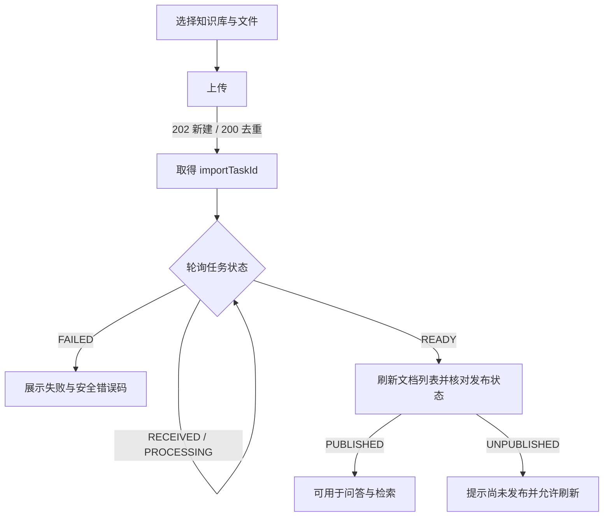
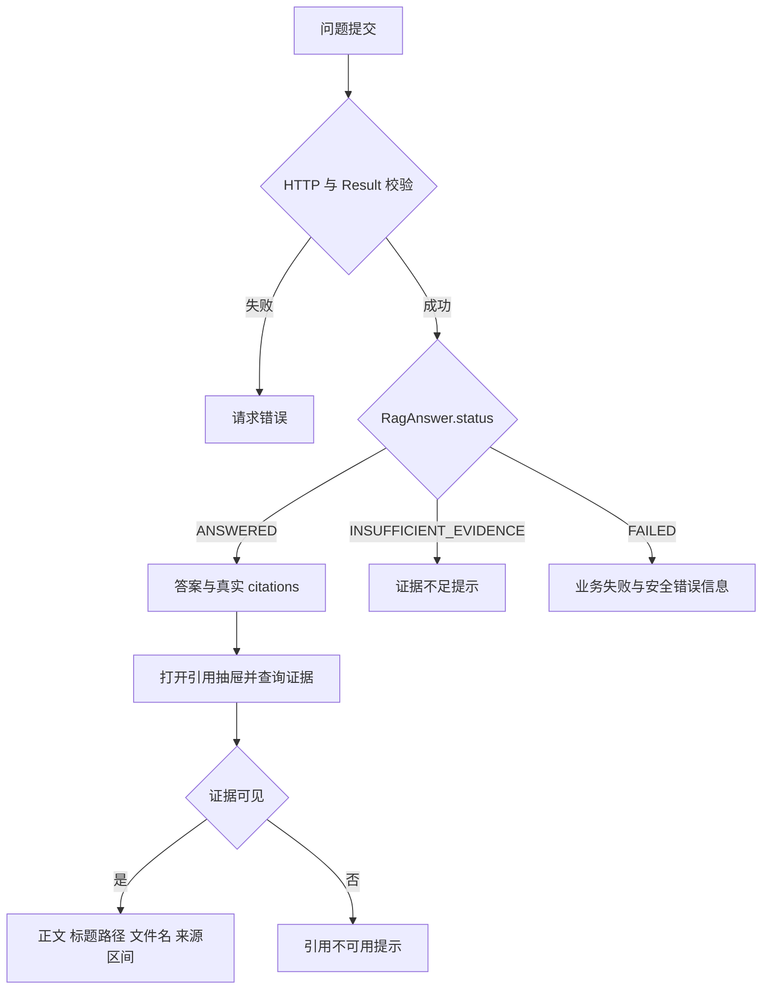
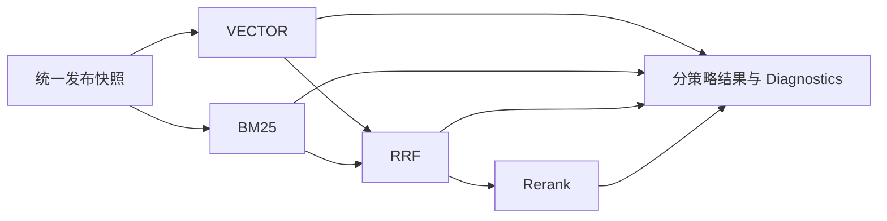

# Web UI V1 产品设计

- 状态：已确定的产品决策与待实施方案归档；尚未开发或运行验收。
- 基线：2026-11-11，feature/web-ui-v1，HEAD/main 均为 78105a27123d9d6fd8357e3393b0ea02cb6a7f8d，包含 RAG Package Structure 重构；开始时工作区干净。
- 依据：[产品基线](product-spec.md)、[架构](../architecture/architecture.md)、[实施计划](../plans/implementation-plan.md)、[API 与工程方案](../engineering/web-ui-v1-api-inventory.md)。冻结计划中的阶段限制不作改写，本次授权仅归档 Web UI 方案。

## 1. 产品定位与范围

Knowledge Assistant 是面向个人的 AI 知识库问答产品与通用 RAG 底座，技术知识学习是 V1 实际使用场景。普通用户体验优先于开发者调试体验，不将技术领域规则写入通用交互。为 M4、Memory、Agent 保留模块边界，不提前实现。

必须实现：知识库选择和创建、文档上传和状态展示、独立单轮 RAG、引用证据、四策略检索、基础诊断、完整异常处理。

不实现：持久化多轮会话、Streaming、Memory、Agent、M4 评估平台、多用户协作、复杂权限、深色模式、删除、版本管理、手动重试任务。

## 2. 信息架构

左侧导航包含三个独立功能区：AI 问答（默认首页）、知识库、检索实验室。全局共享当前知识库选择；切换知识库清空当前业务展示并使旧请求失效。不同知识库的答案、文档、任务、检索结果不得混用。

问答历史仅保存在当前页面 JavaScript 内存，刷新清空，不使用 localStorage 保存。页面中的历史用于阅读；每次请求只提交当前问题，不传递之前问答。开发者诊断默认折叠。

## 3. 布局与视觉

采用暖白极简：页面背景 #FAFAF8，内容背景 #FFFFFF，次级表面 #F1F3F5，主强调 #2563EB，主要文字 #1F2937。尺寸可在实现阶段调整。

左侧导航配主工作区；问答居中，最大阅读宽度约 820px；引用在右侧抽屉展示。知识库使用轻量文件列表，含文件名、导入任务状态、发布状态、时间与上传入口。检索实验室分查询控制区、策略结果区、折叠诊断面板。窄屏导航收拢，抽屉占可用宽度，结果区纵向排列。

控件提供 label、可见焦点与键盘操作；抽屉打开后管理焦点，Escape 关闭并返回触发按钮；状态信息不只依靠颜色，异步结果使用适度的 aria-live 提示。

## 4. 核心用户流程

### A. 文档进入知识库

选择或创建知识库 → 单文件上传 → 接收任务 → 非重叠轮询任务 → 确认活动版本发布 → 刷新文档列表。重复内容可能直接返回既有任务，不代表新任务或新版本。前端不能以重复上传作为重试。

上传成功只是任务被接收；READY 表示任务成功。现有发布事务一起写活动指针、版本 PUBLISHED 与任务 SUCCEEDED，但 UI 发布展示仍以活动指针和版本一致性为准。任务轮询失败保留 taskId，用户可恢复查询；达到客户端等待上限提示仍可能在处理，不将服务端任务标记 FAILED。默认 worker 关闭，不能承诺上传后自动完成。

### B. RAG 问答

选择知识库 → 选择策略（默认 HYBRID_RRF）→ 输入问题 → 提交独立单轮请求 → 展示业务状态 → 点击真实引用 → 按完整归属路径加载证据。

ANSWERED 必须有答案和引用；INSUFFICIENT_EVIDENCE 不是系统故障，不能编造引用；FAILED 无答案与引用，有 error。引用按钮由 RagCitation 创建，不能仅通过模型文本中的数字生成。证据加载失败不删除已有答案。

### C. 检索实验

输入问题 → 选择一至四种不重复策略 → 一次请求 → 分策略展示 Chunk、排名与评分 → 展开 Diagnostics。空结果与失败分别展示，某策略失败不遮蔽其他策略结果。

| 策略 | 依赖 | 失败语义 |
|---|---|---|
| VECTOR | 发布快照、Query Embedding、PG vector | Embedding 或向量失败则该策略 FAILED |
| BM25 | 发布快照、Elasticsearch / IK、PG 回查 | 通道不可用或失败则 FAILED |
| HYBRID_RRF | VECTOR + BM25 + RRF | 任一路失败则失败，不返回部分结果 |
| HYBRID_RERANK | 完整融合候选池 + Rerank | 上游或重排失败则失败，不隐式退回 RRF |

评分按通道原义展示：vectorDistance 越小越近，BM25/RRF/Rerank 不视为统一概率，不进行跨策略同尺度比较。完整字段见工程文档。

## 5. 页面状态与恢复

| 状态 | 展示与动作 |
|---|---|
| Loading | 保留上下文，阻止重复提交，提供取消等待 |
| Empty | 区分无知识库、无文档、无检索结果，引导创建或上传 |
| Success | 展示已确认结果和业务状态 |
| Failed | 安全错误消息、业务错误码、requestId；不展示原始异常 |
| Network Error | 网络失败提示；上传结果可能已提交，避免直接重传 |
| Timeout | 等待超时，不宣称服务端失败；不自动重复付费请求 |
| Retry | 用户明确触发重试；任务状态查询可恢复，模型请求需说明可能重复执行 |
| Cancelled | 仅取消客户端等待，服务端可能继续执行 |

AbortController 不等于服务端执行终止。页面切换、知识库切换以请求代次阻止旧响应覆盖新状态。轮询在前一次完成后再调度，离开页面停止；不使用重叠 setInterval。

## 6. 实施与验收入口

所有 WEB-01～WEB-06 在 feature/web-ui-v1 实施，先建立入口与 API Client，再增加两个只读 API，随后完成三个功能区与端到端验收。具体任务、协议、安全和验收矩阵见 [工程方案](../engineering/web-ui-v1-api-inventory.md)。本文件不代表已完成任何功能测试。
