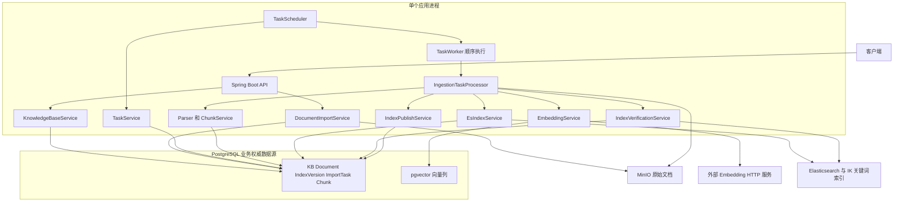
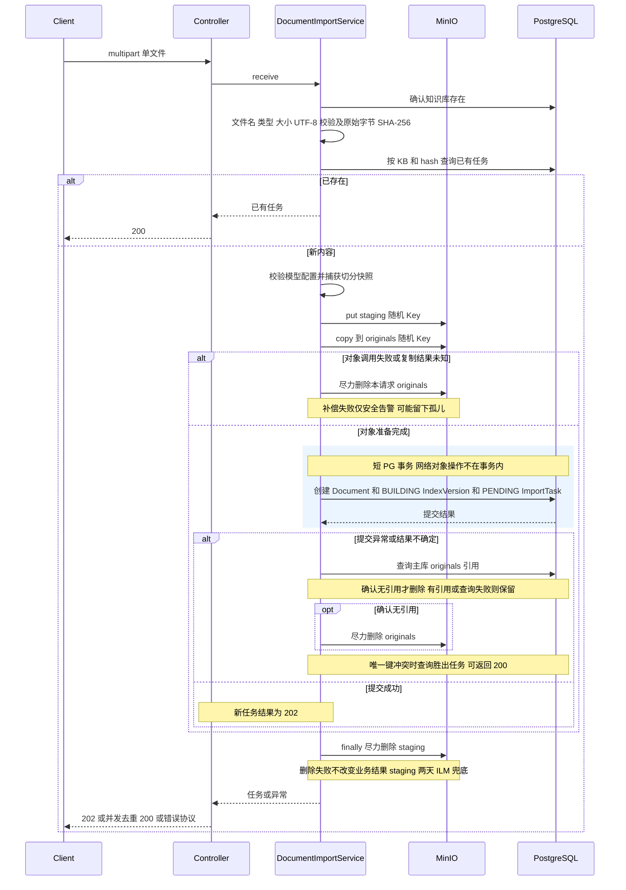
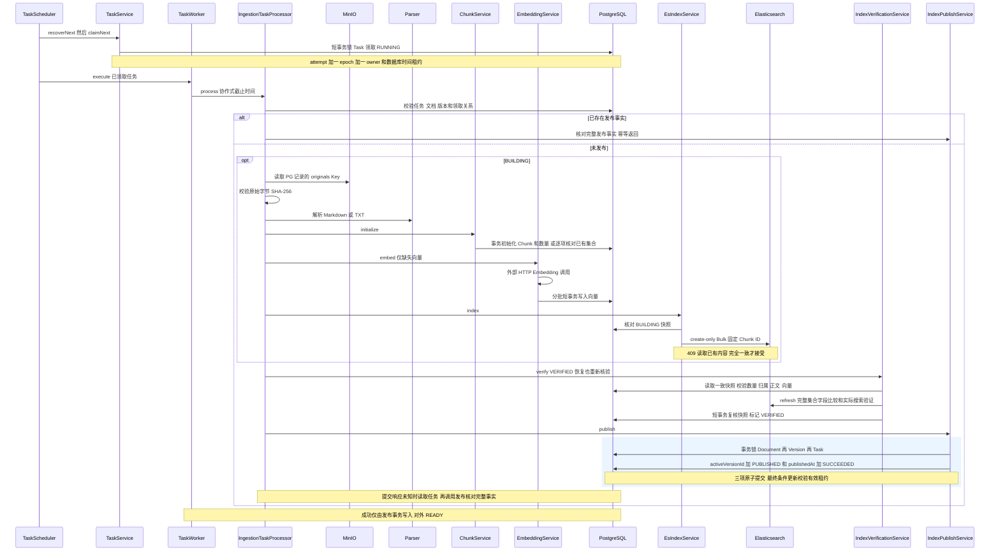

# M0～M1 架构与核心流程

基线：`feature/m1-ingestion-indexing`，`29af0d444ce9f0baa762f2574b1ac1205119f965`。依据生产 Java、Mapper SQL、V1～V5 迁移和 application 配置整理；不是未来 V1 全景。

## 1. 系统架构

pgvector 位于 PostgreSQL 内。ES 是关键词副本，不能决定发布事实。MinIO 同一 Bucket 下区分 staging 和 originals。Worker 没有独立部署或分布式互斥，必须只运行一个启用 Worker 的应用。

启动由 KnowledgeAssistantApplication 扫描组件；TaskScheduler 仅在 worker.enabled=true 装配，默认 false。ModelConfiguration / EmbeddingService 受 model.enabled 控制；ES 服务和验证器受 elasticsearch.enabled 控制；IngestionTaskProcessor 要求这两个开关同时为 true。Scheduler 找不到处理器则不领取。开关不等于外部连通性验证。

## 2. 上传

主要类：DocumentImportController、DocumentImportService、DocumentImportRepository、MinioOriginalFileStore。原始 BOM 纳入摘要；去重范围是同一 KB。数据库异常不能直接等同回滚；正式对象引用未知时禁止删除。originals 补偿失败不由 staging ILM 回收，需人工核对。

## 3. 构建与首次发布

主要类还包括 EmbeddingRepository、PgIntegrityService、EsIntegrityService、IndexPublishRepository。整个处理器无外层事务；MinIO、模型、ES 网络请求均不持有 PG 业务事务。Chunk 初始化、向量批次写入、验证完成和发布各自使用短事务。发布后不再执行会触发失败转换的截止时间检查。

## 4. 任务状态与恢复

```mermaid
stateDiagram-v2
  state ImportTask {
    [*] --> PENDING
    PENDING --> RUNNING: 领取 次数加一
    RUNNING --> SUCCEEDED: 首次发布事务
    RUNNING --> FAILED: 执行失败或异 owner 租约过期恢复
    FAILED --> RUNNING: 可重试且到期且次数小于4
    SUCCEEDED --> SUCCEEDED: 原领取事实幂等确认
  }
  state IndexVersion {
    [*] --> BUILDING
    BUILDING --> VERIFIED: 双索引验证和快照复核
    VERIFIED --> VERIFIED: 恢复后重新验证
    VERIFIED --> PUBLISHED: 首次发布事务
    PUBLISHED --> PUBLISHED: 完整发布事实幂等确认
    state "FAILED（枚举存在，当前无写入路径）" as VersionFailed
  }
```

FAILED 为真实枚举值；图中保留孤立节点，表示当前生产流程没有写入路径。

ImportTask 的 FAILED 不必然终止：可重试错误安排 5/15/45 秒退避，加 ±20% 抖动，默认总共最多执行四次（配置可覆盖）。永久错误及未知 RuntimeException 不重试，next_retry_at 为空。租约默认十五分钟；任务协作式截止时间十分钟，不续租、不强制中断。恢复记录 WORKER_INTERRUPTED，恢复后仍走正常领取。必须确认旧进程停止，租约不提供跨存储 fencing。

IndexVersion 枚举有 FAILED，但当前任务 fail/recover SQL 只修改 ImportTask，不会把版本改为 FAILED，也不会自动重置版本为 BUILDING。正常失败保留 BUILDING 或 VERIFIED；后者下次跳过构建但重新验证。TaskMapper 允许领取某些 FAILED 版本，而处理器拒绝该状态，这是当前实现边界，不能画成已实现的 FAILED 到 BUILDING 转换。

TaskStateMachine 只管理领取和失败；SUCCEEDED 由 IndexPublishService 管理。READY 是 ImportTaskResponse 的外部映射，不是新增持久化状态。

## 一致性与能力边界

- PG 唯一约束裁决 KB 内 hash 去重；Chunk 按版本和顺序唯一；向量列固定 1024 维，版本模型及切分快照不得漂移。
- 发布锁顺序 Document → IndexVersion → ImportTask；只锁 Task 的事务不反向锁其他实体。activeVersionId 决定可见性，版本和任务事实必须同时提交。
- PG 与 ES、MinIO 无分布式事务；部分索引写入靠幂等补齐和重新核验，不能宣称永久强一致。
- 已实现 KB API、上传、MD/TXT、双索引验证与首次发布；没有 Retrieval、RAG、Evaluation 服务、Memory、Agent 或 Web UI。

## 与冻结 Architecture Spec 的差异（仅记录）

1. 第六节仍写 M1-12 没有生产 TaskProcessor；当前已存在 IngestionTaskProcessor。
2. 状态语义描述失败版本重新进入 BUILDING，生产 fail/recover 没有该转换。
3. EsIndexService 注释仍提 M1-09 fencing；当前架构明确单 Worker、不承诺严格 fencing。
4. 架构文档当前已是 Boot 4.1.2，用户 AGENTS 所述 Boot 3.x 差异在此基线不再存在。
5. 架构全景包含后续 Retrieval/RAG/Evaluation，不能作为 M1 已实现清单。

验证：依据源码逐项审阅。Mermaid 实际渲染检查尚未完成，不标记通过。未运行 Maven；本阶段仅新增文档。未修改冻结架构。
