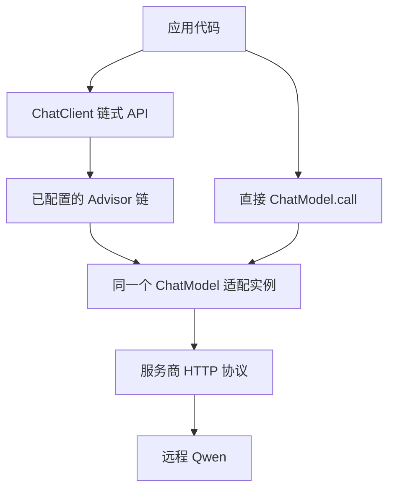
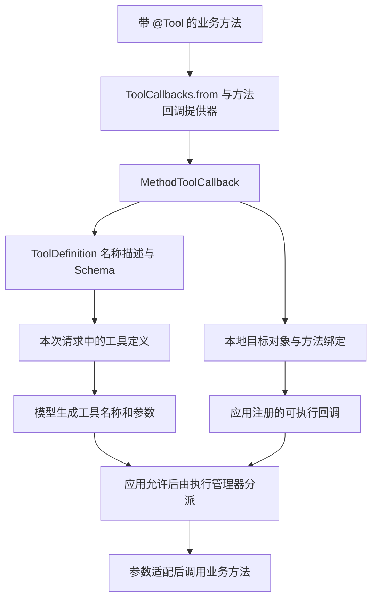

# 05 Spring AI：模型适配、客户端链与工具执行

## 版本与阅读范围

本专题工程锁定 Java 17+、Spring Boot 3.5.15、Spring AI 1.1.8，以 OpenAiChatModel 连接百炼兼容接口。远程模型为 Qwen；类名含 OpenAi 不代表使用 OpenAI 的模型服务。工程手工声明相关 Bean，不把手工组装解释成 Starter 自动配置。

以下执行位置针对这个版本及同步 OpenAI 适配器路径。其他版本可能调整循环组织方式，不能把本页类关系当作所有版本的永久契约。源码依据见 [sources](sources.md)。

## ChatModel 和 ChatClient 为什么同时存在

ChatModel 是模型调用抽象，具体适配器负责把 Prompt/选项变成服务商请求，再把响应映射为 ChatResponse。它是本地 Java 对象，不是远程神经网络本身。

ChatClient 在 ChatModel 之上提供便于组织 Prompt、默认配置、Advisor 和响应提取的调用入口。应用可以通过不同入口使用同一个适配器。

图中的链式 API 指 fluent 编程接口，不表示流式网络响应；本实验为非流式调用。

如果 Advisor 追加“请用英文回答”，只有经过该客户端链的请求受影响。直接调用 ChatModel 不经过这个 Advisor。Advisor 也不是 Spring AOP 代理，不能自动拦截所有订单方法或所有模型 Bean。

`defaultSystem` 一类配置是默认系统消息，不自动保存用户聊天历史。历史是独立的消息集合及其管理机制；当前实验没有记忆组件，不能把默认 Prompt 当成对话记忆。

## 为什么不能只取 content

`.content()` 适合只需要正文的简单路径，但可靠应用还可能需要结束原因、Usage、工具请求和响应元数据。应取 ChatResponse，分别判断生成是否完整、是否要求执行工具、正文是否符合事实。元数据正常不代表语义正确。

真实对照日志显示 direct 的 Advisor 次数为 0、client 为 1，两者均 STOP 且用量为 56/221/277。正文逐字相同是本次观察，不是验收要求；语义正确和事实一致才是内容标准。实际请求等价性还需检查 wire JSON，本会话未提供这些文件。

## 从 @Tool 到本地业务方法

工具机制需要同时保存“给模型看的描述”和“本地怎么执行”的绑定。仅有描述无法执行 Java；仅有 Java 方法也不会自动成为本次模型可选能力。

定义阶段读取注解、生成输入 Schema，不执行查询。注册阶段将回调放入本次调用选项，使工具定义可发送，并使本地执行能找到绑定。执行阶段才解析模型参数、取得可信上下文、调用业务方法和序列化返回值。

| 名称 | 作用 | 不承担的保证 |
|---|---|---|
| `@Tool` | 标记方法并提供工具描述等信息 | 认证、订单权限、事务 |
| `ToolCallback` | 提供定义及工具调用入口 | 用户已经确认写入 |
| `MethodToolCallback` | 把 JSON 参数适配到绑定方法并处理结果 | 所有业务规则正确 |
| `ToolCallingManager` | 定位执行工具、组织关联结果及历史 | 识别用户真正的写入授权 |
| 业务方法 | 检查权限和规则，执行确定操作 | 生成最终自然语言说明 |

本工程额外使用 CheckedToolCallback 检查输入形状并拒绝身份参数。这是应用写的包装，不是框架自动提供的完整业务 Schema 校验器。

## ToolContext 的作用和边界

在锁定版本的方法适配中，`queryOrder(String orderId, ToolContext context)` 的 ToolContext 不进入输入 Schema。应用从选项传入固定模拟 identity=T1/U100，执行管理器把上下文交给方法；模型只生成 orderId。

这解决了“模型参数与可信执行上下文分离”的问题，但不是秘密存储保证。业务代码若将身份拼进 Prompt、工具结果或日志，仍会泄露。ToolContext 也不等于生产认证系统；当前身份是教学固定值。

## 自动执行与手动控制到底差在哪

在 1.1.8 同步 OpenAiChatModel 自动路径中，适配器检测到可执行工具请求后，调用 ToolCallingManager 执行，再以更新后的消息继续调用模型。外层调用一次可能包含两次 HTTP 和一次业务方法执行。

手动路径配置 `internalToolExecutionEnabled=false`，仍发送工具定义，但首次 call 先把请求返回应用。应用审核后显式执行管理器，再以更新历史请求模型。

| 观察点 | 自动正常路径 | 手动正常路径 |
|---|---:|---:|
| 外层 ChatModel.call 次数 | 1 | 2 |
| 模型 HTTP 请求次数 | 2 | 2 |
| 工具执行次数 | 1 | 1 |
| 第一次外层返回时已执行工具 | 是 | 否 |

这些数值来自当前单工具、两轮正常日志，不是所有运行的固定规律。模型可能不调用工具，也可能继续提出请求；应用仍要限次。

自动模式不知道 ORDER_NOT_ACCESSIBLE 的业务含义，可能继续让模型解释拒绝；手动模式可以明确拒绝后停止。若涉及退款写入、阶段授权或严格恢复边界，手动控制更便于在执行前决策，但安全性仍取决于业务检查，不能仅凭“手动”二字获得保证。

## 用量和循环的观察方法

记录每轮 HTTP 样本才能区分外层调用与内层请求。自动路径最终 Usage 可能包含前面轮次的聚合；手动第二次调用的统计范围未必相同。比较成本前先明确聚合范围，再查各轮 raw response，避免重复相加。

两个 Spring 实验使用真实框架组件和模拟 HTTP 的离线测试，也收到了学习者真实 API 控制台日志；没有上传 raw 样本或独立观察 IDEA 断点。代码设计、离线覆盖和真实日志是不同强度的证据，详见 [证据核对](../evidence/2026-11-03-acceptance-ledger.md)。
