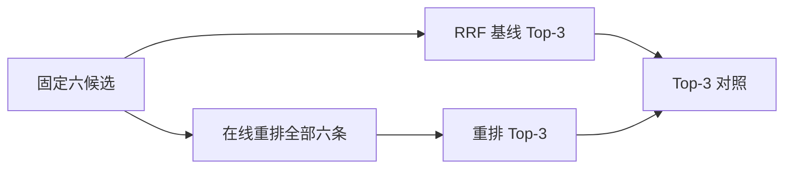
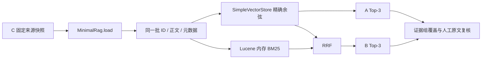
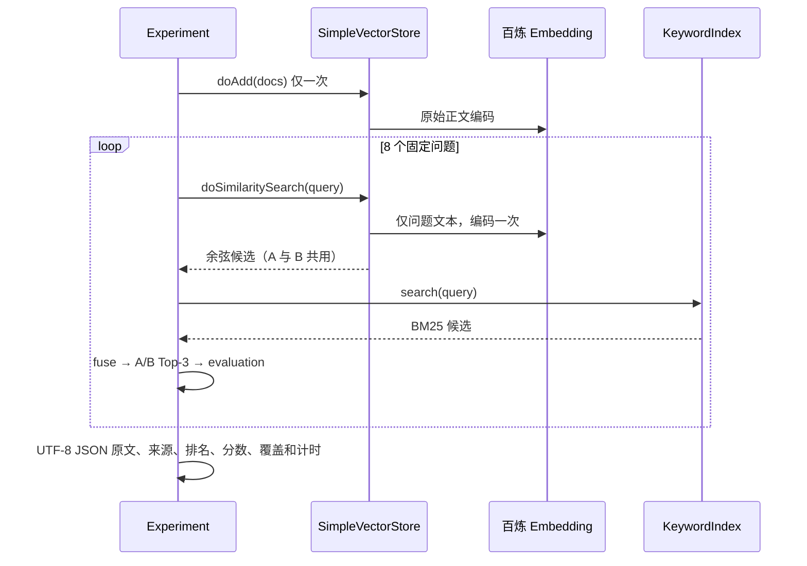

# 实验 D 第一轮：纯向量与混合检索

## 第二轮：D03 固定候选重排

目标是观察直接结论 R506 是否进入 Top-3、Redis D373 是否后移，以及一次在线重排的额外耗时。输入是本目录第一轮真实运行的 UTF-8 `live-output.json` 中 D03 的问题和完整 RRF 六候选；入口只读取快照，不重新执行 Embedding、BM25、RRF。基线是原 RRF Top-3。请求中的每个文档统一为 `标题：<原始标题>\n正文：<原始正文>`，不传 ID、开发标注、期望答案或证据组。



使用百炼 `gte-rerank-v2` 独立 HTTP 接口，`input.query` 与 `input.documents` 为请求内容，`parameters.top_n=6` 返回完整顺序；响应 `output.results[].index` 是原候选零基索引，`relevance_score` 是本次请求内相关分数。认证为 `Authorization: Bearer` API Key。参见[官方 HTTP 文档](https://help.aliyun.com/zh/model-studio/text-rerank-api)。

在实验 D 目录运行 `mvn clean test`。在线运行前，在 IDEA 环境变量中配置 `DASHSCOPE_API_KEY` 和官方北京地域的完整 `DASHSCOPE_RERANK_URL`（`https://{WorkspaceId}.cn-beijing.maas.aliyuncs.com/api/v1/services/rerank/text-rerank/text-rerank`）；运行 Java main `lab.rag.RerankComparison`，工作目录为本目录。命令行可用 `mvn compile exec:java -Dexec.mainClass=lab.rag.RerankComparison`。若本地没有真实快照，先运行原 `lab.rag.HybridRetrieval` 入口生成 `live-output.json`，再运行重排入口。离线响应验证可传 `live-output.json --mock-response mock-response.json`，此输出不能当作在线结论。

输出逐行给出 Chunk ID、原 RRF 名次、新名次、分数、来源与正文摘要，并列出两个 Top-3、D03 证据覆盖和重排步骤耗时。R293 已使原 Top-3 覆盖 D03，因此 R506 上移属于直接证据排序改善，不等于证据覆盖提升。结论填写位置：待在线运行后记录 R506、R293、D373 的新名次、覆盖变化及耗时。单次 HTTP 计时包含网络波动，不代表稳定性能；固定快照仅支持 D03 对照。

验证在固定正文、Chunk、问题与 Embedding 模型下，BM25 + RRF 能否补回纯向量遗漏的证据，以及是否引入干扰。8 条是开发样本，不是未见测试集；本轮不调用生成模型，不接入重排，不根据结果改题或调参。

基线为 `experiment/minimal-rag` 的 `9e49a6d`，包含 C 的检索阈值、引用格式和明确否定证据修复。创建 `experiment/hybrid-retrieval`，不改 C。原工作区仅有未跟踪 `.idea/`，保留。没有新增授权来源或材料。项目 Java 17，实际使用 JDK 21.0.10 验证。

## 复用与比较边界

Maven build-helper 直接加入相邻 C 的 Java 源码和 resources；运行 `MinimalRag.load()`，沿用哈希/行数检查、LF 规范化、空行切段、Chunk ID、来源和标题元数据。需要保留相邻目录，IDEA 导入本目录 pom 后刷新 Maven。没有复制或重写加载器，没有抽取公共模块。

两路只索引 `Document.getText()`，均不拼接标题、ID、来源元数据、标签或预期答案。两组面对相同 9 个 Chunk、相同固定来源范围；没有 ACL 差异。向量仍使用百炼北京 compatible-mode、`text-embedding-v3`、`MetadataMode.NONE`，复用 Spring AI 1.1.8 `SimpleVectorStore` 精确余弦实现及阈值 0。D 使用公开的 `doAdd` / `doSimilaritySearch`，绕过 observation 包装，避免 observation 获取维度时额外编码；不改变 C 的调用。

A 只取向量结果；B 复用 A 的同一向量候选，额外串行执行 BM25 和 RRF。文档只入向量库一次，每题只发一次 Query Embedding，并断言调用数。默认每路 Top-6，最终各 Top-3。为使截止位置的并列分数稳定，小语料先取全体分数，再按分数降序、Chunk ID 字典序截断，各路与融合均使用此规则。向量阈值仍可能排除负余弦，因此候选可以不足。

B 多执行一路检索；相同最终候选数不等于相同计算预算。这里全量排序适用于 9 块的实验，不能据此外推大规模 BM25 延迟。





## 来源与冻结标注

来源均为 backend-interview-lab 提交 `80229847c98e9a23eddbc91085934c3e12e0da98`。完整标题、SHA-256、来源路径在 C 的 `sources.json`，结果 JSON 也保存所有 Chunk 原文和元数据。可用源仓库 `git show <commit>:<path>` 对照。下表的 R 表示 `rabbitmq-80229847c98e-`，D 表示 `redis-80229847c98e-`。

| Chunk | 源文件 | 行 | 原文定位 |
|---|---|---|---|
| R46 | rabbitmq/notes/02-reliability-and-idempotency.md | 98 | “ACK/NACK 由 Broker 向生产者发送…不表示消费者完成业务” |
| R217 | 同上 | 100 | “假设 Direct Exchange…没有匹配…Queue Binding” |
| R293 | 同上 | 102–104 | mandatory 两种配置、basic.return 和不存在 Exchange 的通道关闭 |
| R506 | 同上 | 106 | “Confirm ACK ≠ 一定路由成功…≠ 消费成功” |
| D21 | redis/notes/02-expiration-memory.md | 7 | “每个键配一个倒计时线程…管理成本不可接受” |
| D122 | 同上 | 9 | 访问检查、后台主动过期抽样与时间预算 |
| D248 | 同上 | 11 | “t=61…GET 不能…返回旧值” |
| D373 | 同上 | 13 | 四个时刻不必重合，RSS 不保证立即下降 |
| mysql-80229847c98e-20 | mysql/notes/01-index-and-sql.md | 7 | B+Tree 与页，作为同库其他主题候选 |

`DevelopmentSet.questions()` 在任何检索前定义题目、类型、可答性、预期要点和必需证据组，并校验引用 ID 存在。没有先跑检索再选标签。答案要点也应由以下必需组支持，替代组不要求把该段的其他事实全部答出。

| ID | 类型／可答 | 固定问题与回答要点 | 必需证据；同组替代 |
|---|---|---|---|
| D01 | 精确术语／是 | Publisher Confirm ACK 是否表示消费者完成业务？不表示。 | R46 或 R506 |
| D02 | 配置项／是 | mandatory=true 无法路由会怎样，ACK 够吗？Return 后仍可能 ACK，两者都要判断。 | R293 |
| D03 | 同义改写／是 | 发布得到肯定确认能保证投递到队列吗？不能。 | R293 或 R506 |
| D04 | 跨块／是 | Confirm 谁发出，无路由与不存在 Exchange 如何处理？Broker；依 mandatory 判断 Return，不存在时可能关闭通道。 | R46 **且** R293 |
| D05 | 同义改写／跨块／是 | 无人访问的过期键如何回收，是否逐键倒计时线程？逐键成本不可接受；主动抽样、时间预算。 | D21 **且** D122 |
| D06 | 跨块／是 | TTL 后 GET 可读旧值吗，RSS 立刻下降吗？不可读；不保证立即降 RSS。 | D248 **且** D373 |
| D07 | 不足／否 | 本公司 Redis 昨天 P99？没有生产监控数据。 | 无，单独报告 |
| D08 | 错误码／不足／否 | RabbitMQ 406 完整处理步骤？没有错误码定义和操作流程。 | 无，单独报告 |

## 分词与融合

嵌入式 Lucene 9.12.3，`ByteBuffersDirectory`，`SmartChineseAnalyzer` 内置词典对简体中文及中英文混合文本分词，默认停用标点。中文不是按空格切词。英文小写并词干化，标识符的点和等号形成边界；数字错误码保留。原文和来源始终完整保留。索引和查询使用完全相同的分词器，不做答案扩词、人工同义词或标签注入。

实际离线分词（完整结果见 `offline-output.json`）：

| 输入 | tokens |
|---|---|
| Publisher Confirm | publish, confirm |
| mandatory=true basic.return order.exchange | mandatori, true, basic, return, order, exchang |
| 错误码406 消费者完成业务 | 错误码, 406, 消费者, 完成, 业务 |

必要术语以相同归一化形式参与匹配，例如 Publisher 与 mandatory 分别用 publish、mandatori；没有强制保留大小写或整个 `basic.return` token。点分标识符不能保证整串精确匹配，`mandatory=false` 与 `mandatory=true` 共享 mandatory 词干，这是本轮关键词方案的边界。查询中每个不同 token 构建一个 `TermQuery`，SHOULD/OR 组合，不使用 QueryParser，不将 `=` 等符号当作查询语法。BM25 默认 k1=1.2、b=0.75。

已核对官方 [SmartChineseAnalyzer](https://lucene.apache.org/core/9_12_3/analysis/smartcn/org/apache/lucene/analysis/cn/smart/SmartChineseAnalyzer.html)、[BM25Similarity](https://lucene.apache.org/core/9_12_3/core/org/apache/lucene/search/similarities/BM25Similarity.html)、[IndexSearcher](https://lucene.apache.org/core/9_12_3/core/org/apache/lucene/search/IndexSearcher.html) 和 [ByteBuffersDirectory](https://lucene.apache.org/core/9_12_3/core/org/apache/lucene/store/ByteBuffersDirectory.html) API。锁定版本，不随升级自动改变分析行为。

RRF 为 `Σ 1/(rankConstant + rank)`，rank 从 1 开始，默认 constant=60。未命中贡献 0；单路重复 ID 只使用首次命中，去重后赋连续排名；双路同 ID 累加，不把不同尺度的原始分数相加。JSON 分开保存余弦、BM25 和 RRF 分数；融合行同时记录两路排名。没有任一路结果也可运行。

## 指标与耗时

证据组内 ID 是 OR，组间是 AND。一个组命中多个替代 Chunk 仍只计一次；重复 Chunk 不增加覆盖。每题 Recall@3 = Top-3 覆盖的必需组数 / 该题必需组数；汇总为 6 个可答开发题的宏平均。证据齐全比例 = 所有组都覆盖的题数 / 6。改善、持平、退步按同题覆盖组数比较，仅计 6 个可答题。D07/D08 的 Recall 和 complete 为 null，不记 0，也不把返回候选视为有答案。

`firstSupportRank` 是各自完整候选列表首个满足任一必需组的排名；null 表示没有支持或该题没有标注证据。`missing` 列出 Top-3 缺失组。`supportInFusionButOutsideFinal` 列出融合候选有、最终 Top-3 没有的组，供后续判断是否值得重排。它不是“重排必然改善”的证明。自动覆盖只是 ID 与人工标注匹配，须逐项对照打印原文复核语义。

文档编码 `documentEncodingNs`、向量建库其他开销 `vectorIndexOtherNs` 和 `bm25IndexNs` 单列。Query Embedding 由 `TimedEmbedding` 计时；`vectorSearchOther` 是向量查询端到端减 provider 编码耗时，含本地框架、余弦搜索和稳定排序，不宣称纯 CPU 内核时间。`bm25` 包含分词、检索及排序；`fusion` 单列。`aOnline` 是编码与向量路端到端；`bOnlineSerial` 从同一开始计时并包含额外 BM25 与融合，无并行加速。格式化、评估、输出落盘不计入在线检索。冷启动、JIT、网络波动都影响单次观察，不据此报告稳定性能结论。

## IDEA 与命令行

打开本目录 pom.xml，JDK 17/21，刷新 Maven，运行 `lab.rag.HybridRetrieval.main`。工作目录设为本实验目录。离线 Program arguments 为 `--offline`；在线删除该参数，在 IDEA Run Configuration → Environment variables 设置 `DASHSCOPE_API_KEY`。密钥不写源码、VM 参数或命令行，不打印环境变量。没有生成模型调用。

在本目录运行以下 Maven 命令，无 PowerShell 脚本：

```text
mvn clean test
mvn compile exec:java -Dexec.args=--offline
mvn compile exec:java
```

默认参数集中在 `Experiment.Config.read()`。可通过 JVM system properties `routeK`、`finalK`、`rankConstant` 配置，例如 IDEA VM options `-DrouteK=6 -DfinalK=3 -DrankConstant=60`。Maven exec 在 Maven JVM 内运行，可在命令添加 `"-DrankConstant=60"`；实际参数写入 JSON。该轮默认配置的指标称 Recall@3；更改 finalK 后须按实际 K 解读。

运行生成当前工作目录的 UTF-8 `offline-output.json` 或 `live-output.json`，并打印同一 JSON。在线输出默认 gitignore，审查不含凭据后可按需要显式纳入证据；程序不保存密钥。离线只执行来源校验和真实 Lucene BM25，不创建伪向量、不输出虚假的 A/B 排名、零耗时或质量指标。

建议断点：`MinimalRag.load()` 看原文/ID；`DevelopmentSet.validate()` 看固定证据；`KeywordIndex.tokens/search()` 看词项和候选；`TimedEmbedding.call/embed()` 看真实 provider 输入；`Experiment.run()` 的 `store.doAdd`、`doSimilaritySearch`、`fuse` 与 `Evaluation.coverage()` 看共用向量、两路排名、最终候选和缺失证据。不要在 Evaluate 中重复调用在线请求。

## 实际结果与验证范围（2026-11-05）

本机没有 DASHSCOPE_API_KEY。已保存 `offline-output.json`：真实 9 块建 BM25 索引及 8 题候选、原始分数、原文与来源，未调用百炼。不能据此声称 B 优于 A，也不能判断真实融合候选是否卡在 Top-3 之外。

实际 BM25 观察：D01 前三为 R46、R293、R506；D02 为 R293、R506、R46；D03 为 R46、D373、R293，出现 Redis 干扰；D04 为 R293、R46、R506；D05 为 D122、D21、MySQL20；D06 为 D373、D248、D122。D07 仍返回 Redis/MySQL 段，D08 仍返回 Confirm/Redis/MySQL 段，均不能回答所问事实。未据这些结果改题或调参。

模拟排名另见 `simulated-rrf.json`：用于验证算式与并列规则，不是检索质量实测；测试中的常量二维向量也仅用于检查请求隔离和调用次数，不作为实验分数。

验证通过：D 的 `mvn clean verify exec:java -Dexec.args=--offline`（4 项测试、打包和离线入口），来源哈希/ID、RRF 从 1 开始与双路累加、单路空/双路空、重复 ID、分数并列稳定、候选不足、重复/替代证据不虚增、跨块完整性与不足题 null；模拟 provider 记录输入，确认文档只收到原始正文、问题只收到 query，9 块只编码一次、8 题各一次，标签/预期答案未进入请求。C 的 `mvn clean test exec:java -Dexec.args=--offline` 同样通过，C 无修改。

待验证：有凭据后以默认配置运行完整 8 题，人工复核 JSON 的 A/B Top-3 与证据，报告宏 Recall@3、完整率、改善/持平/退步以及计时。检查 `supportInFusionButOutsideFinal`：若非空，记录对应题、组和融合排名作为下一轮重排依据；若没有，也接受该结论。当前所有真实向量/RRF 质量结论保留待运行。


## 后续在线结果与阶段归档

上面“待在线运行”“本机没有 Key”保留了该次提交时的验证状态。用户随后在本机运行了真实向量/BM25+RRF 对照：9 Chunk、8 道开发题中的 6 道可答题，向量与融合的宏证据 Recall@3 均为 1、证据齐全比例均为 1；这不代表排序完全一致。D03 的 RRF Top-3 为 R46、Redis D373、R293，R293 已覆盖路由问题，但 Redis 材料占了一个上下文位置。

固定 D03 六候选的真实百炼重排中，Redis D373 从第 2 降到第 5，直接结论 R506 仍第 4，R217 上升第 3；证据覆盖前后均为 true。一次 HTTP 步骤约 1316.289 ms，不能作为稳定延迟。完整在线 live-output.json 和重排原始控制台日志未提交到仓库；[在线观察记录](../../evidence/online-observations.md)仅转录用户会话提供的关键排名与口径，不应冒充原始可复跑文件。实验不据这一次结果调整参数或宣称重排普遍有效。
