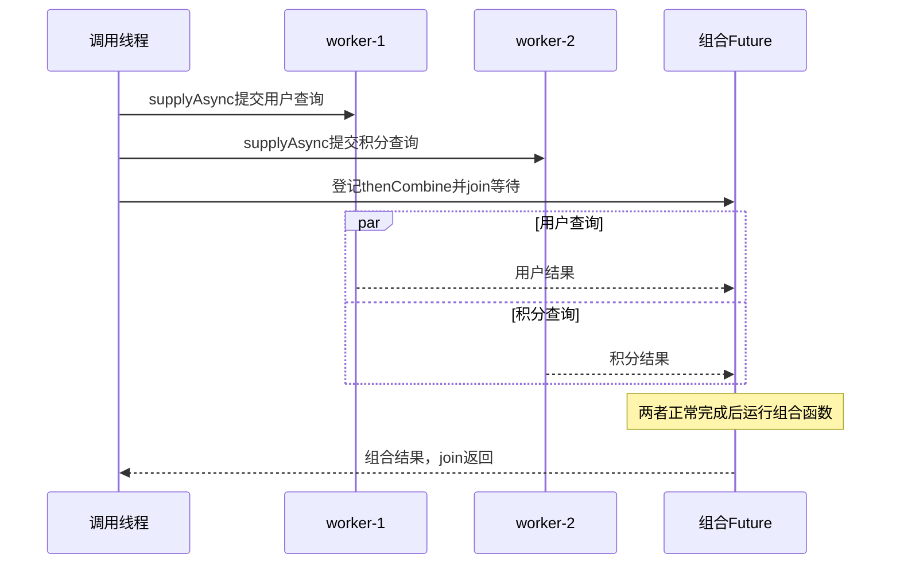
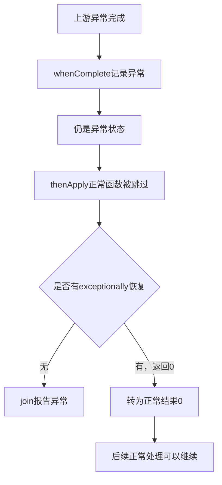

# CompletableFuture：把依赖关系与执行资源分别说清楚

## 1. 为什么要组合而不是到处 get

页面要查用户和积分，两者独立。如果提交用户立刻 join，然后才提交积分，仍是串行；supplyAsync 只是换线程，不会自动消除等待依赖。

```java
CompletableFuture<User> user = CompletableFuture.supplyAsync(this::queryUser, ioPool);
CompletableFuture<Integer> points = CompletableFuture.supplyAsync(this::queryPoints, ioPool);
CompletableFuture<String> page = user.thenCombine(points,
        (u, p) -> u.getName() + ":" + p);
String result = page.join();
```

这是业务类型片段；完整可运行版本是 [实验 3](../labs/03-completable-future/CompletableFutureLab.java)。两个任务在调用 supplyAsync 时就提交，不是 join 时启动；有两个空闲线程时可以并行。调用者最后 join 仍会占用调用线程等待，不等于整个 HTTP 链路已非阻塞。

## 2. 画两条时间线，分清执行与等待

教学假设：用户固定 200 ms，积分固定 300 ms，忽略调度开销。

```text
并行：
请求线程：提交 U → 提交 P → join 页面结果
worker-1：    用户查询 -------- 200 ms
worker-2：       积分查询 -------------- 300 ms
组合：两者正常完成后拼接，总体约 max(200,300)

串行：
提交 U → join U 等 200 ms → 提交 P → join P 等 300 ms
总体约 200+300
```

用户实测为正常约 349 ms、积分失败降级约 333 ms，支持这个小示例的执行结构；不能由一次耗时证明吞吐提升比例，更不能推导生产 P99。参见 [原始观察](../labs/evidence/user-observations.md)。

## 3. 返回值类型为什么容易混淆

<a id="diagram-parallel"></a>

**图：先提交两个独立任务，再等待组合。** 假设显式线程池有两个空闲worker。回调不带Async时不承诺固定执行线程，join仍会等待调用者。



| 操作 | lambda 返回 | 整体返回 | 适用 |
| --- | --- | --- | --- |
| thenApply | 普通 R | CompletableFuture<R> | 转换一个结果 |
| thenCompose | CompletableFuture<R> | CompletableFuture<R> | 依赖前一步的异步操作 |
| thenCombine | (T,U) 转换为 R | CompletableFuture<R> | 合并两个已有异步结果 |

本会话连续纠正过这个问题：`name -> name.length()` 返回 int（装箱 Integer），不是 CompletableFuture<Integer>；外面的 thenApply 才返回 Future。

```java
CompletableFuture<String> name = userFuture.thenApply(u -> u.getName());
CompletableFuture<Integer> points = userFuture.thenCompose(
        u -> queryPointsAsync(u.getId()));
```

buildDisplayName 返回 String，不能在它后面 join；String 没该方法。queryPointsAsync 返回 Future，compose 需要直接接它；在 lambda 内 join 会阻塞，并变成 Integer，类型不匹配。

用 thenApply 返回异步任务会形成 Future<Future<Integer>>：外层完成只表示已经拿到内层句柄，不说明内层工作完成。compose 将依赖完成关系衔接起来，不会凭空创建一个新工作线程。

## 4. 依赖和独立应同时利用

商品与库存都只需要商品 ID，可并行；运费需要商品重量，应等商品结果后 compose。不要因为最后要组装一页，就让库存也阻止运费尽早开始。

完整 [FutureCompositionDemo.java](../examples/FutureCompositionDemo.java) 在 main 登记转换，用户与积分工作在显式线程池，使用 thenCompose/thenCombine 并保留结果类型。例子不靠 sleep 保证回调在哪个线程；非 Async 的真实执行线程允许变化。

## 5. 异常会沿链传播，恢复位置决定业务含义

```java
CompletableFuture<Integer> points = queryPointsAsync(id)
        .exceptionally(ex -> {
            log.warn("积分查询失败", ex);
            return 0;
        });
```

积分分支失败转成正常 0，thenCombine 仍可接用户结果。若把 exceptionally 放整个用户→积分链末尾，用户查询失败也会变 0，业务上可能掩盖身份加载失败。恢复要符合“哪些数据允许缺省”的合同。

步骤推演：

| 上游状态 | thenApply | whenComplete（自身不抛） | exceptionally |
| --- | --- | --- | --- |
| 正常值 100 | 可转换 | 观察成功，保留结果 | 不调用恢复函数 |
| 异常 | 跳过正常函数 | 可记录，仍失败 | 返回替代值则恢复成功 |

whenComplete 不是 catch 后自动成功。它的回调如果自己抛异常，返回阶段还可能失败，不能泛称“只观察绝不改变状态”。handle 同时收到结果/异常并可返回新值，本次只补用途，不要求新增练习。

get 失败通常抛 ExecutionException 并保留 cause；join 失败通常抛 CompletionException；取消有 CancellationException 语义，不要把任何失败都硬套一种包装。join 不声明 InterruptedException，不应当作可中断等待接口。

## 6. 后续函数到底在哪个线程执行

<a id="diagram-async-errors"></a>

**图：观察失败与恢复失败。** 假设whenComplete回调自身不抛异常，exceptionally正常返回0。



- supplyAsync(..., ioPool)：任务由指定执行器调度；若执行器策略自己在提交者执行，也不能仅凭名字保证隔离。
- thenApply/thenCompose/thenCombine：没有 Async 后缀不保证另开线程，可由完成前序的线程执行；已完成时登记回调也可能由当前调用者执行。
- thenApplyAsync(..., workPool)：显式调度这一步到指定执行器。
- 不传执行器的异步方法通常用 commonPool；Java 17 API 还规定低并行度时新建线程的回退，不能当成永远固定工作池。

“第一个 supplyAsync 指定了 ioPool”并不保证后面所有 Async 步骤自动继承这个池。轻量名称转换通常无需切线程；慢 I/O、重 CPU 工作需按资源分池或预算，而非一律加 Async。

## 7. 组合 API 不消除饥饿

如果 pool 全部线程都执行父任务，在其中 submit 同池任务再 join，子任务排队且没有工作线程，仍会卡死。用 compose 表达后续并返回链，让工作线程退出当前动作，才可能避免占着线程等；最终又在同池全员 join，则重新引入问题。

allOf 等待所有指定 Future 完成，返回 Void，不自动汇总值或取消其他分支；thenCombine 的一个分支失败也不承诺其他工作立即取消或整个组合立刻快速失败。这里只保留影响业务判断的边界，不列全 API。

## 8. 超时的是结果，不一定是底层调用

```java
CompletableFuture<User> f = CompletableFuture
        .supplyAsync(this::queryUser, ioPool)
        .orTimeout(500, TimeUnit.MILLISECONDS);
```

orTimeout 在 Java 9+ 可用，使这个 Future 超时异常完成；不是创建一个 HTTP 读取超时，也不是自动中断底层查询。completeOnTimeout 用默认值完成也一样不保证停止实际计算。CompletableFuture.cancel(true) 的 true 不提供停止底层计算的中断保证。

教学时序：500 ms 调用者收到超时 → worker 仍等远程响应 → 10 s 才结束 → 期间新请求持续提交，池仍可能耗尽。需要 HTTP/数据库客户端自己的超时、有限并发、有限排队与拒绝，不能把快速返回误当资源已经释放。

写业务还需识别“结果未知”：支付超时后可能最终成功，不能盲目重试或返回失败后立即释放所有业务资源。正常分支转默认值也可能把取消掩盖，生产应按异常类型决定是否允许降级。

## 9. 面试口述与追问

**参考回答：怎样用 CompletableFuture 提高接口聚合效率？**

“我先画数据依赖。独立查询先提交再 combine，依赖前一步的异步查询用 compose，普通转换用 apply。明确每步执行器，不在同池里全员 join。异常按分支决定是否可降级，末端统一等待或继续异步响应。并行只减少可重叠部分的等待，总吞吐仍受 CPU、连接与下游限制；还要配置底层超时和过载保护。”

**追问：orTimeout 后已经快速失败，为什么仍满池？**

“Future 已结束不代表任务停止。我要看工作线程是否仍在远程栈、连接是否被占，再确认客户端超时与取消能力；同时限制进入速度和在途数，而不是只在外层包装一个超时。”

来源：[CompletableFuture 17](https://docs.oracle.com/en/java/javase/17/docs/api/java.base/java/util/concurrent/CompletableFuture.html)。真实类型错误与修正保存在 [session-qa](../review/session-qa.md)。
