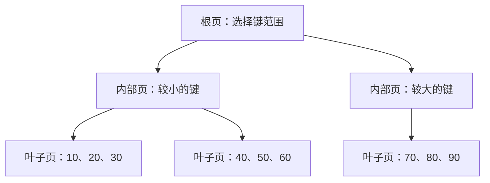
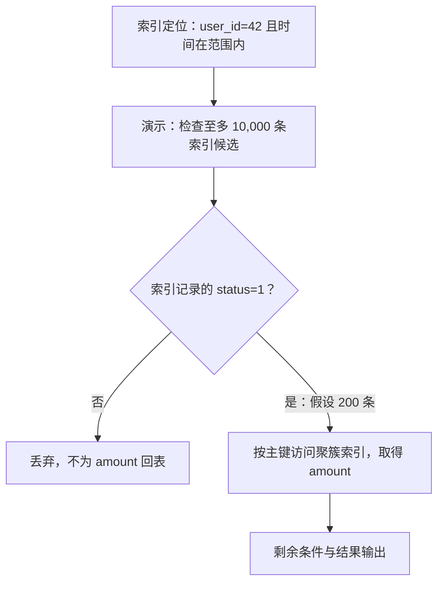

# 索引与 SQL 优化：从记录位置推到执行成本

本文以 MySQL 8.0 + InnoDB 为背景。相关[真实执行计划](../labs/evidence/user-observations.md)、[复现实验](../labs/README.md)、[面试问答](../review/interview-questions.md)分别承担证据、操作和表达训练的作用。

## 1. 为什么需要 B+Tree

InnoDB 把记录装进页，磁盘与 Buffer Pool 都以页为重要读写单位。没有合适的访问路径，找一行可能检查大量页；索引使我们先沿有序的 B+Tree 找到叶子页，再在相邻的叶子记录上扫描。上层节点用于导航，叶子承载索引记录。一个页包含多个键，树通常不必很高；相邻键方便范围查询和顺序遍历。示意是逻辑关系，不代表真实页恰好只有这些记录：



找 `id=50` 是定位后读目标叶子记录；找 `id BETWEEN 20 AND 80` 则从起点沿叶子记录继续扫描。后者即使使用索引，仍可能因范围巨大而慢；页是否在内存、检查多少记录、是否回表和额外排序，都会改变耗时。

## 2. 聚簇索引、二级索引、回表和覆盖

统一使用这张示例表；实验数据分布另见[证据](../labs/evidence/user-observations.md)。

```sql
CREATE TABLE order_lab (
  id BIGINT PRIMARY KEY,
  user_id BIGINT NOT NULL,
  status TINYINT NOT NULL,
  created_at DATETIME NOT NULL,
  amount DECIMAL(10,2) NOT NULL,
  KEY idx_user_time_status(user_id, created_at, status),
  KEY idx_user_status_time(user_id, status, created_at)
) ENGINE=InnoDB;
```

聚簇索引叶子记录保存完整行；表的数据按主键组织。二级索引叶子保存索引列与主键值，而非整个行。比如主键叶子含 `(id=800,user_id=42,status=1,created_at=...,amount=99)`，`idx_user_time_status` 的叶子含 `(user_id=42,created_at=...,status=1,id=800)`。查询 `id,user_id,created_at` 时后者可覆盖；查询 `amount` 时需用索引记录中的 id 到聚簇索引再查整行，叫回表。覆盖是**当前查询相对于某个索引**的性质，不能给索引永久贴标签。若查出的候选很多且都要回表，即使使用索引也可能很慢。短而稳定的主键通常减少所有二级索引中的主键负担，但还需考虑业务唯一性及插入模式。

## 3. 联合索引的扫描区间与 ICP

把 `(user_id,created_at,status)` 想成先按用户、同一用户按时间、同一时间按状态排列。假设用户 42 有 5 万行，其中状态 1 有 500 行：

```sql
SELECT id,created_at,amount
FROM order_lab FORCE INDEX(idx_user_time_status)
WHERE user_id=42 AND created_at>='2026-01-01 06:56:40' AND status=1
ORDER BY created_at DESC LIMIT 20;
```

`user_id=42` 固定第一维，时间范围划定连续区间；在这个区间中，状态 1 分散于不同时间，通常不能像索引 `(user_id,status,created_at)` 那样用两个等值条件直接定位一个窄区间。**范围列后面的列并未失效**：它还可能用于边界优化、索引上的过滤、ICP、覆盖。实际 C1 计划的范围文本甚至有 `1 <= status`，但这不意味着所有 `status=1` 都被连续定位；索引条件仍明确有 `status=1`。

ICP（索引条件下推）让存储引擎在取完整行前先检查可由二级索引记录判断的条件。假设时间区间检查 10,000 条索引记录、状态 1 有 200 条，查询还需要索引中没有的 `amount`：索引有 `status` 时可以先过滤，多数不必回表；若 `status` 不在索引中，通常要先回表再判断。**10,000/200 是机制演示，并非本轮 C1 的实测扫描与回表计数**。`Using index condition` 说明计划采用下推，不直接给出节省了多少次回表。覆盖查询无需为读取完整行而使用这种下推，可能显示 `Using index`。换用 `(user_id,status,created_at)` 则两个等值前缀先确定更窄的时间区间；但在不限制 status 的其他查询里，排序代价可能增加。

用上述**假设数据**把“扫描区间”“索引过滤”“回表”分成三步；箭头只表示候选如何被处理，`LIMIT` 下真正检查的条数依赖扫描位置，不能把图中数字当作本轮计划的实测：



`(user_id,status,created_at)` 可以在进入时间扫描前先固定 status，因而可能从更窄的范围开始；本图展示的是 `(user_id,created_at,status)` 的 ICP 路径，不代表两个索引的真实耗时差。实际 C1/C2 见[实测记录](../labs/evidence/user-observations.md#01-索引覆盖与排序)。

## 4. WHERE、ORDER BY、GROUP BY、LIMIT

```sql
SELECT id,created_at FROM order_lab FORCE INDEX(idx_user_time_status)
WHERE user_id=42 ORDER BY created_at DESC LIMIT 20;

SELECT id,created_at FROM order_lab FORCE INDEX(idx_user_status_time)
WHERE user_id=42 ORDER BY created_at DESC LIMIT 20;
```

第一条固定用户后可反向沿时间顺序遍历，较早得到 20 条。第二条先按 status 分段，每一段中时间有序，跨状态却不是全局时间顺序；需要读取候选并额外排序。实验 D1 底层向 Sort 输出 **50,000** 行、Sort 最终给出 20；D2 顺序给出 20。`LIMIT 20` 不保证只读 20 行。`Using filesort` 表示额外排序阶段，不等于真的写磁盘文件。

`WHERE user_id=42 GROUP BY status` 可借助 `(user_id,status,created_at)` 中同状态相邻的顺序做分组计数；在 `(user_id,created_at,status)` 上，状态分散，未必能顺序聚合。复杂聚合仍看具体执行计划，不能由索引存在推断是否用了临时表。

深分页 `ORDER BY created_at DESC,id DESC LIMIT 500000,20` 即使用有序索引也要越过前 50 万候选。若上一页最后一行为 `('2026-10-10 12:00:00',800)`：

```sql
SELECT id,created_at,amount FROM order_lab
WHERE user_id=42
  AND (created_at<'2026-10-10 12:00:00'
       OR (created_at='2026-10-10 12:00:00' AND id<800))
ORDER BY created_at DESC,id DESC LIMIT 20;
```

同一时间可能有多行，漏掉等号分支会漏数据。需要完整稳定的排序键；二级索引隐含主键在本例可能提供所需顺序，但要对目标版本与实际计划核对。游标分页适合连续向后翻页，任意跳页和并发写入时的展示语义需另行设计。

## 5. 读真实执行计划

实验 A 与 B 过滤和排序相同，只在 B 的 SELECT 列增加 `amount`。这里写出两条可直接执行的完整 SQL；在前面加 `EXPLAIN` 或 `EXPLAIN ANALYZE` 就是本轮查看计划的方式：

```sql
SELECT id,user_id,created_at
FROM order_lab FORCE INDEX(idx_user_time_status)
WHERE user_id=42 AND created_at>='2026-01-01 06:56:40'
ORDER BY created_at DESC LIMIT 20;

SELECT id,user_id,created_at,amount
FROM order_lab FORCE INDEX(idx_user_time_status)
WHERE user_id=42 AND created_at>='2026-01-01 06:56:40'
ORDER BY created_at DESC LIMIT 20;
```

| 字段或节点 | 解释与边界 |
| --- | --- |
| `type=range`、`key` | 计划中的索引范围访问；`key` 不证明覆盖或省排序 |
| `possible_keys`、`key_len`、`ref` | 候选索引、最大使用键前缀长度、等值引用；须结合计划阅读，不能只数列 |
| `rows`、`filtered` | 优化器估算访问量和过滤比例，非实际访问数；本轮 `rows=1` 的计划实际返回 20 |
| `Using index` | 查询所需列由索引覆盖；A 同时显示 `Backward index scan` |
| `Using index condition` | 索引侧先检查可下推条件；B 仍因 `amount` 需要完整行 |
| `actual time=a..b rows=n loops=m` | 迭代器首行/末行计时、每轮向上输出行数、执行轮次；节点输出行数不总等于其底层检查记录数 |
| `cost`、`Sort`、`(reverse)` | 模型相对成本、额外排序节点、反向遍历；cost 不是毫秒 |

A 实测 `Covering index range scan ... (reverse)`，Limit 约 `0.0261..0.0402 ms`；B 是 `Index range scan ... with index condition`，约 `0.0665..0.151 ms`。对上述 C1 的同一条 SQL，仅把 `FORCE INDEX` 改为 `idx_user_status_time` 即 C2；C1 约 `0.0692..0.671 ms`，C2 约 `0.0862..0.173 ms`。C2 计划范围直接包含 `user_id=42 AND status=1 AND created_at>=...`，C1 则首先按用户和时间范围扫描。只能解释本次路径，不能用单次毫秒差值宣称生产稳定收益。

实验 D 的完整 SQL 在上一节，两条语句 SELECT/WHERE/ORDER/LIMIT 完全相同，只改变强制索引。用户实际的 D1 计划核心如下（节点缩写仅省略 cost，不改行数及计时）：

```text
Limit: 20 row(s) (actual time=19.6..19.6 rows=20 loops=1)
  Sort: order_lab.created_at DESC, limit input to 20 row(s) per chunk
    (actual time=19.6..19.6 rows=20 loops=1)
    Index lookup on order_lab using idx_user_status_time (user_id=42)
      (actual time=1.28..12 rows=50000 loops=1)
```

Sort 中的 `limit input to 20 row(s) per chunk` 是排序实现优化，不等于只接收 20 条输入：它的子节点已向上交出 50,000 条。D2 的 `Covering index lookup ... (reverse)` 没有 Sort，Limit `actual time=2.22..2.24 rows=20`，底层估算 `rows=104095` 而实际输出 20。同连接 `Handler_read_key` +1、`Handler_read_prev` +19，与一次定位、19 次反向读取请求一致；Handler 请求不是物理页 IO 数。用户直接执行 D2 多次约 600 ms，**差异原因尚未定位**。

分析时依次问：**索引能否定位区间、能否覆盖、能否提供排序、优化器实际选择哪条路径**。再用分布和实际工作负载判断是否增索引；新索引增加磁盘和缓存占用、写入维护。实验使用 `FORCE INDEX` 控制变量，不代表生产应固定提示。原始计划与证据见[用户实测](../labs/evidence/user-observations.md)。

## 官方依据

- [InnoDB 索引组织](https://dev.mysql.com/doc/refman/8.0/en/innodb-index-types.html)、[ICP](https://dev.mysql.com/doc/refman/8.0/en/index-condition-pushdown-optimization.html)
- [范围优化](https://dev.mysql.com/doc/refman/8.0/en/range-optimization.html)、[EXPLAIN 输出](https://dev.mysql.com/doc/refman/8.0/en/explain-output.html)、[EXPLAIN ANALYZE](https://dev.mysql.com/doc/refman/8.0/en/explain.html)
