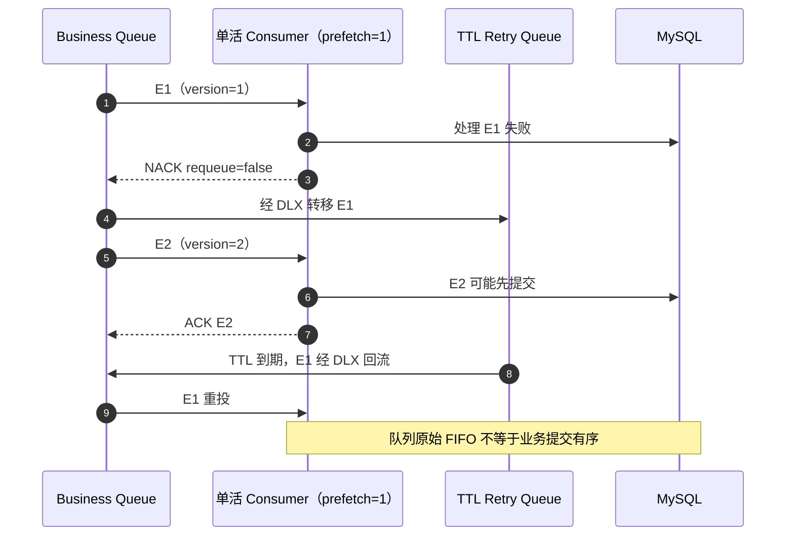
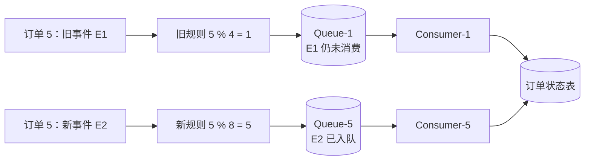

# RabbitMQ 顺序消息：原理、方案与面试

> 本文为理论与案例总结，尚未新增顺序消息人工实验。适用 RabbitMQ 4.1。

## 可视化：TTL 重试如何让 E2 超过 E1



## 可视化：固定 Key 分区及扩容迁移风险



两个队列可并行提交，E2 可能先于 E1 生效。解决时不能只修改取模参数：需要稳定分区映射、有序迁移屏障，或版本校验加可靠缺口恢复。参见本章“按 orderId 分区”和“业务版本号”。


## 一、队列 FIFO 为什么不等于业务有序？

订单 1001 的三个事件：E1 创建、E2 支付、E3 发货。需要区分：
1. **生产顺序**：多个生产者是否按照业务先后顺序把事件发布到同一个队列。
2. **投递顺序**：Broker 以什么顺序把事件交给消费者。
3. **完成顺序**：消费者数据库事务最终按什么顺序提交。

假设 E1、E2、E3 被三个消费者分别处理，耗时 300、50、20 毫秒，则业务提交可能为 E3、E2、E1。**FIFO 不代表并发业务完成顺序。**

## 二、单队列方案

使用单队列、Single Active Consumer（SAC）、prefetch=1、manual ACK、同步调用独立的事务 Service，事务成功提交后 ACK。

```yaml
spring:
  rabbitmq:
    listener:
      simple:
        acknowledge-mode: manual
        prefetch: 1
```

```java
Queue q = QueueBuilder.durable("order.status")
    .withArgument("x-single-active-consumer", true)
    .build();
```

`concurrency=1` 只约束一个 Spring 监听容器，多个 Spring Boot 实例可能仍有多个消费者；SAC 允许多个消费者注册，但仅一个活跃。SAC 在声明队列时启用，不能仅靠动态 policy 开启。

前序消息失败时，必须阻止依赖它的后续事件先完成业务。可以暂停分区并受控恢复，不能将失败消息移走后仍宣称严格保序。缺点是吞吐受限、队头阻塞。

## 三、TTL + DLX 如何破坏顺序？

```text
Business Queue: E1 → E2 → E3
E1 处理失败 → basicNack(tag,false,false)
    → Business DLX → Retry Exchange → TTL Retry Queue
E1 已离开 Business Queue，释放 prefetch 窗口
E2、E3 可能先完成
5 秒后 E1 TTL 到期 → DLX → Business Exchange → Business Queue
```

因此，即使单消费者、prefetch=1，也可能乱序。Broker 完成 TTL 回流不依赖 Java 消费者。普通 TTL 重试方案不适合直接保证严格顺序。使用 requeue=true 也可能形成热重试循环，不能当作完整解决方案。

## 四、按 orderId 分区实现局部有序

例如四个 Queue：根据 orderId 计算固定分区，同一订单始终进入同一 Queue，每个 Queue 使用 SAC + prefetch=1；不同分区并行。

前提：生产端同一订单有序发布；分区内同步提交事务；失败时不放行依赖前序事件的业务；消费端继续幂等。

**扩容陷阱**：orderId=5，旧规则 5%4=1，新规则 5%8=5。E1 仍在 Queue-1，新事件 E2 却进入 Queue-5，两队列并行消费，E2 可能先提交。不能直接改取模规则。可采用稳定分区映射、停止发布并排空旧分区、有序迁移屏障或带版本路由。分区失败还可能阻塞同分区其他订单。

## 五、版本号保证业务状态正确

事件 E1 CREATED(version=1)、E2 PAID(version=2)、E3 SHIPPED(version=3)。数据库当前 version=0。E2 先到时不可直接更新：

```sql
UPDATE orders
SET status = :status, version = :event_version
WHERE id = :order_id AND version = :event_version - 1;
```

必须检查影响行数。版本过大说明前序缺失，需可靠暂存与补偿；版本较小说明可能重复或过期，需对照 eventId 与 payload；并发失败需要重查数据库。状态机也应校验迁移是否合法。

**版本号防止乱序状态覆盖，但不保证消息按序到达，也不会自动补齐缺失事件。** 暂存后 ACK 的前提是暂存本身可靠持久化。

## 六、方案比较

| 方案 | 保序范围 | 代价 |
|---|---|---|
| 单 Queue + SAC + prefetch=1 | 队列级串行 | 低吞吐、全队列阻塞 |
| 固定 Key 分区 + 分区 SAC | 同 Key 局部顺序（需生产端有序） | 分区阻塞、热 Key、迁移复杂 |
| 版本号 + 幂等 + 可靠待处理事件 | 状态生效顺序 | 需要缺口恢复、状态机与补偿 |

## 七、面试回答

RabbitMQ 可以实现有序消费，但必须区分生产、投递和业务提交顺序。吞吐量不高时可用单队列、SAC、prefetch=1、手动 ACK，并确保数据库提交后 ACK；失败时不能将前序事件送到普通 TTL 重试队列后直接放行后续消息。通常订单业务只要求同 orderId 有序，可以按 Key 路由到固定分区队列、每分区单活消费，不同分区并行。同时保证生产端顺序，并处理分区扩容迁移。最后仍需要 eventId 幂等、业务版本校验和缺失事件恢复；顺序消费不等于不会重复消费。

## 八、典型追问

**Q：单消费者 + prefetch=1，为什么 TTL 重试还会乱序？**  
A：E1 被 NACK 到 Retry Queue 后释放了 Business Queue 的未确认窗口，E2、E3 可能先执行。

**Q：部署三个 Spring Boot 实例，每个 concurrency=1 就是单消费者吗？**  
A：不是，总共可能三个消费者。跨实例可用 SAC 控制单活。

**Q：按 Key 分区就绝对有序吗？**  
A：不是。还要生产端有序、串行提交、正确处理重试、迁移和故障切换。

**Q：从四个分区改为八个为什么有问题？**  
A：同一 Key 的旧事件与新事件可能落入不同队列，并发提交。

**Q：前序事件永久失败怎么办？**  
A：严格保序要求暂停相关分区并告警、修复；如果业务允许跳过，必须显式定义终止状态和后续事件规则，不能悄悄放行。

**Q：版本号能替代顺序消息吗？**  
A：能保护状态不被旧事件覆盖，但缺失事件仍需可靠恢复。

## 九、实验与参考

- [01 基础可靠投递](../labs/01-minimal-reliable/README.md)
- [02-A TTL/DLX 重试](../labs/02a-ttl-dlx-retry/README.md)
- [02-B Final DLQ](../labs/02b-final-dlq/README.md)
- [03 事务提交后 ACK 前崩溃](../labs/03-consumer-ack-crash/README.md)
- [06 Prefetch、并发、积压](../labs/06-prefetch-throughput/README.md)

官方文档：[RabbitMQ 4.1 Consumers](https://www.rabbitmq.com/docs/4.1/consumers)、[Publisher Confirms and Consumer ACK](https://www.rabbitmq.com/docs/4.1/confirms)。
