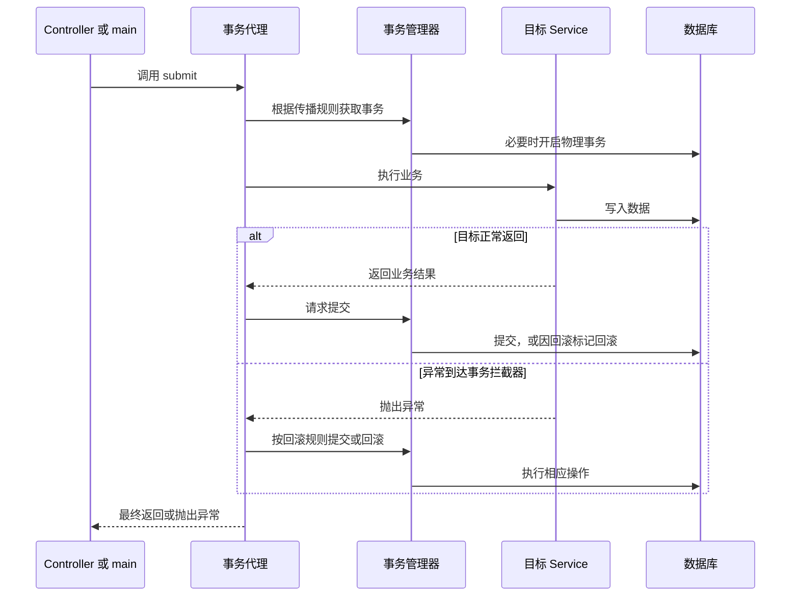

# Spring 事务：先找边界，再看异常与资源

## 一次事务调用到底由谁完成

@Transactional 不是 Spring MVC 读取并执行的 HTTP 功能。事务基础设施识别方法配置，为适用的 Bean 调用建立拦截；事务管理器协调资源，数据库真正执行物理提交回滚。本篇主要针对实验 C 的 DataSourceTransactionManager + JdbcTemplate + MySQL InnoDB，不泛化到 JTA 或响应式事务。

“目标正常返回”不代表“事务成功提交”。rollbackOnly、提交阶段错误等都可能使代理最终失败。若提交期间连接故障，数据库最终状态甚至可能需要核实，不能绝对说所有提交异常都证明已回滚。

## 三步判断事务是否按预期工作

1. 调用是否进入事务代理？new 对象、自调用、初始化回调直接调用自身都可能绕过。
2. 当前线程是否已有事务、使用哪个事务管理器和资源？传播规则决定参与、挂起、新建或保存点。
3. 异常是否到达相应事务拦截器，匹配什么回滚规则？不能只看异常的类名。

默认规则对 RuntimeException 和 Error 回滚，检查异常默认不触发回滚。rollbackFor=IOException.class 明确改变规则。目标内部把异常吞掉、正常返回时，该异常没有到达代理；仅增加 rollbackFor 无法让代理感知它。Controller 的 catch 在 Service 代理外，代理已处理完相应事务后才捕获，不会撤销已完成的回滚或提交。

| 情形：均已通过代理、此前无事务 | 结果（无其他回滚标记） |
| --- | --- |
| 目标抛出 IOException，默认规则 | 提交后继续向外抛异常 |
| 目标抛出 IOException，rollbackFor 指定该异常 | 回滚后继续向外抛异常 |
| 目标内部捕获自己的 IOException，正常返回 | 代理按正常返回路径请求提交 |
| REQUIRED 内层代理因运行时异常标记共享事务，外层 catch | 共享事务不能提交，最终回滚并可能抛 UnexpectedRollbackException |

最后一行与“同一目标方法自己 catch”不同：内层事务代理已经看见异常并修改事务状态。

## 六个组合：先限定实验条件

外层 REQUIRED，内层是另一个 Bean 的代理方法；同一事务管理器，SQL 先成功，再由 Java 代码抛 IllegalStateException。场景一内层失败、外层捕获后正常结束；场景二内层成功、外层随后抛异常。所有结果按独立 runId 查询，避免旧记录干扰。

| 内层传播 | 资源模型 | 场景一：请假/附加，调用结果 | 场景二：请假/附加，调用结果 |
| --- | --- | --- | --- |
| REQUIRED | 同连接，同物理事务 | 0/0，UnexpectedRollbackException | 0/0，外层 IllegalStateException |
| REQUIRES_NEW | 挂起外层，另一连接独立事务 | 1/0，正常返回 | 0/1，外层 IllegalStateException |
| NESTED | 同连接同物理事务，保存点 | 1/0，正常返回 | 0/0，外层 IllegalStateException |

### REQUIRED：捕获异常为什么仍失败

内外两个逻辑事务范围共享物理事务。内层运行时异常穿过内层代理，默认参与者失败处理将共享事务标记为 rollbackOnly。外层 catch 只处理 Java 异常，不清除标记。外层目标正常结束，代理请求提交时只能回滚，并以 UnexpectedRollbackException 告诉调用者“没有成功提交”。实验中内层 new=false/savepoint=false，外层 catch 后 rollbackOnly=true。

如果审批方法不加事务注解，但在相同线程通过 Spring JDBC 使用同一数据源，也能参与已有外层事务。不同点在于没有该方法自己的事务拦截器边界；它抛出而被外层目标捕获的普通业务异常，不会仅凭这个未注解方法自动设置 rollbackOnly。底层资源错误另论。

### REQUIRES_NEW：独立事务与异常传播分开判断

外层资源被挂起但没有提交，仍占连接；内层另取连接开启独立事务，完成后恢复外层资源。成功的内层提交不被后续外层回滚撤销。内层失败若外层捕获，外层可继续；不捕获时运行时异常穿过外层代理，外层会按自己的规则回滚，并非内层事务直接“传染”了外层状态。

实验 inner new=true、savepoint=false，连接 A→B→A。连接池需容纳外层占用与内层额外需求；并发下所有外层都占住连接再申请内层连接，可能造成等待甚至耗尽。实验池大小 4 只为单线程观察，不作为生产容量建议。

### NESTED：局部回滚不是独立提交

同一连接在外层写入后建立保存点。内层失败时回滚到保存点，撤销附加记录，保留之前请假写入；外层捕获后仍可提交。内层成功只完成保存点范围，没有独立提交，外层最终回滚会撤销两者。

实验 inner new=false、savepoint=true，同一连接；DataSourceTransactionManager 允许嵌套，驱动支持 JDBC 保存点，两表 InnoDB。NESTED 不是所有事务管理器都支持，不能把 JDBC 保存点语义直接套给所有 JPA/JTA 场景。

## 根据业务选择传播

请假单和审批必须原子：外层 REQUIRED，审批可 REQUIRED，也可无注解依赖调用契约；若明确禁止脱离事务调用，可 MANDATORY。操作尝试日志要求业务失败仍保留：通过另一个 Bean 的 REQUIRES_NEW 保存，并对是否让日志异常影响业务作明确决策。日志自身失败回滚时当然不会有“保证保存成功”的记录，必须区分独立性与成功保证。

不要用 NESTED 保存“必须独立保留”的日志，因为外层失败仍会回滚它。操作尝试与请假成功是不同语义，不能提前提交一条“成功”日志，事后外层却回滚。

## 线程、隔离级别、只读和超时

命令式 JDBC 事务通过线程绑定资源。新线程不自动继承父线程事务；Future.get 等待完成也不共享连接。子线程通过代理调用 REQUIRED 时，在该线程无事务的前提下会新开独立事务；父线程回滚不撤销已提交的子线程事务。父线程可以因等待异常而自己失败，但这是异常传播造成的另一条回滚路径。

隔离级别与 timeout 通常应用于新建物理事务。外层 REPEATABLE_READ，内层 REQUIRED 声明 READ_COMMITTED，默认仍参与外层事务，不会把隔离级别改为 RC。启用已有事务特征校验可拒绝不兼容配置；不能把忽略内层配置说成永远静默接受。

readOnly 是提示，实际行为取决于管理器、驱动与数据库，不保证所有场景下写入必失败或必成功。DataSourceTransactionManager 默认可调用 Connection.setReadOnly；启用 enforceReadOnly 可额外执行数据库只读事务语句。它不自动完成读写分离路由。

timeout 不是定时中断 Java 线程的看门狗。JDBC 路径可将剩余时限用于 Statement 超时，具体还取决于驱动；Thread.sleep 或 HTTP 调用不因此自动被中断，远程调用要单独配置超时。内层 REQUIRED 不会重置外层的事务预算。

## 事务不等于并发互斥

两个事务都可能先查询“学生此时无请假单”，再分别插入重叠区间。原子提交不等于业务谓词自动串行化。requestId 唯一约束解决同一请求重试，不等价于任意时间区间不重叠。

可按学生序列化操作，例如在事务内先锁定稳定的学生行，再以适当的当前读检查冲突并写入；所有相关写路径要遵守该锁协议。分布式锁也是可选方案，但必须考虑租期、所有权及故障窗口，且覆盖事务最终提交。若在事务目标方法 finally 中释放，外围代理尚未提交，第二个请求可能过早进入。跨多实例时 synchronized 仅能约束单进程。

## 最小源码与证据

TransactionInterceptor#invoke → TransactionAspectSupport#invokeWithinTransaction：获取事务、调用目标、按异常规则完成事务、正常路径提交。AbstractPlatformTransactionManager 负责传播与提交流程，DataSourceTransactionManager 负责 JDBC 资源操作。先解释每层职责，再决定是否向下单步。

[实验 C 手册](../labs/03-transaction-propagation/README.md) 提供环境及操作；[人工验收](../review/manual-acceptance.md) 保存用户六次运行的 runId、连接与行数。归档没有重跑数据库，不将历史执行记成本次执行。
